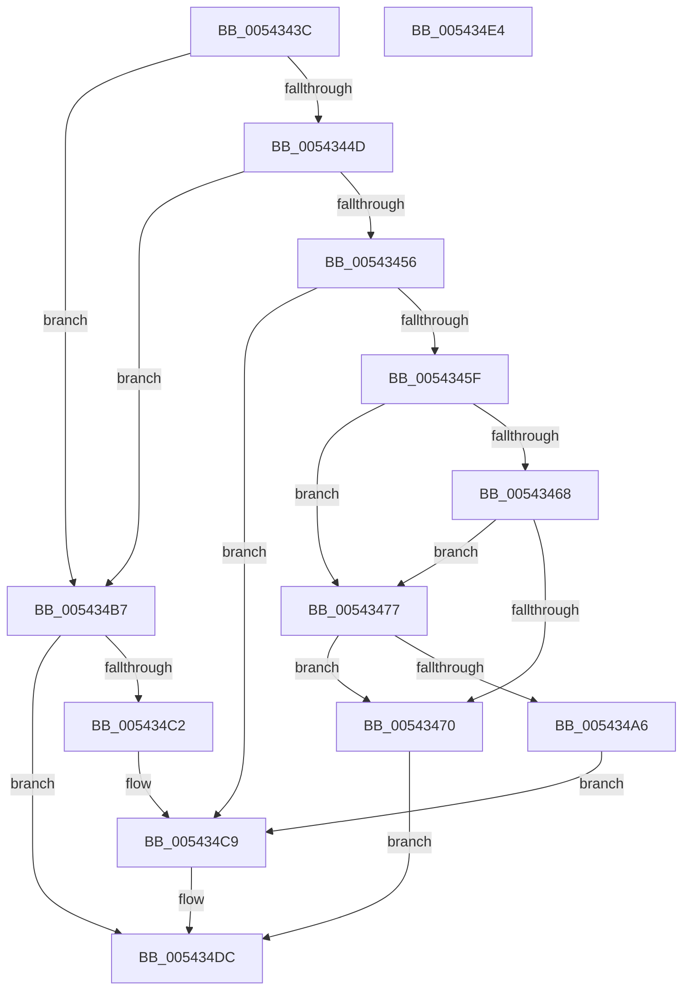

# HalpInterruptBuildGlobalStartupStub

- RVA: `0x0054343C`–`0x005434E5` (길이 `169` bytes)
- VA: `0x000000014054343C`
- 실행 섹션: `.text`
- PDB 이름 있음: `예`; PDB Function 태그: `아니요`
- unwind 정보 RVA: `0x000BD408`
- 디코드: `43`개 명령, `169/169` bytes 표시
- 미해석 바이트: `0` (있으면 어셈블리에 `.byte`로 보존)

> 이 문서는 커널 이미지의 기계어와 PDB 기호를 분석해 생성했습니다. 4번과 5번은 함수 원형과 자료형을 바이너리 사용 방식에서 추정한 C 해석이며 원본 소스 복구 결과는 아닙니다.

## 1. Dependencies

- 직접 호출 지점: **5**; 고유 호출 대상: **5**
- 직접 호출자로 확인된 함수: **1**
- RIP 상대 이미지 참조: **8**

### Outgoing calls
- `0x00543444` → [HalpHvVpStartEnabled](HalpHvVpStartEnabled_function_0054D0F4.md) (function, `0x0054D0F4`)
- `0x00543495` → [MmAllocateContiguousNodeMemory](../3E/MmAllocateContiguousNodeMemory_function_003E9E40.md) (function, `0x003E9E40`)
- `0x005434A9` → [MmGetPhysicalAddress](../23/MmGetPhysicalAddress_function_0023A500.md) (function, `0x0023A500`)
- `0x005434B7` → [HalpMmBuildTiledMemoryMap](../../pagelk/B5/HalpMmBuildTiledMemoryMap_function_00B5EA50.md) (function, `0x00B5EA50`)
- `0x005434D7` → [HalpInterruptBuildStartupStub](../55/HalpInterruptBuildStartupStub_function_0055A470.md) (function, `0x0055A470`)

### Direct callers
- [HalpInterruptInitSystem](../../pagelk/B5/HalpInterruptInitSystem_function_00B5D550.md) at `0x00B5D684`

### Static image references
- `0x0054344D` → RVA `0x00FC1C42` (`.data`; read)
- `0x00543456` → RVA `0x00FC1AA8` (`.data`; read)
- `0x0054345F` → RVA `0x00FC1ED0` (`.data`; read)
- `0x00543468` → RVA `0x00F90690` (`.data`; read)
- `0x0054349A` → RVA `0x00FC1AA8` (`.data`; write)
- `0x005434AE` → RVA `0x00FC1AA0` (`.data`; write)
- `0x005434C2` → RVA `0x00FC3E28` (`.data`; write)
- `0x005434D0` → RVA `0x00FC3E40` (`.data`; write)

## 2. Other-region calls and transfers

- 다른 실행 섹션으로 향하는 call: **1**
  - `0x005434B7` → [HalpMmBuildTiledMemoryMap](../../pagelk/B5/HalpMmBuildTiledMemoryMap_function_00B5EA50.md) (`.text` → `PAGELK`)
- 별도 외부 분기/꼬리 이동을 확인하지 못했습니다.

## 3. Assembly (complete function range)

```asm
0054343C  40 57                           push rdi
0054343E  48 83 EC 30                     sub rsp, 0x30
00543442  33 FF                           xor edi, edi
00543444  E8 AB 9C 00 00                  call 0x14054d0f4
00543449  84 C0                           test al, al
0054344B  74 6A                           je 0x1405434b7
0054344D  40 38 3D EE E7 A7 00            cmp byte ptr [rip + 0xa7e7ee], dil
00543454  74 61                           je 0x1405434b7
00543456  48 39 3D 4B E6 A7 00            cmp qword ptr [rip + 0xa7e64b], rdi
0054345D  75 6A                           jne 0x1405434c9
0054345F  40 38 3D 6A EA A7 00            cmp byte ptr [rip + 0xa7ea6a], dil
00543466  75 0F                           jne 0x140543477
00543468  39 3D 22 D2 A4 00               cmp dword ptr [rip + 0xa4d222], edi
0054346E  74 07                           je 0x140543477
00543470  BF 17 00 00 C0                  mov edi, 0xc0000017
00543475  EB 65                           jmp 0x1405434dc
00543477  C7 44 24 28 00 00 00 80         mov dword ptr [rsp + 0x28], 0x80000000
0054347F  45 33 C9                        xor r9d, r9d
00543482  49 83 C8 FF                     or r8, 0xffffffffffffffff
00543486  C7 44 24 20 04 00 00 00         mov dword ptr [rsp + 0x20], 4
0054348E  33 D2                           xor edx, edx
00543490  B9 00 10 00 00                  mov ecx, 0x1000
00543495  E8 A6 69 EA FF                  call 0x1403e9e40
0054349A  48 89 05 07 E6 A7 00            mov qword ptr [rip + 0xa7e607], rax
005434A1  48 85 C0                        test rax, rax
005434A4  74 CA                           je 0x140543470
005434A6  48 8B C8                        mov rcx, rax
005434A9  E8 52 70 CF FF                  call 0x14023a500
005434AE  48 89 05 EB E5 A7 00            mov qword ptr [rip + 0xa7e5eb], rax
005434B5  EB 12                           jmp 0x1405434c9
005434B7  E8 94 B5 61 00                  call 0x140b5ea50
005434BC  8B F8                           mov edi, eax
005434BE  85 C0                           test eax, eax
005434C0  78 1A                           js 0x1405434dc
005434C2  C6 05 5F 09 A8 00 01            mov byte ptr [rip + 0xa8095f], 1
005434C9  48 8B 0D D8 E5 A7 00            mov rcx, qword ptr [rip + 0xa7e5d8]
005434D0  48 89 0D 69 09 A8 00            mov qword ptr [rip + 0xa80969], rcx
005434D7  E8 94 6F 01 00                  call 0x14055a470
005434DC  8B C7                           mov eax, edi
005434DE  48 83 C4 30                     add rsp, 0x30
005434E2  5F                              pop rdi
005434E3  C3                              ret
005434E4  CC                              int3
```

## 4. C-style interpretation (structured pseudocode)

```c
__int64 __fastcall HalpInterruptBuildGlobalStartupStub(__int64 a1, int a2, __int64 a3, int a4)
{
    __int64 result;
    __int64 v_rdi;
    __int64 v_rsp;
    unsigned int v_stack_m10;
    unsigned int v_stack_m18;

    v_rsp = (v_rsp) - (48);
    v_rdi = 0;
    result = HalpHvVpStartEnabled(a1, a2, a3, a4);
    if ((unsigned __int8)(result) == 0) goto loc_005434B7;
    if ((*(unsigned __int8 *)(v_rip + 11003886)) == 0) goto loc_005434B7;
    if ((*(unsigned __int64 *)(v_rip + 11003467)) != 0) goto loc_005434C9;
    if ((*(unsigned __int8 *)(v_rip + 11004522)) != 0) goto loc_00543477;
    if ((*(unsigned int *)(v_rip + 10801698)) == 0) goto loc_00543477;
loc_00543470:
    goto loc_005434DC;
loc_00543477:
    v_stack_m10 = 0x80000000ULL;
    a4 = 0;
    a3 = (a3) | (-1);
    v_stack_m18 = 4;
    a2 = 0;
    result = MmAllocateContiguousNodeMemory((unsigned int)(0x1000ULL), a2, a3, a4);
    *(unsigned __int64 *)(v_rip + 11003399) = result;
    if (result == 0) goto loc_00543470;
    result = MmGetPhysicalAddress(result, a2, a3, a4);
    *(unsigned __int64 *)(v_rip + 11003371) = result;
    goto loc_005434C9;
loc_005434B7:
    result = HalpMmBuildTiledMemoryMap(result, a2, a3, a4);
    if (sign_flag) goto loc_005434DC;
    *(unsigned __int8 *)(v_rip + 11012447) = 1;
loc_005434C9:
    *(unsigned __int64 *)(v_rip + 11012457) = *(unsigned __int64 *)(v_rip + 11003352);
    result = HalpInterruptBuildStartupStub(*(unsigned __int64 *)(v_rip + 11003352), a2, a3, a4);
loc_005434DC:
    v_rsp = (v_rsp) + (48);
    return (unsigned int)((unsigned int)((unsigned int)((unsigned int)(result))));
}
```

## 5. (Beta) C Style

```c
int64_t HalpInterruptBuildGlobalStartupStub(int64_t Arg1, int32_t Arg2, int64_t Arg3, int32_t Arg4)
{
    int64_t result;
    int64_t local_rdi;
    int64_t local_rsp;
    uint32_t v_stack_m10;
    uint32_t v_stack_m18;

    local_rsp = (local_rsp) - (48);
    local_rdi = 0;
    result = HalpHvVpStartEnabled(Arg1, Arg2, Arg3, Arg4);
    if ((uint8_t)(result) == 0) goto loc_005434B7;
    if ((*(uint8_t *)(v_rip + 0xA7E7EE)) == 0) goto loc_005434B7;
    if ((*(uint64_t *)(v_rip + 0xA7E64B)) != 0) goto loc_005434C9;
    if ((*(uint8_t *)(v_rip + 0xA7EA6A)) != 0) goto loc_00543477;
    if ((*(uint32_t *)(v_rip + 0xA4D222)) == 0) goto loc_00543477;
loc_00543470:
    goto loc_005434DC;
loc_00543477:
    v_stack_m10 = 0x80000000ULL;
    Arg4 = 0;
    Arg3 = (Arg3) | (-1);
    v_stack_m18 = 4;
    Arg2 = 0;
    result = MmAllocateContiguousNodeMemory((uint32_t)(0x1000ULL), Arg2, Arg3, Arg4);
    *(uint64_t *)(v_rip + 0xA7E607) = result;
    if (result == 0) goto loc_00543470;
    result = MmGetPhysicalAddress(result, Arg2, Arg3, Arg4);
    *(uint64_t *)(v_rip + 0xA7E5EB) = result;
    goto loc_005434C9;
loc_005434B7:
    result = HalpMmBuildTiledMemoryMap(result, Arg2, Arg3, Arg4);
    if (sign_flag) goto loc_005434DC;
    *(uint8_t *)(v_rip + 0xA8095F) = 1;
loc_005434C9:
    *(uint64_t *)(v_rip + 0xA80969) = *(uint64_t *)(v_rip + 0xA7E5D8);
    result = HalpInterruptBuildStartupStub(*(uint64_t *)(v_rip + 0xA7E5D8), Arg2, Arg3, Arg4);
loc_005434DC:
    local_rsp = (local_rsp) + (48);
    return (uint32_t)((uint32_t)((uint32_t)((uint32_t)(result))));
}
```

## 6. Execution-region graph

[열기: 2D/3D 그래프와 함수 탐색 컨트롤 패널](../../../control-panel.html?section=text&rva=0x0054343C&view=graph)

- 2D 그래프는 위에서 아래로 흐르고, 3D 그래프는 빈 공간을 드래그해 회전합니다. Shift+드래그는 이동, 휠은 확대·축소, 함수 노드 선택은 대상 보고서 이동입니다.

### Static fallback


