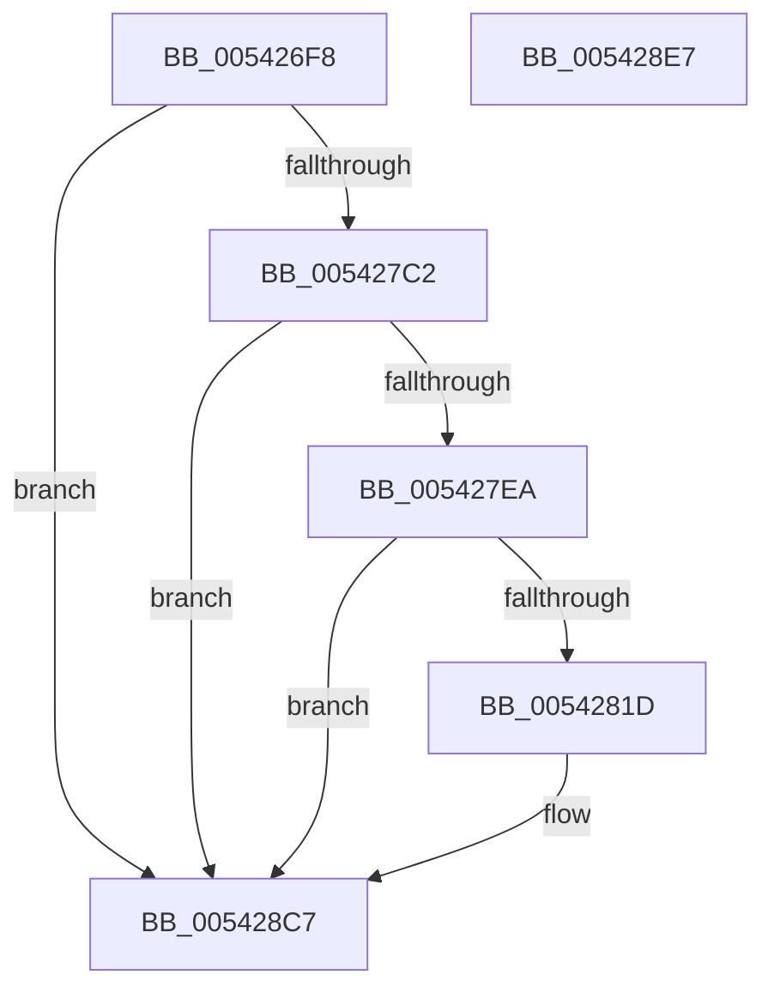

# HalpInterruptConnect

- RVA: `0x005426F8`–`0x005428E8` (길이 `496` bytes)
- VA: `0x00000001405426F8`
- 실행 섹션: `.text`
- PDB 이름 있음: `예`; PDB Function 태그: `아니요`
- unwind 정보 RVA: `0x000959A4`
- 디코드: `122`개 명령, `496/496` bytes 표시
- 미해석 바이트: `0` (있으면 어셈블리에 `.byte`로 보존)

> 이 문서는 커널 이미지의 기계어와 PDB 기호를 분석해 생성했습니다. 4번과 5번은 함수 원형과 자료형을 바이너리 사용 방식에서 추정한 C 해석이며 원본 소스 복구 결과는 아닙니다.

## 1. Dependencies

- 직접 호출 지점: **9**; 고유 호출 대상: **8**
- 직접 호출자로 확인된 함수: **3**
- RIP 상대 이미지 참조: **3**

### Outgoing calls
- `0x0054275A` → [memset](../6C/memset_function_006C6C40.md) (function, `0x006C6C40`)
- `0x005427B3` → [HalpInterruptGsiToLine](../2D/HalpInterruptGsiToLine_function_002D2DD0.md) (function, `0x002D2DD0`)
- `0x005427CF` → [HalpInterruptApplyOverrides](../2D/HalpInterruptApplyOverrides_function_002D2CE0.md) (function, `0x002D2CE0`)
- `0x005427DD` → [HalpInterruptLineToGsi](../4A/HalpInterruptLineToGsi_function_004A94F8.md) (function, `0x004A94F8`)
- `0x00542810` → [HalpInterruptRemap](HalpInterruptRemap_function_00542AE4.md) (function, `0x00542AE4`)
- `0x0054284A` → [IoSetDevicePropertyData](../../page/8F/IoSetDevicePropertyData_function_008F6010.md) (function, `0x008F6010`)
- `0x0054285A` → [memset](../6C/memset_function_006C6C40.md) (function, `0x006C6C40`)
- `0x005428BD` → [IoConnectInterruptEx](../../page/90/IoConnectInterruptEx_function_009001F0.md) (function, `0x009001F0`)
- `0x005428CE` → [_security_check_cookie](../6A/_security_check_cookie_function_006AC640.md) (function, `0x006AC640`)

### Direct callers
- [HalpTimerInitializeSystemWatchdog](HalpTimerInitializeSystemWatchdog_function_0054C58C.md) at `0x0054C65E`
- [HalpRegisterPeiErrorSource](../55/HalpRegisterPeiErrorSource_function_00555BD8.md) at `0x00555C68`
- [HalpDmaConfigureInterrupt](../56/HalpDmaConfigureInterrupt_function_005693FC.md) at `0x00569460`

### Static image references
- `0x00542711` → RVA `0x00E0A740` (`.data`; read)
- `0x0054281D` → RVA `0x00E10388` (`.data`; read)
- `0x0054282D` → RVA `0x00011710` (`.rdata`; read)

## 2. Other-region calls and transfers

- 다른 실행 섹션으로 향하는 call: **2**
  - `0x0054284A` → [IoSetDevicePropertyData](../../page/8F/IoSetDevicePropertyData_function_008F6010.md) (`.text` → `PAGE`)
  - `0x005428BD` → [IoConnectInterruptEx](../../page/90/IoConnectInterruptEx_function_009001F0.md) (`.text` → `PAGE`)
- 별도 외부 분기/꼬리 이동을 확인하지 못했습니다.

## 3. Assembly (complete function range)

```asm
005426F8  40 55                           push rbp
005426FA  53                              push rbx
005426FB  56                              push rsi
005426FC  57                              push rdi
005426FD  41 54                           push r12
005426FF  41 55                           push r13
00542701  41 56                           push r14
00542703  41 57                           push r15
00542705  48 8D 6C 24 D8                  lea rbp, [rsp - 0x28]
0054270A  48 81 EC 28 01 00 00            sub rsp, 0x128
00542711  48 8B 05 28 80 8C 00            mov rax, qword ptr [rip + 0x8c8028]
00542718  48 33 C4                        xor rax, rsp
0054271B  48 89 45 10                     mov qword ptr [rbp + 0x10], rax
0054271F  48 8B 85 B0 00 00 00            mov rax, qword ptr [rbp + 0xb0]
00542726  8B DA                           mov ebx, edx
00542728  4C 8B A5 A0 00 00 00            mov r12, qword ptr [rbp + 0xa0]
0054272F  33 D2                           xor edx, edx
00542731  4C 8B AD A8 00 00 00            mov r13, qword ptr [rbp + 0xa8]
00542738  41 8B F0                        mov esi, r8d
0054273B  48 89 44 24 58                  mov qword ptr [rsp + 0x58], rax
00542740  48 8B F9                        mov rdi, rcx
00542743  48 8B 85 C8 00 00 00            mov rax, qword ptr [rbp + 0xc8]
0054274A  48 8D 4D B0                     lea rcx, [rbp - 0x50]
0054274E  44 8D 42 60                     lea r8d, [rdx + 0x60]
00542752  48 89 44 24 50                  mov qword ptr [rsp + 0x50], rax
00542757  45 8A F1                        mov r14b, r9b
0054275A  E8 E1 44 18 00                  call 0x1406c6c40
0054275F  8B 55 E0                        mov edx, dword ptr [rbp - 0x20]
00542762  8B CB                           mov ecx, ebx
00542764  0F 10 07                        movups xmm0, xmmword ptr [rdi]
00542767  44 8B BD 98 00 00 00            mov r15d, dword ptr [rbp + 0x98]
0054276E  0F BA EA 1E                     bts edx, 0x1e
00542772  83 65 B8 00                     and dword ptr [rbp - 0x48], 0
00542776  8B C2                           mov eax, edx
00542778  33 85 C0 00 00 00               xor eax, dword ptr [rbp + 0xc0]
0054277E  48 83 64 24 40 00               and qword ptr [rsp + 0x40], 0
00542784  25 FF FF FF 3F                  and eax, 0x3fffffff
00542789  33 C2                           xor eax, edx
0054278B  C7 45 B0 01 00 00 00            mov dword ptr [rbp - 0x50], 1
00542792  89 45 E0                        mov dword ptr [rbp - 0x20], eax
00542795  48 8D 54 24 40                  lea rdx, [rsp + 0x40]
0054279A  8B 85 90 00 00 00               mov eax, dword ptr [rbp + 0x90]
005427A0  89 45 C4                        mov dword ptr [rbp - 0x3c], eax
005427A3  89 75 BC                        mov dword ptr [rbp - 0x44], esi
005427A6  44 88 75 C0                     mov byte ptr [rbp - 0x40], r14b
005427AA  F3 0F 7F 45 D0                  movdqu xmmword ptr [rbp - 0x30], xmm0
005427AF  44 89 7D C8                     mov dword ptr [rbp - 0x38], r15d
005427B3  E8 18 06 D9 FF                  call 0x1402d2dd0
005427B8  33 DB                           xor ebx, ebx
005427BA  85 C0                           test eax, eax
005427BC  0F 88 05 01 00 00               js 0x1405428c7
005427C2  4C 8D 45 C8                     lea r8, [rbp - 0x38]
005427C6  48 8D 55 C4                     lea rdx, [rbp - 0x3c]
005427CA  48 8D 4C 24 40                  lea rcx, [rsp + 0x40]
005427CF  E8 0C 05 D9 FF                  call 0x1402d2ce0
005427D4  48 8D 55 F0                     lea rdx, [rbp - 0x10]
005427D8  48 8D 4C 24 40                  lea rcx, [rsp + 0x40]
005427DD  E8 16 6D F6 FF                  call 0x1404a94f8
005427E2  85 C0                           test eax, eax
005427E4  0F 88 DD 00 00 00               js 0x1405428c7
005427EA  48 8D 45 B8                     lea rax, [rbp - 0x48]
005427EE  C7 44 24 28 01 00 00 00         mov dword ptr [rsp + 0x28], 1
005427F6  45 33 C9                        xor r9d, r9d
005427F9  48 89 44 24 20                  mov qword ptr [rsp + 0x20], rax
005427FE  4C 8D 44 24 40                  lea r8, [rsp + 0x40]
00542803  48 89 5C 24 44                  mov qword ptr [rsp + 0x44], rbx
00542808  33 D2                           xor edx, edx
0054280A  89 5C 24 40                     mov dword ptr [rsp + 0x40], ebx
0054280E  33 C9                           xor ecx, ecx
00542810  E8 CF 02 00 00                  call 0x140542ae4
00542815  85 C0                           test eax, eax
00542817  0F 88 AA 00 00 00               js 0x1405428c7
0054281D  48 8B 0D 64 DB 8C 00            mov rcx, qword ptr [rip + 0x8cdb64]
00542824  48 8D 45 B0                     lea rax, [rbp - 0x50]
00542828  48 89 44 24 30                  mov qword ptr [rsp + 0x30], rax
0054282D  48 8D 15 DC EE AC FF            lea rdx, [rip - 0x531124]
00542834  C7 44 24 28 60 00 00 00         mov dword ptr [rsp + 0x28], 0x60
0054283C  45 33 C9                        xor r9d, r9d
0054283F  45 33 C0                        xor r8d, r8d
00542842  C7 44 24 20 03 10 00 00         mov dword ptr [rsp + 0x20], 0x1003
0054284A  E8 C1 37 3B 00                  call 0x1408f6010
0054284F  33 D2                           xor edx, edx
00542851  44 8D 43 50                     lea r8d, [rbx + 0x50]
00542855  48 8D 4C 24 60                  lea rcx, [rsp + 0x60]
0054285A  E8 E1 43 18 00                  call 0x1406c6c40
0054285F  48 8B 05 22 DB 8C 00            mov rax, qword ptr [rip + 0x8cdb22]
00542866  48 8D 4C 24 60                  lea rcx, [rsp + 0x60]
0054286B  48 89 44 24 68                  mov qword ptr [rsp + 0x68], rax
00542870  48 8B 44 24 50                  mov rax, qword ptr [rsp + 0x50]
00542875  48 89 44 24 70                  mov qword ptr [rsp + 0x70], rax
0054287A  48 8B 44 24 58                  mov rax, qword ptr [rsp + 0x58]
0054287F  48 89 45 88                     mov qword ptr [rbp - 0x78], rax
00542883  8A 85 B8 00 00 00               mov al, byte ptr [rbp + 0xb8]
00542889  88 45 90                        mov byte ptr [rbp - 0x70], al
0054288C  48 8B 07                        mov rax, qword ptr [rdi]
0054288F  48 89 45 A0                     mov qword ptr [rbp - 0x60], rax
00542893  0F B7 47 08                     movzx eax, word ptr [rdi + 8]
00542897  66 89 45 A8                     mov word ptr [rbp - 0x58], ax
0054289B  C7 44 24 60 04 00 00 00         mov dword ptr [rsp + 0x60], 4
005428A3  4C 89 64 24 78                  mov qword ptr [rsp + 0x78], r12
005428A8  4C 89 6D 80                     mov qword ptr [rbp - 0x80], r13
005428AC  66 C7 45 91 00 01               mov word ptr [rbp - 0x6f], 0x100
005428B2  89 75 94                        mov dword ptr [rbp - 0x6c], esi
005428B5  44 88 75 98                     mov byte ptr [rbp - 0x68], r14b
005428B9  44 89 7D 9C                     mov dword ptr [rbp - 0x64], r15d
005428BD  E8 2E D9 3B 00                  call 0x1409001f0
005428C2  85 C0                           test eax, eax
005428C4  0F 49 C3                        cmovns eax, ebx
005428C7  48 8B 4D 10                     mov rcx, qword ptr [rbp + 0x10]
005428CB  48 33 CC                        xor rcx, rsp
005428CE  E8 6D 9D 16 00                  call 0x1406ac640
005428D3  48 81 C4 28 01 00 00            add rsp, 0x128
005428DA  41 5F                           pop r15
005428DC  41 5E                           pop r14
005428DE  41 5D                           pop r13
005428E0  41 5C                           pop r12
005428E2  5F                              pop rdi
005428E3  5E                              pop rsi
005428E4  5B                              pop rbx
005428E5  5D                              pop rbp
005428E6  C3                              ret
005428E7  CC                              int3
```

## 4. C-style interpretation (structured pseudocode)

```c
__int64 __fastcall HalpInterruptConnect(__int64 a1, int a2, int a3, int a4, unsigned int a5, unsigned int a6, __int64 a7, __int64 a8, __int64 a9, unsigned __int8 a10, unsigned int a11, __int64 a12)
{
    __int64 result;
    __int64 v_rbx;
    __int64 v_rsp;
    unsigned __int64 v_stack_m100;
    unsigned __int64 v_stack_m108;
    unsigned __int64 v_stack_m110;
    unsigned __int64 v_stack_m118;
    unsigned __int64 v_stack_m124;
    unsigned __int64 v_stack_m128;
    unsigned __int64 v_stack_m138;
    unsigned int v_stack_m140;
    unsigned __int64 v_stack_m148;
    unsigned __int64 v_stack_m58;
    unsigned __int64 v_stack_m68;
    unsigned __int64 v_stack_m78;
    unsigned int v_stack_m88;
    unsigned __int64 v_stack_m98;
    unsigned int v_stack_mA0;
    unsigned int v_stack_mA4;
    unsigned __int8 v_stack_mA8;
    unsigned int v_stack_mAC;
    unsigned int v_stack_mB0;
    unsigned __int64 v_stack_mB8;
    unsigned __int16 v_stack_mC0;
    unsigned __int64 v_stack_mC8;
    unsigned int v_stack_mCC;
    unsigned __int8 v_stack_mD0;
    unsigned int v_stack_mD4;
    unsigned __int16 v_stack_mD7;
    unsigned __int8 v_stack_mD8;
    unsigned __int64 v_stack_mE0;
    unsigned __int64 v_stack_mE8;
    unsigned __int64 v_stack_mF0;
    unsigned __int64 v_stack_mF8;

    v_rsp = (v_rsp) - (296);
    result = (*(unsigned __int64 *)(v_rip + 9207848)) ^ (v_rsp);
    v_stack_m58 = result;
    a2 = 0;
    v_stack_m110 = a9;
    v_stack_m118 = a12;
    result = memset(v_stack_mB8, a2, a2 + 96, a4);
    result = (unsigned int)(((unsigned int)((unsigned int)((unsigned int)(v_stack_m88)))) ^ (a11));
    result = (unsigned int)((result) & (0x3FFFFFFFULL));
    result = (unsigned int)((result) ^ ((unsigned int)((unsigned int)(v_stack_m88))));
    v_stack_mB8 = 1;
    v_stack_m88 = (unsigned int)(result);
    v_stack_mA4 = (unsigned int)((unsigned int)(a5));
    v_stack_mAC = (unsigned int)((unsigned int)(a3));
    v_stack_mA8 = (unsigned __int8)((unsigned __int8)(a4));
    v_stack_m98 = v_xmm0;
    v_stack_mA0 = (unsigned int)((unsigned int)(a6));
    result = HalpInterruptGsiToLine((unsigned int)((unsigned int)((unsigned int)(a2))), v_stack_m128, a2 + 96, a4);
    v_rbx = 0;
    if (sign_flag) goto loc_005428C7;
    result = HalpInterruptApplyOverrides(v_stack_m128, v_stack_mA4, v_stack_mA0, a4);
    result = HalpInterruptLineToGsi(v_stack_m128, v_stack_m78, v_stack_mA0, a4);
    if (sign_flag) goto loc_005428C7;
    v_stack_m140 = 1;
    a4 = 0;
    v_stack_m148 = v_stack_mB0;
    v_stack_m124 = 0;
    a2 = 0;
    v_stack_m128 = 0;
    a1 = 0;
    result = HalpInterruptRemap(a1, a2, v_stack_m128, a4);
    if (!(sign_flag)) {
        a1 = *(unsigned __int64 *)(v_rip + 9231204);
        result = v_stack_mB8;
        v_stack_m138 = result;
        a2 = v_rip - 5443876;
        v_stack_m140 = 96;
        a4 = 0;
        a3 = 0;
        v_stack_m148 = 0x1003ULL;
        result = IoSetDevicePropertyData(a1, a2, a3, a4);
        a2 = 0;
        a3 = v_rbx + 80;
        a1 = v_stack_m108;
        result = memset(a1, a2, a3, a4);
        result = *(unsigned __int64 *)(v_rip + 9231138);
        a1 = v_stack_m108;
        v_stack_m100 = result;
        result = v_stack_m118;
        v_stack_mF8 = result;
        result = v_stack_m110;
        v_stack_mE0 = result;
        result = a10;
        v_stack_mD8 = (unsigned __int8)(result);
        result = *(unsigned __int64 *)(a1);
        v_stack_mC8 = result;
        result = *(unsigned __int16 *)(a1 + 8);
        v_stack_mC0 = (unsigned __int16)(result);
        v_stack_m108 = 4;
        v_stack_mF0 = a7;
        v_stack_mE8 = a8;
        v_stack_mD7 = 256;
        v_stack_mD4 = (unsigned int)((unsigned int)(a3));
        v_stack_mD0 = (unsigned __int8)((unsigned __int8)(a4));
        v_stack_mCC = (unsigned int)((unsigned int)(a6));
        result = IoConnectInterruptEx(a1, a2, a3, a4);
        if (!sign_flag) { result = 0; }
    }
    a1 = (v_stack_m58) ^ (v_rsp);
    result = _security_check_cookie(a1, a2, a3, a4);
    v_rsp = (v_rsp) + (296);
    return result;
}
```

## 5. (Beta) C Style

```c
int64_t HalpInterruptConnect(void *Arg1, int32_t Arg2, int32_t Arg3, int32_t Arg4, uint32_t Arg5, uint32_t Arg6, int64_t Arg7, int64_t Arg8, int64_t Arg9, uint8_t Arg10, uint32_t Arg11, int64_t Arg12)
{
    uint8_t *arg1 = (uint8_t *)Arg1;

    int64_t result;
    int64_t local_rbx;
    int64_t local_rsp;
    uint64_t v_stack_m100;
    uint64_t v_stack_m108;
    uint64_t v_stack_m110;
    uint64_t v_stack_m118;
    uint64_t v_stack_m124;
    uint64_t v_stack_m128;
    uint64_t v_stack_m138;
    uint32_t v_stack_m140;
    uint64_t v_stack_m148;
    uint64_t v_stack_m58;
    uint64_t v_stack_m68;
    uint64_t v_stack_m78;
    uint32_t v_stack_m88;
    uint64_t v_stack_m98;
    uint32_t v_stack_mA0;
    uint32_t v_stack_mA4;
    uint8_t v_stack_mA8;
    uint32_t v_stack_mAC;
    uint32_t v_stack_mB0;
    uint64_t v_stack_mB8;
    uint16_t v_stack_mC0;
    uint64_t v_stack_mC8;
    uint32_t v_stack_mCC;
    uint8_t v_stack_mD0;
    uint32_t v_stack_mD4;
    uint16_t v_stack_mD7;
    uint8_t v_stack_mD8;
    uint64_t v_stack_mE0;
    uint64_t v_stack_mE8;
    uint64_t v_stack_mF0;
    uint64_t v_stack_mF8;

    local_rsp = (local_rsp) - (296);
    result = (*(uint64_t *)(v_rip + 0x8C8028)) ^ (local_rsp);
    v_stack_m58 = result;
    Arg2 = 0;
    v_stack_m110 = Arg9;
    v_stack_m118 = Arg12;
    result = memset(v_stack_mB8, Arg2, Arg2 + 96, Arg4);
    result = (uint32_t)(((uint32_t)((uint32_t)((uint32_t)(v_stack_m88)))) ^ (Arg11));
    result = (uint32_t)((result) & (0x3FFFFFFFULL));
    result = (uint32_t)((result) ^ ((uint32_t)((uint32_t)(v_stack_m88))));
    v_stack_mB8 = 1;
    v_stack_m88 = (uint32_t)(result);
    v_stack_mA4 = (uint32_t)((uint32_t)(Arg5));
    v_stack_mAC = (uint32_t)((uint32_t)(Arg3));
    v_stack_mA8 = (uint8_t)((uint8_t)(Arg4));
    v_stack_m98 = v_xmm0;
    v_stack_mA0 = (uint32_t)((uint32_t)(Arg6));
    result = HalpInterruptGsiToLine((uint32_t)((uint32_t)((uint32_t)(Arg2))), v_stack_m128, Arg2 + 96, Arg4);
    local_rbx = 0;
    if (sign_flag) goto loc_005428C7;
    result = HalpInterruptApplyOverrides(v_stack_m128, v_stack_mA4, v_stack_mA0, Arg4);
    result = HalpInterruptLineToGsi(v_stack_m128, v_stack_m78, v_stack_mA0, Arg4);
    if (sign_flag) goto loc_005428C7;
    v_stack_m140 = 1;
    Arg4 = 0;
    v_stack_m148 = v_stack_mB0;
    v_stack_m124 = 0;
    Arg2 = 0;
    v_stack_m128 = 0;
    Arg1 = 0;
    result = HalpInterruptRemap(Arg1, Arg2, v_stack_m128, Arg4);
    if (!(sign_flag)) {
        Arg1 = *(uint64_t *)(v_rip + 0x8CDB64);
        result = v_stack_mB8;
        v_stack_m138 = result;
        Arg2 = v_rip - 5443876;
        v_stack_m140 = 96;
        Arg4 = 0;
        Arg3 = 0;
        v_stack_m148 = 0x1003ULL;
        result = IoSetDevicePropertyData(Arg1, Arg2, Arg3, Arg4);
        Arg2 = 0;
        Arg3 = local_rbx + 80;
        Arg1 = v_stack_m108;
        result = memset(Arg1, Arg2, Arg3, Arg4);
        result = *(uint64_t *)(v_rip + 0x8CDB22);
        Arg1 = v_stack_m108;
        v_stack_m100 = result;
        result = v_stack_m118;
        v_stack_mF8 = result;
        result = v_stack_m110;
        v_stack_mE0 = result;
        result = Arg10;
        v_stack_mD8 = (uint8_t)(result);
        result = *(uint64_t *)(arg1);
        v_stack_mC8 = result;
        result = *(uint16_t *)(arg1 + 0x8);
        v_stack_mC0 = (uint16_t)(result);
        v_stack_m108 = 4;
        v_stack_mF0 = Arg7;
        v_stack_mE8 = Arg8;
        v_stack_mD7 = 256;
        v_stack_mD4 = (uint32_t)((uint32_t)(Arg3));
        v_stack_mD0 = (uint8_t)((uint8_t)(Arg4));
        v_stack_mCC = (uint32_t)((uint32_t)(Arg6));
        result = IoConnectInterruptEx(Arg1, Arg2, Arg3, Arg4);
        if (!sign_flag) { result = 0; }
    }
    Arg1 = (v_stack_m58) ^ (local_rsp);
    result = _security_check_cookie(Arg1, Arg2, Arg3, Arg4);
    local_rsp = (local_rsp) + (296);
    return result;
}
```

### 관측된 메모리 오프셋

구조체 형식이 확인되지 않은 접근은 인자 기준의 오프셋으로만 기록했습니다.

| 기준 인자 | 오프셋 표현 | 폭 (bit) | 접근 |
|---|---:|---:|---|
| `Arg1` | `+ 0x0` | `64` | `R` |
| `Arg1` | `+ 0x0` | `128` | `R` |
| `Arg1` | `+ 0x8` | `16` | `R` |

## 6. Execution-region graph

[열기: 2D/3D 그래프와 함수 탐색 컨트롤 패널](../../../control-panel.html?section=text&rva=0x005426F8&view=graph)

- 2D 그래프는 위에서 아래로 흐르고, 3D 그래프는 빈 공간을 드래그해 회전합니다. Shift+드래그는 이동, 휠은 확대·축소, 함수 노드 선택은 대상 보고서 이동입니다.

### Static fallback


