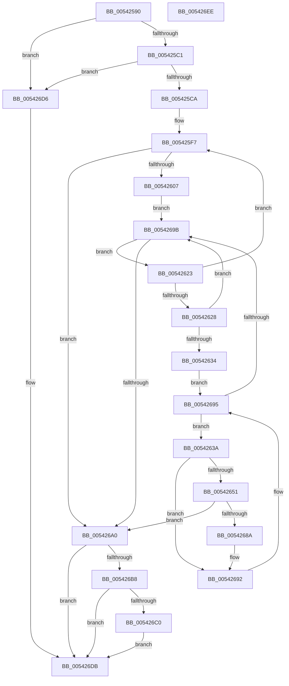

# HalpInterruptEnumerateUnmaskedInterrupts

- RVA: `0x00542590`–`0x005426EF` (길이 `351` bytes)
- VA: `0x0000000140542590`
- 실행 섹션: `.text`
- PDB 이름 있음: `예`; PDB Function 태그: `아니요`
- unwind 정보 RVA: `0x000C3B5C`
- 디코드: `101`개 명령, `351/351` bytes 표시
- 미해석 바이트: `0` (있으면 어셈블리에 `.byte`로 보존)

> 이 문서는 커널 이미지의 기계어와 PDB 기호를 분석해 생성했습니다. 4번과 5번은 함수 원형과 자료형을 바이너리 사용 방식에서 추정한 C 해석이며 원본 소스 복구 결과는 아닙니다.

## 1. Dependencies

- 직접 호출 지점: **5**; 고유 호출 대상: **5**
- 직접 호출자로 확인된 함수: **0**
- RIP 상대 이미지 참조: **3**

### Outgoing calls
- `0x005425D3` → [memset](../6C/memset_function_006C6C40.md) (function, `0x006C6C40`)
- `0x005425E4` → [HalpAcquireHighLevelLock](../2D/HalpAcquireHighLevelLock_function_002D2390.md) (function, `0x002D2390`)
- `0x0054267E` → [guard_dispatch_icall](../6B/guard_dispatch_icall_function_006BAAD0.md) (function, `0x006BAAD0`)
- `0x005426AE` → [HalpReleaseHighLevelLock](../2D/HalpReleaseHighLevelLock_function_002D1C58.md) (function, `0x002D1C58`)
- `0x005426CD` → [HalpInterruptEnumerateUnmaskedSecondaryInterrupts](../55/HalpInterruptEnumerateUnmaskedSecondaryInterrupts_function_00556F8C.md) (function, `0x00556F8C`)

### Direct callers
- 이 함수 시작 RVA로 연결되는 직접 call은 확인되지 않았습니다. 간접 호출은 완전히 역산할 수 없습니다.

### Static image references
- `0x005425DB` → RVA `0x00FC19A8` (`.data`; read)
- `0x005425E9` → RVA `0x00FC38F0` (`.data`; read)
- `0x005426B8` → RVA `0x00E10424` (`.data`; read)

## 2. Other-region calls and transfers

- 다른 실행 섹션으로 향하는 call: **0**
- 별도 외부 분기/꼬리 이동을 확인하지 못했습니다.

## 3. Assembly (complete function range)

```asm
00542590  48 89 54 24 10                  mov qword ptr [rsp + 0x10], rdx
00542595  48 89 4C 24 08                  mov qword ptr [rsp + 8], rcx
0054259A  53                              push rbx
0054259B  55                              push rbp
0054259C  56                              push rsi
0054259D  57                              push rdi
0054259E  41 54                           push r12
005425A0  41 55                           push r13
005425A2  41 56                           push r14
005425A4  41 57                           push r15
005425A6  48 83 EC 28                     sub rsp, 0x28
005425AA  41 0F B7 40 02                  movzx eax, word ptr [r8 + 2]
005425AF  BB 01 00 00 00                  mov ebx, 1
005425B4  49 8B F0                        mov rsi, r8
005425B7  66 41 39 18                     cmp word ptr [r8], bx
005425BB  0F 82 15 01 00 00               jb 0x1405426d6
005425C1  83 F8 20                        cmp eax, 0x20
005425C4  0F 82 0C 01 00 00               jb 0x1405426d6
005425CA  44 8D 40 FC                     lea r8d, [rax - 4]
005425CE  33 D2                           xor edx, edx
005425D0  48 8B CE                        mov rcx, rsi
005425D3  E8 68 46 18 00                  call 0x1406c6c40
005425D8  40 8A FB                        mov dil, bl
005425DB  48 8D 0D C6 F3 A7 00            lea rcx, [rip + 0xa7f3c6]
005425E2  33 DB                           xor ebx, ebx
005425E4  E8 A7 FD D8 FF                  call 0x1402d2390
005425E9  4C 8B 25 00 13 A8 00            mov r12, qword ptr [rip + 0xa81300]
005425F0  88 84 24 80 00 00 00            mov byte ptr [rsp + 0x80], al
005425F7  48 8D 05 F2 12 A8 00            lea rax, [rip + 0xa812f2]
005425FE  4C 3B E0                        cmp r12, rax
00542601  0F 84 99 00 00 00               je 0x1405426a0
00542607  4D 8B C4                        mov r8, r12
0054260A  4C 89 A4 24 88 00 00 00         mov qword ptr [rsp + 0x88], r12
00542612  4D 8B 24 24                     mov r12, qword ptr [r12]
00542616  4D 8D A8 08 01 00 00            lea r13, [r8 + 0x108]
0054261D  4D 8B 7D 00                     mov r15, qword ptr [r13]
00542621  EB 78                           jmp 0x14054269b
00542623  4D 3B FD                        cmp r15, r13
00542626  74 CF                           je 0x1405425f7
00542628  49 8B EF                        mov rbp, r15
0054262B  4D 8B 3F                        mov r15, qword ptr [r15]
0054262E  83 7D 1C FF                     cmp dword ptr [rbp + 0x1c], -1
00542632  74 67                           je 0x14054269b
00542634  44 8B 75 14                     mov r14d, dword ptr [rbp + 0x14]
00542638  EB 5B                           jmp 0x140542695
0054263A  41 8B CE                        mov ecx, r14d
0054263D  2B 4D 14                        sub ecx, dword ptr [rbp + 0x14]
00542640  8B C1                           mov eax, ecx
00542642  48 6B D0 38                     imul rdx, rax, 0x38
00542646  48 03 55 28                     add rdx, qword ptr [rbp + 0x28]
0054264A  8B 42 0C                        mov eax, dword ptr [rdx + 0xc]
0054264D  A8 01                           test al, 1
0054264F  74 41                           je 0x140542692
00542651  03 4D 1C                        add ecx, dword ptr [rbp + 0x1c]
00542654  89 4E 10                        mov dword ptr [rsi + 0x10], ecx
00542657  48 8B 4C 24 78                  mov rcx, qword ptr [rsp + 0x78]
0054265C  66 89 5E 04                     mov word ptr [rsi + 4], bx
00542660  8B 42 08                        mov eax, dword ptr [rdx + 8]
00542663  89 46 08                        mov dword ptr [rsi + 8], eax
00542666  8B 02                           mov eax, dword ptr [rdx]
00542668  48 8B D6                        mov rdx, rsi
0054266B  89 46 0C                        mov dword ptr [rsi + 0xc], eax
0054266E  49 8B 80 70 01 00 00            mov rax, qword ptr [r8 + 0x170]
00542675  48 89 46 18                     mov qword ptr [rsi + 0x18], rax
00542679  48 8B 44 24 70                  mov rax, qword ptr [rsp + 0x70]
0054267E  E8 4D 84 17 00                  call 0x1406baad0
00542683  40 8A F8                        mov dil, al
00542686  84 C0                           test al, al
00542688  74 16                           je 0x1405426a0
0054268A  4C 8B 84 24 88 00 00 00         mov r8, qword ptr [rsp + 0x88]
00542692  41 FF C6                        inc r14d
00542695  44 3B 75 18                     cmp r14d, dword ptr [rbp + 0x18]
00542699  7C 9F                           jl 0x14054263a
0054269B  40 84 FF                        test dil, dil
0054269E  75 83                           jne 0x140542623
005426A0  8A 94 24 80 00 00 00            mov dl, byte ptr [rsp + 0x80]
005426A7  48 8D 0D FA F2 A7 00            lea rcx, [rip + 0xa7f2fa]
005426AE  E8 A5 F5 D8 FF                  call 0x1402d1c58
005426B3  40 84 FF                        test dil, dil
005426B6  74 23                           je 0x1405426db
005426B8  38 1D 66 DD 8C 00               cmp byte ptr [rip + 0x8cdd66], bl
005426BE  74 1B                           je 0x1405426db
005426C0  48 8B 54 24 78                  mov rdx, qword ptr [rsp + 0x78]
005426C5  4C 8B C6                        mov r8, rsi
005426C8  48 8B 4C 24 70                  mov rcx, qword ptr [rsp + 0x70]
005426CD  E8 BA 48 01 00                  call 0x140556f8c
005426D2  8B D8                           mov ebx, eax
005426D4  EB 05                           jmp 0x1405426db
005426D6  BB 0D 00 00 C0                  mov ebx, 0xc000000d
005426DB  8B C3                           mov eax, ebx
005426DD  48 83 C4 28                     add rsp, 0x28
005426E1  41 5F                           pop r15
005426E3  41 5E                           pop r14
005426E5  41 5D                           pop r13
005426E7  41 5C                           pop r12
005426E9  5F                              pop rdi
005426EA  5E                              pop rsi
005426EB  5D                              pop rbp
005426EC  5B                              pop rbx
005426ED  C3                              ret
005426EE  CC                              int3
```

## 4. C-style interpretation (structured pseudocode)

```c
__int64 __fastcall HalpInterruptEnumerateUnmaskedInterrupts(__int64 a1, __int64 a2, __int64 a3)
{
    __int64 result;
    __int64 v_r14;
    __int64 v_rbx;
    __int64 v_rsp;
    unsigned __int64 v_stack_p10;
    unsigned __int8 v_stack_p18;
    unsigned __int64 v_stack_p20;
    unsigned __int64 v_stack_p8;

    v_stack_p10 = a2;
    v_stack_p8 = a1;
    v_rsp = (v_rsp) - (40);
    if ((*(unsigned __int16 *)(a3)) < 1) goto loc_005426D6;
    if (((unsigned int)(*(unsigned __int16 *)(a3 + 2))) < 32) goto loc_005426D6;
    a2 = 0;
    result = memset(a3, a2, *(unsigned __int16 *)(a3 + 2) - 4, a4);
    v_rbx = 0;
    result = HalpAcquireHighLevelLock(v_rip + 11006918, a2, *(unsigned __int16 *)(a3 + 2) - 4, a4);
    v_stack_p18 = (unsigned __int8)(result);
loc_005425F7:
    if ((*(unsigned __int64 *)(v_rip + 11014912)) == (v_rip + 11014898)) goto loc_005426A0;
    v_stack_p20 = *(unsigned __int64 *)(v_rip + 11014912);
    goto loc_0054269B;
loc_00542623:
    if ((*(unsigned __int64 *)(*(unsigned __int64 *)(v_rip + 11014912) + 264)) == (*(unsigned __int64 *)(v_rip + 11014912) + 264)) goto loc_005425F7;
    if ((*(unsigned int *)(*(unsigned __int64 *)(*(unsigned __int64 *)(v_rip + 11014912) + 264) + 28)) == -1) goto loc_0054269B;
    goto loc_00542695;
loc_0054263A:
    a1 = (unsigned int)(((unsigned int)((unsigned int)((unsigned int)(*(unsigned int *)(*(unsigned __int64 *)(*(unsigned __int64 *)(v_rip + 11014912) + 264) + 20))))) - (*(unsigned int *)(*(unsigned __int64 *)(*(unsigned __int64 *)(v_rip + 11014912) + 264) + 20)));
    a2 = (a2) * ((unsigned int)((unsigned int)(a1)));
    a2 = (a2) + (*(unsigned __int64 *)(*(unsigned __int64 *)(*(unsigned __int64 *)(v_rip + 11014912) + 264) + 40));
    if ((((unsigned __int8)((unsigned int)(*(unsigned int *)(a2 + 12)))) & (1)) == 0) goto loc_00542692;
    a1 = (unsigned int)((a1) + (*(unsigned int *)(*(unsigned __int64 *)(*(unsigned __int64 *)(v_rip + 11014912) + 264) + 28)));
    *(unsigned int *)(a3 + 16) = (unsigned int)(a1);
    *(unsigned __int16 *)(a3 + 4) = 0;
    *(unsigned int *)(a3 + 8) = (unsigned int)((unsigned int)(*(unsigned int *)(a2 + 8)));
    *(unsigned int *)(a3 + 12) = (unsigned int)((unsigned int)(*(unsigned int *)(a2)));
    *(unsigned __int64 *)(a3 + 24) = *(unsigned __int64 *)(*(unsigned __int64 *)(v_rip + 11014912) + 368);
    result = guard_dispatch_icall(v_stack_p10, a3, *(unsigned __int64 *)(v_rip + 11014912), a4);
    if ((unsigned __int8)(result) == 0) goto loc_005426A0;
loc_00542692:
    v_r14 = (unsigned int)(((unsigned int)(*(unsigned int *)(*(unsigned __int64 *)(*(unsigned __int64 *)(v_rip + 11014912) + 264) + 20))) + 1);
loc_00542695:
    if (((unsigned int)(v_r14)) < (*(unsigned int *)(*(unsigned __int64 *)(*(unsigned __int64 *)(v_rip + 11014912) + 264) + 24))) goto loc_0054263A;
loc_0054269B:
    if ((unsigned __int8)((unsigned __int8)(result)) != 0) goto loc_00542623;
loc_005426A0:
    result = HalpReleaseHighLevelLock(v_rip + 11006714, v_stack_p18, v_stack_p20, a4);
    if ((unsigned __int8)((unsigned __int8)(result)) == 0) goto loc_005426DB;
    if ((*(unsigned __int8 *)(v_rip + 9231718)) == 0) goto loc_005426DB;
    result = HalpInterruptEnumerateUnmaskedSecondaryInterrupts(v_stack_p8, v_stack_p10, a3, a4);
    goto loc_005426DB;
loc_005426D6:
loc_005426DB:
    v_rsp = (v_rsp) + (40);
    return (unsigned int)((unsigned int)((unsigned int)(0xC000000DULL)));
}
```

## 5. (Beta) C Style

```c
int64_t HalpInterruptEnumerateUnmaskedInterrupts(int64_t Arg1, int64_t Arg2, void *Arg3)
{
    uint8_t *arg3 = (uint8_t *)Arg3;

    int64_t result;
    int64_t local_r14;
    int64_t local_rbx;
    int64_t local_rsp;
    uint64_t v_stack_p10;
    uint8_t v_stack_p18;
    uint64_t v_stack_p20;
    uint64_t v_stack_p8;

    v_stack_p10 = Arg2;
    v_stack_p8 = Arg1;
    local_rsp = (local_rsp) - (40);
    if ((*(uint16_t *)(arg3)) < 1) goto loc_005426D6;
    if (((uint32_t)(*(uint16_t *)(arg3 + 0x2))) < 32) goto loc_005426D6;
    Arg2 = 0;
    result = memset(Arg3, Arg2, *(uint16_t *)(arg3 + 0x2) - 4, a4);
    local_rbx = 0;
    result = HalpAcquireHighLevelLock(v_rip + 11006918, Arg2, *(uint16_t *)(arg3 + 0x2) - 4, a4);
    v_stack_p18 = (uint8_t)(result);
loc_005425F7:
    if ((*(uint64_t *)(v_rip + 0xA81300)) == (v_rip + 11014898)) goto loc_005426A0;
    v_stack_p20 = *(uint64_t *)(v_rip + 0xA81300);
    goto loc_0054269B;
loc_00542623:
    if ((*(uint64_t *)(*(uint64_t *)(v_rip + 0xA81300) + 0x108)) == (*(uint64_t *)(v_rip + 0xA81300) + 264)) goto loc_005425F7;
    if ((*(uint32_t *)(*(uint64_t *)(*(uint64_t *)(v_rip + 0xA81300) + 0x108) + 0x1C)) == -1) goto loc_0054269B;
    goto loc_00542695;
loc_0054263A:
    Arg1 = (uint32_t)(((uint32_t)((uint32_t)((uint32_t)(*(uint32_t *)(*(uint64_t *)(*(uint64_t *)(v_rip + 0xA81300) + 0x108) + 0x14))))) - (*(uint32_t *)(*(uint64_t *)(*(uint64_t *)(v_rip + 0xA81300) + 0x108) + 0x14)));
    Arg2 = (Arg2) * ((uint32_t)((uint32_t)(Arg1)));
    Arg2 = (Arg2) + (*(uint64_t *)(*(uint64_t *)(*(uint64_t *)(v_rip + 0xA81300) + 0x108) + 0x28));
    if ((((uint8_t)((uint32_t)(*(uint32_t *)(Arg2 + 0xC)))) & (1)) == 0) goto loc_00542692;
    Arg1 = (uint32_t)((Arg1) + (*(uint32_t *)(*(uint64_t *)(*(uint64_t *)(v_rip + 0xA81300) + 0x108) + 0x1C)));
    *(uint32_t *)(arg3 + 0x10) = (uint32_t)(Arg1);
    *(uint16_t *)(arg3 + 0x4) = 0;
    *(uint32_t *)(arg3 + 0x8) = (uint32_t)((uint32_t)(*(uint32_t *)(Arg2 + 0x8)));
    *(uint32_t *)(arg3 + 0xC) = (uint32_t)((uint32_t)(*(uint32_t *)(Arg2)));
    *(uint64_t *)(arg3 + 0x18) = *(uint64_t *)(*(uint64_t *)(v_rip + 0xA81300) + 0x170);
    result = guard_dispatch_icall(v_stack_p10, Arg3, *(uint64_t *)(v_rip + 0xA81300), a4);
    if ((uint8_t)(result) == 0) goto loc_005426A0;
loc_00542692:
    local_r14 = (uint32_t)(((uint32_t)(*(uint32_t *)(*(uint64_t *)(*(uint64_t *)(v_rip + 0xA81300) + 0x108) + 0x14))) + 1);
loc_00542695:
    if (((uint32_t)(local_r14)) < (*(uint32_t *)(*(uint64_t *)(*(uint64_t *)(v_rip + 0xA81300) + 0x108) + 0x18))) goto loc_0054263A;
loc_0054269B:
    if ((uint8_t)((uint8_t)(result)) != 0) goto loc_00542623;
loc_005426A0:
    result = HalpReleaseHighLevelLock(v_rip + 11006714, v_stack_p18, v_stack_p20, a4);
    if ((uint8_t)((uint8_t)(result)) == 0) goto loc_005426DB;
    if ((*(uint8_t *)(v_rip + 0x8CDD66)) == 0) goto loc_005426DB;
    result = HalpInterruptEnumerateUnmaskedSecondaryInterrupts(v_stack_p8, v_stack_p10, Arg3, a4);
    goto loc_005426DB;
loc_005426D6:
loc_005426DB:
    local_rsp = (local_rsp) + (40);
    return (uint32_t)((uint32_t)((uint32_t)(0xC000000DULL)));
}
```

### 관측된 메모리 오프셋

구조체 형식이 확인되지 않은 접근은 인자 기준의 오프셋으로만 기록했습니다.

| 기준 인자 | 오프셋 표현 | 폭 (bit) | 접근 |
|---|---:|---:|---|
| `Arg3` | `+ 0x0` | `16` | `R` |
| `Arg3` | `+ 0x2` | `16` | `R` |
| `Arg3` | `+ 0x4` | `16` | `W` |
| `Arg3` | `+ 0x8` | `32` | `W` |
| `Arg3` | `+ 0xC` | `32` | `W` |
| `Arg3` | `+ 0x10` | `32` | `W` |
| `Arg3` | `+ 0x18` | `64` | `W` |

## 6. Execution-region graph

[열기: 2D/3D 그래프와 함수 탐색 컨트롤 패널](../../../control-panel.html?section=text&rva=0x00542590&view=graph)

- 2D 그래프는 위에서 아래로 흐르고, 3D 그래프는 빈 공간을 드래그해 회전합니다. Shift+드래그는 이동, 휠은 확대·축소, 함수 노드 선택은 대상 보고서 이동입니다.

### Static fallback


