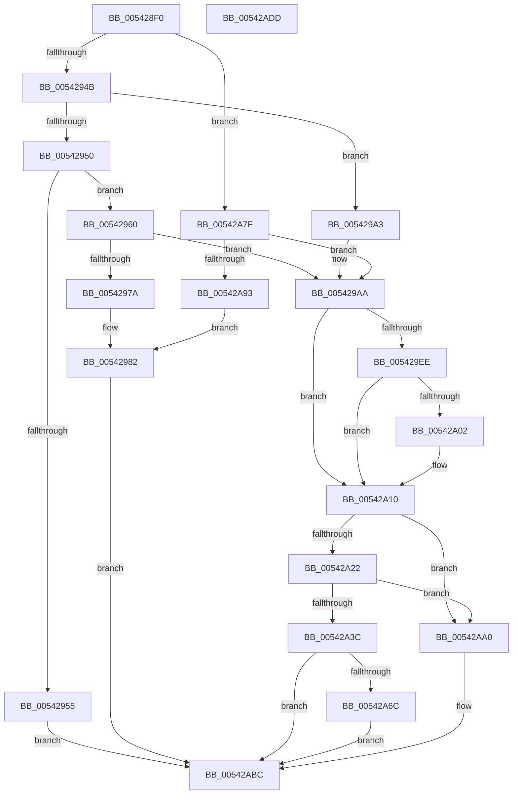

# HalpInterruptGenerateMessage

- RVA: `0x005428F0`–`0x00542ADE` (길이 `494` bytes)
- VA: `0x00000001405428F0`
- 실행 섹션: `.text`
- PDB 이름 있음: `예`; PDB Function 태그: `아니요`
- unwind 정보 RVA: `0x000C3BB4`
- 디코드: `125`개 명령, `494/494` bytes 표시
- 미해석 바이트: `0` (있으면 어셈블리에 `.byte`로 보존)

> 이 문서는 커널 이미지의 기계어와 PDB 기호를 분석해 생성했습니다. 4번과 5번은 함수 원형과 자료형을 바이너리 사용 방식에서 추정한 C 해석이며 원본 소스 복구 결과는 아닙니다.

## 1. Dependencies

- 직접 호출 지점: **5**; 고유 호출 대상: **4**
- 직접 호출자로 확인된 함수: **2**
- RIP 상대 이미지 참조: **3**

### Outgoing calls
- `0x00542971` → [HalGetProcessorIdByNtNumber](../2D/HalGetProcessorIdByNtNumber_function_002D5560.md) (function, `0x002D5560`)
- `0x00542993` → [HalpInterruptSetProblemEx](../48/HalpInterruptSetProblemEx_function_0048AC8C.md) (function, `0x0048AC8C`)
- `0x00542A30` → [guard_dispatch_icall](../6B/guard_dispatch_icall_function_006BAAD0.md) (function, `0x006BAAD0`)
- `0x00542A86` → [HalpInterruptDestinationToTarget](../48/HalpInterruptDestinationToTarget_function_0048AA54.md) (function, `0x0048AA54`)
- `0x00542AB7` → [HalpInterruptSetProblemEx](../48/HalpInterruptSetProblemEx_function_0048AC8C.md) (function, `0x0048AC8C`)

### Direct callers
- [HalpPopulateMsiMessages](HalpPopulateMsiMessages_function_00543010.md) at `0x00543061`
- [HalpIommuConfigureInterrupt](../55/HalpIommuConfigureInterrupt_function_00553464.md) at `0x005535BA`

### Static image references
- `0x0054290F` → RVA `0x00E101F0` (`.data`; read)
- `0x00542982` → RVA `0x00010AA8` (`.rdata`; read)
- `0x00542A3C` → RVA `0x00E10461` (`.data`; read)

## 2. Other-region calls and transfers

- 다른 실행 섹션으로 향하는 call: **0**
- 별도 외부 분기/꼬리 이동을 확인하지 못했습니다.

## 3. Assembly (complete function range)

```asm
005428F0  48 8B C4                        mov rax, rsp
005428F3  48 89 58 08                     mov qword ptr [rax + 8], rbx
005428F7  48 89 70 10                     mov qword ptr [rax + 0x10], rsi
005428FB  48 89 78 18                     mov qword ptr [rax + 0x18], rdi
005428FF  4C 89 68 20                     mov qword ptr [rax + 0x20], r13
00542903  55                              push rbp
00542904  41 56                           push r14
00542906  41 57                           push r15
00542908  48 8B EC                        mov rbp, rsp
0054290B  48 83 EC 70                     sub rsp, 0x70
0054290F  48 8B 3D DA D8 8C 00            mov rdi, qword ptr [rip + 0x8cd8da]
00542916  33 C0                           xor eax, eax
00542918  49 21 00                        and qword ptr [r8], rax
0054291B  0F 57 C0                        xorps xmm0, xmm0
0054291E  49 21 01                        and qword ptr [r9], rax
00542921  48 8B D9                        mov rbx, rcx
00542924  8B 09                           mov ecx, dword ptr [rcx]
00542926  45 32 FF                        xor r15b, r15b
00542929  48 89 45 F0                     mov qword ptr [rbp - 0x10], rax
0054292D  49 8B F1                        mov rsi, r9
00542930  4D 8B F0                        mov r14, r8
00542933  4C 8B EA                        mov r13, rdx
00542936  0F 11 45 C0                     movups xmmword ptr [rbp - 0x40], xmm0
0054293A  0F 11 45 D0                     movups xmmword ptr [rbp - 0x30], xmm0
0054293E  0F 11 45 E0                     movups xmmword ptr [rbp - 0x20], xmm0
00542942  83 E9 01                        sub ecx, 1
00542945  0F 84 34 01 00 00               je 0x140542a7f
0054294B  83 E9 02                        sub ecx, 2
0054294E  74 53                           je 0x1405429a3
00542950  83 F9 03                        cmp ecx, 3
00542953  74 0B                           je 0x140542960
00542955  41 B8 BB 00 00 C0               mov r8d, 0xc00000bb
0054295B  E9 5C 01 00 00                  jmp 0x140542abc
00542960  8B 4B 08                        mov ecx, dword ptr [rbx + 8]
00542963  48 8D 55 E0                     lea rdx, [rbp - 0x20]
00542967  41 B7 01                        mov r15b, 1
0054296A  C7 45 D8 04 00 00 00            mov dword ptr [rbp - 0x28], 4
00542971  E8 EA 2B D9 FF                  call 0x1402d5560
00542976  85 C0                           test eax, eax
00542978  79 30                           jns 0x1405429aa
0054297A  C7 44 24 20 B3 07 00 00         mov dword ptr [rsp + 0x20], 0x7b3
00542982  4C 8D 0D 1F E1 AC FF            lea r9, [rip - 0x531ee1]
00542989  44 8B C0                        mov r8d, eax
0054298C  BA 15 00 00 00                  mov edx, 0x15
00542991  33 C9                           xor ecx, ecx
00542993  E8 F4 82 F4 FF                  call 0x14048ac8c
00542998  41 B8 0D 00 00 C0               mov r8d, 0xc000000d
0054299E  E9 19 01 00 00                  jmp 0x140542abc
005429A3  C7 45 D8 01 00 00 00            mov dword ptr [rbp - 0x28], 1
005429AA  B8 10 00 00 00                  mov eax, 0x10
005429AF  C7 45 C0 02 00 00 00            mov dword ptr [rbp - 0x40], 2
005429B6  45 84 FF                        test r15b, r15b
005429B9  C7 45 C8 01 00 00 00            mov dword ptr [rbp - 0x38], 1
005429C0  C7 45 D4 01 00 00 00            mov dword ptr [rbp - 0x2c], 1
005429C7  8D 48 02                        lea ecx, [rax + 2]
005429CA  0F 44 C1                        cmove eax, ecx
005429CD  83 4D D0 FF                     or dword ptr [rbp - 0x30], 0xffffffff
005429D1  89 45 CC                        mov dword ptr [rbp - 0x34], eax
005429D4  41 8B 45 04                     mov eax, dword ptr [r13 + 4]
005429D8  89 45 F0                        mov dword ptr [rbp - 0x10], eax
005429DB  48 8B 05 0E D8 8C 00            mov rax, qword ptr [rip + 0x8cd80e]
005429E2  F7 80 F4 00 00 00 00 01 00 00   test dword ptr [rax + 0xf4], 0x100
005429EC  74 22                           je 0x140542a10
005429EE  48 8B 4B 10                     mov rcx, qword ptr [rbx + 0x10]
005429F2  BA FF FF FF 3F                  mov edx, 0x3fffffff
005429F7  8B 01                           mov eax, dword ptr [rcx]
005429F9  23 C2                           and eax, edx
005429FB  3D FE FF FF 3F                  cmp eax, 0x3ffffffe
00542A00  74 0E                           je 0x140542a10
00542A02  C7 45 D8 07 00 00 00            mov dword ptr [rbp - 0x28], 7
00542A09  8B 01                           mov eax, dword ptr [rcx]
00542A0B  23 C2                           and eax, edx
00542A0D  89 45 E0                        mov dword ptr [rbp - 0x20], eax
00542A10  48 8B 87 88 00 00 00            mov rax, qword ptr [rdi + 0x88]
00542A17  41 B8 BB 00 00 C0               mov r8d, 0xc00000bb
00542A1D  48 85 C0                        test rax, rax
00542A20  74 7E                           je 0x140542aa0
00542A22  48 8B 4F 10                     mov rcx, qword ptr [rdi + 0x10]
00542A26  48 8D 55 C0                     lea rdx, [rbp - 0x40]
00542A2A  4C 8B CE                        mov r9, rsi
00542A2D  4D 8B C6                        mov r8, r14
00542A30  E8 9B 80 17 00                  call 0x1406baad0
00542A35  44 8B C0                        mov r8d, eax
00542A38  85 C0                           test eax, eax
00542A3A  78 64                           js 0x140542aa0
00542A3C  8A 05 1F DA 8C 00               mov al, byte ptr [rip + 0x8cda1f]
00542A42  41 B8 20 04 00 C0               mov r8d, 0xc0000420
00542A48  F6 D8                           neg al
00542A4A  48 B8 00 00 00 00 01 00 00 FF   movabs rax, 0xff00000100000000
00542A54  48 1B C9                        sbb rcx, rcx
00542A57  48 23 C8                        and rcx, rax
00542A5A  48 B8 00 00 00 00 FF FF FF FF   movabs rax, 0xffffffff00000000
00542A64  48 03 C8                        add rcx, rax
00542A67  49 85 0E                        test qword ptr [r14], rcx
00542A6A  75 50                           jne 0x140542abc
00542A6C  48 8B 06                        mov rax, qword ptr [rsi]
00542A6F  48 25 00 00 FF FF               and rax, 0xffffffffffff0000
00542A75  48 F7 D8                        neg rax
00542A78  1B C9                           sbb ecx, ecx
00542A7A  44 23 C1                        and r8d, ecx
00542A7D  EB 3D                           jmp 0x140542abc
00542A7F  4C 8D 45 D8                     lea r8, [rbp - 0x28]
00542A83  48 8B D3                        mov rdx, rbx
00542A86  E8 C9 7F F4 FF                  call 0x14048aa54
00542A8B  85 C0                           test eax, eax
00542A8D  0F 89 17 FF FF FF               jns 0x1405429aa
00542A93  C7 44 24 20 C3 07 00 00         mov dword ptr [rsp + 0x20], 0x7c3
00542A9B  E9 E2 FE FF FF                  jmp 0x140542982
00542AA0  4C 8D 0D 01 E0 AC FF            lea r9, [rip - 0x531fff]
00542AA7  C7 44 24 20 01 08 00 00         mov dword ptr [rsp + 0x20], 0x801
00542AAF  BA 08 00 00 00                  mov edx, 8
00542AB4  48 8B CF                        mov rcx, rdi
00542AB7  E8 D0 81 F4 FF                  call 0x14048ac8c
00542ABC  4C 8D 5C 24 70                  lea r11, [rsp + 0x70]
00542AC1  41 8B C0                        mov eax, r8d
00542AC4  49 8B 5B 20                     mov rbx, qword ptr [r11 + 0x20]
00542AC8  49 8B 73 28                     mov rsi, qword ptr [r11 + 0x28]
00542ACC  49 8B 7B 30                     mov rdi, qword ptr [r11 + 0x30]
00542AD0  4D 8B 6B 38                     mov r13, qword ptr [r11 + 0x38]
00542AD4  49 8B E3                        mov rsp, r11
00542AD7  41 5F                           pop r15
00542AD9  41 5E                           pop r14
00542ADB  5D                              pop rbp
00542ADC  C3                              ret
00542ADD  CC                              int3
```

## 4. C-style interpretation (structured pseudocode)

```c
__int64 __fastcall HalpInterruptGenerateMessage(__int64 a1, __int64 a2, __int64 a3, __int64 a4)
{
    __int64 result;
    __int64 v_r15;
    __int64 v_rsp;
    unsigned __int64 v_stack_m18;
    unsigned __int64 v_stack_m28;
    unsigned __int64 v_stack_m38;
    unsigned int v_stack_m40;
    unsigned int v_stack_m44;
    unsigned __int64 v_stack_m48;
    unsigned int v_stack_m4C;
    unsigned int v_stack_m50;
    unsigned __int64 v_stack_m58;
    unsigned int v_stack_m68;

    *(unsigned __int64 *)(v_rsp + 8) = v_rbx;
    *(unsigned __int64 *)(v_rsp + 16) = v_rsi;
    *(unsigned __int64 *)(v_rsp + 24) = v_rdi;
    *(unsigned __int64 *)(v_rsp + 32) = v_r13;
    v_rsp = (v_rsp) - (112);
    result = 0;
    v_r15 = 0;
    v_stack_m28 = 0;
    v_stack_m58 = v_xmm0;
    v_stack_m48 = v_xmm0;
    v_stack_m38 = v_xmm0;
    a1 = (unsigned int)(((unsigned int)(*(unsigned int *)(a1))) - (1));
    if (condition_is_equal) goto loc_00542A7F;
    a1 = (unsigned int)((a1) - (2));
    if (condition_is_equal) goto loc_005429A3;
    if (((unsigned int)(a1)) == 3) goto loc_00542960;
    goto loc_00542ABC;
loc_00542960:
    v_stack_m40 = 4;
    result = HalGetProcessorIdByNtNumber((unsigned int)(*(unsigned int *)(a1 + 8)), v_stack_m38, (unsigned int)(0xC00000BBULL), a4);
    if (!sign_flag) goto loc_005429AA;
    v_stack_m68 = 0x7B3ULL;
loc_00542982:
    a1 = 0;
    result = HalpInterruptSetProblemEx(a1, 21, (unsigned int)((unsigned int)(result)), v_rip - 5447393);
    goto loc_00542ABC;
loc_005429A3:
    v_stack_m40 = 1;
loc_005429AA:
    v_stack_m58 = 2;
    v_stack_m50 = 1;
    v_stack_m44 = 1;
    result = 16;
    if (1 == 0) { result = (unsigned int)(16 + 2); }
    v_stack_m4C = (unsigned int)(result);
    v_stack_m28 = (unsigned int)((unsigned int)(*(unsigned int *)(a2 + 4)));
    if (((*(unsigned int *)(*(unsigned __int64 *)(v_rip + 9230350) + 244)) & (256)) == 0) goto loc_00542A10;
    result = (unsigned int)(((unsigned int)(*(unsigned int *)(*(unsigned __int64 *)(a1 + 16)))) & ((unsigned int)((unsigned int)(0x3FFFFFFFULL))));
    if (((unsigned int)(result)) != 0x3FFFFFFEULL) {
        v_stack_m40 = 7;
        result = *(unsigned int *)(*(unsigned __int64 *)(a1 + 16));
        result = (unsigned int)((result) & ((unsigned int)((unsigned int)(0x3FFFFFFFULL))));
        v_stack_m38 = (unsigned int)(result);
    }
    if (*(unsigned __int64 *)(*(unsigned __int64 *)(v_rip + 9230554) + 136) == 0) goto loc_00542AA0;
    result = guard_dispatch_icall(*(unsigned __int64 *)(*(unsigned __int64 *)(v_rip + 9230554) + 16), v_stack_m58, a3, a4);
    if (sign_flag) goto loc_00542AA0;
    result = (unsigned __int8)(-(*(unsigned __int8 *)(v_rip + 9230879)));
    a1 = (*(unsigned __int64 *)(*(unsigned __int64 *)(v_rip + 9230554) + 16)) & (result);
    a1 = (a1) + (result);
    if (((*(unsigned __int64 *)(a3)) & (a1)) != 0) goto loc_00542ABC;
    result = (*(unsigned __int64 *)(a4)) & (0xFFFFFFFFFFFF0000ULL);
    result = -(result);
    a3 = (unsigned int)(((unsigned int)(0xC0000420ULL)) & ((unsigned int)(a1)));
    goto loc_00542ABC;
loc_00542A7F:
    result = HalpInterruptDestinationToTarget(a1, a1, v_stack_m40, a4);
    if (!sign_flag) goto loc_005429AA;
    v_stack_m68 = 0x7C3ULL;
    goto loc_00542982;
loc_00542AA0:
    v_stack_m68 = 0x801ULL;
    result = HalpInterruptSetProblemEx(*(unsigned __int64 *)(v_rip + 9230554), 8, v_stack_m40, v_rip - 5447679);
loc_00542ABC:
    return (unsigned int)((unsigned int)(v_stack_m40));
}
```

## 5. (Beta) C Style

```c
int64_t HalpInterruptGenerateMessage(void *Arg1, void *Arg2, void *Arg3, void *Arg4)
{
    uint8_t *arg1 = (uint8_t *)Arg1;
    uint8_t *arg2 = (uint8_t *)Arg2;
    uint8_t *arg3 = (uint8_t *)Arg3;
    uint8_t *arg4 = (uint8_t *)Arg4;

    int64_t result;
    int64_t local_r15;
    int64_t local_rsp;
    uint64_t v_stack_m18;
    uint64_t v_stack_m28;
    uint64_t v_stack_m38;
    uint32_t v_stack_m40;
    uint32_t v_stack_m44;
    uint64_t v_stack_m48;
    uint32_t v_stack_m4C;
    uint32_t v_stack_m50;
    uint64_t v_stack_m58;
    uint32_t v_stack_m68;

    *(uint64_t *)(local_rsp + 0x8) = local_rbx;
    *(uint64_t *)(local_rsp + 0x10) = local_rsi;
    *(uint64_t *)(local_rsp + 0x18) = local_rdi;
    *(uint64_t *)(local_rsp + 0x20) = local_r13;
    local_rsp = (local_rsp) - (112);
    result = 0;
    local_r15 = 0;
    v_stack_m28 = 0;
    v_stack_m58 = v_xmm0;
    v_stack_m48 = v_xmm0;
    v_stack_m38 = v_xmm0;
    Arg1 = (uint32_t)(((uint32_t)(*(uint32_t *)(arg1))) - (1));
    if (condition_is_equal) goto loc_00542A7F;
    Arg1 = (uint32_t)((Arg1) - (2));
    if (condition_is_equal) goto loc_005429A3;
    if (((uint32_t)(Arg1)) == 3) goto loc_00542960;
    goto loc_00542ABC;
loc_00542960:
    v_stack_m40 = 4;
    result = HalGetProcessorIdByNtNumber((uint32_t)(*(uint32_t *)(arg1 + 0x8)), v_stack_m38, (uint32_t)(0xC00000BBULL), Arg4);
    if (!sign_flag) goto loc_005429AA;
    v_stack_m68 = 0x7B3ULL;
loc_00542982:
    Arg1 = 0;
    result = HalpInterruptSetProblemEx(Arg1, 21, (uint32_t)((uint32_t)(result)), v_rip - 5447393);
    goto loc_00542ABC;
loc_005429A3:
    v_stack_m40 = 1;
loc_005429AA:
    v_stack_m58 = 2;
    v_stack_m50 = 1;
    v_stack_m44 = 1;
    result = 16;
    if (1 == 0) { result = (uint32_t)(16 + 2); }
    v_stack_m4C = (uint32_t)(result);
    v_stack_m28 = (uint32_t)((uint32_t)(*(uint32_t *)(arg2 + 0x4)));
    if (((*(uint32_t *)(*(uint64_t *)(v_rip + 0x8CD80E) + 0xF4)) & (256)) == 0) goto loc_00542A10;
    result = (uint32_t)(((uint32_t)(*(uint32_t *)(*(uint64_t *)(arg1 + 0x10)))) & ((uint32_t)((uint32_t)(0x3FFFFFFFULL))));
    if (((uint32_t)(result)) != 0x3FFFFFFEULL) {
        v_stack_m40 = 7;
        result = *(uint32_t *)(*(uint64_t *)(arg1 + 0x10));
        result = (uint32_t)((result) & ((uint32_t)((uint32_t)(0x3FFFFFFFULL))));
        v_stack_m38 = (uint32_t)(result);
    }
    if (*(uint64_t *)(*(uint64_t *)(v_rip + 0x8CD8DA) + 0x88) == 0) goto loc_00542AA0;
    result = guard_dispatch_icall(*(uint64_t *)(*(uint64_t *)(v_rip + 0x8CD8DA) + 0x10), v_stack_m58, Arg3, Arg4);
    if (sign_flag) goto loc_00542AA0;
    result = (uint8_t)(-(*(uint8_t *)(v_rip + 0x8CDA1F)));
    Arg1 = (*(uint64_t *)(*(uint64_t *)(v_rip + 0x8CD8DA) + 0x10)) & (result);
    Arg1 = (Arg1) + (result);
    if (((*(uint64_t *)(arg3)) & (Arg1)) != 0) goto loc_00542ABC;
    result = (*(uint64_t *)(arg4)) & (0xFFFFFFFFFFFF0000ULL);
    result = -(result);
    Arg3 = (uint32_t)(((uint32_t)(0xC0000420ULL)) & ((uint32_t)(Arg1)));
    goto loc_00542ABC;
loc_00542A7F:
    result = HalpInterruptDestinationToTarget(Arg1, Arg1, v_stack_m40, Arg4);
    if (!sign_flag) goto loc_005429AA;
    v_stack_m68 = 0x7C3ULL;
    goto loc_00542982;
loc_00542AA0:
    v_stack_m68 = 0x801ULL;
    result = HalpInterruptSetProblemEx(*(uint64_t *)(v_rip + 0x8CD8DA), 8, v_stack_m40, v_rip - 5447679);
loc_00542ABC:
    return (uint32_t)((uint32_t)(v_stack_m40));
}
```

### 관측된 메모리 오프셋

구조체 형식이 확인되지 않은 접근은 인자 기준의 오프셋으로만 기록했습니다.

| 기준 인자 | 오프셋 표현 | 폭 (bit) | 접근 |
|---|---:|---:|---|
| `Arg1` | `+ 0x0` | `32` | `R` |
| `Arg1` | `+ 0x8` | `32` | `R` |
| `Arg1` | `+ 0x10` | `64` | `R` |
| `Arg2` | `+ 0x4` | `32` | `R` |
| `Arg3` | `+ 0x0` | `64` | `R` |
| `Arg3` | `+ 0x0` | `64` | `R/W` |
| `Arg4` | `+ 0x0` | `64` | `R` |
| `Arg4` | `+ 0x0` | `64` | `R/W` |

## 6. Execution-region graph

[열기: 2D/3D 그래프와 함수 탐색 컨트롤 패널](../../../control-panel.html?section=text&rva=0x005428F0&view=graph)

- 2D 그래프는 위에서 아래로 흐르고, 3D 그래프는 빈 공간을 드래그해 회전합니다. Shift+드래그는 이동, 휠은 확대·축소, 함수 노드 선택은 대상 보고서 이동입니다.

### Static fallback


