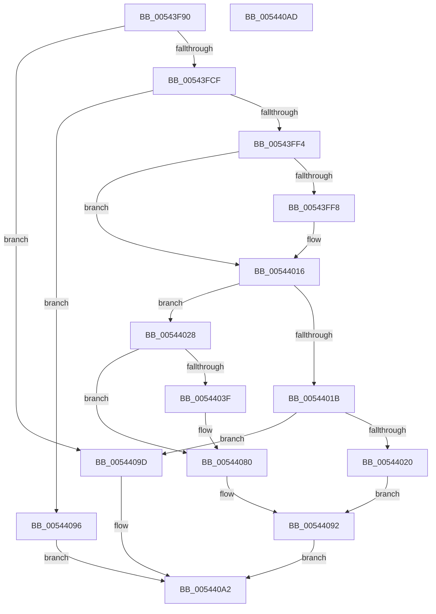

# HalpInterruptGetHighestPriorityInterrupt

- RVA: `0x00543F90`–`0x005440AE` (길이 `286` bytes)
- VA: `0x0000000140543F90`
- 실행 섹션: `.text`
- PDB 이름 있음: `예`; PDB Function 태그: `아니요`
- unwind 정보 RVA: `0x000718C0`
- 디코드: `74`개 명령, `286/286` bytes 표시
- 미해석 바이트: `0` (있으면 어셈블리에 `.byte`로 보존)

> 이 문서는 커널 이미지의 기계어와 PDB 기호를 분석해 생성했습니다. 4번과 5번은 함수 원형과 자료형을 바이너리 사용 방식에서 추정한 C 해석이며 원본 소스 복구 결과는 아닙니다.

## 1. Dependencies

- 직접 호출 지점: **5**; 고유 호출 대상: **4**
- 직접 호출자로 확인된 함수: **1**
- RIP 상대 이미지 참조: **2**

### Outgoing calls
- `0x00543FDE` → [guard_dispatch_icall](../6B/guard_dispatch_icall_function_006BAAD0.md) (function, `0x006BAAD0`)
- `0x00544010` → [KeBugCheckEx](../4F/KeBugCheckEx_function_004FD660.md) (function, `0x004FD660`)
- `0x00544032` → [HalpInterruptFindLines](../2D/HalpInterruptFindLines_function_002D2C88.md) (function, `0x002D2C88`)
- `0x00544059` → [HalpInterruptSetProblemEx](../48/HalpInterruptSetProblemEx_function_0048AC8C.md) (function, `0x0048AC8C`)
- `0x0054407A` → [KeBugCheckEx](../4F/KeBugCheckEx_function_004FD660.md) (function, `0x004FD660`)

### Direct callers
- [HalpTimerOnlyClockInterruptPending](HalpTimerOnlyClockInterruptPending_function_00548700.md) at `0x00548718`

### Static image references
- `0x00543F9C` → RVA `0x00E101F0` (`.data`; read)
- `0x00544044` → RVA `0x00023C30` (`.rdata`; read)

## 2. Other-region calls and transfers

- 다른 실행 섹션으로 향하는 call: **0**
- 별도 외부 분기/꼬리 이동을 확인하지 못했습니다.

## 3. Assembly (complete function range)

```asm
00543F90  4C 8B DC                        mov r11, rsp
00543F93  49 89 5B 08                     mov qword ptr [r11 + 8], rbx
00543F97  57                              push rdi
00543F98  48 83 EC 40                     sub rsp, 0x40
00543F9C  48 8B 1D 4D C2 8C 00            mov rbx, qword ptr [rip + 0x8cc24d]
00543FA3  48 8B F9                        mov rdi, rcx
00543FA6  49 83 63 E8 00                  and qword ptr [r11 - 0x18], 0
00543FAB  83 64 24 60 00                  and dword ptr [rsp + 0x60], 0
00543FB0  83 64 24 68 00                  and dword ptr [rsp + 0x68], 0
00543FB5  8B 83 00 01 00 00               mov eax, dword ptr [rbx + 0x100]
00543FBB  89 44 24 30                     mov dword ptr [rsp + 0x30], eax
00543FBF  48 8B 83 B8 00 00 00            mov rax, qword ptr [rbx + 0xb8]
00543FC6  48 85 C0                        test rax, rax
00543FC9  0F 84 CE 00 00 00               je 0x14054409d
00543FCF  48 8B 4B 10                     mov rcx, qword ptr [rbx + 0x10]
00543FD3  4D 8D 43 18                     lea r8, [r11 + 0x18]
00543FD7  4C 8B CA                        mov r9, rdx
00543FDA  49 8D 53 EC                     lea rdx, [r11 - 0x14]
00543FDE  E8 ED 6A 17 00                  call 0x1406baad0
00543FE3  8B D0                           mov edx, eax
00543FE5  8D 48 FE                        lea ecx, [rax - 2]
00543FE8  F7 C1 FD FF FF FF               test ecx, 0xfffffffd
00543FEE  0F 84 A2 00 00 00               je 0x140544096
00543FF4  85 C0                           test eax, eax
00543FF6  75 1E                           jne 0x140544016
00543FF8  4C 63 83 F0 00 00 00            movsxd r8, dword ptr [rbx + 0xf0]
00543FFF  8D 48 5C                        lea ecx, [rax + 0x5c]
00544002  48 83 64 24 20 00               and qword ptr [rsp + 0x20], 0
00544008  4C 8B CB                        mov r9, rbx
0054400B  BA 03 02 00 00                  mov edx, 0x203
00544010  E8 4B 96 FB FF                  call 0x1404fd660
00544015  CC                              int3
00544016  83 EA 01                        sub edx, 1
00544019  74 0D                           je 0x140544028
0054401B  83 FA 02                        cmp edx, 2
0054401E  75 7D                           jne 0x14054409d
00544020  8B 44 24 60                     mov eax, dword ptr [rsp + 0x60]
00544024  89 07                           mov dword ptr [rdi], eax
00544026  EB 6A                           jmp 0x140544092
00544028  48 8D 54 24 68                  lea rdx, [rsp + 0x68]
0054402D  48 8D 4C 24 30                  lea rcx, [rsp + 0x30]
00544032  E8 51 EC D8 FF                  call 0x1402d2c88
00544037  48 8B D0                        mov rdx, rax
0054403A  48 85 C0                        test rax, rax
0054403D  75 41                           jne 0x140544080
0054403F  4C 63 44 24 34                  movsxd r8, dword ptr [rsp + 0x34]
00544044  4C 8D 0D E5 FB AD FF            lea r9, [rip - 0x52041b]
0054404B  8D 50 12                        lea edx, [rax + 0x12]
0054404E  C7 44 24 20 D2 0F 00 00         mov dword ptr [rsp + 0x20], 0xfd2
00544056  48 8B CB                        mov rcx, rbx
00544059  E8 2E 6C F4 FF                  call 0x14048ac8c
0054405E  49 8B C8                        mov rcx, r8
00544061  4C 8B CB                        mov r9, rbx
00544064  4C 63 83 F0 00 00 00            movsxd r8, dword ptr [rbx + 0xf0]
0054406B  BA 03 02 00 00                  mov edx, 0x203
00544070  48 89 4C 24 20                  mov qword ptr [rsp + 0x20], rcx
00544075  B9 5C 00 00 00                  mov ecx, 0x5c
0054407A  E8 E1 95 FB FF                  call 0x1404fd660
0054407F  CC                              int3
00544080  8B 44 24 68                     mov eax, dword ptr [rsp + 0x68]
00544084  48 6B C8 38                     imul rcx, rax, 0x38
00544088  48 8B 42 28                     mov rax, qword ptr [rdx + 0x28]
0054408C  8B 4C 01 30                     mov ecx, dword ptr [rcx + rax + 0x30]
00544090  89 0F                           mov dword ptr [rdi], ecx
00544092  33 C0                           xor eax, eax
00544094  EB 0C                           jmp 0x1405440a2
00544096  B8 01 00 00 C0                  mov eax, 0xc0000001
0054409B  EB 05                           jmp 0x1405440a2
0054409D  B8 BB 00 00 C0                  mov eax, 0xc00000bb
005440A2  48 8B 5C 24 50                  mov rbx, qword ptr [rsp + 0x50]
005440A7  48 83 C4 40                     add rsp, 0x40
005440AB  5F                              pop rdi
005440AC  C3                              ret
005440AD  CC                              int3
```

## 4. C-style interpretation (structured pseudocode)

```c
__int64 __fastcall HalpInterruptGetHighestPriorityInterrupt(__int64 a1, __int64 a2)
{
    __int64 result;
    __int64 v_rsp;
    unsigned int v_stack_m14;
    unsigned int v_stack_m18;
    unsigned __int64 v_stack_m28;
    unsigned int v_stack_p18;
    unsigned int v_stack_p20;
    unsigned __int64 v_stack_p8;

    *(unsigned __int64 *)(v_rsp + 8) = v_rbx;
    v_rsp = (v_rsp) - (64);
    v_stack_m18 = (unsigned int)((unsigned int)(*(unsigned int *)(*(unsigned __int64 *)(v_rip + 9224781) + 256)));
    if (*(unsigned __int64 *)(*(unsigned __int64 *)(v_rip + 9224781) + 184) == 0) goto loc_0054409D;
    result = guard_dispatch_icall(*(unsigned __int64 *)(*(unsigned __int64 *)(v_rip + 9224781) + 16), v_rsp - 20, v_rsp + 24, a2);
    if ((((unsigned int)(result - 2)) & (0xFFFFFFFDULL)) == 0) goto loc_00544096;
    if ((unsigned int)(result) == 0) {
        a3 = (int)(*(unsigned int *)(*(unsigned __int64 *)(v_rip + 9224781) + 240));
        a1 = result + 92;
        a4 = *(unsigned __int64 *)(v_rip + 9224781);
        a2 = 515;
        result = KeBugCheckEx(a1, a2, a3, a4);
    }
    a2 = (unsigned int)((a2) - (1));
    if (condition_is_equal) goto loc_00544028;
    if (((unsigned int)(a2)) != 2) goto loc_0054409D;
    *(unsigned int *)(a1) = (unsigned int)((unsigned int)(v_stack_p18));
    goto loc_00544092;
loc_00544028:
    result = HalpInterruptFindLines(v_stack_m18, v_stack_p20, a3, a4);
    if (result == 0) {
        a3 = (int)(v_stack_m14);
        a4 = v_rip - 5375003;
        a2 = result + 18;
        v_stack_m28 = 0xFD2ULL;
        a1 = *(unsigned __int64 *)(v_rip + 9224781);
        result = HalpInterruptSetProblemEx(a1, a2, a3, a4);
        a1 = a3;
        a4 = *(unsigned __int64 *)(v_rip + 9224781);
        a3 = (int)(*(unsigned int *)(*(unsigned __int64 *)(v_rip + 9224781) + 240));
        a2 = 515;
        v_stack_m28 = a1;
        a1 = 92;
        result = KeBugCheckEx(a1, a2, a3, a4);
    }
    a1 = (a1) * ((unsigned int)(v_stack_p20));
    *(unsigned int *)(a1) = (unsigned int)((unsigned int)(*(unsigned int *)(a1 + *(unsigned __int64 *)(a2 + 40) * 1 + 48)));
loc_00544092:
    result = 0;
    goto loc_005440A2;
loc_00544096:
    goto loc_005440A2;
loc_0054409D:
loc_005440A2:
    v_rsp = (v_rsp) + (64);
    return (unsigned int)(0xC00000BBULL);
}
```

## 5. (Beta) C Style

```c
int64_t HalpInterruptGetHighestPriorityInterrupt(void *Arg1, int64_t Arg2)
{
    uint8_t *arg1 = (uint8_t *)Arg1;

    int64_t result;
    int64_t local_rsp;
    uint32_t v_stack_m14;
    uint32_t v_stack_m18;
    uint64_t v_stack_m28;
    uint32_t v_stack_p18;
    uint32_t v_stack_p20;
    uint64_t v_stack_p8;

    *(uint64_t *)(local_rsp + 0x8) = local_rbx;
    local_rsp = (local_rsp) - (64);
    v_stack_m18 = (uint32_t)((uint32_t)(*(uint32_t *)(*(uint64_t *)(v_rip + 0x8CC24D) + 0x100)));
    if (*(uint64_t *)(*(uint64_t *)(v_rip + 0x8CC24D) + 0xB8) == 0) goto loc_0054409D;
    result = guard_dispatch_icall(*(uint64_t *)(*(uint64_t *)(v_rip + 0x8CC24D) + 0x10), local_rsp - 20, local_rsp + 24, Arg2);
    if ((((uint32_t)(result - 2)) & (0xFFFFFFFDULL)) == 0) goto loc_00544096;
    if ((uint32_t)(result) == 0) {
        a3 = (int32_t)(*(uint32_t *)(*(uint64_t *)(v_rip + 0x8CC24D) + 0xF0));
        Arg1 = result + 92;
        a4 = *(uint64_t *)(v_rip + 0x8CC24D);
        Arg2 = 515;
        result = KeBugCheckEx(Arg1, Arg2, a3, a4);
    }
    Arg2 = (uint32_t)((Arg2) - (1));
    if (condition_is_equal) goto loc_00544028;
    if (((uint32_t)(Arg2)) != 2) goto loc_0054409D;
    *(uint32_t *)(arg1) = (uint32_t)((uint32_t)(v_stack_p18));
    goto loc_00544092;
loc_00544028:
    result = HalpInterruptFindLines(v_stack_m18, v_stack_p20, a3, a4);
    if (result == 0) {
        a3 = (int32_t)(v_stack_m14);
        a4 = v_rip - 5375003;
        Arg2 = result + 18;
        v_stack_m28 = 0xFD2ULL;
        Arg1 = *(uint64_t *)(v_rip + 0x8CC24D);
        result = HalpInterruptSetProblemEx(Arg1, Arg2, a3, a4);
        Arg1 = a3;
        a4 = *(uint64_t *)(v_rip + 0x8CC24D);
        a3 = (int32_t)(*(uint32_t *)(*(uint64_t *)(v_rip + 0x8CC24D) + 0xF0));
        Arg2 = 515;
        v_stack_m28 = Arg1;
        Arg1 = 92;
        result = KeBugCheckEx(Arg1, Arg2, a3, a4);
    }
    Arg1 = (Arg1) * ((uint32_t)(v_stack_p20));
    *(uint32_t *)(arg1) = (uint32_t)((uint32_t)(*(uint32_t *)(arg1 + *(uint64_t *)(Arg2 + 0x28) * 1 + 0x30)));
loc_00544092:
    result = 0;
    goto loc_005440A2;
loc_00544096:
    goto loc_005440A2;
loc_0054409D:
loc_005440A2:
    local_rsp = (local_rsp) + (64);
    return (uint32_t)(0xC00000BBULL);
}
```

### 관측된 메모리 오프셋

구조체 형식이 확인되지 않은 접근은 인자 기준의 오프셋으로만 기록했습니다.

| 기준 인자 | 오프셋 표현 | 폭 (bit) | 접근 |
|---|---:|---:|---|
| `Arg1` | `+ 0x0` | `32` | `W` |

## 6. Execution-region graph

[열기: 2D/3D 그래프와 함수 탐색 컨트롤 패널](../../../control-panel.html?section=text&rva=0x00543F90&view=graph)

- 2D 그래프는 위에서 아래로 흐르고, 3D 그래프는 빈 공간을 드래그해 회전합니다. Shift+드래그는 이동, 휠은 확대·축소, 함수 노드 선택은 대상 보고서 이동입니다.

### Static fallback


