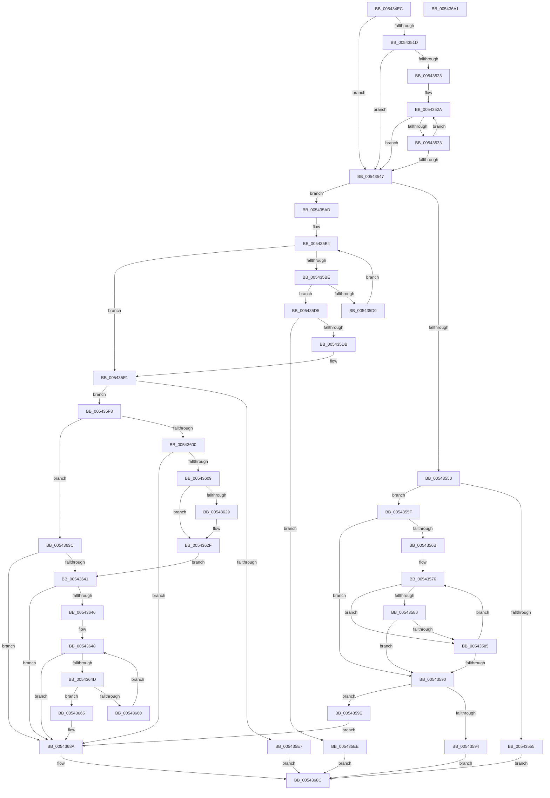

# HalpInterruptGetNextProcessorLocalId

- RVA: `0x005434EC`–`0x005436A2` (길이 `438` bytes)
- VA: `0x00000001405434EC`
- 실행 섹션: `.text`
- PDB 이름 있음: `예`; PDB Function 태그: `아니요`
- unwind 정보 RVA: `0x0006C8E8`
- 디코드: `133`개 명령, `438/438` bytes 표시
- 미해석 바이트: `0` (있으면 어셈블리에 `.byte`로 보존)

> 이 문서는 커널 이미지의 기계어와 PDB 기호를 분석해 생성했습니다. 4번과 5번은 함수 원형과 자료형을 바이너리 사용 방식에서 추정한 C 해석이며 원본 소스 복구 결과는 아닙니다.

## 1. Dependencies

- 직접 호출 지점: **1**; 고유 호출 대상: **1**
- 직접 호출자로 확인된 함수: **1**
- RIP 상대 이미지 참조: **5**

### Outgoing calls
- `0x00543509` → [HalpQueryMaximumRegisteredProcessorCount](HalpQueryMaximumRegisteredProcessorCount_function_00543BE8.md) (function, `0x00543BE8`)

### Direct callers
- [HalpInterruptStartProcessor](../../pagelk/B5/HalpInterruptStartProcessor_function_00B5BEF0.md) at `0x00B5BF37`

### Static image references
- `0x00543523` → RVA `0x00FC3E10` (`.data`; read)
- `0x0054355F` → RVA `0x00E10200` (`.data`; read)
- `0x0054356B` → RVA `0x00FC3E30` (`.data`; read)
- `0x00543632` → RVA `0x00E10200` (`.data`; write)
- `0x00543668` → RVA `0x00FC3E4C` (`.data`; read/write)

## 2. Other-region calls and transfers

- 다른 실행 섹션으로 향하는 call: **0**
- 별도 외부 분기/꼬리 이동을 확인하지 못했습니다.

## 3. Assembly (complete function range)

```asm
005434EC  48 89 5C 24 10                  mov qword ptr [rsp + 0x10], rbx
005434F1  48 89 6C 24 18                  mov qword ptr [rsp + 0x18], rbp
005434F6  48 89 74 24 20                  mov qword ptr [rsp + 0x20], rsi
005434FB  57                              push rdi
005434FC  48 83 EC 20                     sub rsp, 0x20
00543500  48 8B F2                        mov rsi, rdx
00543503  8B E9                           mov ebp, ecx
00543505  33 FF                           xor edi, edi
00543507  33 DB                           xor ebx, ebx
00543509  E8 DA 06 00 00                  call 0x140543be8
0054350E  44 8B C5                        mov r8d, ebp
00543511  44 8D 5F 01                     lea r11d, [rdi + 1]
00543515  44 8B D0                        mov r10d, eax
00543518  45 23 C3                        and r8d, r11d
0054351B  74 2A                           je 0x140543547
0054351D  33 D2                           xor edx, edx
0054351F  85 C0                           test eax, eax
00543521  74 24                           je 0x140543547
00543523  48 8B 0D E6 08 A8 00            mov rcx, qword ptr [rip + 0xa808e6]
0054352A  80 79 0C 00                     cmp byte ptr [rcx + 0xc], 0
0054352E  48 8B D9                        mov rbx, rcx
00543531  74 14                           je 0x140543547
00543533  8B 06                           mov eax, dword ptr [rsi]
00543535  39 01                           cmp dword ptr [rcx], eax
00543537  48 0F 44 F9                     cmove rdi, rcx
0054353B  41 03 D3                        add edx, r11d
0054353E  48 83 C1 40                     add rcx, 0x40
00543542  41 3B D2                        cmp edx, r10d
00543545  72 E3                           jb 0x14054352a
00543547  44 8B 0E                        mov r9d, dword ptr [rsi]
0054354A  41 83 F9 FF                     cmp r9d, -1
0054354E  75 5D                           jne 0x1405435ad
00543550  45 85 C0                        test r8d, r8d
00543553  74 0A                           je 0x14054355f
00543555  B8 0D 00 00 C0                  mov eax, 0xc000000d
0054355A  E9 2D 01 00 00                  jmp 0x14054368c
0054355F  8B 15 9B CC 8C 00               mov edx, dword ptr [rip + 0x8ccc9b]
00543565  33 C9                           xor ecx, ecx
00543567  85 D2                           test edx, edx
00543569  74 25                           je 0x140543590
0054356B  48 8B 05 BE 08 A8 00            mov rax, qword ptr [rip + 0xa808be]
00543572  48 83 C0 38                     add rax, 0x38
00543576  80 78 D4 00                     cmp byte ptr [rax - 0x2c], 0
0054357A  48 8D 58 C8                     lea rbx, [rax - 0x38]
0054357E  75 05                           jne 0x140543585
00543580  80 38 00                        cmp byte ptr [rax], 0
00543583  74 0B                           je 0x140543590
00543585  41 03 CB                        add ecx, r11d
00543588  48 83 C0 40                     add rax, 0x40
0054358C  3B CA                           cmp ecx, edx
0054358E  72 E6                           jb 0x140543576
00543590  3B CA                           cmp ecx, edx
00543592  75 0A                           jne 0x14054359e
00543594  B8 25 02 00 C0                  mov eax, 0xc0000225
00543599  E9 EE 00 00 00                  jmp 0x14054368c
0054359E  8B 03                           mov eax, dword ptr [rbx]
005435A0  33 C9                           xor ecx, ecx
005435A2  44 88 5B 0C                     mov byte ptr [rbx + 0xc], r11b
005435A6  89 06                           mov dword ptr [rsi], eax
005435A8  E9 DD 00 00 00                  jmp 0x14054368a
005435AD  B9 25 02 00 C0                  mov ecx, 0xc0000225
005435B2  33 C0                           xor eax, eax
005435B4  8B 15 46 CC 8C 00               mov edx, dword ptr [rip + 0x8ccc46]
005435BA  3B C2                           cmp eax, edx
005435BC  73 23                           jae 0x1405435e1
005435BE  8B D8                           mov ebx, eax
005435C0  48 C1 E3 06                     shl rbx, 6
005435C4  48 03 1D 65 08 A8 00            add rbx, qword ptr [rip + 0xa80865]
005435CB  44 39 0B                        cmp dword ptr [rbx], r9d
005435CE  74 05                           je 0x1405435d5
005435D0  41 03 C3                        add eax, r11d
005435D3  EB DF                           jmp 0x1405435b4
005435D5  80 7B 0C 00                     cmp byte ptr [rbx + 0xc], 0
005435D9  75 13                           jne 0x1405435ee
005435DB  44 88 5B 0C                     mov byte ptr [rbx + 0xc], r11b
005435DF  33 C9                           xor ecx, ecx
005435E1  40 F6 C5 02                     test bpl, 2
005435E5  74 11                           je 0x1405435f8
005435E7  33 C0                           xor eax, eax
005435E9  E9 9E 00 00 00                  jmp 0x14054368c
005435EE  B8 08 07 00 C0                  mov eax, 0xc0000708
005435F3  E9 94 00 00 00                  jmp 0x14054368c
005435F8  81 F9 25 02 00 C0               cmp ecx, 0xc0000225
005435FE  75 3C                           jne 0x14054363c
00543600  45 85 C0                        test r8d, r8d
00543603  0F 84 81 00 00 00               je 0x14054368a
00543609  48 8B DA                        mov rbx, rdx
0054360C  48 C1 E3 06                     shl rbx, 6
00543610  48 03 1D 19 08 A8 00            add rbx, qword ptr [rip + 0xa80819]
00543617  44 88 5B 0C                     mov byte ptr [rbx + 0xc], r11b
0054361B  8B 06                           mov eax, dword ptr [rsi]
0054361D  89 03                           mov dword ptr [rbx], eax
0054361F  8B 06                           mov eax, dword ptr [rsi]
00543621  89 43 08                        mov dword ptr [rbx + 8], eax
00543624  48 85 FF                        test rdi, rdi
00543627  74 06                           je 0x14054362f
00543629  8B 47 08                        mov eax, dword ptr [rdi + 8]
0054362C  89 43 08                        mov dword ptr [rbx + 8], eax
0054362F  41 03 D3                        add edx, r11d
00543632  89 15 C8 CB 8C 00               mov dword ptr [rip + 0x8ccbc8], edx
00543638  33 C9                           xor ecx, ecx
0054363A  EB 05                           jmp 0x140543641
0054363C  45 85 C0                        test r8d, r8d
0054363F  74 49                           je 0x14054368a
00543641  48 85 FF                        test rdi, rdi
00543644  75 44                           jne 0x14054368a
00543646  33 D2                           xor edx, edx
00543648  41 3B D2                        cmp edx, r10d
0054364B  73 3D                           jae 0x14054368a
0054364D  8B C2                           mov eax, edx
0054364F  48 C1 E0 06                     shl rax, 6
00543653  48 03 05 B6 07 A8 00            add rax, qword ptr [rip + 0xa807b6]
0054365A  80 78 0C 00                     cmp byte ptr [rax + 0xc], 0
0054365E  74 05                           je 0x140543665
00543660  41 03 D3                        add edx, r11d
00543663  EB E3                           jmp 0x140543648
00543665  0F 10 03                        movups xmm0, xmmword ptr [rbx]
00543668  44 01 1D DD 07 A8 00            add dword ptr [rip + 0xa807dd], r11d
0054366F  0F 11 00                        movups xmmword ptr [rax], xmm0
00543672  0F 10 4B 10                     movups xmm1, xmmword ptr [rbx + 0x10]
00543676  0F 11 48 10                     movups xmmword ptr [rax + 0x10], xmm1
0054367A  0F 10 43 20                     movups xmm0, xmmword ptr [rbx + 0x20]
0054367E  0F 11 40 20                     movups xmmword ptr [rax + 0x20], xmm0
00543682  0F 10 4B 30                     movups xmm1, xmmword ptr [rbx + 0x30]
00543686  0F 11 48 30                     movups xmmword ptr [rax + 0x30], xmm1
0054368A  8B C1                           mov eax, ecx
0054368C  48 8B 5C 24 38                  mov rbx, qword ptr [rsp + 0x38]
00543691  48 8B 6C 24 40                  mov rbp, qword ptr [rsp + 0x40]
00543696  48 8B 74 24 48                  mov rsi, qword ptr [rsp + 0x48]
0054369B  48 83 C4 20                     add rsp, 0x20
0054369F  5F                              pop rdi
005436A0  C3                              ret
005436A1  CC                              int3
```

## 4. C-style interpretation (structured pseudocode)

```c
__int64 __fastcall HalpInterruptGetNextProcessorLocalId(int a1, __int64 a2)
{
    __int64 result;
    __int64 v_rbx;
    __int64 v_rdi;
    __int64 v_rsp;
    unsigned __int64 v_stack_p10;
    unsigned __int64 v_stack_p18;
    unsigned __int64 v_stack_p20;

    v_stack_p10 = v_rbx;
    v_stack_p18 = v_rbp;
    v_stack_p20 = v_rsi;
    v_rsp = (v_rsp) - (32);
    v_rdi = 0;
    v_rbx = 0;
    result = HalpQueryMaximumRegisteredProcessorCount(a1, a2, a3, a4);
    a3 = (unsigned int)(((unsigned int)((unsigned int)((unsigned int)(a1)))) & ((unsigned int)(v_rdi + 1)));
    if (condition_is_equal) goto loc_00543547;
    a2 = 0;
    if ((unsigned int)(result) == 0) goto loc_00543547;
loc_0054352A:
    if ((*(unsigned __int8 *)(*(unsigned __int64 *)(v_rip + 11012326) + 12)) == 0) goto loc_00543547;
    if ((*(unsigned int *)(*(unsigned __int64 *)(v_rip + 11012326))) == ((unsigned int)((unsigned int)(*(unsigned int *)(a2))))) { v_rdi = *(unsigned __int64 *)(v_rip + 11012326); }
    a2 = (unsigned int)((a2) + ((unsigned int)(v_rdi + 1)));
    a1 = (*(unsigned __int64 *)(v_rip + 11012326)) + (64);
    if (((unsigned int)(a2)) < ((unsigned int)((unsigned int)((unsigned int)(result))))) goto loc_0054352A;
loc_00543547:
    if (((unsigned int)((unsigned int)(*(unsigned int *)(a2)))) != -1) goto loc_005435AD;
    if ((unsigned int)(a3) == 0) goto loc_0054355F;
    goto loc_0054368C;
loc_0054355F:
    a1 = 0;
    if ((unsigned int)((unsigned int)(*(unsigned int *)(v_rip + 9227419))) == 0) goto loc_00543590;
    result = (*(unsigned __int64 *)(v_rip + 11012286)) + (56);
loc_00543576:
    if ((*(unsigned __int8 *)(result - 44)) != 0) goto loc_00543585;
    if ((*(unsigned __int8 *)(result)) == 0) goto loc_00543590;
loc_00543585:
    a1 = (unsigned int)((a1) + ((unsigned int)(v_rdi + 1)));
    result = (result) + (64);
    if (a1 < ((unsigned int)((unsigned int)(*(unsigned int *)(v_rip + 9227419))))) goto loc_00543576;
loc_00543590:
    if (a1 != ((unsigned int)((unsigned int)(*(unsigned int *)(v_rip + 9227419))))) goto loc_0054359E;
    goto loc_0054368C;
loc_0054359E:
    a1 = 0;
    *(unsigned __int8 *)(result - 56 + 12) = (unsigned __int8)(v_rdi + 1);
    *(unsigned int *)(a2) = (unsigned int)((unsigned int)(*(unsigned int *)(result - 56)));
    goto loc_0054368A;
loc_005435AD:
    result = 0;
loc_005435B4:
    if (0 >= ((unsigned int)((unsigned int)(*(unsigned int *)(v_rip + 9227334))))) goto loc_005435E1;
    v_rbx = (0) << (6);
    v_rbx = (v_rbx) + (*(unsigned __int64 *)(v_rip + 11012197));
    if ((*(unsigned int *)(v_rbx)) == ((unsigned int)((unsigned int)(*(unsigned int *)(a2))))) goto loc_005435D5;
    result = (unsigned int)((result) + ((unsigned int)(v_rdi + 1)));
    goto loc_005435B4;
loc_005435D5:
    if ((*(unsigned __int8 *)(v_rbx + 12)) != 0) goto loc_005435EE;
    *(unsigned __int8 *)(v_rbx + 12) = (unsigned __int8)(v_rdi + 1);
    a1 = 0;
loc_005435E1:
    if ((((unsigned __int8)((unsigned int)(a1))) & (2)) == 0) goto loc_005435F8;
    result = 0;
    goto loc_0054368C;
loc_005435EE:
    goto loc_0054368C;
loc_005435F8:
    if (0 != 0xC0000225ULL) goto loc_0054363C;
    if ((unsigned int)(a3) == 0) goto loc_0054368A;
    v_rbx = ((unsigned int)(*(unsigned int *)(v_rip + 9227334))) << (6);
    v_rbx = (v_rbx) + (*(unsigned __int64 *)(v_rip + 11012121));
    *(unsigned __int8 *)(v_rbx + 12) = (unsigned __int8)(v_rdi + 1);
    *(unsigned int *)(v_rbx) = (unsigned int)((unsigned int)(*(unsigned int *)(a2)));
    *(unsigned int *)(v_rbx + 8) = (unsigned int)((unsigned int)(*(unsigned int *)(a2)));
    result = (unsigned int)(*(unsigned int *)(a2));
    if (v_rdi != 0) {
        result = *(unsigned int *)(v_rdi + 8);
        *(unsigned int *)(v_rbx + 8) = (unsigned int)(result);
    }
    a2 = (unsigned int)(((unsigned int)(*(unsigned int *)(v_rip + 9227334))) + ((unsigned int)(v_rdi + 1)));
    *(unsigned int *)(v_rip + 9227208) = (unsigned int)(a2);
    a1 = 0;
    goto loc_00543641;
loc_0054363C:
    if ((unsigned int)(a3) == 0) goto loc_0054368A;
loc_00543641:
    if (v_rdi != 0) goto loc_0054368A;
    a2 = 0;
loc_00543648:
    if (0 >= ((unsigned int)((unsigned int)((unsigned int)(result))))) goto loc_0054368A;
    result = (0) << (6);
    result = (result) + (*(unsigned __int64 *)(v_rip + 11012022));
    if ((*(unsigned __int8 *)(result + 12)) == 0) goto loc_00543665;
    a2 = (unsigned int)((a2) + ((unsigned int)(v_rdi + 1)));
    goto loc_00543648;
loc_00543665:
    *(unsigned __int64 *)(result) = v_xmm0;
    *(unsigned __int64 *)(result + 16) = v_xmm1;
    *(unsigned __int64 *)(result + 32) = v_xmm0;
    *(unsigned __int64 *)(result + 48) = v_xmm1;
loc_0054368A:
loc_0054368C:
    v_rsp = (v_rsp) + (32);
    return 0;
}
```

## 5. (Beta) C Style

```c
int64_t HalpInterruptGetNextProcessorLocalId(int32_t Arg1, void *Arg2)
{
    uint8_t *arg2 = (uint8_t *)Arg2;

    int64_t result;
    int64_t local_rbx;
    int64_t local_rdi;
    int64_t local_rsp;
    uint64_t v_stack_p10;
    uint64_t v_stack_p18;
    uint64_t v_stack_p20;

    v_stack_p10 = local_rbx;
    v_stack_p18 = local_rbp;
    v_stack_p20 = local_rsi;
    local_rsp = (local_rsp) - (32);
    local_rdi = 0;
    local_rbx = 0;
    result = HalpQueryMaximumRegisteredProcessorCount(Arg1, Arg2, a3, a4);
    a3 = (uint32_t)(((uint32_t)((uint32_t)((uint32_t)(Arg1)))) & ((uint32_t)(local_rdi + 1)));
    if (condition_is_equal) goto loc_00543547;
    Arg2 = 0;
    if ((uint32_t)(result) == 0) goto loc_00543547;
loc_0054352A:
    if ((*(uint8_t *)(*(uint64_t *)(v_rip + 0xA808E6) + 0xC)) == 0) goto loc_00543547;
    if ((*(uint32_t *)(*(uint64_t *)(v_rip + 0xA808E6))) == ((uint32_t)((uint32_t)(*(uint32_t *)(arg2))))) { local_rdi = *(uint64_t *)(v_rip + 0xA808E6); }
    Arg2 = (uint32_t)((Arg2) + ((uint32_t)(local_rdi + 1)));
    Arg1 = (*(uint64_t *)(v_rip + 0xA808E6)) + (64);
    if (((uint32_t)(Arg2)) < ((uint32_t)((uint32_t)((uint32_t)(result))))) goto loc_0054352A;
loc_00543547:
    if (((uint32_t)((uint32_t)(*(uint32_t *)(arg2)))) != -1) goto loc_005435AD;
    if ((uint32_t)(a3) == 0) goto loc_0054355F;
    goto loc_0054368C;
loc_0054355F:
    Arg1 = 0;
    if ((uint32_t)((uint32_t)(*(uint32_t *)(v_rip + 0x8CCC9B))) == 0) goto loc_00543590;
    result = (*(uint64_t *)(v_rip + 0xA808BE)) + (56);
loc_00543576:
    if ((*(uint8_t *)(result - 0x2C)) != 0) goto loc_00543585;
    if ((*(uint8_t *)(result)) == 0) goto loc_00543590;
loc_00543585:
    Arg1 = (uint32_t)((Arg1) + ((uint32_t)(local_rdi + 1)));
    result = (result) + (64);
    if (Arg1 < ((uint32_t)((uint32_t)(*(uint32_t *)(v_rip + 0x8CCC9B))))) goto loc_00543576;
loc_00543590:
    if (Arg1 != ((uint32_t)((uint32_t)(*(uint32_t *)(v_rip + 0x8CCC9B))))) goto loc_0054359E;
    goto loc_0054368C;
loc_0054359E:
    Arg1 = 0;
    *(uint8_t *)(result - 0x38 + 0xC) = (uint8_t)(local_rdi + 1);
    *(uint32_t *)(arg2) = (uint32_t)((uint32_t)(*(uint32_t *)(result - 0x38)));
    goto loc_0054368A;
loc_005435AD:
    result = 0;
loc_005435B4:
    if (0 >= ((uint32_t)((uint32_t)(*(uint32_t *)(v_rip + 0x8CCC46))))) goto loc_005435E1;
    local_rbx = (0) << (6);
    local_rbx = (local_rbx) + (*(uint64_t *)(v_rip + 0xA80865));
    if ((*(uint32_t *)(local_rbx)) == ((uint32_t)((uint32_t)(*(uint32_t *)(arg2))))) goto loc_005435D5;
    result = (uint32_t)((result) + ((uint32_t)(local_rdi + 1)));
    goto loc_005435B4;
loc_005435D5:
    if ((*(uint8_t *)(local_rbx + 0xC)) != 0) goto loc_005435EE;
    *(uint8_t *)(local_rbx + 0xC) = (uint8_t)(local_rdi + 1);
    Arg1 = 0;
loc_005435E1:
    if ((((uint8_t)((uint32_t)(Arg1))) & (2)) == 0) goto loc_005435F8;
    result = 0;
    goto loc_0054368C;
loc_005435EE:
    goto loc_0054368C;
loc_005435F8:
    if (0 != 0xC0000225ULL) goto loc_0054363C;
    if ((uint32_t)(a3) == 0) goto loc_0054368A;
    local_rbx = ((uint32_t)(*(uint32_t *)(v_rip + 0x8CCC46))) << (6);
    local_rbx = (local_rbx) + (*(uint64_t *)(v_rip + 0xA80819));
    *(uint8_t *)(local_rbx + 0xC) = (uint8_t)(local_rdi + 1);
    *(uint32_t *)(local_rbx) = (uint32_t)((uint32_t)(*(uint32_t *)(arg2)));
    *(uint32_t *)(local_rbx + 0x8) = (uint32_t)((uint32_t)(*(uint32_t *)(arg2)));
    result = (uint32_t)(*(uint32_t *)(arg2));
    if (local_rdi != 0) {
        result = *(uint32_t *)(local_rdi + 0x8);
        *(uint32_t *)(local_rbx + 0x8) = (uint32_t)(result);
    }
    Arg2 = (uint32_t)(((uint32_t)(*(uint32_t *)(v_rip + 0x8CCC46))) + ((uint32_t)(local_rdi + 1)));
    *(uint32_t *)(v_rip + 0x8CCBC8) = (uint32_t)(Arg2);
    Arg1 = 0;
    goto loc_00543641;
loc_0054363C:
    if ((uint32_t)(a3) == 0) goto loc_0054368A;
loc_00543641:
    if (local_rdi != 0) goto loc_0054368A;
    Arg2 = 0;
loc_00543648:
    if (0 >= ((uint32_t)((uint32_t)((uint32_t)(result))))) goto loc_0054368A;
    result = (0) << (6);
    result = (result) + (*(uint64_t *)(v_rip + 0xA807B6));
    if ((*(uint8_t *)(result + 0xC)) == 0) goto loc_00543665;
    Arg2 = (uint32_t)((Arg2) + ((uint32_t)(local_rdi + 1)));
    goto loc_00543648;
loc_00543665:
    *(uint64_t *)(result) = v_xmm0;
    *(uint64_t *)(result + 0x10) = v_xmm1;
    *(uint64_t *)(result + 0x20) = v_xmm0;
    *(uint64_t *)(result + 0x30) = v_xmm1;
loc_0054368A:
loc_0054368C:
    local_rsp = (local_rsp) + (32);
    return 0;
}
```

### 관측된 메모리 오프셋

구조체 형식이 확인되지 않은 접근은 인자 기준의 오프셋으로만 기록했습니다.

| 기준 인자 | 오프셋 표현 | 폭 (bit) | 접근 |
|---|---:|---:|---|
| `Arg2` | `+ 0x0` | `32` | `R` |
| `Arg2` | `+ 0x0` | `32` | `W` |

## 6. Execution-region graph

[열기: 2D/3D 그래프와 함수 탐색 컨트롤 패널](../../../control-panel.html?section=text&rva=0x005434EC&view=graph)

- 2D 그래프는 위에서 아래로 흐르고, 3D 그래프는 빈 공간을 드래그해 회전합니다. Shift+드래그는 이동, 휠은 확대·축소, 함수 노드 선택은 대상 보고서 이동입니다.

### Static fallback


