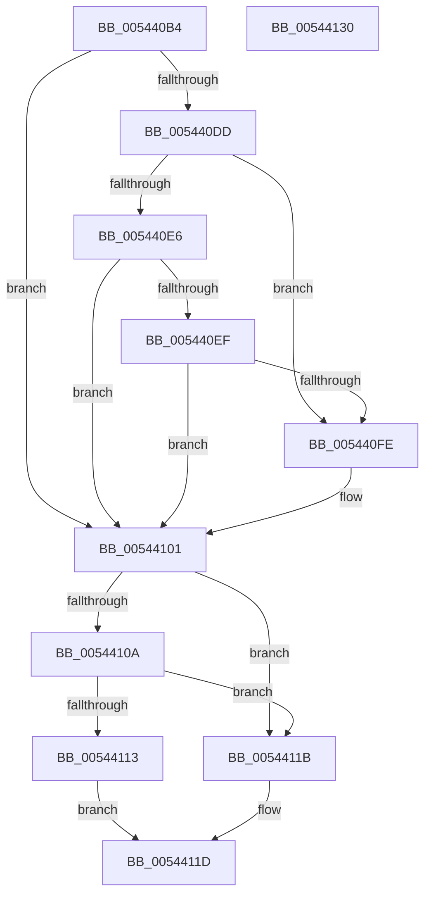

# HalpInterruptGetX2ApicPolicy

- RVA: `0x005440B4`–`0x00544131` (길이 `125` bytes)
- VA: `0x00000001405440B4`
- 실행 섹션: `.text`
- PDB 이름 있음: `예`; PDB Function 태그: `아니요`
- unwind 정보 RVA: `0x000AB2E4`
- 디코드: `38`개 명령, `125/125` bytes 표시
- 미해석 바이트: `0` (있으면 어셈블리에 `.byte`로 보존)

> 이 문서는 커널 이미지의 기계어와 PDB 기호를 분석해 생성했습니다. 4번과 5번은 함수 원형과 자료형을 바이너리 사용 방식에서 추정한 C 해석이며 원본 소스 복구 결과는 아닙니다.

## 1. Dependencies

- 직접 호출 지점: **2**; 고유 호출 대상: **2**
- 직접 호출자로 확인된 함수: **1**
- RIP 상대 이미지 참조: **4**

### Outgoing calls
- `0x005440E6` → [HalpIsMicrosoftCompatibleHvLoaded](../4A/HalpIsMicrosoftCompatibleHvLoaded_function_004AFAAC.md) (function, `0x004AFAAC`)
- `0x00544125` → [_security_check_cookie](../6A/_security_check_cookie_function_006AC640.md) (function, `0x006AC640`)

### Direct callers
- [HalSocRequestConfigurationData](../56/HalSocRequestConfigurationData_function_00562ADC.md) at `0x00562BEA`

### Static image references
- `0x005440BA` → RVA `0x00E0A740` (`.data`; read)
- `0x005440DD` → RVA `0x00E0A80C` (`.data`; read)
- `0x00544101` → RVA `0x00E0A77C` (`.data`; read)
- `0x0054410A` → RVA `0x00FC1ED0` (`.data`; read)

## 2. Other-region calls and transfers

- 다른 실행 섹션으로 향하는 call: **0**
- 별도 외부 분기/꼬리 이동을 확인하지 못했습니다.

## 3. Assembly (complete function range)

```asm
005440B4  40 53                           push rbx
005440B6  48 83 EC 40                     sub rsp, 0x40
005440BA  48 8B 05 7F 66 8C 00            mov rax, qword ptr [rip + 0x8c667f]
005440C1  48 33 C4                        xor rax, rsp
005440C4  48 89 44 24 30                  mov qword ptr [rsp + 0x30], rax
005440C9  45 33 DB                        xor r11d, r11d
005440CC  33 C9                           xor ecx, ecx
005440CE  45 8A D3                        mov r10b, r11b
005440D1  41 8D 43 01                     lea eax, [r11 + 1]
005440D5  0F A2                           cpuid
005440D7  0F BA E1 15                     bt ecx, 0x15
005440DB  73 24                           jae 0x140544101
005440DD  44 38 1D 28 67 8C 00            cmp byte ptr [rip + 0x8c6728], r11b
005440E4  75 18                           jne 0x1405440fe
005440E6  E8 C1 B9 F6 FF                  call 0x1404afaac
005440EB  84 C0                           test al, al
005440ED  74 12                           je 0x140544101
005440EF  33 C9                           xor ecx, ecx
005440F1  B8 04 00 00 40                  mov eax, 0x40000004
005440F6  0F A2                           cpuid
005440F8  0F BA E0 13                     bt eax, 0x13
005440FC  73 03                           jae 0x140544101
005440FE  41 B2 01                        mov r10b, 1
00544101  44 38 1D 74 66 8C 00            cmp byte ptr [rip + 0x8c6674], r11b
00544108  74 11                           je 0x14054411b
0054410A  44 38 1D BF DD A7 00            cmp byte ptr [rip + 0xa7ddbf], r11b
00544111  75 08                           jne 0x14054411b
00544113  45 84 D2                        test r10b, r10b
00544116  0F 95 C0                        setne al
00544119  EB 02                           jmp 0x14054411d
0054411B  32 C0                           xor al, al
0054411D  48 8B 4C 24 30                  mov rcx, qword ptr [rsp + 0x30]
00544122  48 33 CC                        xor rcx, rsp
00544125  E8 16 85 16 00                  call 0x1406ac640
0054412A  48 83 C4 40                     add rsp, 0x40
0054412E  5B                              pop rbx
0054412F  C3                              ret
00544130  CC                              int3
```

## 4. C-style interpretation (structured pseudocode)

```c
__int64 __fastcall HalpInterruptGetX2ApicPolicy(int a1)
{
    __int64 result;
    __int64 v_r10;
    __int64 v_r11;
    __int64 v_rsp;
    unsigned __int64 v_stack_m18;

    v_rsp = (v_rsp) - (64);
    result = (*(unsigned __int64 *)(v_rip + 9201279)) ^ (v_rsp);
    v_stack_m18 = result;
    v_r11 = 0;
    a1 = 0;
    if (condition_is_above_or_equal) goto loc_00544101;
    if ((*(unsigned __int8 *)(v_rip + 9201448)) != 0) goto loc_005440FE;
    result = HalpIsMicrosoftCompatibleHvLoaded(a1, a2, a3, a4);
    if ((unsigned __int8)(result) == 0) goto loc_00544101;
    a1 = 0;
    v_r10 = 0;
    if (!(condition_is_above_or_equal)) {
        v_r10 = 1;
    }
    if ((*(unsigned __int8 *)(v_rip + 9201268)) == 0) goto loc_0054411B;
    if ((*(unsigned __int8 *)(v_rip + 11001279)) != 0) goto loc_0054411B;
    result = ((unsigned __int8)(v_r10) != 0) ? 1 : 0;
    goto loc_0054411D;
loc_0054411B:
    result = 0;
loc_0054411D:
    a1 = (v_stack_m18) ^ (v_rsp);
    result = _security_check_cookie(a1, a2, a3, a4);
    v_rsp = (v_rsp) + (64);
    return result;
}
```

## 5. (Beta) C Style

```c
int64_t HalpInterruptGetX2ApicPolicy(int32_t Arg1)
{
    int64_t result;
    int64_t local_r10;
    int64_t local_r11;
    int64_t local_rsp;
    uint64_t v_stack_m18;

    local_rsp = (local_rsp) - (64);
    result = (*(uint64_t *)(v_rip + 0x8C667F)) ^ (local_rsp);
    v_stack_m18 = result;
    local_r11 = 0;
    Arg1 = 0;
    if (condition_is_above_or_equal) goto loc_00544101;
    if ((*(uint8_t *)(v_rip + 0x8C6728)) != 0) goto loc_005440FE;
    result = HalpIsMicrosoftCompatibleHvLoaded(Arg1, a2, a3, a4);
    if ((uint8_t)(result) == 0) goto loc_00544101;
    Arg1 = 0;
    local_r10 = 0;
    if (!(condition_is_above_or_equal)) {
        local_r10 = 1;
    }
    if ((*(uint8_t *)(v_rip + 0x8C6674)) == 0) goto loc_0054411B;
    if ((*(uint8_t *)(v_rip + 0xA7DDBF)) != 0) goto loc_0054411B;
    result = ((uint8_t)(local_r10) != 0) ? 1 : 0;
    goto loc_0054411D;
loc_0054411B:
    result = 0;
loc_0054411D:
    Arg1 = (v_stack_m18) ^ (local_rsp);
    result = _security_check_cookie(Arg1, a2, a3, a4);
    local_rsp = (local_rsp) + (64);
    return result;
}
```

## 6. Execution-region graph

[열기: 2D/3D 그래프와 함수 탐색 컨트롤 패널](../../../control-panel.html?section=text&rva=0x005440B4&view=graph)

- 2D 그래프는 위에서 아래로 흐르고, 3D 그래프는 빈 공간을 드래그해 회전합니다. Shift+드래그는 이동, 휠은 확대·축소, 함수 노드 선택은 대상 보고서 이동입니다.

### Static fallback


