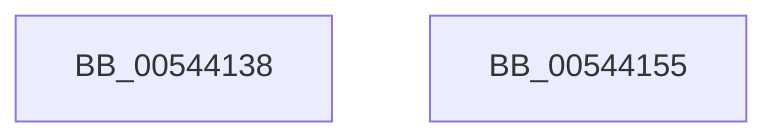

# HalpInterruptInitializeGlobals

- RVA: `0x00544138`–`0x00544156` (길이 `30` bytes)
- VA: `0x0000000140544138`
- 실행 섹션: `.text`
- PDB 이름 있음: `예`; PDB Function 태그: `아니요`
- unwind 정보 RVA: `0x000DB714`
- 디코드: `6`개 명령, `30/30` bytes 표시
- 미해석 바이트: `0` (있으면 어셈블리에 `.byte`로 보존)

> 이 문서는 커널 이미지의 기계어와 PDB 기호를 분석해 생성했습니다. 4번과 5번은 함수 원형과 자료형을 바이너리 사용 방식에서 추정한 C 해석이며 원본 소스 복구 결과는 아닙니다.

## 1. Dependencies

- 직접 호출 지점: **0**; 고유 호출 대상: **0**
- 직접 호출자로 확인된 함수: **1**
- RIP 상대 이미지 참조: **4**

### Outgoing calls
- 직접 디코드된 call 명령이 없습니다.

### Direct callers
- [HalpInterruptInitSystem](../../pagelk/B5/HalpInterruptInitSystem_function_00B5D550.md) at `0x00B5D596`

### Static image references
- `0x00544138` → RVA `0x00E101D0` (`.data`; read/write)
- `0x0054413F` → RVA `0x00FC38F0` (`.data`; read)
- `0x00544146` → RVA `0x00FC38F8` (`.data`; write)
- `0x0054414D` → RVA `0x00FC38F0` (`.data`; write)

## 2. Other-region calls and transfers

- 다른 실행 섹션으로 향하는 call: **0**
- 별도 외부 분기/꼬리 이동을 확인하지 못했습니다.

## 3. Assembly (complete function range)

```asm
00544138  83 25 91 C0 8C 00 00            and dword ptr [rip + 0x8cc091], 0
0054413F  48 8D 05 AA F7 A7 00            lea rax, [rip + 0xa7f7aa]
00544146  48 89 05 AB F7 A7 00            mov qword ptr [rip + 0xa7f7ab], rax
0054414D  48 89 05 9C F7 A7 00            mov qword ptr [rip + 0xa7f79c], rax
00544154  C3                              ret
00544155  CC                              int3
```

## 4. C-style interpretation (structured pseudocode)

```c
__int64 __fastcall HalpInterruptInitializeGlobals(void)
{
    *(unsigned __int64 *)(v_rip + 11007915) = v_rip + 11007914;
    *(unsigned __int64 *)(v_rip + 11007900) = v_rip + 11007914;
    return v_rip + 11007914;
}
```

## 5. (Beta) C Style

```c
void HalpInterruptInitializeGlobals(void)
{
    *(uint64_t *)(v_rip + 0xA7F7AB) = v_rip + 11007914;
    *(uint64_t *)(v_rip + 0xA7F79C) = v_rip + 11007914;
    return v_rip + 11007914;
}
```

## 6. Execution-region graph

[열기: 2D/3D 그래프와 함수 탐색 컨트롤 패널](../../../control-panel.html?section=text&rva=0x00544138&view=graph)

- 2D 그래프는 위에서 아래로 흐르고, 3D 그래프는 빈 공간을 드래그해 회전합니다. Shift+드래그는 이동, 휠은 확대·축소, 함수 노드 선택은 대상 보고서 이동입니다.

### Static fallback


