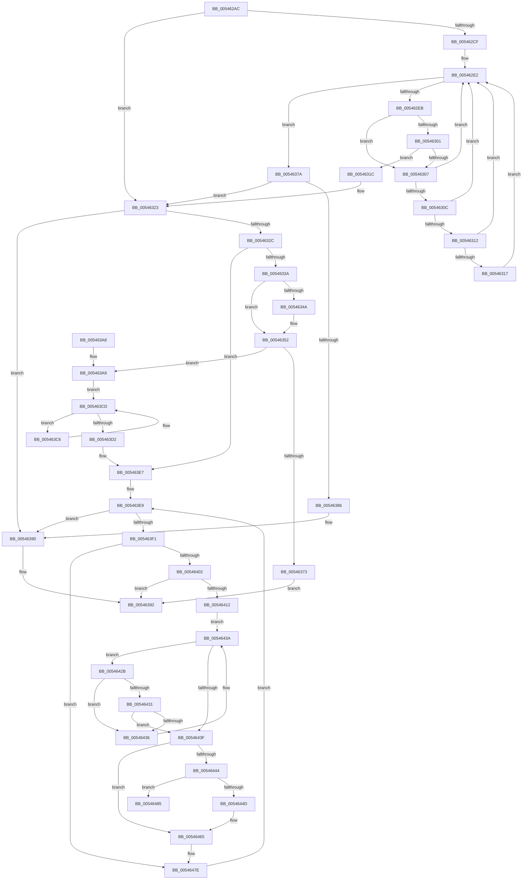

# HalpInterruptInitializeIpis

- RVA: `0x005462AC`–`0x005464A9` (길이 `509` bytes)
- VA: `0x00000001405462AC`
- 실행 섹션: `.text`
- PDB 이름 있음: `예`; PDB Function 태그: `아니요`
- unwind 정보 RVA: `0x000C3D10`
- 디코드: `132`개 명령, `509/509` bytes 표시
- 미해석 바이트: `0` (있으면 어셈블리에 `.byte`로 보존)

> 이 문서는 커널 이미지의 기계어와 PDB 기호를 분석해 생성했습니다. 4번과 5번은 함수 원형과 자료형을 바이너리 사용 방식에서 추정한 C 해석이며 원본 소스 복구 결과는 아닙니다.

## 1. Dependencies

- 직접 호출 지점: **4**; 고유 호출 대상: **4**
- 직접 호출자로 확인된 함수: **2**
- RIP 상대 이미지 참조: **17**

### Outgoing calls
- `0x0054635F` → [HalpMmAllocateMemoryInternal](HalpMmAllocateMemoryInternal_function_00544990.md) (function, `0x00544990`)
- `0x005463B1` → [memset](../6C/memset_function_006C6C40.md) (function, `0x006C6C40`)
- `0x00546409` → [KeGetProcessorNumberFromIndex](../2D/KeGetProcessorNumberFromIndex_function_002DD320.md) (function, `0x002DD320`)
- `0x005464A3` → [KeBugCheckEx](../4F/KeBugCheckEx_function_004FD660.md) (function, `0x004FD660`)

### Direct callers
- [HalpInitializeInterruptsPn](HalpInitializeInterruptsPn_function_00543E38.md) at `0x00543F31`
- [HalpInitializeInterrupts](../../init/C1/HalpInitializeInterrupts_function_00C1E4F8.md) at `0x00C1E8D8`

### Static image references
- `0x005462C5` → RVA `0x00E102D8` (`.data`; read)
- `0x005462CF` → RVA `0x00E101F0` (`.data`; read)
- `0x0054631C` → RVA `0x00E102D8` (`.data`; write)
- `0x00546323` → RVA `0x00F90698` (`.data`; read)
- `0x0054632C` → RVA `0x00E102D0` (`.data`; read)
- `0x0054633A` → RVA `0x00E101D8` (`.data`; read)
- `0x00546340` → RVA `0x00E1020C` (`.data`; read)
- `0x00546364` → RVA `0x00E102D0` (`.data`; write)
- `0x00546386` → RVA `0x00E1020C` (`.data`; write)
- `0x005463D9` → RVA `0x00E102E0` (`.data`; write)
- `0x005463E0` → RVA `0x00E102F0` (`.data`; write)
- `0x005463E9` → RVA `0x00E10200` (`.data`; read)
- `0x005463F1` → RVA `0x00E101E8` (`.data`; read)
- `0x00546422` → RVA `0x00E102E0` (`.data`; read)
- `0x00546444` → RVA `0x00E102F0` (`.data`; read)
- `0x0054644D` → RVA `0x00E102EC` (`.data`; read/write)
- `0x00546465` → RVA `0x00F231B0` (`.data`; read)

## 2. Other-region calls and transfers

- 다른 실행 섹션으로 향하는 call: **0**
- 별도 외부 분기/꼬리 이동을 확인하지 못했습니다.

## 3. Assembly (complete function range)

```asm
005462AC  48 8B C4                        mov rax, rsp
005462AF  48 89 58 10                     mov qword ptr [rax + 0x10], rbx
005462B3  48 89 70 18                     mov qword ptr [rax + 0x18], rsi
005462B7  48 89 78 20                     mov qword ptr [rax + 0x20], rdi
005462BB  41 56                           push r14
005462BD  48 83 EC 30                     sub rsp, 0x30
005462C1  83 60 08 00                     and dword ptr [rax + 8], 0
005462C5  48 83 3D 0B A0 8C 00 00         cmp qword ptr [rip + 0x8ca00b], 0
005462CD  75 54                           jne 0x140546323
005462CF  4C 8B 15 1A 9F 8C 00            mov r10, qword ptr [rip + 0x8c9f1a]
005462D6  33 C9                           xor ecx, ecx
005462D8  49 81 C2 08 01 00 00            add r10, 0x108
005462DF  4D 8B 02                        mov r8, qword ptr [r10]
005462E2  4D 3B C2                        cmp r8, r10
005462E5  0F 84 8F 00 00 00               je 0x14054637a
005462EB  49 8B D0                        mov rdx, r8
005462EE  4D 8B 00                        mov r8, qword ptr [r8]
005462F1  44 8B 4A 18                     mov r9d, dword ptr [rdx + 0x18]
005462F5  44 2B 4A 14                     sub r9d, dword ptr [rdx + 0x14]
005462F9  8B 42 20                        mov eax, dword ptr [rdx + 0x20]
005462FC  83 F8 05                        cmp eax, 5
005462FF  75 06                           jne 0x140546307
00546301  41 83 F9 01                     cmp r9d, 1
00546305  73 15                           jae 0x14054631c
00546307  83 F8 04                        cmp eax, 4
0054630A  75 D6                           jne 0x1405462e2
0054630C  41 83 F9 01                     cmp r9d, 1
00546310  72 D0                           jb 0x1405462e2
00546312  48 85 C9                        test rcx, rcx
00546315  75 CB                           jne 0x1405462e2
00546317  48 8B CA                        mov rcx, rdx
0054631A  EB C6                           jmp 0x1405462e2
0054631C  48 89 15 B5 9F 8C 00            mov qword ptr [rip + 0x8c9fb5], rdx
00546323  80 3D 6E A3 A4 00 00            cmp byte ptr [rip + 0xa4a36e], 0
0054632A  74 64                           je 0x140546390
0054632C  48 83 3D 9C 9F 8C 00 00         cmp qword ptr [rip + 0x8c9f9c], 0
00546334  0F 85 AD 00 00 00               jne 0x1405463e7
0054633A  8B 05 98 9E 8C 00               mov eax, dword ptr [rip + 0x8c9e98]
00546340  8B 3D C6 9E 8C 00               mov edi, dword ptr [rip + 0x8c9ec6]
00546346  85 C0                           test eax, eax
00546348  74 08                           je 0x140546352
0054634A  C1 E0 05                        shl eax, 5
0054634D  3B C7                           cmp eax, edi
0054634F  0F 42 F8                        cmovb edi, eax
00546352  8D 34 7F                        lea esi, [rdi + rdi*2]
00546355  BA 01 00 00 00                  mov edx, 1
0054635A  C1 E6 03                        shl esi, 3
0054635D  8B CE                           mov ecx, esi
0054635F  E8 2C E6 FF FF                  call 0x140544990
00546364  48 89 05 65 9F 8C 00            mov qword ptr [rip + 0x8c9f65], rax
0054636B  48 8B D8                        mov rbx, rax
0054636E  48 85 C0                        test rax, rax
00546371  75 36                           jne 0x1405463a9
00546373  B8 17 00 00 C0                  mov eax, 0xc0000017
00546378  EB 18                           jmp 0x140546392
0054637A  48 89 0D 57 9F 8C 00            mov qword ptr [rip + 0x8c9f57], rcx
00546381  48 85 C9                        test rcx, rcx
00546384  75 9D                           jne 0x140546323
00546386  C7 05 7C 9E 8C 00 01 00 00 00   mov dword ptr [rip + 0x8c9e7c], 1
00546390  33 C0                           xor eax, eax
00546392  48 8B 5C 24 48                  mov rbx, qword ptr [rsp + 0x48]
00546397  48 8B 74 24 50                  mov rsi, qword ptr [rsp + 0x50]
0054639C  48 8B 7C 24 58                  mov rdi, qword ptr [rsp + 0x58]
005463A1  48 83 C4 30                     add rsp, 0x30
005463A5  41 5E                           pop r14
005463A7  C3                              ret
005463A8  CC                              int3
005463A9  44 8B C6                        mov r8d, esi
005463AC  33 D2                           xor edx, edx
005463AE  48 8B CB                        mov rcx, rbx
005463B1  E8 8A 08 18 00                  call 0x1406c6c40
005463B6  8B C7                           mov eax, edi
005463B8  48 8D 0C 40                     lea rcx, [rax + rax*2]
005463BC  48 8D 04 CB                     lea rax, [rbx + rcx*8]
005463C0  48 8D 14 CB                     lea rdx, [rbx + rcx*8]
005463C4  EB 07                           jmp 0x1405463cd
005463C6  83 0B FF                        or dword ptr [rbx], 0xffffffff
005463C9  48 83 C3 18                     add rbx, 0x18
005463CD  48 3B D8                        cmp rbx, rax
005463D0  72 F4                           jb 0x1405463c6
005463D2  48 8B 05 F7 9E 8C 00            mov rax, qword ptr [rip + 0x8c9ef7]
005463D9  48 89 05 00 9F 8C 00            mov qword ptr [rip + 0x8c9f00], rax
005463E0  48 89 15 09 9F 8C 00            mov qword ptr [rip + 0x8c9f09], rdx
005463E7  33 DB                           xor ebx, ebx
005463E9  3B 1D 11 9E 8C 00               cmp ebx, dword ptr [rip + 0x8c9e11]
005463EF  73 9F                           jae 0x140546390
005463F1  48 8B 35 F0 9D 8C 00            mov rsi, qword ptr [rip + 0x8c9df0]
005463F8  48 8D 3C 5B                     lea rdi, [rbx + rbx*2]
005463FC  83 3C FE 06                     cmp dword ptr [rsi + rdi*8], 6
00546400  75 7C                           jne 0x14054647e
00546402  48 8D 54 24 40                  lea rdx, [rsp + 0x40]
00546407  8B CB                           mov ecx, ebx
00546409  E8 12 6F D9 FF                  call 0x1402dd320
0054640E  85 C0                           test eax, eax
00546410  78 80                           js 0x140546392
00546412  44 8B 44 FE 08                  mov r8d, dword ptr [rsi + rdi*8 + 8]
00546417  48 8B 15 B2 9E 8C 00            mov rdx, qword ptr [rip + 0x8c9eb2]
0054641E  8B 44 24 40                     mov eax, dword ptr [rsp + 0x40]
00546422  48 8B 0D B7 9E 8C 00            mov rcx, qword ptr [rip + 0x8c9eb7]
00546429  EB 0F                           jmp 0x14054643a
0054642B  66 39 42 10                     cmp word ptr [rdx + 0x10], ax
0054642F  75 05                           jne 0x140546436
00546431  44 39 02                        cmp dword ptr [rdx], r8d
00546434  74 09                           je 0x14054643f
00546436  48 83 C2 18                     add rdx, 0x18
0054643A  48 3B D1                        cmp rdx, rcx
0054643D  72 EC                           jb 0x14054642b
0054643F  48 3B D1                        cmp rdx, rcx
00546442  75 21                           jne 0x140546465
00546444  48 3B 15 A5 9E 8C 00            cmp rdx, qword ptr [rip + 0x8c9ea5]
0054644B  73 38                           jae 0x140546485
0054644D  FF 05 99 9E 8C 00               inc dword ptr [rip + 0x8c9e99]
00546453  48 83 C1 18                     add rcx, 0x18
00546457  44 89 02                        mov dword ptr [rdx], r8d
0054645A  48 89 0D 7F 9E 8C 00            mov qword ptr [rip + 0x8c9e7f], rcx
00546461  66 89 42 10                     mov word ptr [rdx + 0x10], ax
00546465  48 8B 05 44 CD 9D 00            mov rax, qword ptr [rip + 0x9dcd44]
0054646C  8B 0C 98                        mov ecx, dword ptr [rax + rbx*4]
0054646F  48 8B 42 08                     mov rax, qword ptr [rdx + 8]
00546473  83 E1 3F                        and ecx, 0x3f
00546476  48 0F AB C8                     bts rax, rcx
0054647A  48 89 42 08                     mov qword ptr [rdx + 8], rax
0054647E  FF C3                           inc ebx
00546480  E9 64 FF FF FF                  jmp 0x1405463e9
00546485  8B 05 4D 9D 8C 00               mov eax, dword ptr [rip + 0x8c9d4d]
0054648B  45 33 C0                        xor r8d, r8d
0054648E  49 C7 C1 05 00 00 80            mov r9, 0xffffffff80000005
00546495  48 89 44 24 20                  mov qword ptr [rsp + 0x20], rax
0054649A  BA 01 02 00 00                  mov edx, 0x201
0054649F  41 8D 48 5C                     lea ecx, [r8 + 0x5c]
005464A3  E8 B8 71 FB FF                  call 0x1404fd660
005464A8  CC                              int3
```

## 4. C-style interpretation (structured pseudocode)

```c
__int64 __fastcall HalpInterruptInitializeIpis(int a1)
{
    __int64 result;
    __int64 v_r10;
    __int64 v_rbx;
    __int64 v_rdi;
    __int64 v_rsi;
    __int64 v_rsp;
    unsigned __int64 v_stack_p10;
    unsigned __int64 v_stack_p18;
    unsigned __int64 v_stack_p20;
    unsigned __int64 v_stack_p40;

    *(unsigned __int64 *)(v_rsp + 16) = v_rbx;
    *(unsigned __int64 *)(v_rsp + 24) = v_rsi;
    *(unsigned __int64 *)(v_rsp + 32) = v_rdi;
    v_rsp = (v_rsp) - (48);
    if ((*(unsigned __int64 *)(v_rip + 9216011)) != 0) goto loc_00546323;
    a1 = 0;
    v_r10 = (*(unsigned __int64 *)(v_rip + 9215770)) + (264);
loc_005462E2:
    if ((*(unsigned __int64 *)(v_r10)) == v_r10) goto loc_0054637A;
    a4 = (unsigned int)(((unsigned int)(*(unsigned int *)(*(unsigned __int64 *)(v_r10) + 24))) - (*(unsigned int *)(*(unsigned __int64 *)(v_r10) + 20)));
    if (((unsigned int)((unsigned int)(*(unsigned int *)(*(unsigned __int64 *)(v_r10) + 32)))) != 5) goto loc_00546307;
    if (((unsigned int)(a4)) >= 1) goto loc_0054631C;
loc_00546307:
    if (((unsigned int)((unsigned int)(*(unsigned int *)(*(unsigned __int64 *)(v_r10) + 32)))) != 4) goto loc_005462E2;
    if (((unsigned int)(a4)) < 1) goto loc_005462E2;
    if (0 != 0) goto loc_005462E2;
    goto loc_005462E2;
loc_0054631C:
    *(unsigned __int64 *)(v_rip + 9215925) = *(unsigned __int64 *)(v_r10);
loc_00546323:
    if ((*(unsigned __int8 *)(v_rip + 10789742)) == 0) goto loc_00546390;
    if ((*(unsigned __int64 *)(v_rip + 9215900)) != 0) goto loc_005463E7;
    result = (unsigned int)(*(unsigned int *)(v_rip + 9215640));
    v_rdi = (unsigned int)(*(unsigned int *)(v_rip + 9215686));
    if ((unsigned int)((unsigned int)(*(unsigned int *)(v_rip + 9215640))) != 0) {
        result = (unsigned int)(((unsigned int)(*(unsigned int *)(v_rip + 9215640))) << (5));
        v_rdi = (unsigned int)(*(unsigned int *)(v_rip + 9215686));
        if (((unsigned int)(result)) < ((unsigned int)((unsigned int)(*(unsigned int *)(v_rip + 9215686))))) { v_rdi = (unsigned int)(result); }
    }
    v_rsi = (unsigned int)((v_rdi + v_rdi * 2) << (3));
    result = HalpMmAllocateMemoryInternal((unsigned int)((unsigned int)(v_rsi)), 1, *(unsigned __int64 *)(*(unsigned __int64 *)(v_r10)), a4);
    *(unsigned __int64 *)(v_rip + 9215845) = result;
    if (result != 0) goto loc_005463A9;
    goto loc_00546392;
loc_0054637A:
    *(unsigned __int64 *)(v_rip + 9215831) = (unsigned int)((unsigned int)(v_rsi));
    if ((unsigned int)((unsigned int)(v_rsi)) != 0) goto loc_00546323;
    *(unsigned int *)(v_rip + 9215612) = 1;
loc_00546390:
    result = 0;
loc_00546392:
    v_rsp = (v_rsp) + (48);
    return result;
loc_005463A9:
    a2 = 0;
    result = memset(v_stack_p10, a2, (unsigned int)((unsigned int)(v_stack_p18)), a4);
    goto loc_005463CD;
loc_005463C6:
    v_rbx = (v_stack_p10) + (24);
loc_005463CD:
    if (v_rbx < (v_stack_p10 + (unsigned int)((unsigned int)(v_stack_p20)) + (unsigned int)((unsigned int)(v_stack_p20)) * 2 * 8)) goto loc_005463C6;
    *(unsigned __int64 *)(v_rip + 9215744) = *(unsigned __int64 *)(v_rip + 9215735);
    *(unsigned __int64 *)(v_rip + 9215753) = v_stack_p10 + (unsigned int)((unsigned int)(v_stack_p20)) + (unsigned int)((unsigned int)(v_stack_p20)) * 2 * 8;
loc_005463E7:
    v_rbx = 0;
loc_005463E9:
    if (0 >= (*(unsigned int *)(v_rip + 9215505))) goto loc_00546390;
    if ((*(unsigned int *)(*(unsigned __int64 *)(v_rip + 9215472) + v_rbx + v_rbx * 2 * 8)) != 6) goto loc_0054647E;
    result = KeGetProcessorNumberFromIndex(0, v_stack_p40, (unsigned int)((unsigned int)(v_stack_p18)), a4);
    if (sign_flag) goto loc_00546392;
    goto loc_0054643A;
loc_0054642B:
    if ((*(unsigned __int16 *)(*(unsigned __int64 *)(v_rip + 9215666) + 16)) != ((unsigned __int16)((unsigned int)(v_stack_p40)))) goto loc_00546436;
    if ((*(unsigned int *)(*(unsigned __int64 *)(v_rip + 9215666))) == ((unsigned int)((unsigned int)(*(unsigned int *)(*(unsigned __int64 *)(v_rip + 9215472) + v_rbx + v_rbx * 2 * 8 + 8))))) goto loc_0054643F;
loc_00546436:
    a2 = (*(unsigned __int64 *)(v_rip + 9215666)) + (24);
loc_0054643A:
    if (a2 < (*(unsigned __int64 *)(v_rip + 9215671))) goto loc_0054642B;
loc_0054643F:
    if (a2 != (*(unsigned __int64 *)(v_rip + 9215671))) goto loc_00546465;
    if (a2 >= (*(unsigned __int64 *)(v_rip + 9215653))) goto loc_00546485;
    a1 = (*(unsigned __int64 *)(v_rip + 9215671)) + (24);
    *(unsigned int *)(a2) = (unsigned int)((unsigned int)(*(unsigned int *)(*(unsigned __int64 *)(v_rip + 9215472) + v_rbx + v_rbx * 2 * 8 + 8)));
    *(unsigned __int64 *)(v_rip + 9215615) = a1;
    *(unsigned __int16 *)(a2 + 16) = (unsigned __int16)((unsigned int)(v_stack_p40));
loc_00546465:
    a1 = (unsigned int)(((unsigned int)(*(unsigned int *)(*(unsigned __int64 *)(v_rip + 10341700) + v_rbx * 4))) & (63));
    *(unsigned __int64 *)(a2 + 8) = *(unsigned __int64 *)(a2 + 8);
loc_0054647E:
    v_rbx = (unsigned int)((v_rbx) + 1);
    goto loc_005463E9;
loc_00546485:
    a3 = 0;
    v_stack_p20 = (unsigned int)(*(unsigned int *)(v_rip + 9215309));
    result = KeBugCheckEx(a3 + 92, 513, a3, 0xFFFFFFFF80000005ULL);
    return result;
}
```

## 5. (Beta) C Style

```c
int64_t HalpInterruptInitializeIpis(int32_t Arg1)
{
    int64_t result;
    int64_t local_r10;
    int64_t local_rbx;
    int64_t local_rdi;
    int64_t local_rsi;
    int64_t local_rsp;
    uint64_t v_stack_p10;
    uint64_t v_stack_p18;
    uint64_t v_stack_p20;
    uint64_t v_stack_p40;

    *(uint64_t *)(local_rsp + 0x10) = local_rbx;
    *(uint64_t *)(local_rsp + 0x18) = local_rsi;
    *(uint64_t *)(local_rsp + 0x20) = local_rdi;
    local_rsp = (local_rsp) - (48);
    if ((*(uint64_t *)(v_rip + 0x8CA00B)) != 0) goto loc_00546323;
    Arg1 = 0;
    local_r10 = (*(uint64_t *)(v_rip + 0x8C9F1A)) + (264);
loc_005462E2:
    if ((*(uint64_t *)(local_r10)) == local_r10) goto loc_0054637A;
    a4 = (uint32_t)(((uint32_t)(*(uint32_t *)(*(uint64_t *)(local_r10) + 0x18))) - (*(uint32_t *)(*(uint64_t *)(local_r10) + 0x14)));
    if (((uint32_t)((uint32_t)(*(uint32_t *)(*(uint64_t *)(local_r10) + 0x20)))) != 5) goto loc_00546307;
    if (((uint32_t)(a4)) >= 1) goto loc_0054631C;
loc_00546307:
    if (((uint32_t)((uint32_t)(*(uint32_t *)(*(uint64_t *)(local_r10) + 0x20)))) != 4) goto loc_005462E2;
    if (((uint32_t)(a4)) < 1) goto loc_005462E2;
    if (0 != 0) goto loc_005462E2;
    goto loc_005462E2;
loc_0054631C:
    *(uint64_t *)(v_rip + 0x8C9FB5) = *(uint64_t *)(local_r10);
loc_00546323:
    if ((*(uint8_t *)(v_rip + 0xA4A36E)) == 0) goto loc_00546390;
    if ((*(uint64_t *)(v_rip + 0x8C9F9C)) != 0) goto loc_005463E7;
    result = (uint32_t)(*(uint32_t *)(v_rip + 0x8C9E98));
    local_rdi = (uint32_t)(*(uint32_t *)(v_rip + 0x8C9EC6));
    if ((uint32_t)((uint32_t)(*(uint32_t *)(v_rip + 0x8C9E98))) != 0) {
        result = (uint32_t)(((uint32_t)(*(uint32_t *)(v_rip + 0x8C9E98))) << (5));
        local_rdi = (uint32_t)(*(uint32_t *)(v_rip + 0x8C9EC6));
        if (((uint32_t)(result)) < ((uint32_t)((uint32_t)(*(uint32_t *)(v_rip + 0x8C9EC6))))) { local_rdi = (uint32_t)(result); }
    }
    local_rsi = (uint32_t)((local_rdi + local_rdi * 2) << (3));
    result = HalpMmAllocateMemoryInternal((uint32_t)((uint32_t)(local_rsi)), 1, *(uint64_t *)(*(uint64_t *)(local_r10)), a4);
    *(uint64_t *)(v_rip + 0x8C9F65) = result;
    if (result != 0) goto loc_005463A9;
    goto loc_00546392;
loc_0054637A:
    *(uint64_t *)(v_rip + 0x8C9F57) = (uint32_t)((uint32_t)(local_rsi));
    if ((uint32_t)((uint32_t)(local_rsi)) != 0) goto loc_00546323;
    *(uint32_t *)(v_rip + 0x8C9E7C) = 1;
loc_00546390:
    result = 0;
loc_00546392:
    local_rsp = (local_rsp) + (48);
    return result;
loc_005463A9:
    a2 = 0;
    result = memset(v_stack_p10, a2, (uint32_t)((uint32_t)(v_stack_p18)), a4);
    goto loc_005463CD;
loc_005463C6:
    local_rbx = (v_stack_p10) + (24);
loc_005463CD:
    if (local_rbx < (v_stack_p10 + (uint32_t)((uint32_t)(v_stack_p20)) + (uint32_t)((uint32_t)(v_stack_p20)) * 2 * 8)) goto loc_005463C6;
    *(uint64_t *)(v_rip + 0x8C9F00) = *(uint64_t *)(v_rip + 0x8C9EF7);
    *(uint64_t *)(v_rip + 0x8C9F09) = v_stack_p10 + (uint32_t)((uint32_t)(v_stack_p20)) + (uint32_t)((uint32_t)(v_stack_p20)) * 2 * 8;
loc_005463E7:
    local_rbx = 0;
loc_005463E9:
    if (0 >= (*(uint32_t *)(v_rip + 0x8C9E11))) goto loc_00546390;
    if ((*(uint32_t *)(*(uint64_t *)(v_rip + 0x8C9DF0) + local_rbx + local_rbx * 2 * 8)) != 6) goto loc_0054647E;
    result = KeGetProcessorNumberFromIndex(0, v_stack_p40, (uint32_t)((uint32_t)(v_stack_p18)), a4);
    if (sign_flag) goto loc_00546392;
    goto loc_0054643A;
loc_0054642B:
    if ((*(uint16_t *)(*(uint64_t *)(v_rip + 0x8C9EB2) + 0x10)) != ((uint16_t)((uint32_t)(v_stack_p40)))) goto loc_00546436;
    if ((*(uint32_t *)(*(uint64_t *)(v_rip + 0x8C9EB2))) == ((uint32_t)((uint32_t)(*(uint32_t *)(*(uint64_t *)(v_rip + 0x8C9DF0) + local_rbx + local_rbx * 2 * 8 + 0x8))))) goto loc_0054643F;
loc_00546436:
    a2 = (*(uint64_t *)(v_rip + 0x8C9EB2)) + (24);
loc_0054643A:
    if (a2 < (*(uint64_t *)(v_rip + 0x8C9EB7))) goto loc_0054642B;
loc_0054643F:
    if (a2 != (*(uint64_t *)(v_rip + 0x8C9EB7))) goto loc_00546465;
    if (a2 >= (*(uint64_t *)(v_rip + 0x8C9EA5))) goto loc_00546485;
    Arg1 = (*(uint64_t *)(v_rip + 0x8C9EB7)) + (24);
    *(uint32_t *)(a2) = (uint32_t)((uint32_t)(*(uint32_t *)(*(uint64_t *)(v_rip + 0x8C9DF0) + local_rbx + local_rbx * 2 * 8 + 0x8)));
    *(uint64_t *)(v_rip + 0x8C9E7F) = Arg1;
    *(uint16_t *)(a2 + 0x10) = (uint16_t)((uint32_t)(v_stack_p40));
loc_00546465:
    Arg1 = (uint32_t)(((uint32_t)(*(uint32_t *)(*(uint64_t *)(v_rip + 0x9DCD44) + local_rbx * 4))) & (63));
    *(uint64_t *)(a2 + 0x8) = *(uint64_t *)(a2 + 0x8);
loc_0054647E:
    local_rbx = (uint32_t)((local_rbx) + 1);
    goto loc_005463E9;
loc_00546485:
    a3 = 0;
    v_stack_p20 = (uint32_t)(*(uint32_t *)(v_rip + 0x8C9D4D));
    result = KeBugCheckEx(a3 + 92, 513, a3, 0xFFFFFFFF80000005ULL);
    return result;
}
```

## 6. Execution-region graph

[열기: 2D/3D 그래프와 함수 탐색 컨트롤 패널](../../../control-panel.html?section=text&rva=0x005462AC&view=graph)

- 2D 그래프는 위에서 아래로 흐르고, 3D 그래프는 빈 공간을 드래그해 회전합니다. Shift+드래그는 이동, 휠은 확대·축소, 함수 노드 선택은 대상 보고서 이동입니다.

### Static fallback


