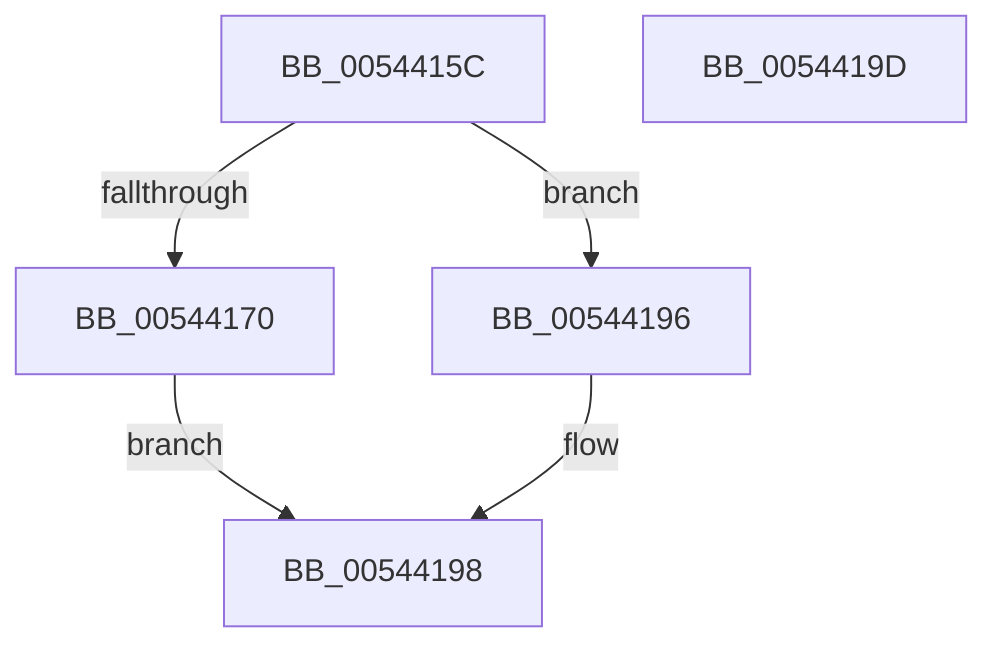

# HalpInterruptIsCmciSupported

- RVA: `0x0054415C`–`0x0054419E` (길이 `66` bytes)
- VA: `0x000000014054415C`
- 실행 섹션: `.text`
- PDB 이름 있음: `예`; PDB Function 태그: `아니요`
- unwind 정보 RVA: `0x0005C788`
- 디코드: `17`개 명령, `66/66` bytes 표시
- 미해석 바이트: `0` (있으면 어셈블리에 `.byte`로 보존)

> 이 문서는 커널 이미지의 기계어와 PDB 기호를 분석해 생성했습니다. 4번과 5번은 함수 원형과 자료형을 바이너리 사용 방식에서 추정한 C 해석이며 원본 소스 복구 결과는 아닙니다.

## 1. Dependencies

- 직접 호출 지점: **1**; 고유 호출 대상: **1**
- 직접 호출자로 확인된 함수: **1**
- RIP 상대 이미지 참조: **1**

### Outgoing calls
- `0x00544189` → [HalpInterruptFindLines](../2D/HalpInterruptFindLines_function_002D2C88.md) (function, `0x002D2C88`)

### Direct callers
- [HalpIsCmciImplemented](../../pagelk/B5/HalpIsCmciImplemented_function_00B5C314.md) at `0x00B5C32D`
- [HalpIsCmciImplemented](../../pagelk/B5/HalpIsCmciImplemented_function_00B5C314.md) at `0x00B5C33A`

### Static image references
- `0x00544160` → RVA `0x00E101F0` (`.data`; read)

## 2. Other-region calls and transfers

- 다른 실행 섹션으로 향하는 call: **0**
- 별도 외부 분기/꼬리 이동을 확인하지 못했습니다.

## 3. Assembly (complete function range)

```asm
0054415C  48 83 EC 28                     sub rsp, 0x28
00544160  48 8B 05 89 C0 8C 00            mov rax, qword ptr [rip + 0x8cc089]
00544167  83 B8 F0 00 00 00 02            cmp dword ptr [rax + 0xf0], 2
0054416E  75 26                           jne 0x140544196
00544170  8B 80 00 01 00 00               mov eax, dword ptr [rax + 0x100]
00544176  48 8D 4C 24 30                  lea rcx, [rsp + 0x30]
0054417B  33 D2                           xor edx, edx
0054417D  89 44 24 30                     mov dword ptr [rsp + 0x30], eax
00544181  C7 44 24 34 F9 FF FF FF         mov dword ptr [rsp + 0x34], 0xfffffff9
00544189  E8 FA EA D8 FF                  call 0x1402d2c88
0054418E  48 85 C0                        test rax, rax
00544191  0F 95 C0                        setne al
00544194  EB 02                           jmp 0x140544198
00544196  32 C0                           xor al, al
00544198  48 83 C4 28                     add rsp, 0x28
0054419C  C3                              ret
0054419D  CC                              int3
```

## 4. C-style interpretation (structured pseudocode)

```c
__int64 __fastcall HalpInterruptIsCmciSupported(__int64 a1, int a2)
{
    __int64 result;
    __int64 v_rsp;
    unsigned __int64 v_stack_p8;
    unsigned int v_stack_pC;

    v_rsp = (v_rsp) - (40);
    if ((*(unsigned int *)(*(unsigned __int64 *)(v_rip + 9224329) + 240)) != 2) goto loc_00544196;
    a2 = 0;
    v_stack_p8 = (unsigned int)((unsigned int)(*(unsigned int *)(*(unsigned __int64 *)(v_rip + 9224329) + 256)));
    v_stack_pC = 0xFFFFFFF9ULL;
    result = HalpInterruptFindLines(v_stack_p8, a2, a3, a4);
    result = (result != 0) ? 1 : 0;
    goto loc_00544198;
loc_00544196:
    result = 0;
loc_00544198:
    v_rsp = (v_rsp) + (40);
    return result;
}
```

## 5. (Beta) C Style

```c
int64_t HalpInterruptIsCmciSupported(int64_t Arg1, int32_t Arg2)
{
    int64_t result;
    int64_t local_rsp;
    uint64_t v_stack_p8;
    uint32_t v_stack_pC;

    local_rsp = (local_rsp) - (40);
    if ((*(uint32_t *)(*(uint64_t *)(v_rip + 0x8CC089) + 0xF0)) != 2) goto loc_00544196;
    Arg2 = 0;
    v_stack_p8 = (uint32_t)((uint32_t)(*(uint32_t *)(*(uint64_t *)(v_rip + 0x8CC089) + 0x100)));
    v_stack_pC = 0xFFFFFFF9ULL;
    result = HalpInterruptFindLines(v_stack_p8, Arg2, a3, a4);
    result = (result != 0) ? 1 : 0;
    goto loc_00544198;
loc_00544196:
    result = 0;
loc_00544198:
    local_rsp = (local_rsp) + (40);
    return result;
}
```

## 6. Execution-region graph

[열기: 2D/3D 그래프와 함수 탐색 컨트롤 패널](../../../control-panel.html?section=text&rva=0x0054415C&view=graph)

- 2D 그래프는 위에서 아래로 흐르고, 3D 그래프는 빈 공간을 드래그해 회전합니다. Shift+드래그는 이동, 휠은 확대·축소, 함수 노드 선택은 대상 보고서 이동입니다.

### Static fallback


