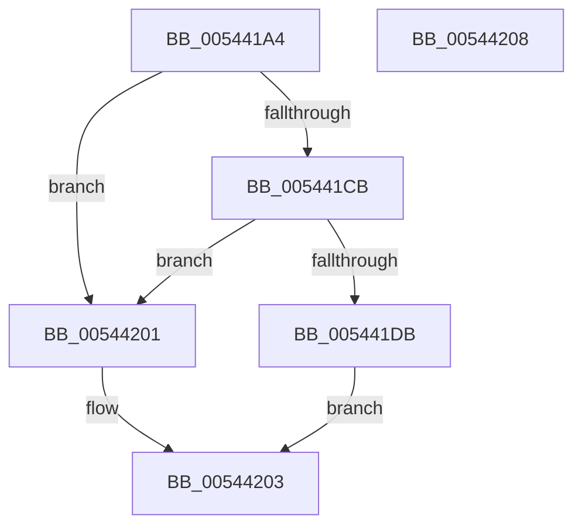

# HalpInterruptIsDeferredErrorSupported

- RVA: `0x005441A4`–`0x00544209` (길이 `101` bytes)
- VA: `0x00000001405441A4`
- 실행 섹션: `.text`
- PDB 이름 있음: `예`; PDB Function 태그: `아니요`
- unwind 정보 RVA: `0x0005C788`
- 디코드: `28`개 명령, `101/101` bytes 표시
- 미해석 바이트: `0` (있으면 어셈블리에 `.byte`로 보존)

> 이 문서는 커널 이미지의 기계어와 PDB 기호를 분석해 생성했습니다. 4번과 5번은 함수 원형과 자료형을 바이너리 사용 방식에서 추정한 C 해석이며 원본 소스 복구 결과는 아닙니다.

## 1. Dependencies

- 직접 호출 지점: **2**; 고유 호출 대상: **2**
- 직접 호출자로 확인된 함수: **1**
- RIP 상대 이미지 참조: **1**

### Outgoing calls
- `0x005441B9` → [HalpGetCpuInfo](../49/HalpGetCpuInfo_function_00498A70.md) (function, `0x00498A70`)
- `0x005441F4` → [HalpInterruptFindLines](../2D/HalpInterruptFindLines_function_002D2C88.md) (function, `0x002D2C88`)

### Direct callers
- [HalpIsCmciImplemented](../../pagelk/B5/HalpIsCmciImplemented_function_00B5C314.md) at `0x00B5C345`

### Static image references
- `0x005441CB` → RVA `0x00E101F0` (`.data`; read)

## 2. Other-region calls and transfers

- 다른 실행 섹션으로 향하는 call: **0**
- 별도 외부 분기/꼬리 이동을 확인하지 못했습니다.

## 3. Assembly (complete function range)

```asm
005441A4  48 83 EC 28                     sub rsp, 0x28
005441A8  4C 8D 4C 24 30                  lea r9, [rsp + 0x30]
005441AD  C6 44 24 30 00                  mov byte ptr [rsp + 0x30], 0
005441B2  45 33 C0                        xor r8d, r8d
005441B5  33 D2                           xor edx, edx
005441B7  33 C9                           xor ecx, ecx
005441B9  E8 B2 48 F5 FF                  call 0x140498a70
005441BE  F6 D8                           neg al
005441C0  1A C9                           sbb cl, cl
005441C2  22 4C 24 30                     and cl, byte ptr [rsp + 0x30]
005441C6  80 F9 01                        cmp cl, 1
005441C9  75 36                           jne 0x140544201
005441CB  48 8B 05 1E C0 8C 00            mov rax, qword ptr [rip + 0x8cc01e]
005441D2  83 B8 F0 00 00 00 02            cmp dword ptr [rax + 0xf0], 2
005441D9  75 26                           jne 0x140544201
005441DB  8B 80 00 01 00 00               mov eax, dword ptr [rax + 0x100]
005441E1  48 8D 4C 24 30                  lea rcx, [rsp + 0x30]
005441E6  33 D2                           xor edx, edx
005441E8  89 44 24 30                     mov dword ptr [rsp + 0x30], eax
005441EC  C7 44 24 34 F8 FF FF FF         mov dword ptr [rsp + 0x34], 0xfffffff8
005441F4  E8 8F EA D8 FF                  call 0x1402d2c88
005441F9  48 85 C0                        test rax, rax
005441FC  0F 95 C0                        setne al
005441FF  EB 02                           jmp 0x140544203
00544201  32 C0                           xor al, al
00544203  48 83 C4 28                     add rsp, 0x28
00544207  C3                              ret
00544208  CC                              int3
```

## 4. C-style interpretation (structured pseudocode)

```c
__int64 __fastcall HalpInterruptIsDeferredErrorSupported(int a1, int a2, int a3)
{
    __int64 result;
    __int64 v_rsp;
    unsigned __int64 v_stack_p8;
    unsigned int v_stack_pC;

    v_rsp = (v_rsp) - (40);
    v_stack_p8 = 0;
    a3 = 0;
    a2 = 0;
    a1 = 0;
    result = HalpGetCpuInfo(a1, a2, a3, v_stack_p8);
    result = (unsigned __int8)(-(result));
    a1 = (unsigned __int8)((a1) & (v_stack_p8));
    if (((unsigned __int8)(a1)) != 1) goto loc_00544201;
    if ((*(unsigned int *)(*(unsigned __int64 *)(v_rip + 9224222) + 240)) != 2) goto loc_00544201;
    a2 = 0;
    v_stack_p8 = (unsigned int)((unsigned int)(*(unsigned int *)(*(unsigned __int64 *)(v_rip + 9224222) + 256)));
    v_stack_pC = 0xFFFFFFF8ULL;
    result = HalpInterruptFindLines(v_stack_p8, a2, a3, v_stack_p8);
    result = (result != 0) ? 1 : 0;
    goto loc_00544203;
loc_00544201:
    result = 0;
loc_00544203:
    v_rsp = (v_rsp) + (40);
    return result;
}
```

## 5. (Beta) C Style

```c
int64_t HalpInterruptIsDeferredErrorSupported(int32_t Arg1, int32_t Arg2, int32_t Arg3)
{
    int64_t result;
    int64_t local_rsp;
    uint64_t v_stack_p8;
    uint32_t v_stack_pC;

    local_rsp = (local_rsp) - (40);
    v_stack_p8 = 0;
    Arg3 = 0;
    Arg2 = 0;
    Arg1 = 0;
    result = HalpGetCpuInfo(Arg1, Arg2, Arg3, v_stack_p8);
    result = (uint8_t)(-(result));
    Arg1 = (uint8_t)((Arg1) & (v_stack_p8));
    if (((uint8_t)(Arg1)) != 1) goto loc_00544201;
    if ((*(uint32_t *)(*(uint64_t *)(v_rip + 0x8CC01E) + 0xF0)) != 2) goto loc_00544201;
    Arg2 = 0;
    v_stack_p8 = (uint32_t)((uint32_t)(*(uint32_t *)(*(uint64_t *)(v_rip + 0x8CC01E) + 0x100)));
    v_stack_pC = 0xFFFFFFF8ULL;
    result = HalpInterruptFindLines(v_stack_p8, Arg2, Arg3, v_stack_p8);
    result = (result != 0) ? 1 : 0;
    goto loc_00544203;
loc_00544201:
    result = 0;
loc_00544203:
    local_rsp = (local_rsp) + (40);
    return result;
}
```

## 6. Execution-region graph

[열기: 2D/3D 그래프와 함수 탐색 컨트롤 패널](../../../control-panel.html?section=text&rva=0x005441A4&view=graph)

- 2D 그래프는 위에서 아래로 흐르고, 3D 그래프는 빈 공간을 드래그해 회전합니다. Shift+드래그는 이동, 휠은 확대·축소, 함수 노드 선택은 대상 보고서 이동입니다.

### Static fallback


