# HalpInterruptMarkProcessorStarted

- RVA: `0x005436A8`–`0x00543869` (길이 `449` bytes)
- VA: `0x00000001405436A8`
- 실행 섹션: `.text`
- PDB 이름 있음: `예`; PDB Function 태그: `아니요`
- unwind 정보 RVA: `0x000C3BD4`
- 디코드: `118`개 명령, `449/449` bytes 표시
- 미해석 바이트: `0` (있으면 어셈블리에 `.byte`로 보존)

> 이 문서는 커널 이미지의 기계어와 PDB 기호를 분석해 생성했습니다. 4번과 5번은 함수 원형과 자료형을 바이너리 사용 방식에서 추정한 C 해석이며 원본 소스 복구 결과는 아닙니다.

## 1. Dependencies

- 직접 호출 지점: **0**; 고유 호출 대상: **0**
- 직접 호출자로 확인된 함수: **1**
- RIP 상대 이미지 참조: **9**

### Outgoing calls
- 직접 디코드된 call 명령이 없습니다.

### Direct callers
- [HalpInterruptInitializeLocalUnit](../55/HalpInterruptInitializeLocalUnit_function_00557A2C.md) at `0x00557AEF`

### Static image references
- `0x005436C3` → RVA `0x00FC3E38` (`.data`; read)
- `0x00543732` → RVA `0x00E10200` (`.data`; read)
- `0x0054374B` → RVA `0x00FC3E30` (`.data`; read)
- `0x00543765` → RVA `0x00FC3E50` (`.data`; read)
- `0x00543798` → RVA `0x00E0A774` (`.data`; read/write)
- `0x0054380F` → RVA `0x00FC3E10` (`.data`; read)
- `0x0054383C` → RVA `0x00FC3E3C` (`.data`; read/write)
- `0x00543843` → RVA `0x00FC3E48` (`.data`; read)
- `0x0054384B` → RVA `0x00FC3E48` (`.data`; write)

## 2. Other-region calls and transfers

- 다른 실행 섹션으로 향하는 call: **0**
- 별도 외부 분기/꼬리 이동을 확인하지 못했습니다.

## 3. Assembly (complete function range)

```asm
005436A8  48 89 5C 24 08                  mov qword ptr [rsp + 8], rbx
005436AD  48 89 6C 24 18                  mov qword ptr [rsp + 0x18], rbp
005436B2  48 89 74 24 20                  mov qword ptr [rsp + 0x20], rsi
005436B7  57                              push rdi
005436B8  41 54                           push r12
005436BA  41 56                           push r14
005436BC  41 57                           push r15
005436BE  45 33 FF                        xor r15d, r15d
005436C1  8B F9                           mov edi, ecx
005436C3  44 38 3D 6E 07 A8 00            cmp byte ptr [rip + 0xa8076e], r15b
005436CA  44 89 7C 24 30                  mov dword ptr [rsp + 0x30], r15d
005436CF  0F 84 7C 01 00 00               je 0x140543851
005436D5  65 48 8B 04 25 20 00 00 00      mov rax, qword ptr gs:[0x20]
005436DE  45 8D 67 01                     lea r12d, [r15 + 1]
005436E2  41 8A EF                        mov bpl, r15b
005436E5  45 8A CF                        mov r9b, r15b
005436E8  45 8B D7                        mov r10d, r15d
005436EB  0F B6 B0 D0 00 00 00            movzx esi, byte ptr [rax + 0xd0]
005436F2  65 48 8B 04 25 20 00 00 00      mov rax, qword ptr gs:[0x20]
005436FB  65 48 8B 14 25 20 00 00 00      mov rdx, qword ptr gs:[0x20]
00543704  66 89 74 24 30                  mov word ptr [rsp + 0x30], si
00543709  44 8A B0 D1 00 00 00            mov r14b, byte ptr [rax + 0xd1]
00543710  65 48 8B 04 25 20 00 00 00      mov rax, qword ptr gs:[0x20]
00543719  44 88 74 24 32                  mov byte ptr [rsp + 0x32], r14b
0054371E  8B 98 A0 00 00 00               mov ebx, dword ptr [rax + 0xa0]
00543724  0F AF 9A A4 00 00 00            imul ebx, dword ptr [rdx + 0xa4]
0054372B  8B 44 24 30                     mov eax, dword ptr [rsp + 0x30]
0054372F  41 2B DC                        sub ebx, r12d
00543732  44 39 3D C7 CA 8C 00            cmp dword ptr [rip + 0x8ccac7], r15d
00543739  F7 D3                           not ebx
0054373B  0F 84 BD 00 00 00               je 0x1405437fe
00543741  45 8B C2                        mov r8d, r10d
00543744  45 8A DF                        mov r11b, r15b
00543747  49 C1 E0 06                     shl r8, 6
0054374B  4C 03 05 DE 06 A8 00            add r8, qword ptr [rip + 0xa806de]
00543752  45 38 78 0C                     cmp byte ptr [r8 + 0xc], r15b
00543756  75 0A                           jne 0x140543762
00543758  66 85 F6                        test si, si
0054375B  75 08                           jne 0x140543765
0054375D  45 84 F6                        test r14b, r14b
00543760  75 03                           jne 0x140543765
00543762  45 8A DC                        mov r11b, r12b
00543765  83 3D E4 06 A8 00 03            cmp dword ptr [rip + 0xa806e4], 3
0054376C  72 18                           jb 0x140543786
0054376E  49 8B 48 30                     mov rcx, qword ptr [r8 + 0x30]
00543772  48 C1 E9 08                     shr rcx, 8
00543776  8B D1                           mov edx, ecx
00543778  41 33 50 30                     xor edx, dword ptr [r8 + 0x30]
0054377C  81 E2 FF FF FF 00               and edx, 0xffffff
00543782  33 D1                           xor edx, ecx
00543784  EB 03                           jmp 0x140543789
00543786  41 8B 10                        mov edx, dword ptr [r8]
00543789  45 84 DB                        test r11b, r11b
0054378C  74 3D                           je 0x1405437cb
0054378E  3B D7                           cmp edx, edi
00543790  75 39                           jne 0x1405437cb
00543792  45 38 78 0D                     cmp byte ptr [r8 + 0xd], r15b
00543796  75 08                           jne 0x1405437a0
00543798  F0 44 01 25 D4 6F 8C 00         lock add dword ptr [rip + 0x8c6fd4], r12d
005437A0  45 88 60 0F                     mov byte ptr [r8 + 0xf], r12b
005437A4  45 88 60 0D                     mov byte ptr [r8 + 0xd], r12b
005437A8  41 89 40 10                     mov dword ptr [r8 + 0x10], eax
005437AC  65 8B 0C 25 A4 01 00 00         mov ecx, dword ptr gs:[0x1a4]
005437B4  41 89 48 14                     mov dword ptr [r8 + 0x14], ecx
005437B8  66 85 F6                        test si, si
005437BB  75 09                           jne 0x1405437c6
005437BD  45 84 F6                        test r14b, r14b
005437C0  75 04                           jne 0x1405437c6
005437C2  45 88 60 0C                     mov byte ptr [r8 + 0xc], r12b
005437C6  41 8A EC                        mov bpl, r12b
005437C9  EB 1E                           jmp 0x1405437e9
005437CB  45 38 78 0D                     cmp byte ptr [r8 + 0xd], r15b
005437CF  74 13                           je 0x1405437e4
005437D1  8B D3                           mov edx, ebx
005437D3  45 0F B6 C9                     movzx r9d, r9b
005437D7  41 23 10                        and edx, dword ptr [r8]
005437DA  8B CB                           mov ecx, ebx
005437DC  23 CF                           and ecx, edi
005437DE  3B D1                           cmp edx, ecx
005437E0  45 0F 44 CC                     cmove r9d, r12d
005437E4  40 84 ED                        test bpl, bpl
005437E7  74 05                           je 0x1405437ee
005437E9  45 84 C9                        test r9b, r9b
005437EC  75 10                           jne 0x1405437fe
005437EE  45 03 D4                        add r10d, r12d
005437F1  44 3B 15 08 CA 8C 00            cmp r10d, dword ptr [rip + 0x8cca08]
005437F8  0F 82 43 FF FF FF               jb 0x140543741
005437FE  41 8B D7                        mov edx, r15d
00543801  3B 15 F9 C9 8C 00               cmp edx, dword ptr [rip + 0x8cc9f9]
00543807  73 2E                           jae 0x140543837
00543809  8B CA                           mov ecx, edx
0054380B  48 C1 E1 06                     shl rcx, 6
0054380F  48 03 0D FA 05 A8 00            add rcx, qword ptr [rip + 0xa805fa]
00543816  44 38 79 0C                     cmp byte ptr [rcx + 0xc], r15b
0054381A  74 04                           je 0x140543820
0054381C  39 39                           cmp dword ptr [rcx], edi
0054381E  74 05                           je 0x140543825
00543820  41 03 D4                        add edx, r12d
00543823  EB DC                           jmp 0x140543801
00543825  44 88 61 0D                     mov byte ptr [rcx + 0xd], r12b
00543829  89 41 10                        mov dword ptr [rcx + 0x10], eax
0054382C  65 8B 04 25 A4 01 00 00         mov eax, dword ptr gs:[0x1a4]
00543834  89 41 14                        mov dword ptr [rcx + 0x14], eax
00543837  45 84 C9                        test r9b, r9b
0054383A  75 07                           jne 0x140543843
0054383C  44 01 25 F9 05 A8 00            add dword ptr [rip + 0xa805f9], r12d
00543843  3B 35 FF 05 A8 00               cmp esi, dword ptr [rip + 0xa805ff]
00543849  76 06                           jbe 0x140543851
0054384B  89 35 F7 05 A8 00               mov dword ptr [rip + 0xa805f7], esi
00543851  48 8B 5C 24 28                  mov rbx, qword ptr [rsp + 0x28]
00543856  48 8B 6C 24 38                  mov rbp, qword ptr [rsp + 0x38]
0054385B  48 8B 74 24 40                  mov rsi, qword ptr [rsp + 0x40]
00543860  41 5F                           pop r15
00543862  41 5E                           pop r14
00543864  41 5C                           pop r12
00543866  5F                              pop rdi
00543867  C3                              ret
00543868  CC                              int3
```

## 4. C-style interpretation (structured pseudocode)

```c
__int64 __fastcall HalpInterruptMarkProcessorStarted(int a1)
{
    __int64 v_r10;
    __int64 v_r11;
    __int64 v_r15;
    __int64 v_rbx;
    unsigned int v_stack_p10;
    unsigned __int8 v_stack_p12;
    unsigned __int64 v_stack_p18;
    unsigned __int64 v_stack_p20;
    unsigned __int64 v_stack_p8;

    v_stack_p8 = v_rbx;
    v_stack_p18 = v_rbp;
    v_stack_p20 = v_rsi;
    v_r15 = 0;
    v_stack_p10 = 0;
    if ((*(unsigned __int8 *)(v_rip + 11011950)) == 0) goto loc_00543851;
    v_stack_p10 = (unsigned __int16)(*(unsigned __int8 *)(*(unsigned __int64 *)(gs_base + (0 + 32)) + 208));
    v_stack_p12 = (unsigned __int8)(*(unsigned __int8 *)(*(unsigned __int64 *)(gs_base + (0 + 32)) + 209));
    v_rbx = (unsigned int)(((unsigned int)(*(unsigned int *)(*(unsigned __int64 *)(gs_base + (0 + 32)) + 160))) * (*(unsigned int *)(*(unsigned __int64 *)(gs_base + (0 + 32)) + 164)));
    v_rbx = (unsigned int)((v_rbx) - ((unsigned int)(v_r15 + 1)));
    v_rbx = (unsigned int)(~(v_rbx));
    if ((*(unsigned int *)(v_rip + 9226951)) == 0) goto loc_005437FE;
loc_00543741:
    a3 = (0) << (6);
    a3 = (a3) + (*(unsigned __int64 *)(v_rip + 11011806));
    if ((*(unsigned __int8 *)(a3 + 12)) != 0) goto loc_00543762;
    if ((unsigned __int16)(*(unsigned __int8 *)(*(unsigned __int64 *)(gs_base + (0 + 32)) + 208)) != 0) goto loc_00543765;
    v_r11 = 0;
    if ((unsigned __int8)(*(unsigned __int8 *)(*(unsigned __int64 *)(gs_base + (0 + 32)) + 209)) == 0) {
        v_r11 = (unsigned __int8)(v_r15 + 1);
    }
    if ((*(unsigned int *)(v_rip + 11011812)) < 3) goto loc_00543786;
    a1 = (*(unsigned __int64 *)(a3 + 48)) >> (8);
    a2 = (unsigned int)(((unsigned int)(a1)) ^ (*(unsigned int *)(a3 + 48)));
    a2 = (unsigned int)((a2) & (0xFFFFFFULL));
    a2 = (unsigned int)((a2) ^ (a1));
    goto loc_00543789;
loc_00543786:
loc_00543789:
    if ((unsigned __int8)(v_r11) == 0) goto loc_005437CB;
    if (((unsigned int)((unsigned int)(*(unsigned int *)(a3)))) != ((unsigned int)((unsigned int)(a1)))) goto loc_005437CB;
    if ((*(unsigned __int8 *)(a3 + 13)) == 0) {
    }
    *(unsigned __int8 *)(a3 + 15) = (unsigned __int8)(v_r15 + 1);
    *(unsigned __int8 *)(a3 + 13) = (unsigned __int8)(v_r15 + 1);
    *(unsigned int *)(a3 + 16) = (unsigned int)((unsigned int)(v_stack_p10));
    *(unsigned int *)(a3 + 20) = (unsigned int)((unsigned int)(*(unsigned int *)(gs_base + (0 + 420))));
    if ((unsigned __int16)(*(unsigned __int8 *)(*(unsigned __int64 *)(gs_base + (0 + 32)) + 208)) != 0) goto loc_005437C6;
    if ((unsigned __int8)(*(unsigned __int8 *)(*(unsigned __int64 *)(gs_base + (0 + 32)) + 209)) == 0) {
        *(unsigned __int8 *)(a3 + 12) = (unsigned __int8)(v_r15 + 1);
    }
    goto loc_005437E9;
loc_005437CB:
    if ((*(unsigned __int8 *)(a3 + 13)) != 0) {
        a2 = (unsigned int)(v_rbx);
        a4 = 0;
        a2 = (unsigned int)((a2) & (*(unsigned int *)(a3)));
        a1 = (unsigned int)(v_rbx);
        a1 = (unsigned int)((a1) & ((unsigned int)((unsigned int)(a1))));
        if (((unsigned int)(a2)) == a1) { a4 = (unsigned int)(v_r15 + 1); }
    }
    if ((unsigned __int8)((unsigned __int8)(v_r15 + 1)) == 0) goto loc_005437EE;
loc_005437E9:
    if ((unsigned __int8)(a4) != 0) goto loc_005437FE;
loc_005437EE:
    v_r10 = (unsigned int)((0) + ((unsigned int)(v_r15 + 1)));
    if (((unsigned int)(v_r10)) < (*(unsigned int *)(v_rip + 9226760))) goto loc_00543741;
loc_005437FE:
loc_00543801:
    if (0 >= (*(unsigned int *)(v_rip + 9226745))) goto loc_00543837;
    a1 = (0) << (6);
    a1 = (a1) + (*(unsigned __int64 *)(v_rip + 11011578));
    if ((*(unsigned __int8 *)(a1 + 12)) == 0) goto loc_00543820;
    if ((*(unsigned int *)(a1)) == ((unsigned int)((unsigned int)(a1)))) goto loc_00543825;
loc_00543820:
    a2 = (unsigned int)((0) + ((unsigned int)(v_r15 + 1)));
    goto loc_00543801;
loc_00543825:
    *(unsigned __int8 *)(a1 + 13) = (unsigned __int8)(v_r15 + 1);
    *(unsigned int *)(a1 + 16) = (unsigned int)((unsigned int)(v_stack_p10));
    *(unsigned int *)(a1 + 20) = (unsigned int)((unsigned int)(*(unsigned int *)(gs_base + (0 + 420))));
loc_00543837:
    if ((unsigned __int8)(a4) == 0) {
    }
    if (((unsigned int)(*(unsigned __int8 *)(*(unsigned __int64 *)(gs_base + (0 + 32)) + 208))) >= = (*(unsigned int *)(v_rip + 11011583))) {
        *(unsigned int *)(v_rip + 11011575) = (unsigned int)(*(unsigned __int8 *)(*(unsigned __int64 *)(gs_base + (0 + 32)) + 208));
    }
    return (unsigned int)(*(unsigned int *)(gs_base + (0 + 420)));
}
```

## 5. (Beta) C Style

```c
int64_t HalpInterruptMarkProcessorStarted(int32_t Arg1)
{
    int64_t local_r10;
    int64_t local_r11;
    int64_t local_r15;
    int64_t local_rbx;
    uint32_t v_stack_p10;
    uint8_t v_stack_p12;
    uint64_t v_stack_p18;
    uint64_t v_stack_p20;
    uint64_t v_stack_p8;

    v_stack_p8 = local_rbx;
    v_stack_p18 = local_rbp;
    v_stack_p20 = local_rsi;
    local_r15 = 0;
    v_stack_p10 = 0;
    if ((*(uint8_t *)(v_rip + 0xA8076E)) == 0) goto loc_00543851;
    v_stack_p10 = (uint16_t)(*(uint8_t *)(*(uint64_t *)(gs_base + (0 + 0x20)) + 0xD0));
    v_stack_p12 = (uint8_t)(*(uint8_t *)(*(uint64_t *)(gs_base + (0 + 0x20)) + 0xD1));
    local_rbx = (uint32_t)(((uint32_t)(*(uint32_t *)(*(uint64_t *)(gs_base + (0 + 0x20)) + 0xA0))) * (*(uint32_t *)(*(uint64_t *)(gs_base + (0 + 0x20)) + 0xA4)));
    local_rbx = (uint32_t)((local_rbx) - ((uint32_t)(local_r15 + 1)));
    local_rbx = (uint32_t)(~(local_rbx));
    if ((*(uint32_t *)(v_rip + 0x8CCAC7)) == 0) goto loc_005437FE;
loc_00543741:
    a3 = (0) << (6);
    a3 = (a3) + (*(uint64_t *)(v_rip + 0xA806DE));
    if ((*(uint8_t *)(a3 + 0xC)) != 0) goto loc_00543762;
    if ((uint16_t)(*(uint8_t *)(*(uint64_t *)(gs_base + (0 + 0x20)) + 0xD0)) != 0) goto loc_00543765;
    local_r11 = 0;
    if ((uint8_t)(*(uint8_t *)(*(uint64_t *)(gs_base + (0 + 0x20)) + 0xD1)) == 0) {
        local_r11 = (uint8_t)(local_r15 + 1);
    }
    if ((*(uint32_t *)(v_rip + 0xA806E4)) < 3) goto loc_00543786;
    Arg1 = (*(uint64_t *)(a3 + 0x30)) >> (8);
    a2 = (uint32_t)(((uint32_t)(Arg1)) ^ (*(uint32_t *)(a3 + 0x30)));
    a2 = (uint32_t)((a2) & (0xFFFFFFULL));
    a2 = (uint32_t)((a2) ^ (Arg1));
    goto loc_00543789;
loc_00543786:
loc_00543789:
    if ((uint8_t)(local_r11) == 0) goto loc_005437CB;
    if (((uint32_t)((uint32_t)(*(uint32_t *)(a3)))) != ((uint32_t)((uint32_t)(Arg1)))) goto loc_005437CB;
    if ((*(uint8_t *)(a3 + 0xD)) == 0) {
    }
    *(uint8_t *)(a3 + 0xF) = (uint8_t)(local_r15 + 1);
    *(uint8_t *)(a3 + 0xD) = (uint8_t)(local_r15 + 1);
    *(uint32_t *)(a3 + 0x10) = (uint32_t)((uint32_t)(v_stack_p10));
    *(uint32_t *)(a3 + 0x14) = (uint32_t)((uint32_t)(*(uint32_t *)(gs_base + (0 + 0x1A4))));
    if ((uint16_t)(*(uint8_t *)(*(uint64_t *)(gs_base + (0 + 0x20)) + 0xD0)) != 0) goto loc_005437C6;
    if ((uint8_t)(*(uint8_t *)(*(uint64_t *)(gs_base + (0 + 0x20)) + 0xD1)) == 0) {
        *(uint8_t *)(a3 + 0xC) = (uint8_t)(local_r15 + 1);
    }
    goto loc_005437E9;
loc_005437CB:
    if ((*(uint8_t *)(a3 + 0xD)) != 0) {
        a2 = (uint32_t)(local_rbx);
        a4 = 0;
        a2 = (uint32_t)((a2) & (*(uint32_t *)(a3)));
        Arg1 = (uint32_t)(local_rbx);
        Arg1 = (uint32_t)((Arg1) & ((uint32_t)((uint32_t)(Arg1))));
        if (((uint32_t)(a2)) == Arg1) { a4 = (uint32_t)(local_r15 + 1); }
    }
    if ((uint8_t)((uint8_t)(local_r15 + 1)) == 0) goto loc_005437EE;
loc_005437E9:
    if ((uint8_t)(a4) != 0) goto loc_005437FE;
loc_005437EE:
    local_r10 = (uint32_t)((0) + ((uint32_t)(local_r15 + 1)));
    if (((uint32_t)(local_r10)) < (*(uint32_t *)(v_rip + 0x8CCA08))) goto loc_00543741;
loc_005437FE:
loc_00543801:
    if (0 >= (*(uint32_t *)(v_rip + 0x8CC9F9))) goto loc_00543837;
    Arg1 = (0) << (6);
    Arg1 = (Arg1) + (*(uint64_t *)(v_rip + 0xA805FA));
    if ((*(uint8_t *)(Arg1 + 0xC)) == 0) goto loc_00543820;
    if ((*(uint32_t *)(Arg1)) == ((uint32_t)((uint32_t)(Arg1)))) goto loc_00543825;
loc_00543820:
    a2 = (uint32_t)((0) + ((uint32_t)(local_r15 + 1)));
    goto loc_00543801;
loc_00543825:
    *(uint8_t *)(Arg1 + 0xD) = (uint8_t)(local_r15 + 1);
    *(uint32_t *)(Arg1 + 0x10) = (uint32_t)((uint32_t)(v_stack_p10));
    *(uint32_t *)(Arg1 + 0x14) = (uint32_t)((uint32_t)(*(uint32_t *)(gs_base + (0 + 0x1A4))));
loc_00543837:
    if ((uint8_t)(a4) == 0) {
    }
    if (((uint32_t)(*(uint8_t *)(*(uint64_t *)(gs_base + (0 + 0x20)) + 0xD0))) >= = (*(uint32_t *)(v_rip + 0xA805FF))) {
        *(uint32_t *)(v_rip + 0xA805F7) = (uint32_t)(*(uint8_t *)(*(uint64_t *)(gs_base + (0 + 0x20)) + 0xD0));
    }
    return (uint32_t)(*(uint32_t *)(gs_base + (0 + 0x1A4)));
}
```

## 6. Execution-region graph

[열기: 2D/3D 그래프와 함수 탐색 컨트롤 패널](../../../control-panel.html?section=text&rva=0x005436A8&view=graph)

- 2D 그래프는 위에서 아래로 흐르고, 3D 그래프는 빈 공간을 드래그해 회전합니다. Shift+드래그는 이동, 휠은 확대·축소, 함수 노드 선택은 대상 보고서 이동입니다.

### Static fallback

```mermaid
flowchart TD
  bb_005436A8[BB_005436A8]
  bb_005436D5[BB_005436D5]
  bb_00543741[BB_00543741]
  bb_00543758[BB_00543758]
  bb_0054375D[BB_0054375D]
  bb_00543762[BB_00543762]
  bb_00543765[BB_00543765]
  bb_0054376E[BB_0054376E]
  bb_00543786[BB_00543786]
  bb_00543789[BB_00543789]
  bb_0054378E[BB_0054378E]
  bb_00543792[BB_00543792]
  bb_00543798[BB_00543798]
  bb_005437A0[BB_005437A0]
  bb_005437BD[BB_005437BD]
  bb_005437C2[BB_005437C2]
  bb_005437C6[BB_005437C6]
  bb_005437CB[BB_005437CB]
  bb_005437D1[BB_005437D1]
  bb_005437E4[BB_005437E4]
  bb_005437E9[BB_005437E9]
  bb_005437EE[BB_005437EE]
  bb_005437FE[BB_005437FE]
  bb_00543801[BB_00543801]
  bb_00543809[BB_00543809]
  bb_0054381C[BB_0054381C]
  bb_00543820[BB_00543820]
  bb_00543825[BB_00543825]
  bb_00543837[BB_00543837]
  bb_0054383C[BB_0054383C]
  bb_00543843[BB_00543843]
  bb_0054384B[BB_0054384B]
  bb_00543851[BB_00543851]
  bb_00543868[BB_00543868]
  bb_005436A8 -->|branch| bb_00543851
  bb_005436A8 -->|fallthrough| bb_005436D5
  bb_005436D5 -->|branch| bb_005437FE
  bb_005436D5 -->|fallthrough| bb_00543741
  bb_00543741 -->|branch| bb_00543762
  bb_00543741 -->|fallthrough| bb_00543758
  bb_00543758 -->|branch| bb_00543765
  bb_00543758 -->|fallthrough| bb_0054375D
  bb_0054375D -->|branch| bb_00543765
  bb_0054375D -->|fallthrough| bb_00543762
  bb_00543762 -->|flow| bb_00543765
  bb_00543765 -->|branch| bb_00543786
  bb_00543765 -->|fallthrough| bb_0054376E
  bb_0054376E -->|branch| bb_00543789
  bb_00543786 -->|flow| bb_00543789
  bb_00543789 -->|branch| bb_005437CB
  bb_00543789 -->|fallthrough| bb_0054378E
  bb_0054378E -->|branch| bb_005437CB
  bb_0054378E -->|fallthrough| bb_00543792
  bb_00543792 -->|branch| bb_005437A0
  bb_00543792 -->|fallthrough| bb_00543798
  bb_00543798 -->|flow| bb_005437A0
  bb_005437A0 -->|branch| bb_005437C6
  bb_005437A0 -->|fallthrough| bb_005437BD
  bb_005437BD -->|branch| bb_005437C6
  bb_005437BD -->|fallthrough| bb_005437C2
  bb_005437C2 -->|flow| bb_005437C6
  bb_005437C6 -->|branch| bb_005437E9
  bb_005437CB -->|branch| bb_005437E4
  bb_005437CB -->|fallthrough| bb_005437D1
  bb_005437D1 -->|flow| bb_005437E4
  bb_005437E4 -->|branch| bb_005437EE
  bb_005437E4 -->|fallthrough| bb_005437E9
  bb_005437E9 -->|branch| bb_005437FE
  bb_005437E9 -->|fallthrough| bb_005437EE
  bb_005437EE -->|branch| bb_00543741
  bb_005437EE -->|fallthrough| bb_005437FE
  bb_005437FE -->|flow| bb_00543801
  bb_00543801 -->|branch| bb_00543837
  bb_00543801 -->|fallthrough| bb_00543809
  bb_00543809 -->|branch| bb_00543820
  bb_00543809 -->|fallthrough| bb_0054381C
  bb_0054381C -->|branch| bb_00543825
  bb_0054381C -->|fallthrough| bb_00543820
  bb_00543820 -->|branch| bb_00543801
  bb_00543825 -->|flow| bb_00543837
  bb_00543837 -->|branch| bb_00543843
  bb_00543837 -->|fallthrough| bb_0054383C
  bb_0054383C -->|flow| bb_00543843
  bb_00543843 -->|branch| bb_00543851
  bb_00543843 -->|fallthrough| bb_0054384B
  bb_0054384B -->|flow| bb_00543851
```


