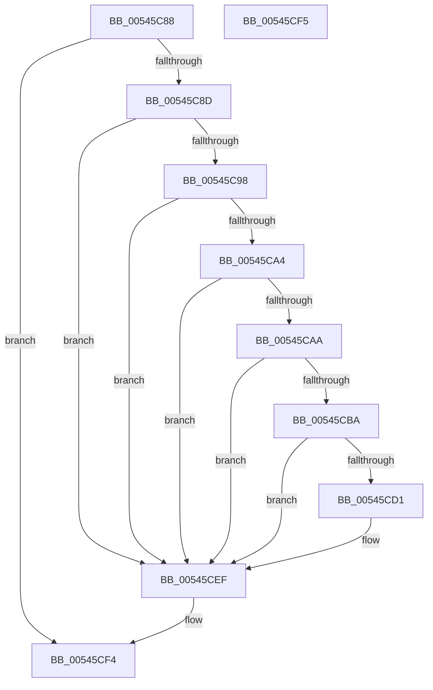

# HalpInterruptPerformDirectedEndOfInterrupt

- RVA: `0x00545C88`–`0x00545CF6` (길이 `110` bytes)
- VA: `0x0000000140545C88`
- 실행 섹션: `.text`
- PDB 이름 있음: `예`; PDB Function 태그: `아니요`
- unwind 정보 RVA: `0x000805BC`
- 디코드: `31`개 명령, `110/110` bytes 표시
- 미해석 바이트: `0` (있으면 어셈블리에 `.byte`로 보존)

> 이 문서는 커널 이미지의 기계어와 PDB 기호를 분석해 생성했습니다. 4번과 5번은 함수 원형과 자료형을 바이너리 사용 방식에서 추정한 C 해석이며 원본 소스 복구 결과는 아닙니다.

## 1. Dependencies

- 직접 호출 지점: **3**; 고유 호출 대상: **3**
- 직접 호출자로 확인된 함수: **2**
- RIP 상대 이미지 참조: **0**

### Outgoing calls
- `0x00545CB0` → [HalpInterruptFindLinesForGsiRange](../2D/HalpInterruptFindLinesForGsiRange_function_002D204C.md) (function, `0x002D204C`)
- `0x00545CBD` → [HalpInterruptLookupController](../2D/HalpInterruptLookupController_function_002D20D4.md) (function, `0x002D20D4`)
- `0x00545CEA` → [guard_dispatch_icall](../6B/guard_dispatch_icall_function_006BAAD0.md) (function, `0x006BAAD0`)

### Direct callers
- [HalPerformEndOfInterrupt](../41/HalPerformEndOfInterrupt_function_00418E20.md) at `0x00418E5A`
- [HvlPerformEndOfInterrupt](../48/HvlPerformEndOfInterrupt_function_004855F0.md) at `0x00485649`

### Static image references
- 디코드된 RIP-relative 메모리 참조가 없습니다.

## 2. Other-region calls and transfers

- 다른 실행 섹션으로 향하는 call: **0**
- 별도 외부 분기/꼬리 이동을 확인하지 못했습니다.

## 3. Assembly (complete function range)

```asm
00545C88  48 85 C9                        test rcx, rcx
00545C8B  74 67                           je 0x140545cf4
00545C8D  53                              push rbx
00545C8E  48 83 EC 20                     sub rsp, 0x20
00545C92  83 79 6C 00                     cmp dword ptr [rcx + 0x6c], 0
00545C96  75 57                           jne 0x140545cef
00545C98  48 8B 99 A0 00 00 00            mov rbx, qword ptr [rcx + 0xa0]
00545C9F  48 85 DB                        test rbx, rbx
00545CA2  74 4B                           je 0x140545cef
00545CA4  83 7B 08 00                     cmp dword ptr [rbx + 8], 0
00545CA8  75 45                           jne 0x140545cef
00545CAA  8B 4B 40                        mov ecx, dword ptr [rbx + 0x40]
00545CAD  8D 51 01                        lea edx, [rcx + 1]
00545CB0  E8 97 C3 D8 FF                  call 0x1402d204c
00545CB5  48 85 C0                        test rax, rax
00545CB8  74 35                           je 0x140545cef
00545CBA  8B 48 10                        mov ecx, dword ptr [rax + 0x10]
00545CBD  E8 12 C4 D8 FF                  call 0x1402d20d4
00545CC2  4C 8B C8                        mov r9, rax
00545CC5  F7 80 F4 00 00 00 00 04 00 00   test dword ptr [rax + 0xf4], 0x400
00545CCF  74 1E                           je 0x140545cef
00545CD1  44 8B 43 30                     mov r8d, dword ptr [rbx + 0x30]
00545CD5  48 8B 80 C8 00 00 00            mov rax, qword ptr [rax + 0xc8]
00545CDC  41 81 E0 FF FF FF 3F            and r8d, 0x3fffffff
00545CE3  8B 53 0C                        mov edx, dword ptr [rbx + 0xc]
00545CE6  49 8B 49 10                     mov rcx, qword ptr [r9 + 0x10]
00545CEA  E8 E1 4D 17 00                  call 0x1406baad0
00545CEF  48 83 C4 20                     add rsp, 0x20
00545CF3  5B                              pop rbx
00545CF4  C3                              ret
00545CF5  CC                              int3
```

## 4. C-style interpretation (structured pseudocode)

```c
__int64 __fastcall HalpInterruptPerformDirectedEndOfInterrupt(__int64 a1)
{
    __int64 result;
    __int64 v_rsp;

    if (a1 == 0) goto loc_00545CF4;
    v_rsp = (v_rsp) - (32);
    if ((*(unsigned int *)(a1 + 108)) != 0) goto loc_00545CEF;
    if (*(unsigned __int64 *)(a1 + 160) == 0) goto loc_00545CEF;
    if ((*(unsigned int *)(*(unsigned __int64 *)(a1 + 160) + 8)) != 0) goto loc_00545CEF;
    result = HalpInterruptFindLinesForGsiRange((unsigned int)(*(unsigned int *)(*(unsigned __int64 *)(a1 + 160) + 64)), (unsigned int)(*(unsigned int *)(*(unsigned __int64 *)(a1 + 160) + 64)) + 1, a3, a4);
    if (result == 0) goto loc_00545CEF;
    result = HalpInterruptLookupController((unsigned int)(*(unsigned int *)(result + 16)), (unsigned int)(*(unsigned int *)(*(unsigned __int64 *)(a1 + 160) + 64)) + 1, a3, a4);
    if (((*(unsigned int *)(result + 244)) & (0x400ULL)) != 0) {
        a3 = *(unsigned int *)(*(unsigned __int64 *)(a1 + 160) + 48);
        result = *(unsigned __int64 *)(result + 200);
        a3 = (unsigned int)((a3) & (0x3FFFFFFFULL));
        a2 = *(unsigned int *)(*(unsigned __int64 *)(a1 + 160) + 12);
        a1 = *(unsigned __int64 *)(result + 16);
        result = guard_dispatch_icall(a1, a2, a3, result);
    }
    v_rsp = (v_rsp) + (32);
loc_00545CF4:
    return result;
}
```

## 5. (Beta) C Style

```c
int64_t HalpInterruptPerformDirectedEndOfInterrupt(int64_t Arg1)
{
    int64_t result;
    int64_t local_rsp;

    if (Arg1 == 0) goto loc_00545CF4;
    local_rsp = (local_rsp) - (32);
    if ((*(uint32_t *)(Arg1 + 0x6C)) != 0) goto loc_00545CEF;
    if (*(uint64_t *)(Arg1 + 0xA0) == 0) goto loc_00545CEF;
    if ((*(uint32_t *)(*(uint64_t *)(Arg1 + 0xA0) + 0x8)) != 0) goto loc_00545CEF;
    result = HalpInterruptFindLinesForGsiRange((uint32_t)(*(uint32_t *)(*(uint64_t *)(Arg1 + 0xA0) + 0x40)), (uint32_t)(*(uint32_t *)(*(uint64_t *)(Arg1 + 0xA0) + 0x40)) + 1, a3, a4);
    if (result == 0) goto loc_00545CEF;
    result = HalpInterruptLookupController((uint32_t)(*(uint32_t *)(result + 0x10)), (uint32_t)(*(uint32_t *)(*(uint64_t *)(Arg1 + 0xA0) + 0x40)) + 1, a3, a4);
    if (((*(uint32_t *)(result + 0xF4)) & (0x400ULL)) != 0) {
        a3 = *(uint32_t *)(*(uint64_t *)(Arg1 + 0xA0) + 0x30);
        result = *(uint64_t *)(result + 0xC8);
        a3 = (uint32_t)((a3) & (0x3FFFFFFFULL));
        a2 = *(uint32_t *)(*(uint64_t *)(Arg1 + 0xA0) + 0xC);
        Arg1 = *(uint64_t *)(result + 0x10);
        result = guard_dispatch_icall(Arg1, a2, a3, result);
    }
    local_rsp = (local_rsp) + (32);
loc_00545CF4:
    return result;
}
```

## 6. Execution-region graph

[열기: 2D/3D 그래프와 함수 탐색 컨트롤 패널](../../../control-panel.html?section=text&rva=0x00545C88&view=graph)

- 2D 그래프는 위에서 아래로 흐르고, 3D 그래프는 빈 공간을 드래그해 회전합니다. Shift+드래그는 이동, 휠은 확대·축소, 함수 노드 선택은 대상 보고서 이동입니다.

### Static fallback


