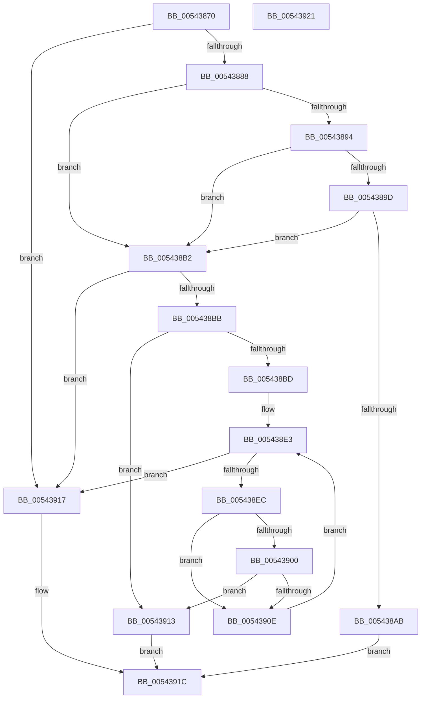

# HalpInterruptRegisterDynamicProcessor

- RVA: `0x00543870`–`0x00543922` (길이 `178` bytes)
- VA: `0x0000000140543870`
- 실행 섹션: `.text`
- PDB 이름 있음: `예`; PDB Function 태그: `아니요`
- unwind 정보 RVA: `0x0005C788`
- 디코드: `47`개 명령, `178/178` bytes 표시
- 미해석 바이트: `0` (있으면 어셈블리에 `.byte`로 보존)

> 이 문서는 커널 이미지의 기계어와 PDB 기호를 분석해 생성했습니다. 4번과 5번은 함수 원형과 자료형을 바이너리 사용 방식에서 추정한 C 해석이며 원본 소스 복구 결과는 아닙니다.

## 1. Dependencies

- 직접 호출 지점: **1**; 고유 호출 대상: **1**
- 직접 호출자로 확인된 함수: **1**
- RIP 상대 이미지 참조: **6**

### Outgoing calls
- `0x0054387A` → [HalpInterruptModel](../4A/HalpInterruptModel_function_004ACA38.md) (function, `0x004ACA38`)

### Direct callers
- [HalRegisterDynamicProcessor](HalRegisterDynamicProcessor_function_00545E10.md) at `0x00545E14`

### Static image references
- `0x0054388B` → RVA `0x00E10204` (`.data`; read)
- `0x00543894` → RVA `0x00F90698` (`.data`; read)
- `0x0054389D` → RVA `0x00E0A818` (`.data`; read)
- `0x005438A3` → RVA `0x00E10200` (`.data`; read)
- `0x005438B2` → RVA `0x00FC3E3C` (`.data`; read)
- `0x005438F3` → RVA `0x00FC3E30` (`.data`; read)

## 2. Other-region calls and transfers

- 다른 실행 섹션으로 향하는 call: **0**
- 별도 외부 분기/꼬리 이동을 확인하지 못했습니다.

## 3. Assembly (complete function range)

```asm
00543870  48 83 EC 28                     sub rsp, 0x28
00543874  44 8B CA                        mov r9d, edx
00543877  44 8B C1                        mov r8d, ecx
0054387A  E8 B9 91 F6 FF                  call 0x1404aca38
0054387F  83 F8 01                        cmp eax, 1
00543882  0F 85 8F 00 00 00               jne 0x140543917
00543888  45 33 D2                        xor r10d, r10d
0054388B  44 38 15 72 C9 8C 00            cmp byte ptr [rip + 0x8cc972], r10b
00543892  75 1E                           jne 0x1405438b2
00543894  44 38 15 FD CD A4 00            cmp byte ptr [rip + 0xa4cdfd], r10b
0054389B  75 15                           jne 0x1405438b2
0054389D  8B 05 75 6F 8C 00               mov eax, dword ptr [rip + 0x8c6f75]
005438A3  39 05 57 C9 8C 00               cmp dword ptr [rip + 0x8cc957], eax
005438A9  76 07                           jbe 0x1405438b2
005438AB  B8 18 00 00 C0                  mov eax, 0xc0000018
005438B0  EB 6A                           jmp 0x14054391c
005438B2  44 39 05 83 05 A8 00            cmp dword ptr [rip + 0xa80583], r8d
005438B9  77 5C                           ja 0x140543917
005438BB  72 56                           jb 0x140543913
005438BD  65 48 8B 0C 25 20 00 00 00      mov rcx, qword ptr gs:[0x20]
005438C6  45 8B C2                        mov r8d, r10d
005438C9  65 48 8B 04 25 20 00 00 00      mov rax, qword ptr gs:[0x20]
005438D2  8B 90 A0 00 00 00               mov edx, dword ptr [rax + 0xa0]
005438D8  0F AF 91 A4 00 00 00            imul edx, dword ptr [rcx + 0xa4]
005438DF  FF CA                           dec edx
005438E1  F7 D2                           not edx
005438E3  44 3B 05 16 C9 8C 00            cmp r8d, dword ptr [rip + 0x8cc916]
005438EA  73 2B                           jae 0x140543917
005438EC  41 8B C8                        mov ecx, r8d
005438EF  48 C1 E1 06                     shl rcx, 6
005438F3  48 03 0D 36 05 A8 00            add rcx, qword ptr [rip + 0xa80536]
005438FA  44 38 51 0D                     cmp byte ptr [rcx + 0xd], r10b
005438FE  74 0E                           je 0x14054390e
00543900  8B 49 08                        mov ecx, dword ptr [rcx + 8]
00543903  8B C2                           mov eax, edx
00543905  23 CA                           and ecx, edx
00543907  41 23 C1                        and eax, r9d
0054390A  3B C8                           cmp ecx, eax
0054390C  74 05                           je 0x140543913
0054390E  41 FF C0                        inc r8d
00543911  EB D0                           jmp 0x1405438e3
00543913  33 C0                           xor eax, eax
00543915  EB 05                           jmp 0x14054391c
00543917  B8 01 00 00 C0                  mov eax, 0xc0000001
0054391C  48 83 C4 28                     add rsp, 0x28
00543920  C3                              ret
00543921  CC                              int3
```

## 4. C-style interpretation (structured pseudocode)

```c
__int64 __fastcall HalpInterruptRegisterDynamicProcessor(int a1, int a2)
{
    __int64 result;
    __int64 v_r10;
    __int64 v_rsp;

    v_rsp = (v_rsp) - (40);
    result = HalpInterruptModel(a1, a2, (unsigned int)(a1), (unsigned int)(a2));
    if (((unsigned int)(result)) != 1) goto loc_00543917;
    v_r10 = 0;
    if ((*(unsigned __int8 *)(v_rip + 9226610)) != 0) goto loc_005438B2;
    if ((*(unsigned __int8 *)(v_rip + 10800637)) != 0) goto loc_005438B2;
    if ((*(unsigned int *)(v_rip + 9226583)) <= ((unsigned int)((unsigned int)(*(unsigned int *)(v_rip + 9203573))))) goto loc_005438B2;
    goto loc_0054391C;
loc_005438B2:
    if ((*(unsigned int *)(v_rip + 11011459)) > ((unsigned int)((unsigned int)(a1)))) goto loc_00543917;
    if ((*(unsigned int *)(v_rip + 11011459)) < ((unsigned int)((unsigned int)(a1)))) goto loc_00543913;
    a2 = (unsigned int)(((unsigned int)(*(unsigned int *)(*(unsigned __int64 *)(gs_base + (0 + 32)) + 160))) * (*(unsigned int *)(*(unsigned __int64 *)(gs_base + (0 + 32)) + 164)));
    a2 = (unsigned int)((a2) - 1);
    a2 = (unsigned int)(~(a2));
loc_005438E3:
    if (0 >= (*(unsigned int *)(v_rip + 9226518))) goto loc_00543917;
    a1 = (0) << (6);
    a1 = (a1) + (*(unsigned __int64 *)(v_rip + 11011382));
    if ((*(unsigned __int8 *)(a1 + 13)) == 0) goto loc_0054390E;
    a1 = (unsigned int)(((unsigned int)(*(unsigned int *)(a1 + 8))) & (a2));
    result = (unsigned int)(((unsigned int)(a2)) & ((unsigned int)((unsigned int)(a2))));
    if (a1 == ((unsigned int)(result))) goto loc_00543913;
loc_0054390E:
    a3 = (unsigned int)((0) + 1);
    goto loc_005438E3;
loc_00543913:
    result = 0;
    goto loc_0054391C;
loc_00543917:
loc_0054391C:
    v_rsp = (v_rsp) + (40);
    return (unsigned int)(0xC0000001ULL);
}
```

## 5. (Beta) C Style

```c
int64_t HalpInterruptRegisterDynamicProcessor(int32_t Arg1, int32_t Arg2)
{
    int64_t result;
    int64_t local_r10;
    int64_t local_rsp;

    local_rsp = (local_rsp) - (40);
    result = HalpInterruptModel(Arg1, Arg2, (uint32_t)(Arg1), (uint32_t)(Arg2));
    if (((uint32_t)(result)) != 1) goto loc_00543917;
    local_r10 = 0;
    if ((*(uint8_t *)(v_rip + 0x8CC972)) != 0) goto loc_005438B2;
    if ((*(uint8_t *)(v_rip + 0xA4CDFD)) != 0) goto loc_005438B2;
    if ((*(uint32_t *)(v_rip + 0x8CC957)) <= ((uint32_t)((uint32_t)(*(uint32_t *)(v_rip + 0x8C6F75))))) goto loc_005438B2;
    goto loc_0054391C;
loc_005438B2:
    if ((*(uint32_t *)(v_rip + 0xA80583)) > ((uint32_t)((uint32_t)(Arg1)))) goto loc_00543917;
    if ((*(uint32_t *)(v_rip + 0xA80583)) < ((uint32_t)((uint32_t)(Arg1)))) goto loc_00543913;
    Arg2 = (uint32_t)(((uint32_t)(*(uint32_t *)(*(uint64_t *)(gs_base + (0 + 0x20)) + 0xA0))) * (*(uint32_t *)(*(uint64_t *)(gs_base + (0 + 0x20)) + 0xA4)));
    Arg2 = (uint32_t)((Arg2) - 1);
    Arg2 = (uint32_t)(~(Arg2));
loc_005438E3:
    if (0 >= (*(uint32_t *)(v_rip + 0x8CC916))) goto loc_00543917;
    Arg1 = (0) << (6);
    Arg1 = (Arg1) + (*(uint64_t *)(v_rip + 0xA80536));
    if ((*(uint8_t *)(Arg1 + 0xD)) == 0) goto loc_0054390E;
    Arg1 = (uint32_t)(((uint32_t)(*(uint32_t *)(Arg1 + 0x8))) & (Arg2));
    result = (uint32_t)(((uint32_t)(Arg2)) & ((uint32_t)((uint32_t)(Arg2))));
    if (Arg1 == ((uint32_t)(result))) goto loc_00543913;
loc_0054390E:
    a3 = (uint32_t)((0) + 1);
    goto loc_005438E3;
loc_00543913:
    result = 0;
    goto loc_0054391C;
loc_00543917:
loc_0054391C:
    local_rsp = (local_rsp) + (40);
    return (uint32_t)(0xC0000001ULL);
}
```

## 6. Execution-region graph

[열기: 2D/3D 그래프와 함수 탐색 컨트롤 패널](../../../control-panel.html?section=text&rva=0x00543870&view=graph)

- 2D 그래프는 위에서 아래로 흐르고, 3D 그래프는 빈 공간을 드래그해 회전합니다. Shift+드래그는 이동, 휠은 확대·축소, 함수 노드 선택은 대상 보고서 이동입니다.

### Static fallback


