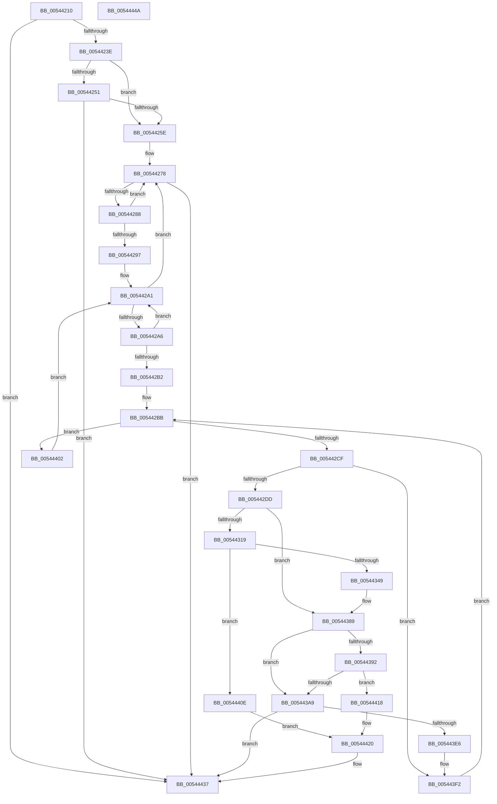

# HalpInterruptRemapFixedLines

- RVA: `0x00544210`–`0x0054444B` (길이 `571` bytes)
- VA: `0x0000000140544210`
- 실행 섹션: `.text`
- PDB 이름 있음: `예`; PDB Function 태그: `아니요`
- unwind 정보 RVA: `0x000C3C34`
- 디코드: `140`개 명령, `571/571` bytes 표시
- 미해석 바이트: `0` (있으면 어셈블리에 `.byte`로 보존)

> 이 문서는 커널 이미지의 기계어와 PDB 기호를 분석해 생성했습니다. 4번과 5번은 함수 원형과 자료형을 바이너리 사용 방식에서 추정한 C 해석이며 원본 소스 복구 결과는 아닙니다.

## 1. Dependencies

- 직접 호출 지점: **7**; 고유 호출 대상: **7**
- 직접 호출자로 확인된 함수: **1**
- RIP 상대 이미지 참조: **6**

### Outgoing calls
- `0x0054433A` → [HalpIrtAllocateIndex](../../page/70/HalpIrtAllocateIndex_function_0070A9D4.md) (function, `0x0070A9D4`)
- `0x00544377` → [HalpIommuUpdateRemappingTableEntry](../48/HalpIommuUpdateRemappingTableEntry_function_0048ABC8.md) (function, `0x0048ABC8`)
- `0x0054439E` → [HalpHvMapIoApicDeviceInterrupt](../../pagelk/B5/HalpHvMapIoApicDeviceInterrupt_function_00B5C858.md) (function, `0x00B5C858`)
- `0x005443B0` → [HalpAcquireHighLevelLock](../2D/HalpAcquireHighLevelLock_function_002D2390.md) (function, `0x002D2390`)
- `0x005443CA` → [HalpInterruptSetLineStateInternal](../2D/HalpInterruptSetLineStateInternal_function_002D2104.md) (function, `0x002D2104`)
- `0x005443DA` → [HalpReleaseHighLevelLock](../2D/HalpReleaseHighLevelLock_function_002D1C58.md) (function, `0x002D1C58`)
- `0x00544432` → [HalpInterruptSetProblemEx](../48/HalpInterruptSetProblemEx_function_0048AC8C.md) (function, `0x0048AC8C`)

### Direct callers
- [HalpInitializeInterruptsBspLate](HalpInitializeInterruptsBspLate_function_00543D70.md) at `0x00543E27`

### Static image references
- `0x00544226` → RVA `0x00E101C8` (`.data`; read)
- `0x0054423E` → RVA `0x00E101F0` (`.data`; read)
- `0x00544251` → RVA `0x00FC1CA8` (`.data`; read)
- `0x0054425E` → RVA `0x00FC38F0` (`.data`; read)
- `0x005443A9` → RVA `0x00FC19A8` (`.data`; read)
- `0x00544420` → RVA `0x00023C30` (`.rdata`; read)

## 2. Other-region calls and transfers

- 다른 실행 섹션으로 향하는 call: **2**
  - `0x0054433A` → [HalpIrtAllocateIndex](../../page/70/HalpIrtAllocateIndex_function_0070A9D4.md) (`.text` → `PAGE`)
  - `0x0054439E` → [HalpHvMapIoApicDeviceInterrupt](../../pagelk/B5/HalpHvMapIoApicDeviceInterrupt_function_00B5C858.md) (`.text` → `PAGELK`)
- 별도 외부 분기/꼬리 이동을 확인하지 못했습니다.

## 3. Assembly (complete function range)

```asm
00544210  48 8B C4                        mov rax, rsp
00544213  53                              push rbx
00544214  55                              push rbp
00544215  56                              push rsi
00544216  57                              push rdi
00544217  41 54                           push r12
00544219  41 55                           push r13
0054421B  41 56                           push r14
0054421D  41 57                           push r15
0054421F  48 83 EC 58                     sub rsp, 0x58
00544223  45 33 C0                        xor r8d, r8d
00544226  44 39 05 9B BF 8C 00            cmp dword ptr [rip + 0x8cbf9b], r8d
0054422D  41 8B F8                        mov edi, r8d
00544230  44 89 40 08                     mov dword ptr [rax + 8], r8d
00544234  4C 89 40 18                     mov qword ptr [rax + 0x18], r8
00544238  0F 84 F9 01 00 00               je 0x140544437
0054423E  48 8B 05 AB BF 8C 00            mov rax, qword ptr [rip + 0x8cbfab]
00544245  F7 80 F4 00 00 00 00 01 00 00   test dword ptr [rax + 0xf4], 0x100
0054424F  75 0D                           jne 0x14054425e
00544251  4C 39 05 50 DA A7 00            cmp qword ptr [rip + 0xa7da50], r8
00544258  0F 84 D9 01 00 00               je 0x140544437
0054425E  4C 8B 35 8B F6 A7 00            mov r14, qword ptr [rip + 0xa7f68b]
00544265  0F 57 C0                        xorps xmm0, xmm0
00544268  0F 11 44 24 40                  movups xmmword ptr [rsp + 0x40], xmm0
0054426D  8B 5C 24 40                     mov ebx, dword ptr [rsp + 0x40]
00544271  89 9C 24 A8 00 00 00            mov dword ptr [rsp + 0xa8], ebx
00544278  48 8D 05 71 F6 A7 00            lea rax, [rip + 0xa7f671]
0054427F  4C 3B F0                        cmp r14, rax
00544282  0F 84 AF 01 00 00               je 0x140544437
00544288  49 8B F6                        mov rsi, r14
0054428B  4D 8B 36                        mov r14, qword ptr [r14]
0054428E  83 BE F0 00 00 00 02            cmp dword ptr [rsi + 0xf0], 2
00544295  75 E1                           jne 0x140544278
00544297  48 8D 86 08 01 00 00            lea rax, [rsi + 0x108]
0054429E  4C 8B 38                        mov r15, qword ptr [rax]
005442A1  4C 3B F8                        cmp r15, rax
005442A4  74 D2                           je 0x140544278
005442A6  49 8B EF                        mov rbp, r15
005442A9  4D 8B 3F                        mov r15, qword ptr [r15]
005442AC  83 7D 20 02                     cmp dword ptr [rbp + 0x20], 2
005442B0  75 EF                           jne 0x1405442a1
005442B2  45 8B E0                        mov r12d, r8d
005442B5  49 8B D0                        mov rdx, r8
005442B8  4D 8B E8                        mov r13, r8
005442BB  8B 4D 18                        mov ecx, dword ptr [rbp + 0x18]
005442BE  2B 4D 14                        sub ecx, dword ptr [rbp + 0x14]
005442C1  48 89 54 24 40                  mov qword ptr [rsp + 0x40], rdx
005442C6  44 3B E1                        cmp r12d, ecx
005442C9  0F 8D 33 01 00 00               jge 0x140544402
005442CF  48 8B 45 30                     mov rax, qword ptr [rbp + 0x30]
005442D3  46 38 04 28                     cmp byte ptr [rax + r13], r8b
005442D7  0F 84 15 01 00 00               je 0x1405443f2
005442DD  8B 86 00 01 00 00               mov eax, dword ptr [rsi + 0x100]
005442E3  89 84 24 B0 00 00 00            mov dword ptr [rsp + 0xb0], eax
005442EA  8B 4D 14                        mov ecx, dword ptr [rbp + 0x14]
005442ED  48 8B 05 FC BE 8C 00            mov rax, qword ptr [rip + 0x8cbefc]
005442F4  41 03 CC                        add ecx, r12d
005442F7  89 8C 24 B4 00 00 00            mov dword ptr [rsp + 0xb4], ecx
005442FE  48 8B 7D 28                     mov rdi, qword ptr [rbp + 0x28]
00544302  48 03 FA                        add rdi, rdx
00544305  F7 80 F4 00 00 00 00 01 00 00   test dword ptr [rax + 0xf4], 0x100
0054430F  48 89 BC 24 B8 00 00 00         mov qword ptr [rsp + 0xb8], rdi
00544317  74 70                           je 0x140544389
00544319  4C 89 44 24 30                  mov qword ptr [rsp + 0x30], r8
0054431E  48 8D 8C 24 A0 00 00 00         lea rcx, [rsp + 0xa0]
00544326  44 88 44 24 28                  mov byte ptr [rsp + 0x28], r8b
0054432B  45 33 C9                        xor r9d, r9d
0054432E  4C 89 44 24 20                  mov qword ptr [rsp + 0x20], r8
00544333  45 33 C0                        xor r8d, r8d
00544336  41 8D 51 01                     lea edx, [r9 + 1]
0054433A  E8 95 66 1C 00                  call 0x14070a9d4
0054433F  8B F8                           mov edi, eax
00544341  85 C0                           test eax, eax
00544343  0F 88 C5 00 00 00               js 0x14054440e
00544349  8B 84 24 A0 00 00 00            mov eax, dword ptr [rsp + 0xa0]
00544350  B9 FF FF FF 3F                  mov ecx, 0x3fffffff
00544355  48 8B BC 24 B8 00 00 00         mov rdi, qword ptr [rsp + 0xb8]
0054435D  23 C1                           and eax, ecx
0054435F  81 E3 00 00 00 C0               and ebx, 0xc0000000
00544365  4C 8B C7                        mov r8, rdi
00544368  0B D8                           or ebx, eax
0054436A  89 9C 24 A8 00 00 00            mov dword ptr [rsp + 0xa8], ebx
00544371  23 D9                           and ebx, ecx
00544373  8B D3                           mov edx, ebx
00544375  33 C9                           xor ecx, ecx
00544377  E8 4C 68 F4 FF                  call 0x14048abc8
0054437C  45 33 C0                        xor r8d, r8d
0054437F  C7 47 18 07 00 00 00            mov dword ptr [rdi + 0x18], 7
00544386  89 5F 20                        mov dword ptr [rdi + 0x20], ebx
00544389  4C 39 05 18 D9 A7 00            cmp qword ptr [rip + 0xa7d918], r8
00544390  74 17                           je 0x1405443a9
00544392  8B 8E 00 01 00 00               mov ecx, dword ptr [rsi + 0x100]
00544398  45 33 C0                        xor r8d, r8d
0054439B  48 8B D7                        mov rdx, rdi
0054439E  E8 B5 84 61 00                  call 0x140b5c858
005443A3  8B F8                           mov edi, eax
005443A5  85 C0                           test eax, eax
005443A7  78 6F                           js 0x140544418
005443A9  48 8D 0D F8 D5 A7 00            lea rcx, [rip + 0xa7d5f8]
005443B0  E8 DB DF D8 FF                  call 0x1402d2390
005443B5  4C 8B 84 24 B8 00 00 00         mov r8, qword ptr [rsp + 0xb8]
005443BD  48 8D 94 24 B0 00 00 00         lea rdx, [rsp + 0xb0]
005443C5  48 8B CE                        mov rcx, rsi
005443C8  8A D8                           mov bl, al
005443CA  E8 35 DD D8 FF                  call 0x1402d2104
005443CF  8A D3                           mov dl, bl
005443D1  48 8D 0D D0 D5 A7 00            lea rcx, [rip + 0xa7d5d0]
005443D8  8B F8                           mov edi, eax
005443DA  E8 79 D8 D8 FF                  call 0x1402d1c58
005443DF  45 33 C0                        xor r8d, r8d
005443E2  85 FF                           test edi, edi
005443E4  78 51                           js 0x140544437
005443E6  48 8B 54 24 40                  mov rdx, qword ptr [rsp + 0x40]
005443EB  8B 9C 24 A8 00 00 00            mov ebx, dword ptr [rsp + 0xa8]
005443F2  41 FF C4                        inc r12d
005443F5  49 83 C5 10                     add r13, 0x10
005443F9  48 83 C2 38                     add rdx, 0x38
005443FD  E9 B9 FE FF FF                  jmp 0x1405442bb
00544402  48 8D 86 08 01 00 00            lea rax, [rsi + 0x108]
00544409  E9 93 FE FF FF                  jmp 0x1405442a1
0054440E  C7 44 24 20 98 07 00 00         mov dword ptr [rsp + 0x20], 0x798
00544416  EB 08                           jmp 0x140544420
00544418  C7 44 24 20 B4 07 00 00         mov dword ptr [rsp + 0x20], 0x7b4
00544420  4C 8D 0D 09 F8 AD FF            lea r9, [rip - 0x5207f7]
00544427  44 8B C0                        mov r8d, eax
0054442A  BA 1F 00 00 00                  mov edx, 0x1f
0054442F  48 8B CE                        mov rcx, rsi
00544432  E8 55 68 F4 FF                  call 0x14048ac8c
00544437  8B C7                           mov eax, edi
00544439  48 83 C4 58                     add rsp, 0x58
0054443D  41 5F                           pop r15
0054443F  41 5E                           pop r14
00544441  41 5D                           pop r13
00544443  41 5C                           pop r12
00544445  5F                              pop rdi
00544446  5E                              pop rsi
00544447  5D                              pop rbp
00544448  5B                              pop rbx
00544449  C3                              ret
0054444A  CC                              int3
```

## 4. C-style interpretation (structured pseudocode)

```c
__int64 __fastcall HalpInterruptRemapFixedLines(__int64 a1, __int64 a2, int a3, int a4)
{
    __int64 result;
    __int64 v_r12;
    __int64 v_r13;
    __int64 v_rbx;
    __int64 v_rdi;
    __int64 v_rsp;
    unsigned __int64 v_stack_m58;
    unsigned __int64 v_stack_m68;
    unsigned __int8 v_stack_m70;
    unsigned __int64 v_stack_m78;
    unsigned int v_stack_p10;
    unsigned int v_stack_p18;
    unsigned int v_stack_p1C;
    unsigned __int64 v_stack_p20;
    unsigned __int64 v_stack_p8;

    v_rsp = (v_rsp) - (88);
    a3 = 0;
    *(unsigned int *)(v_rsp + 8) = 0;
    *(unsigned __int64 *)(v_rsp + 24) = 0;
    if ((*(unsigned int *)(v_rip + 9224091)) == 0) goto loc_00544437;
    if (((*(unsigned int *)(*(unsigned __int64 *)(v_rip + 9224107) + 244)) & (256)) != 0) goto loc_0054425E;
    if ((*(unsigned __int64 *)(v_rip + 11000400)) == 0) goto loc_00544437;
loc_0054425E:
    v_stack_m58 = v_xmm0;
    v_stack_p10 = (unsigned int)((unsigned int)(v_stack_m58));
loc_00544278:
    if ((*(unsigned __int64 *)(v_rip + 11007627)) == (v_rip + 11007601)) goto loc_00544437;
    if ((*(unsigned int *)(*(unsigned __int64 *)(v_rip + 11007627) + 240)) != 2) goto loc_00544278;
loc_005442A1:
    if ((*(unsigned __int64 *)(*(unsigned __int64 *)(v_rip + 11007627) + 264)) == (*(unsigned __int64 *)(v_rip + 11007627) + 264)) goto loc_00544278;
    if ((*(unsigned int *)(*(unsigned __int64 *)(*(unsigned __int64 *)(v_rip + 11007627) + 264) + 32)) != 2) goto loc_005442A1;
loc_005442BB:
    a1 = (unsigned int)(((unsigned int)(*(unsigned int *)(*(unsigned __int64 *)(*(unsigned __int64 *)(v_rip + 11007627) + 264) + 24))) - (*(unsigned int *)(*(unsigned __int64 *)(*(unsigned __int64 *)(v_rip + 11007627) + 264) + 20)));
    v_stack_m58 = 0;
    if (0 >= ((unsigned int)(a1))) goto loc_00544402;
    if ((*(unsigned __int8 *)(*(unsigned __int64 *)(*(unsigned __int64 *)(*(unsigned __int64 *)(v_rip + 11007627) + 264) + 48) + 0 * 1)) == 0) goto loc_005443F2;
    v_stack_p18 = (unsigned int)((unsigned int)(*(unsigned int *)(*(unsigned __int64 *)(v_rip + 11007627) + 256)));
    a1 = (unsigned int)(((unsigned int)(*(unsigned int *)(*(unsigned __int64 *)(*(unsigned __int64 *)(v_rip + 11007627) + 264) + 20))) + (0));
    v_stack_p1C = (unsigned int)(a1);
    v_rdi = (*(unsigned __int64 *)(*(unsigned __int64 *)(*(unsigned __int64 *)(v_rip + 11007627) + 264) + 40)) + (0);
    v_stack_p20 = v_rdi;
    if (((*(unsigned int *)(*(unsigned __int64 *)(v_rip + 9223932) + 244)) & (256)) == 0) goto loc_00544389;
    v_stack_m68 = 0;
    v_stack_m70 = 0;
    a4 = 0;
    v_stack_m78 = 0;
    a3 = 0;
    result = HalpIrtAllocateIndex(v_stack_p8, a4 + 1, a3, a4);
    if (sign_flag) goto loc_0054440E;
    result = (unsigned int)(((unsigned int)(v_stack_p8)) & ((unsigned int)((unsigned int)(0x3FFFFFFFULL))));
    v_rbx = (unsigned int)(((unsigned int)(v_stack_m58)) & (0xC0000000ULL));
    v_rbx = (unsigned int)((v_rbx) | ((unsigned int)(result)));
    v_stack_p10 = (unsigned int)(v_rbx);
    v_rbx = (unsigned int)((v_rbx) & ((unsigned int)((unsigned int)(0x3FFFFFFFULL))));
    a1 = 0;
    result = HalpIommuUpdateRemappingTableEntry(a1, (unsigned int)((unsigned int)(v_rbx)), v_stack_p20, a4);
    a3 = 0;
    *(unsigned int *)(v_stack_p20 + 24) = 7;
    *(unsigned int *)(v_stack_p20 + 32) = (unsigned int)(v_rbx);
loc_00544389:
    if ((*(unsigned __int64 *)(v_rip + 11000088)) == 0) goto loc_005443A9;
    a3 = 0;
    result = HalpHvMapIoApicDeviceInterrupt((unsigned int)(*(unsigned int *)(*(unsigned __int64 *)(v_rip + 11007627) + 256)), v_stack_p20, a3, a4);
    if (sign_flag) goto loc_00544418;
loc_005443A9:
    result = HalpAcquireHighLevelLock(v_rip + 10999288, v_stack_p20, a3, a4);
    result = HalpInterruptSetLineStateInternal(*(unsigned __int64 *)(v_rip + 11007627), v_stack_p18, v_stack_p20, a4);
    result = HalpReleaseHighLevelLock(v_rip + 10999248, (unsigned __int8)((unsigned __int8)(result)), v_stack_p20, a4);
    a3 = 0;
    if (sign_flag) goto loc_00544437;
loc_005443F2:
    v_r12 = (unsigned int)((0) + 1);
    v_r13 = (0) + (16);
    a2 = (v_stack_m58) + (56);
    goto loc_005442BB;
loc_00544402:
    goto loc_005442A1;
loc_0054440E:
    v_stack_m78 = 0x798ULL;
    goto loc_00544420;
loc_00544418:
    v_stack_m78 = 0x7B4ULL;
loc_00544420:
    result = HalpInterruptSetProblemEx(*(unsigned __int64 *)(v_rip + 11007627), 31, (unsigned int)((unsigned int)(*(unsigned __int64 *)(v_rip + 11007627) + 264)), v_rip - 5375991);
loc_00544437:
    v_rsp = (v_rsp) + (88);
    return (unsigned int)((unsigned int)((unsigned int)((unsigned int)(result))));
}
```

## 5. (Beta) C Style

```c
int64_t HalpInterruptRemapFixedLines(int64_t Arg1, int64_t Arg2, int32_t Arg3, int32_t Arg4)
{
    int64_t result;
    int64_t local_r12;
    int64_t local_r13;
    int64_t local_rbx;
    int64_t local_rdi;
    int64_t local_rsp;
    uint64_t v_stack_m58;
    uint64_t v_stack_m68;
    uint8_t v_stack_m70;
    uint64_t v_stack_m78;
    uint32_t v_stack_p10;
    uint32_t v_stack_p18;
    uint32_t v_stack_p1C;
    uint64_t v_stack_p20;
    uint64_t v_stack_p8;

    local_rsp = (local_rsp) - (88);
    Arg3 = 0;
    *(uint32_t *)(local_rsp + 0x8) = 0;
    *(uint64_t *)(local_rsp + 0x18) = 0;
    if ((*(uint32_t *)(v_rip + 0x8CBF9B)) == 0) goto loc_00544437;
    if (((*(uint32_t *)(*(uint64_t *)(v_rip + 0x8CBFAB) + 0xF4)) & (256)) != 0) goto loc_0054425E;
    if ((*(uint64_t *)(v_rip + 0xA7DA50)) == 0) goto loc_00544437;
loc_0054425E:
    v_stack_m58 = v_xmm0;
    v_stack_p10 = (uint32_t)((uint32_t)(v_stack_m58));
loc_00544278:
    if ((*(uint64_t *)(v_rip + 0xA7F68B)) == (v_rip + 11007601)) goto loc_00544437;
    if ((*(uint32_t *)(*(uint64_t *)(v_rip + 0xA7F68B) + 0xF0)) != 2) goto loc_00544278;
loc_005442A1:
    if ((*(uint64_t *)(*(uint64_t *)(v_rip + 0xA7F68B) + 0x108)) == (*(uint64_t *)(v_rip + 0xA7F68B) + 264)) goto loc_00544278;
    if ((*(uint32_t *)(*(uint64_t *)(*(uint64_t *)(v_rip + 0xA7F68B) + 0x108) + 0x20)) != 2) goto loc_005442A1;
loc_005442BB:
    Arg1 = (uint32_t)(((uint32_t)(*(uint32_t *)(*(uint64_t *)(*(uint64_t *)(v_rip + 0xA7F68B) + 0x108) + 0x18))) - (*(uint32_t *)(*(uint64_t *)(*(uint64_t *)(v_rip + 0xA7F68B) + 0x108) + 0x14)));
    v_stack_m58 = 0;
    if (0 >= ((uint32_t)(Arg1))) goto loc_00544402;
    if ((*(uint8_t *)(*(uint64_t *)(*(uint64_t *)(*(uint64_t *)(v_rip + 0xA7F68B) + 0x108) + 0x30) + 0x0 * 1)) == 0) goto loc_005443F2;
    v_stack_p18 = (uint32_t)((uint32_t)(*(uint32_t *)(*(uint64_t *)(v_rip + 0xA7F68B) + 0x100)));
    Arg1 = (uint32_t)(((uint32_t)(*(uint32_t *)(*(uint64_t *)(*(uint64_t *)(v_rip + 0xA7F68B) + 0x108) + 0x14))) + (0));
    v_stack_p1C = (uint32_t)(Arg1);
    local_rdi = (*(uint64_t *)(*(uint64_t *)(*(uint64_t *)(v_rip + 0xA7F68B) + 0x108) + 0x28)) + (0);
    v_stack_p20 = local_rdi;
    if (((*(uint32_t *)(*(uint64_t *)(v_rip + 0x8CBEFC) + 0xF4)) & (256)) == 0) goto loc_00544389;
    v_stack_m68 = 0;
    v_stack_m70 = 0;
    Arg4 = 0;
    v_stack_m78 = 0;
    Arg3 = 0;
    result = HalpIrtAllocateIndex(v_stack_p8, Arg4 + 1, Arg3, Arg4);
    if (sign_flag) goto loc_0054440E;
    result = (uint32_t)(((uint32_t)(v_stack_p8)) & ((uint32_t)((uint32_t)(0x3FFFFFFFULL))));
    local_rbx = (uint32_t)(((uint32_t)(v_stack_m58)) & (0xC0000000ULL));
    local_rbx = (uint32_t)((local_rbx) | ((uint32_t)(result)));
    v_stack_p10 = (uint32_t)(local_rbx);
    local_rbx = (uint32_t)((local_rbx) & ((uint32_t)((uint32_t)(0x3FFFFFFFULL))));
    Arg1 = 0;
    result = HalpIommuUpdateRemappingTableEntry(Arg1, (uint32_t)((uint32_t)(local_rbx)), v_stack_p20, Arg4);
    Arg3 = 0;
    *(uint32_t *)(v_stack_p20 + 0x18) = 7;
    *(uint32_t *)(v_stack_p20 + 0x20) = (uint32_t)(local_rbx);
loc_00544389:
    if ((*(uint64_t *)(v_rip + 0xA7D918)) == 0) goto loc_005443A9;
    Arg3 = 0;
    result = HalpHvMapIoApicDeviceInterrupt((uint32_t)(*(uint32_t *)(*(uint64_t *)(v_rip + 0xA7F68B) + 0x100)), v_stack_p20, Arg3, Arg4);
    if (sign_flag) goto loc_00544418;
loc_005443A9:
    result = HalpAcquireHighLevelLock(v_rip + 10999288, v_stack_p20, Arg3, Arg4);
    result = HalpInterruptSetLineStateInternal(*(uint64_t *)(v_rip + 0xA7F68B), v_stack_p18, v_stack_p20, Arg4);
    result = HalpReleaseHighLevelLock(v_rip + 10999248, (uint8_t)((uint8_t)(result)), v_stack_p20, Arg4);
    Arg3 = 0;
    if (sign_flag) goto loc_00544437;
loc_005443F2:
    local_r12 = (uint32_t)((0) + 1);
    local_r13 = (0) + (16);
    Arg2 = (v_stack_m58) + (56);
    goto loc_005442BB;
loc_00544402:
    goto loc_005442A1;
loc_0054440E:
    v_stack_m78 = 0x798ULL;
    goto loc_00544420;
loc_00544418:
    v_stack_m78 = 0x7B4ULL;
loc_00544420:
    result = HalpInterruptSetProblemEx(*(uint64_t *)(v_rip + 0xA7F68B), 31, (uint32_t)((uint32_t)(*(uint64_t *)(v_rip + 0xA7F68B) + 264)), v_rip - 5375991);
loc_00544437:
    local_rsp = (local_rsp) + (88);
    return (uint32_t)((uint32_t)((uint32_t)((uint32_t)(result))));
}
```

## 6. Execution-region graph

[열기: 2D/3D 그래프와 함수 탐색 컨트롤 패널](../../../control-panel.html?section=text&rva=0x00544210&view=graph)

- 2D 그래프는 위에서 아래로 흐르고, 3D 그래프는 빈 공간을 드래그해 회전합니다. Shift+드래그는 이동, 휠은 확대·축소, 함수 노드 선택은 대상 보고서 이동입니다.

### Static fallback


