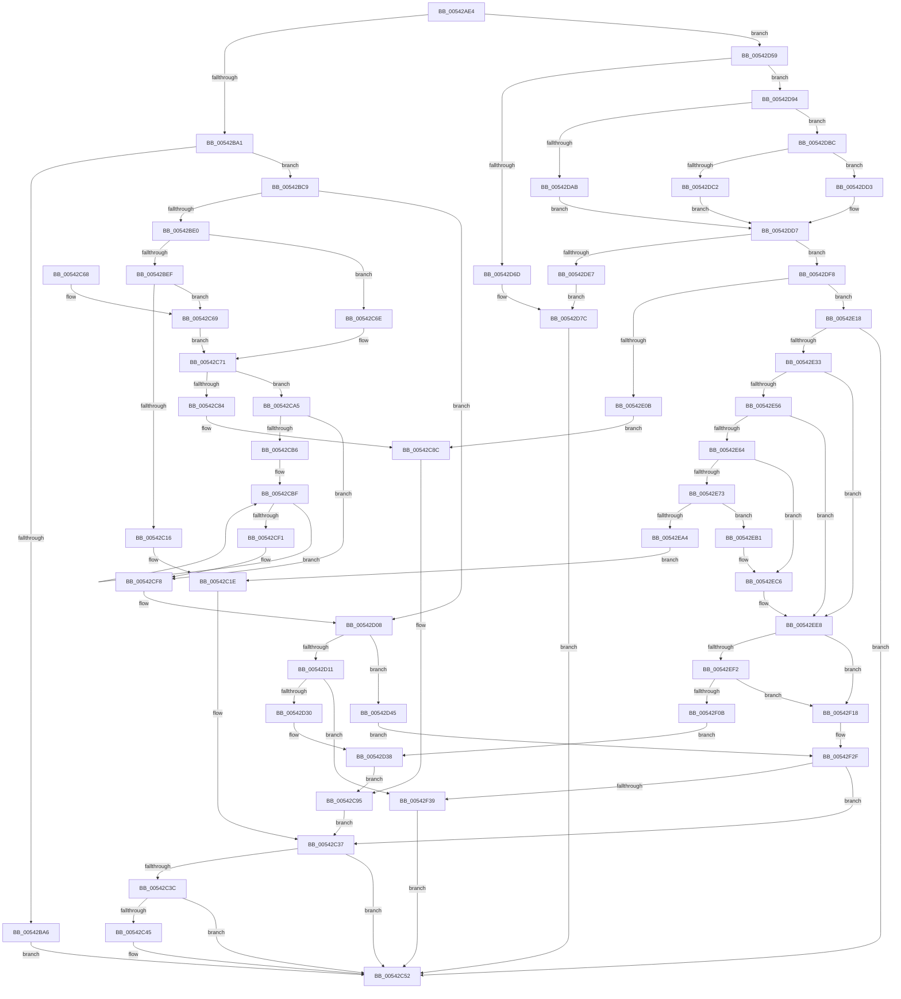

# HalpInterruptRemap

- RVA: `0x00542AE4`–`0x00542F41` (길이 `1,117` bytes)
- VA: `0x0000000140542AE4`
- 실행 섹션: `.text`
- PDB 이름 있음: `예`; PDB Function 태그: `아니요`
- unwind 정보 RVA: `0x000C3B98`
- 디코드: `294`개 명령, `1,117/1,117` bytes 표시
- 미해석 바이트: `0` (있으면 어셈블리에 `.byte`로 보존)

> 이 문서는 커널 이미지의 기계어와 PDB 기호를 분석해 생성했습니다. 4번과 5번은 함수 원형과 자료형을 바이너리 사용 방식에서 추정한 C 해석이며 원본 소스 복구 결과는 아닙니다.

## 1. Dependencies

- 직접 호출 지점: **22**; 고유 호출 대상: **15**
- 직접 호출자로 확인된 함수: **4**
- RIP 상대 이미지 참조: **4**

### Outgoing calls
- `0x00542BBF` → [HalpInterruptSetProblemEx](../48/HalpInterruptSetProblemEx_function_0048AC8C.md) (function, `0x0048AC8C`)
- `0x00542C0B` → [HalpIrtAllocateIndex](../../page/70/HalpIrtAllocateIndex_function_0070A9D4.md) (function, `0x0070A9D4`)
- `0x00542C2F` → [HalpInterruptSetProblemEx](../48/HalpInterruptSetProblemEx_function_0048AC8C.md) (function, `0x0048AC8C`)
- `0x00542C4D` → [HalpIrtFreeIndex](../../page/70/HalpIrtFreeIndex_function_0070AE30.md) (function, `0x0070AE30`)
- `0x00542C79` → [HalpInterruptDestinationToTarget](../48/HalpInterruptDestinationToTarget_function_0048AA54.md) (function, `0x0048AA54`)
- `0x00542C9E` → [HalpInterruptSetProblemEx](../48/HalpInterruptSetProblemEx_function_0048AC8C.md) (function, `0x0048AC8C`)
- `0x00542CAC` → [HalpInterruptRemapUpdateDeliveryMode](../4B/HalpInterruptRemapUpdateDeliveryMode_function_004B23A4.md) (function, `0x004B23A4`)
- `0x00542CDF` → [HalpIommuUpdateRemappingTableEntry](../48/HalpIommuUpdateRemappingTableEntry_function_0048ABC8.md) (function, `0x0048ABC8`)
- `0x00542D21` → [HalpHvMapDeviceMsiRange](../../pagelk/B5/HalpHvMapDeviceMsiRange_function_00B5C728.md) (function, `0x00B5C728`)
- `0x00542D4F` → [HalpPopulateMsiMessages](HalpPopulateMsiMessages_function_00543010.md) (function, `0x00543010`)
- `0x00542D64` → [HalpInterruptGsiToLine](../2D/HalpInterruptGsiToLine_function_002D2DD0.md) (function, `0x002D2DD0`)
- `0x00542D85` → [HalpInterruptSetProblemEx](../48/HalpInterruptSetProblemEx_function_0048AC8C.md) (function, `0x0048AC8C`)
- `0x00542DA0` → [HalpInterruptApplyOverrides](../2D/HalpInterruptApplyOverrides_function_002D2CE0.md) (function, `0x002D2CE0`)
- `0x00542DDA` → [HalpInterruptLookupController](../2D/HalpInterruptLookupController_function_002D20D4.md) (function, `0x002D20D4`)
- `0x00542E00` → [HalpInterruptDestinationToTarget](../48/HalpInterruptDestinationToTarget_function_0048AA54.md) (function, `0x0048AA54`)
- `0x00542E24` → [HalpInterruptFindBestRouting](../48/HalpInterruptFindBestRouting_function_0048A784.md) (function, `0x0048A784`)
- `0x00542E3A` → [HalpInterruptRemapUpdateDeliveryMode](../4B/HalpInterruptRemapUpdateDeliveryMode_function_004B23A4.md) (function, `0x004B23A4`)
- `0x00542E56` → [HalpInterruptModel](../4A/HalpInterruptModel_function_004ACA38.md) (function, `0x004ACA38`)
- `0x00542E99` → [HalpIrtAllocateIndex](../../page/70/HalpIrtAllocateIndex_function_0070A9D4.md) (function, `0x0070A9D4`)
- `0x00542ECF` → [HalpIommuUpdateRemappingTableEntry](../48/HalpIommuUpdateRemappingTableEntry_function_0048ABC8.md) (function, `0x0048ABC8`)
- `0x00542F00` → [HalpHvMapIoApicDeviceInterrupt](../../pagelk/B5/HalpHvMapIoApicDeviceInterrupt_function_00B5C858.md) (function, `0x00B5C858`)
- `0x00542F27` → [HalpInterruptSetRemappedLineStateInternal](HalpInterruptSetRemappedLineStateInternal_function_00542F48.md) (function, `0x00542F48`)

### Direct callers
- [HalpInterruptConnect](HalpInterruptConnect_function_005426F8.md) at `0x00542810`
- [HalpTimerConfigureInterrupt](HalpTimerConfigureInterrupt_function_00548AB0.md) at `0x00548C2E`
- [HalpTimerConfigureInterrupt](HalpTimerConfigureInterrupt_function_00548AB0.md) at `0x00548E51`
- [HalpIommuConfigureInterrupt](../55/HalpIommuConfigureInterrupt_function_00553464.md) at `0x0055357B`
- [HaliAddInterruptRemapping](../../page/70/HaliAddInterruptRemapping_function_00707390.md) at `0x007073C4`

### Static image references
- `0x00542B4B` → RVA `0x00F90680` (`.data`; read)
- `0x00542BA6` → RVA `0x00010AA8` (`.rdata`; read)
- `0x00542BC9` → RVA `0x00E101F0` (`.data`; read)
- `0x00542D08` → RVA `0x00FC1CA8` (`.data`; read)

## 2. Other-region calls and transfers

- 다른 실행 섹션으로 향하는 call: **5**
  - `0x00542C0B` → [HalpIrtAllocateIndex](../../page/70/HalpIrtAllocateIndex_function_0070A9D4.md) (`.text` → `PAGE`)
  - `0x00542C4D` → [HalpIrtFreeIndex](../../page/70/HalpIrtFreeIndex_function_0070AE30.md) (`.text` → `PAGE`)
  - `0x00542D21` → [HalpHvMapDeviceMsiRange](../../pagelk/B5/HalpHvMapDeviceMsiRange_function_00B5C728.md) (`.text` → `PAGELK`)
  - `0x00542E99` → [HalpIrtAllocateIndex](../../page/70/HalpIrtAllocateIndex_function_0070A9D4.md) (`.text` → `PAGE`)
  - `0x00542F00` → [HalpHvMapIoApicDeviceInterrupt](../../pagelk/B5/HalpHvMapIoApicDeviceInterrupt_function_00B5C858.md) (`.text` → `PAGELK`)
- 별도 외부 분기/꼬리 이동을 확인하지 못했습니다.

## 3. Assembly (complete function range)

```asm
00542AE4  48 8B C4                        mov rax, rsp
00542AE7  44 88 48 20                     mov byte ptr [rax + 0x20], r9b
00542AEB  4C 89 40 18                     mov qword ptr [rax + 0x18], r8
00542AEF  89 50 10                        mov dword ptr [rax + 0x10], edx
00542AF2  89 48 08                        mov dword ptr [rax + 8], ecx
00542AF5  55                              push rbp
00542AF6  53                              push rbx
00542AF7  56                              push rsi
00542AF8  57                              push rdi
00542AF9  41 54                           push r12
00542AFB  41 55                           push r13
00542AFD  41 56                           push r14
00542AFF  41 57                           push r15
00542B01  48 8D 68 B1                     lea rbp, [rax - 0x4f]
00542B05  48 81 EC A8 00 00 00            sub rsp, 0xa8
00542B0C  48 8B 75 77                     mov rsi, qword ptr [rbp + 0x77]
00542B10  41 83 CC FF                     or r12d, 0xffffffff
00542B14  0F 57 C0                        xorps xmm0, xmm0
00542B17  48 C7 45 AF 01 00 00 00         mov qword ptr [rbp - 0x51], 1
00542B1F  0F 11 45 C7                     movups xmmword ptr [rbp - 0x39], xmm0
00542B23  44 8B D2                        mov r10d, edx
00542B26  44 89 65 A7                     mov dword ptr [rbp - 0x59], r12d
00542B2A  8A 46 08                        mov al, byte ptr [rsi + 8]
00542B2D  4C 8D 7E 28                     lea r15, [rsi + 0x28]
00542B31  0F B6 56 04                     movzx edx, byte ptr [rsi + 4]
00542B35  4C 8D 76 18                     lea r14, [rsi + 0x18]
00542B39  48 C1 EA 04                     shr rdx, 4
00542B3D  45 33 ED                        xor r13d, r13d
00542B40  0F 11 45 D7                     movups xmmword ptr [rbp - 0x29], xmm0
00542B44  44 8B D9                        mov r11d, ecx
00542B47  4C 89 6D B3                     mov qword ptr [rbp - 0x4d], r13
00542B4B  48 8D 0D 2E DB A4 00            lea rcx, [rip + 0xa4db2e]
00542B52  44 89 65 D7                     mov dword ptr [rbp - 0x29], r12d
00542B56  88 04 0A                        mov byte ptr [rdx + rcx], al
00542B59  41 8B FC                        mov edi, r12d
00542B5C  44 8B 65 7F                     mov r12d, dword ptr [rbp + 0x7f]
00542B60  33 C0                           xor eax, eax
00542B62  48 89 45 F7                     mov qword ptr [rbp - 9], rax
00542B66  BB 01 00 00 C0                  mov ebx, 0xc0000001
00542B6B  8B 46 0C                        mov eax, dword ptr [rsi + 0xc]
00542B6E  89 45 C7                        mov dword ptr [rbp - 0x39], eax
00542B71  8B 46 10                        mov eax, dword ptr [rsi + 0x10]
00542B74  89 45 CF                        mov dword ptr [rbp - 0x31], eax
00542B77  8B 46 04                        mov eax, dword ptr [rsi + 4]
00542B7A  89 45 F7                        mov dword ptr [rbp - 9], eax
00542B7D  8B 06                           mov eax, dword ptr [rsi]
00542B7F  4C 89 7D BF                     mov qword ptr [rbp - 0x41], r15
00542B83  4C 89 75 B7                     mov qword ptr [rbp - 0x49], r14
00542B87  C7 45 D3 10 00 00 00            mov dword ptr [rbp - 0x2d], 0x10
00542B8E  C7 45 DB 01 00 00 00            mov dword ptr [rbp - 0x25], 1
00542B95  0F 11 45 E7                     movups xmmword ptr [rbp - 0x19], xmm0
00542B99  85 C0                           test eax, eax
00542B9B  0F 84 B8 01 00 00               je 0x140542d59
00542BA1  83 F8 03                        cmp eax, 3
00542BA4  74 23                           je 0x140542bc9
00542BA6  4C 8D 0D FB DE AC FF            lea r9, [rip - 0x532105]
00542BAD  C7 44 24 20 AE 0B 00 00         mov dword ptr [rsp + 0x20], 0xbae
00542BB5  41 8D 55 13                     lea edx, [r13 + 0x13]
00542BB9  33 C9                           xor ecx, ecx
00542BBB  45 8D 45 02                     lea r8d, [r13 + 2]
00542BBF  E8 C8 80 F4 FF                  call 0x14048ac8c
00542BC4  E9 89 00 00 00                  jmp 0x140542c52
00542BC9  48 8B 05 20 D6 8C 00            mov rax, qword ptr [rip + 0x8cd620]
00542BD0  F7 80 F4 00 00 00 00 01 00 00   test dword ptr [rax + 0xf4], 0x100
00542BDA  0F 84 28 01 00 00               je 0x140542d08
00542BE0  41 8B 3F                        mov edi, dword ptr [r15]
00542BE3  41 BE FF FF FF 3F               mov r14d, 0x3fffffff
00542BE9  0F BA E7 1E                     bt edi, 0x1e
00542BED  72 7F                           jb 0x140542c6e
00542BEF  48 89 74 24 30                  mov qword ptr [rsp + 0x30], rsi
00542BF4  48 8D 4D A7                     lea rcx, [rbp - 0x59]
00542BF8  44 88 4C 24 28                  mov byte ptr [rsp + 0x28], r9b
00542BFD  41 8B D4                        mov edx, r12d
00542C00  4C 89 44 24 20                  mov qword ptr [rsp + 0x20], r8
00542C05  45 8B CA                        mov r9d, r10d
00542C08  45 8B C3                        mov r8d, r11d
00542C0B  E8 C4 7D 1C 00                  call 0x14070a9d4
00542C10  8B D8                           mov ebx, eax
00542C12  85 C0                           test eax, eax
00542C14  79 53                           jns 0x140542c69
00542C16  C7 44 24 20 B6 0A 00 00         mov dword ptr [rsp + 0x20], 0xab6
00542C1E  4C 8D 0D 83 DE AC FF            lea r9, [rip - 0x53217d]
00542C25  44 8B C0                        mov r8d, eax
00542C28  BA 1F 00 00 00                  mov edx, 0x1f
00542C2D  33 C9                           xor ecx, ecx
00542C2F  E8 58 80 F4 FF                  call 0x14048ac8c
00542C34  8B 7D A7                        mov edi, dword ptr [rbp - 0x59]
00542C37  83 FF FF                        cmp edi, -1
00542C3A  74 16                           je 0x140542c52
00542C3C  41 F7 07 00 00 00 40            test dword ptr [r15], 0x40000000
00542C43  75 0D                           jne 0x140542c52
00542C45  44 8B 06                        mov r8d, dword ptr [rsi]
00542C48  41 8B D4                        mov edx, r12d
00542C4B  8B CF                           mov ecx, edi
00542C4D  E8 DE 81 1C 00                  call 0x14070ae30
00542C52  8B C3                           mov eax, ebx
00542C54  48 81 C4 A8 00 00 00            add rsp, 0xa8
00542C5B  41 5F                           pop r15
00542C5D  41 5E                           pop r14
00542C5F  41 5D                           pop r13
00542C61  41 5C                           pop r12
00542C63  5F                              pop rdi
00542C64  5E                              pop rsi
00542C65  5B                              pop rbx
00542C66  5D                              pop rbp
00542C67  C3                              ret
00542C68  CC                              int3
00542C69  8B 7D A7                        mov edi, dword ptr [rbp - 0x59]
00542C6C  EB 03                           jmp 0x140542c71
00542C6E  41 23 FE                        and edi, r14d
00542C71  4C 8D 45 DF                     lea r8, [rbp - 0x21]
00542C75  48 8D 55 AF                     lea rdx, [rbp - 0x51]
00542C79  E8 D6 7D F4 FF                  call 0x14048aa54
00542C7E  8B D8                           mov ebx, eax
00542C80  85 C0                           test eax, eax
00542C82  79 21                           jns 0x140542ca5
00542C84  C7 44 24 20 C6 0A 00 00         mov dword ptr [rsp + 0x20], 0xac6
00542C8C  BA 13 00 00 00                  mov edx, 0x13
00542C91  44 8D 42 EE                     lea r8d, [rdx - 0x12]
00542C95  33 C9                           xor ecx, ecx
00542C97  4C 8D 0D 0A DE AC FF            lea r9, [rip - 0x5321f6]
00542C9E  E8 E9 7F F4 FF                  call 0x14048ac8c
00542CA3  EB 92                           jmp 0x140542c37
00542CA5  48 8D 55 C7                     lea rdx, [rbp - 0x39]
00542CA9  48 8B CE                        mov rcx, rsi
00542CAC  E8 F3 F6 F6 FF                  call 0x1404b23a4
00542CB1  45 85 E4                        test r12d, r12d
00542CB4  74 42                           je 0x140542cf8
00542CB6  49 8B DF                        mov rbx, r15
00542CB9  44 8B EF                        mov r13d, edi
00542CBC  4D 8B FC                        mov r15, r12
00542CBF  8B 03                           mov eax, dword ptr [rbx]
00542CC1  4C 8D 45 C7                     lea r8, [rbp - 0x39]
00542CC5  8B C8                           mov ecx, eax
00542CC7  41 8B D5                        mov edx, r13d
00542CCA  41 33 CD                        xor ecx, r13d
00542CCD  41 23 D6                        and edx, r14d
00542CD0  41 23 CE                        and ecx, r14d
00542CD3  33 C8                           xor ecx, eax
00542CD5  8B 43 DC                        mov eax, dword ptr [rbx - 0x24]
00542CD8  89 0B                           mov dword ptr [rbx], ecx
00542CDA  B1 01                           mov cl, 1
00542CDC  89 45 F7                        mov dword ptr [rbp - 9], eax
00542CDF  E8 E4 7E F4 FF                  call 0x14048abc8
00542CE4  41 FF C5                        inc r13d
00542CE7  48 8D 5B 58                     lea rbx, [rbx + 0x58]
00542CEB  49 83 EF 01                     sub r15, 1
00542CEF  75 CE                           jne 0x140542cbf
00542CF1  4C 8D 7E 28                     lea r15, [rsi + 0x28]
00542CF5  45 33 ED                        xor r13d, r13d
00542CF8  44 8B 5D 57                     mov r11d, dword ptr [rbp + 0x57]
00542CFC  44 8B 55 5F                     mov r10d, dword ptr [rbp + 0x5f]
00542D00  4C 8B 45 67                     mov r8, qword ptr [rbp + 0x67]
00542D04  44 8A 4D 6F                     mov r9b, byte ptr [rbp + 0x6f]
00542D08  4C 39 2D 99 EF A7 00            cmp qword ptr [rip + 0xa7ef99], r13
00542D0F  74 34                           je 0x140542d45
00542D11  44 89 64 24 28                  mov dword ptr [rsp + 0x28], r12d
00542D16  41 8B D2                        mov edx, r10d
00542D19  41 8B CB                        mov ecx, r11d
00542D1C  48 89 74 24 20                  mov qword ptr [rsp + 0x20], rsi
00542D21  E8 02 9A 61 00                  call 0x140b5c728
00542D26  8B D8                           mov ebx, eax
00542D28  85 C0                           test eax, eax
00542D2A  0F 89 09 02 00 00               jns 0x140542f39
00542D30  C7 44 24 20 E7 0A 00 00         mov dword ptr [rsp + 0x20], 0xae7
00542D38  44 8B C0                        mov r8d, eax
00542D3B  BA 1F 00 00 00                  mov edx, 0x1f
00542D40  E9 50 FF FF FF                  jmp 0x140542c95
00542D45  45 8B C4                        mov r8d, r12d
00542D48  48 8D 4D AF                     lea rcx, [rbp - 0x51]
00542D4C  48 8B D6                        mov rdx, rsi
00542D4F  E8 BC 02 00 00                  call 0x140543010
00542D54  E9 D6 01 00 00                  jmp 0x140542f2f
00542D59  8B 4E 38                        mov ecx, dword ptr [rsi + 0x38]
00542D5C  48 8D 55 77                     lea rdx, [rbp + 0x77]
00542D60  4C 89 6D 77                     mov qword ptr [rbp + 0x77], r13
00542D64  E8 67 00 D9 FF                  call 0x1402d2dd0
00542D69  85 C0                           test eax, eax
00542D6B  79 27                           jns 0x140542d94
00542D6D  45 33 C0                        xor r8d, r8d
00542D70  C7 44 24 20 12 0B 00 00         mov dword ptr [rsp + 0x20], 0xb12
00542D78  41 8D 50 12                     lea edx, [r8 + 0x12]
00542D7C  33 C9                           xor ecx, ecx
00542D7E  4C 8D 0D 23 DD AC FF            lea r9, [rip - 0x5322dd]
00542D85  E8 02 7F F4 FF                  call 0x14048ac8c
00542D8A  BB 0D 00 00 C0                  mov ebx, 0xc000000d
00542D8F  E9 BE FE FF FF                  jmp 0x140542c52
00542D94  4C 8D 45 CF                     lea r8, [rbp - 0x31]
00542D98  48 8D 55 C7                     lea rdx, [rbp - 0x39]
00542D9C  48 8D 4D 77                     lea rcx, [rbp + 0x77]
00542DA0  E8 3B FF D8 FF                  call 0x1402d2ce0
00542DA5  83 7D C7 03                     cmp dword ptr [rbp - 0x39], 3
00542DA9  75 11                           jne 0x140542dbc
00542DAB  C6 45 CB 01                     mov byte ptr [rbp - 0x35], 1
00542DAF  44 89 6D CF                     mov dword ptr [rbp - 0x31], r13d
00542DB3  C7 45 C7 02 00 00 00            mov dword ptr [rbp - 0x39], 2
00542DBA  EB 1B                           jmp 0x140542dd7
00542DBC  83 7D C7 04                     cmp dword ptr [rbp - 0x39], 4
00542DC0  75 11                           jne 0x140542dd3
00542DC2  C6 45 CB 01                     mov byte ptr [rbp - 0x35], 1
00542DC6  44 89 6D CF                     mov dword ptr [rbp - 0x31], r13d
00542DCA  C7 45 C7 01 00 00 00            mov dword ptr [rbp - 0x39], 1
00542DD1  EB 04                           jmp 0x140542dd7
00542DD3  44 88 6D CB                     mov byte ptr [rbp - 0x35], r13b
00542DD7  8B 4D 77                        mov ecx, dword ptr [rbp + 0x77]
00542DDA  E8 F5 F2 D8 FF                  call 0x1402d20d4
00542DDF  4C 8B E8                        mov r13, rax
00542DE2  48 85 C0                        test rax, rax
00542DE5  75 11                           jne 0x140542df8
00542DE7  C7 44 24 20 3F 0B 00 00         mov dword ptr [rsp + 0x20], 0xb3f
00542DEF  8D 50 11                        lea edx, [rax + 0x11]
00542DF2  44 8D 40 01                     lea r8d, [rax + 1]
00542DF6  EB 84                           jmp 0x140542d7c
00542DF8  4C 8D 45 DF                     lea r8, [rbp - 0x21]
00542DFC  48 8D 55 AF                     lea rdx, [rbp - 0x51]
00542E00  E8 4F 7C F4 FF                  call 0x14048aa54
00542E05  8B D8                           mov ebx, eax
00542E07  85 C0                           test eax, eax
00542E09  79 0D                           jns 0x140542e18
00542E0B  C7 44 24 20 4E 0B 00 00         mov dword ptr [rsp + 0x20], 0xb4e
00542E13  E9 74 FE FF FF                  jmp 0x140542c8c
00542E18  48 8B 55 D7                     mov rdx, qword ptr [rbp - 0x29]
00542E1C  4C 8D 45 D7                     lea r8, [rbp - 0x29]
00542E20  48 8D 4D 77                     lea rcx, [rbp + 0x77]
00542E24  E8 5B 79 F4 FF                  call 0x14048a784
00542E29  8B D8                           mov ebx, eax
00542E2B  85 C0                           test eax, eax
00542E2D  0F 88 1F FE FF FF               js 0x140542c52
00542E33  48 8D 55 C7                     lea rdx, [rbp - 0x39]
00542E37  48 8B CE                        mov rcx, rsi
00542E3A  E8 65 F5 F6 FF                  call 0x1404b23a4
00542E3F  48 8B 0D AA D3 8C 00            mov rcx, qword ptr [rip + 0x8cd3aa]
00542E46  F7 81 F4 00 00 00 00 01 00 00   test dword ptr [rcx + 0xf4], 0x100
00542E50  0F 84 92 00 00 00               je 0x140542ee8
00542E56  E8 DD 9B F6 FF                  call 0x1404aca38
00542E5B  83 F8 01                        cmp eax, 1
00542E5E  0F 85 84 00 00 00               jne 0x140542ee8
00542E64  41 8B 17                        mov edx, dword ptr [r15]
00542E67  41 BE FF FF FF 3F               mov r14d, 0x3fffffff
00542E6D  0F BA E2 1E                     bt edx, 0x1e
00542E71  72 53                           jb 0x140542ec6
00542E73  8A 45 6F                        mov al, byte ptr [rbp + 0x6f]
00542E76  48 8D 4D A7                     lea rcx, [rbp - 0x59]
00542E7A  44 8B 4D 5F                     mov r9d, dword ptr [rbp + 0x5f]
00542E7E  BA 01 00 00 00                  mov edx, 1
00542E83  44 8B 45 57                     mov r8d, dword ptr [rbp + 0x57]
00542E87  48 89 74 24 30                  mov qword ptr [rsp + 0x30], rsi
00542E8C  88 44 24 28                     mov byte ptr [rsp + 0x28], al
00542E90  48 8B 45 67                     mov rax, qword ptr [rbp + 0x67]
00542E94  48 89 44 24 20                  mov qword ptr [rsp + 0x20], rax
00542E99  E8 36 7B 1C 00                  call 0x14070a9d4
00542E9E  8B D8                           mov ebx, eax
00542EA0  85 C0                           test eax, eax
00542EA2  79 0D                           jns 0x140542eb1
00542EA4  C7 44 24 20 77 0B 00 00         mov dword ptr [rsp + 0x20], 0xb77
00542EAC  E9 6D FD FF FF                  jmp 0x140542c1e
00542EB1  41 8B 07                        mov eax, dword ptr [r15]
00542EB4  8B 7D A7                        mov edi, dword ptr [rbp - 0x59]
00542EB7  25 00 00 00 C0                  and eax, 0xc0000000
00542EBC  8B D7                           mov edx, edi
00542EBE  41 23 D6                        and edx, r14d
00542EC1  0B D0                           or edx, eax
00542EC3  41 89 17                        mov dword ptr [r15], edx
00542EC6  41 23 D6                        and edx, r14d
00542EC9  4C 8D 45 C7                     lea r8, [rbp - 0x39]
00542ECD  33 C9                           xor ecx, ecx
00542ECF  E8 F4 7C F4 FF                  call 0x14048abc8
00542ED4  41 8B 07                        mov eax, dword ptr [r15]
00542ED7  41 23 C6                        and eax, r14d
00542EDA  C7 45 DF 07 00 00 00            mov dword ptr [rbp - 0x21], 7
00542EE1  89 45 E7                        mov dword ptr [rbp - 0x19], eax
00542EE4  4C 8D 76 18                     lea r14, [rsi + 0x18]
00542EE8  48 83 3D B8 ED A7 00 00         cmp qword ptr [rip + 0xa7edb8], 0
00542EF0  74 26                           je 0x140542f18
00542EF2  41 8B 8D 00 01 00 00            mov ecx, dword ptr [r13 + 0x100]
00542EF9  48 8D 55 C7                     lea rdx, [rbp - 0x39]
00542EFD  4D 8B C6                        mov r8, r14
00542F00  E8 53 99 61 00                  call 0x140b5c858
00542F05  8B D8                           mov ebx, eax
00542F07  85 C0                           test eax, eax
00542F09  79 0D                           jns 0x140542f18
00542F0B  C7 44 24 20 95 0B 00 00         mov dword ptr [rsp + 0x20], 0xb95
00542F13  E9 20 FE FF FF                  jmp 0x140542d38
00542F18  83 65 D3 EF                     and dword ptr [rbp - 0x2d], 0xffffffef
00542F1C  4C 8D 45 C7                     lea r8, [rbp - 0x39]
00542F20  48 8D 55 77                     lea rdx, [rbp + 0x77]
00542F24  49 8B CD                        mov rcx, r13
00542F27  E8 1C 00 00 00                  call 0x140542f48
00542F2C  45 33 ED                        xor r13d, r13d
00542F2F  8B D8                           mov ebx, eax
00542F31  85 C0                           test eax, eax
00542F33  0F 88 FE FC FF FF               js 0x140542c37
00542F39  41 8B DD                        mov ebx, r13d
00542F3C  E9 11 FD FF FF                  jmp 0x140542c52
```

## 4. C-style interpretation (structured pseudocode)

```c
__int64 __fastcall HalpInterruptRemap(int a1, int a2, __int64 a3, unsigned __int8 a4)
{
    __int64 result;
    __int64 v_r12;
    __int64 v_r13;
    __int64 v_r15;
    __int64 v_rdi;
    __int64 v_rsp;
    unsigned __int64 v_stack_mB8;
    unsigned __int8 v_stack_mC0;
    unsigned int v_stack_mC8;
    unsigned int v_stack_p20;
    unsigned int v_stack_p28;
    unsigned __int64 v_stack_p30;

    *(unsigned __int8 *)(v_rsp + 32) = a4;
    *(unsigned __int64 *)(v_rsp + 24) = a3;
    *(unsigned int *)(v_rsp + 16) = a2;
    *(unsigned int *)(v_rsp + 8) = a1;
    v_rsp = (v_rsp) - (168);
    v_r12 = (unsigned int)((v_r12) | (0xFFFFFFFFULL));
    *(unsigned __int64 *)(v_rsp - 79 - 81) = 1;
    *(unsigned __int64 *)(v_rsp - 79 - 57) = v_xmm0;
    *(unsigned int *)(v_rsp - 79 - 89) = (unsigned int)(v_r12);
    a2 = (*(unsigned __int8 *)(*(unsigned __int64 *)(v_rsp - 79 + 119) + 4)) >> (4);
    v_r13 = 0;
    *(unsigned __int64 *)(v_rsp - 79 - 41) = v_xmm0;
    *(unsigned __int64 *)(v_rsp - 79 - 77) = 0;
    *(unsigned int *)(v_rsp - 79 - 41) = (unsigned int)(v_r12);
    *(unsigned __int8 *)(a2 + v_rip + 10804014 * 1) = (unsigned __int8)(*(unsigned __int8 *)(*(unsigned __int64 *)(v_rsp - 79 + 119) + 8));
    result = 0;
    *(unsigned __int64 *)(v_rsp - 79 - 9) = 0;
    *(unsigned int *)(v_rsp - 79 - 57) = (unsigned int)((unsigned int)(*(unsigned int *)(*(unsigned __int64 *)(v_rsp - 79 + 119) + 12)));
    *(unsigned int *)(v_rsp - 79 - 49) = (unsigned int)((unsigned int)(*(unsigned int *)(*(unsigned __int64 *)(v_rsp - 79 + 119) + 16)));
    *(unsigned int *)(v_rsp - 79 - 9) = (unsigned int)((unsigned int)(*(unsigned int *)(*(unsigned __int64 *)(v_rsp - 79 + 119) + 4)));
    *(unsigned __int64 *)(v_rsp - 79 - 65) = *(unsigned __int64 *)(v_rsp - 79 + 119) + 40;
    *(unsigned __int64 *)(v_rsp - 79 - 73) = *(unsigned __int64 *)(v_rsp - 79 + 119) + 24;
    *(unsigned int *)(v_rsp - 79 - 45) = 16;
    *(unsigned int *)(v_rsp - 79 - 37) = 1;
    *(unsigned __int64 *)(v_rsp - 79 - 25) = v_xmm0;
    if ((unsigned int)((unsigned int)(*(unsigned int *)(*(unsigned __int64 *)(v_rsp - 79 + 119)))) == 0) goto loc_00542D59;
    if (((unsigned int)((unsigned int)(*(unsigned int *)(*(unsigned __int64 *)(v_rsp - 79 + 119))))) == 3) goto loc_00542BC9;
    v_stack_mC8 = 0xBAEULL;
    a1 = 0;
    result = HalpInterruptSetProblemEx(a1, v_r13 + 19, v_r13 + 2, v_rip - 5447941);
    goto loc_00542C52;
loc_00542BC9:
    if (((*(unsigned int *)(*(unsigned __int64 *)(v_rip + 9229856) + 244)) & (256)) == 0) goto loc_00542D08;
    if (condition_is_below) goto loc_00542C6E;
    v_stack_mB8 = *(unsigned __int64 *)(v_rsp - 79 + 119);
    v_stack_mC0 = (unsigned __int8)(v_rip - 5447941);
    v_stack_mC8 = v_r13 + 2;
    result = HalpIrtAllocateIndex(v_rsp - 79 - 89, (unsigned int)((unsigned int)((unsigned int)(*(unsigned int *)(v_rsp - 79 + 127)))), (unsigned int)((unsigned int)((unsigned int)(a1))), (unsigned int)((unsigned int)((unsigned int)(a2))));
    if (!sign_flag) goto loc_00542C69;
    v_stack_mC8 = 0xAB6ULL;
loc_00542C1E:
    a1 = 0;
    result = HalpInterruptSetProblemEx(a1, 31, (unsigned int)((unsigned int)(result)), v_rip - 5448061);
loc_00542C37:
    if (((unsigned int)((unsigned int)(*(unsigned int *)(v_rsp - 79 - 89)))) == -1) goto loc_00542C52;
    if (((*(unsigned int *)(*(unsigned __int64 *)(v_rsp - 79 + 119) + 40)) & (0x40000000ULL)) == 0) {
        a3 = *(unsigned int *)(*(unsigned __int64 *)(v_rsp - 79 + 119));
        a2 = (unsigned int)((unsigned int)(*(unsigned int *)(v_rsp - 79 + 127)));
        a1 = (unsigned int)((unsigned int)(*(unsigned int *)(v_rsp - 79 - 89)));
        result = HalpIrtFreeIndex(a1, a2, a3, v_rip - 5448061);
    }
    v_rsp = (v_rsp) + (168);
    return (unsigned int)((unsigned int)((unsigned int)((unsigned int)(result))));
loc_00542C69:
    goto loc_00542C71;
loc_00542C6E:
    v_rdi = (unsigned int)(((unsigned int)(*(unsigned int *)(v_rsp - 79 - 89))) & ((unsigned int)((unsigned int)(0x3FFFFFFFULL))));
loc_00542C71:
    result = HalpInterruptDestinationToTarget(a1, v_rsp - 79 - 81, v_rsp - 79 - 33, v_rip - 5448061);
    if (!sign_flag) goto loc_00542CA5;
    v_stack_p20 = 0xAC6ULL;
loc_00542C8C:
loc_00542C95:
    a1 = 0;
    result = HalpInterruptSetProblemEx(a1, 19, 19 - 18, v_rip - 5448182);
    goto loc_00542C37;
loc_00542CA5:
    result = HalpInterruptRemapUpdateDeliveryMode(*(unsigned __int64 *)(v_rsp - 79 + 119), v_rsp - 79 - 57, 19 - 18, v_rip - 5448182);
    if ((unsigned int)((unsigned int)(*(unsigned int *)(v_rsp - 79 + 127))) == 0) goto loc_00542CF8;
loc_00542CBF:
    a1 = (unsigned int)(((unsigned int)((unsigned int)((unsigned int)(*(unsigned int *)(*(unsigned __int64 *)(v_rsp - 79 + 119) + 40))))) ^ ((unsigned int)((unsigned int)((unsigned int)(v_rdi)))));
    a2 = (unsigned int)(((unsigned int)((unsigned int)((unsigned int)((unsigned int)(v_rdi))))) & ((unsigned int)((unsigned int)(0x3FFFFFFFULL))));
    a1 = (unsigned int)((a1) & ((unsigned int)((unsigned int)(0x3FFFFFFFULL))));
    a1 = (unsigned int)((a1) ^ ((unsigned int)((unsigned int)(*(unsigned int *)(*(unsigned __int64 *)(v_rsp - 79 + 119) + 40)))));
    *(unsigned int *)(*(unsigned __int64 *)(v_rsp - 79 + 119) + 40) = a1;
    *(unsigned int *)(v_rsp - 79 - 9) = (unsigned int)((unsigned int)(*(unsigned int *)(*(unsigned __int64 *)(v_rsp - 79 + 119) + 40 - 36)));
    result = HalpIommuUpdateRemappingTableEntry(1, a2, v_rsp - 79 - 57, v_rip - 5448182);
    v_r13 = (unsigned int)(((unsigned int)((unsigned int)(v_rdi))) + 1);
    v_r15 = ((unsigned int)(*(unsigned int *)(v_rsp - 79 + 127))) - (1);
    if (condition_is_not_equal) goto loc_00542CBF;
    v_r13 = 0;
loc_00542CF8:
loc_00542D08:
    if ((*(unsigned __int64 *)(v_rip + 11005849)) == 0) goto loc_00542D45;
    v_stack_p28 = (unsigned int)((unsigned int)(*(unsigned int *)(v_rsp - 79 + 127)));
    v_stack_p20 = *(unsigned __int64 *)(v_rsp - 79 + 119);
    result = HalpHvMapDeviceMsiRange((unsigned int)((unsigned int)((unsigned int)(*(unsigned int *)(v_rsp - 79 + 87)))), (unsigned int)((unsigned int)((unsigned int)(*(unsigned int *)(v_rsp - 79 + 95)))), *(unsigned __int64 *)(v_rsp - 79 + 103), *(unsigned __int8 *)(v_rsp - 79 + 111));
    if (!sign_flag) goto loc_00542F39;
    v_stack_p20 = 0xAE7ULL;
loc_00542D38:
    goto loc_00542C95;
loc_00542D45:
    result = HalpPopulateMsiMessages(v_rsp - 79 - 81, *(unsigned __int64 *)(v_rsp - 79 + 119), (unsigned int)((unsigned int)((unsigned int)(*(unsigned int *)(v_rsp - 79 + 127)))), *(unsigned __int8 *)(v_rsp - 79 + 111));
    goto loc_00542F2F;
loc_00542D59:
    *(unsigned __int64 *)(v_rsp - 79 + 119) = 0;
    result = HalpInterruptGsiToLine((unsigned int)(*(unsigned int *)(*(unsigned __int64 *)(v_rsp - 79 + 119) + 56)), v_rsp - 79 + 119, (unsigned int)((unsigned int)((unsigned int)(*(unsigned int *)(v_rsp - 79 + 127)))), *(unsigned __int8 *)(v_rsp - 79 + 111));
    if (!sign_flag) goto loc_00542D94;
    a3 = 0;
    v_stack_p20 = 0xB12ULL;
loc_00542D7C:
    a1 = 0;
    result = HalpInterruptSetProblemEx(a1, a3 + 18, a3, v_rip - 5448413);
    goto loc_00542C52;
loc_00542D94:
    result = HalpInterruptApplyOverrides(v_rsp - 79 + 119, v_rsp - 79 - 57, v_rsp - 79 - 49, v_rip - 5448413);
    if ((*(unsigned int *)(v_rsp - 79 - 57)) != 3) goto loc_00542DBC;
    *(unsigned __int8 *)(v_rsp - 79 - 53) = 1;
    *(unsigned int *)(v_rsp - 79 - 49) = 0;
    *(unsigned int *)(v_rsp - 79 - 57) = 2;
    goto loc_00542DD7;
loc_00542DBC:
    if ((*(unsigned int *)(v_rsp - 79 - 57)) != 4) goto loc_00542DD3;
    *(unsigned __int8 *)(v_rsp - 79 - 53) = 1;
    *(unsigned int *)(v_rsp - 79 - 49) = 0;
    *(unsigned int *)(v_rsp - 79 - 57) = 1;
    goto loc_00542DD7;
loc_00542DD3:
    *(unsigned __int8 *)(v_rsp - 79 - 53) = 0;
loc_00542DD7:
    result = HalpInterruptLookupController((unsigned int)(*(unsigned int *)(v_rsp - 79 + 119)), v_rsp - 79 - 57, v_rsp - 79 - 49, v_rip - 5448413);
    if (result != 0) goto loc_00542DF8;
    v_stack_p20 = 0xB3FULL;
    goto loc_00542D7C;
loc_00542DF8:
    result = HalpInterruptDestinationToTarget((unsigned int)(*(unsigned int *)(v_rsp - 79 + 119)), v_rsp - 79 - 81, v_rsp - 79 - 33, v_rip - 5448413);
    if (!sign_flag) goto loc_00542E18;
    v_stack_p20 = 0xB4EULL;
    goto loc_00542C8C;
loc_00542E18:
    result = HalpInterruptFindBestRouting(v_rsp - 79 + 119, *(unsigned __int64 *)(v_rsp - 79 - 41), v_rsp - 79 - 41, v_rip - 5448413);
    if (sign_flag) goto loc_00542C52;
    result = HalpInterruptRemapUpdateDeliveryMode(*(unsigned __int64 *)(v_rsp - 79 + 119), v_rsp - 79 - 57, v_rsp - 79 - 41, v_rip - 5448413);
    if (((*(unsigned int *)(*(unsigned __int64 *)(v_rip + 9229226) + 244)) & (256)) == 0) goto loc_00542EE8;
    result = HalpInterruptModel(*(unsigned __int64 *)(v_rip + 9229226), v_rsp - 79 - 57, v_rsp - 79 - 41, v_rip - 5448413);
    if (((unsigned int)(result)) != 1) goto loc_00542EE8;
    if (((unsigned int)(result)) < 1) goto loc_00542EC6;
    v_stack_p30 = *(unsigned __int64 *)(v_rsp - 79 + 119);
    v_stack_p28 = (unsigned __int8)(*(unsigned __int8 *)(v_rsp - 79 + 111));
    v_stack_p20 = *(unsigned __int64 *)(v_rsp - 79 + 103);
    result = HalpIrtAllocateIndex(v_rsp - 79 - 89, 1, (unsigned int)(*(unsigned int *)(v_rsp - 79 + 87)), (unsigned int)(*(unsigned int *)(v_rsp - 79 + 95)));
    if (!sign_flag) goto loc_00542EB1;
    v_stack_p20 = 0xB77ULL;
    goto loc_00542C1E;
loc_00542EB1:
    result = (unsigned int)(((unsigned int)(*(unsigned int *)(*(unsigned __int64 *)(v_rsp - 79 + 119) + 40))) & (0xC0000000ULL));
    a2 = (unsigned int)(((unsigned int)((unsigned int)((unsigned int)(*(unsigned int *)(v_rsp - 79 - 89))))) & ((unsigned int)((unsigned int)(0x3FFFFFFFULL))));
    a2 = (unsigned int)((a2) | ((unsigned int)(result)));
    *(unsigned int *)(*(unsigned __int64 *)(v_rsp - 79 + 119) + 40) = a2;
loc_00542EC6:
    a2 = (unsigned int)((a2) & ((unsigned int)((unsigned int)(0x3FFFFFFFULL))));
    a1 = 0;
    result = HalpIommuUpdateRemappingTableEntry(a1, a2, v_rsp - 79 - 57, (unsigned int)(*(unsigned int *)(v_rsp - 79 + 95)));
    result = (unsigned int)(((unsigned int)(*(unsigned int *)(*(unsigned __int64 *)(v_rsp - 79 + 119) + 40))) & ((unsigned int)((unsigned int)(0x3FFFFFFFULL))));
    *(unsigned int *)(v_rsp - 79 - 33) = 7;
    *(unsigned int *)(v_rsp - 79 - 25) = (unsigned int)(result);
loc_00542EE8:
    if ((*(unsigned __int64 *)(v_rip + 11005368)) == 0) goto loc_00542F18;
    result = HalpHvMapIoApicDeviceInterrupt((unsigned int)(*(unsigned int *)(result + 256)), v_rsp - 79 - 57, *(unsigned __int64 *)(v_rsp - 79 + 119) + 24, (unsigned int)(*(unsigned int *)(v_rsp - 79 + 95)));
    if (!sign_flag) goto loc_00542F18;
    v_stack_p20 = 0xB95ULL;
    goto loc_00542D38;
loc_00542F18:
    result = HalpInterruptSetRemappedLineStateInternal(result, v_rsp - 79 + 119, v_rsp - 79 - 57, (unsigned int)(*(unsigned int *)(v_rsp - 79 + 95)));
    v_r13 = 0;
loc_00542F2F:
    if (sign_flag) goto loc_00542C37;
loc_00542F39:
    goto loc_00542C52;
}
```

## 5. (Beta) C Style

```c
int64_t HalpInterruptRemap(int32_t Arg1, int32_t Arg2, int64_t Arg3, uint8_t Arg4)
{
    int64_t result;
    int64_t local_r12;
    int64_t local_r13;
    int64_t local_r15;
    int64_t local_rdi;
    int64_t local_rsp;
    uint64_t v_stack_mB8;
    uint8_t v_stack_mC0;
    uint32_t v_stack_mC8;
    uint32_t v_stack_p20;
    uint32_t v_stack_p28;
    uint64_t v_stack_p30;

    *(uint8_t *)(local_rsp + 0x20) = Arg4;
    *(uint64_t *)(local_rsp + 0x18) = Arg3;
    *(uint32_t *)(local_rsp + 0x10) = Arg2;
    *(uint32_t *)(local_rsp + 0x8) = Arg1;
    local_rsp = (local_rsp) - (168);
    local_r12 = (uint32_t)((local_r12) | (0xFFFFFFFFULL));
    *(uint64_t *)(local_rsp - 0x4F - 0x51) = 1;
    *(uint64_t *)(local_rsp - 0x4F - 0x39) = v_xmm0;
    *(uint32_t *)(local_rsp - 0x4F - 0x59) = (uint32_t)(local_r12);
    Arg2 = (*(uint8_t *)(*(uint64_t *)(local_rsp - 0x4F + 0x77) + 0x4)) >> (4);
    local_r13 = 0;
    *(uint64_t *)(local_rsp - 0x4F - 0x29) = v_xmm0;
    *(uint64_t *)(local_rsp - 0x4F - 0x4D) = 0;
    *(uint32_t *)(local_rsp - 0x4F - 0x29) = (uint32_t)(local_r12);
    *(uint8_t *)(Arg2 + v_rip + 0xA4DB2E * 1) = (uint8_t)(*(uint8_t *)(*(uint64_t *)(local_rsp - 0x4F + 0x77) + 0x8));
    result = 0;
    *(uint64_t *)(local_rsp - 0x4F - 0x9) = 0;
    *(uint32_t *)(local_rsp - 0x4F - 0x39) = (uint32_t)((uint32_t)(*(uint32_t *)(*(uint64_t *)(local_rsp - 0x4F + 0x77) + 0xC)));
    *(uint32_t *)(local_rsp - 0x4F - 0x31) = (uint32_t)((uint32_t)(*(uint32_t *)(*(uint64_t *)(local_rsp - 0x4F + 0x77) + 0x10)));
    *(uint32_t *)(local_rsp - 0x4F - 0x9) = (uint32_t)((uint32_t)(*(uint32_t *)(*(uint64_t *)(local_rsp - 0x4F + 0x77) + 0x4)));
    *(uint64_t *)(local_rsp - 0x4F - 0x41) = *(uint64_t *)(local_rsp - 0x4F + 0x77) + 40;
    *(uint64_t *)(local_rsp - 0x4F - 0x49) = *(uint64_t *)(local_rsp - 0x4F + 0x77) + 24;
    *(uint32_t *)(local_rsp - 0x4F - 0x2D) = 16;
    *(uint32_t *)(local_rsp - 0x4F - 0x25) = 1;
    *(uint64_t *)(local_rsp - 0x4F - 0x19) = v_xmm0;
    if ((uint32_t)((uint32_t)(*(uint32_t *)(*(uint64_t *)(local_rsp - 0x4F + 0x77)))) == 0) goto loc_00542D59;
    if (((uint32_t)((uint32_t)(*(uint32_t *)(*(uint64_t *)(local_rsp - 0x4F + 0x77))))) == 3) goto loc_00542BC9;
    v_stack_mC8 = 0xBAEULL;
    Arg1 = 0;
    result = HalpInterruptSetProblemEx(Arg1, local_r13 + 19, local_r13 + 2, v_rip - 5447941);
    goto loc_00542C52;
loc_00542BC9:
    if (((*(uint32_t *)(*(uint64_t *)(v_rip + 0x8CD620) + 0xF4)) & (256)) == 0) goto loc_00542D08;
    if (condition_is_below) goto loc_00542C6E;
    v_stack_mB8 = *(uint64_t *)(local_rsp - 0x4F + 0x77);
    v_stack_mC0 = (uint8_t)(v_rip - 5447941);
    v_stack_mC8 = local_r13 + 2;
    result = HalpIrtAllocateIndex(local_rsp - 79 - 89, (uint32_t)((uint32_t)((uint32_t)(*(uint32_t *)(local_rsp - 0x4F + 0x7F)))), (uint32_t)((uint32_t)((uint32_t)(Arg1))), (uint32_t)((uint32_t)((uint32_t)(Arg2))));
    if (!sign_flag) goto loc_00542C69;
    v_stack_mC8 = 0xAB6ULL;
loc_00542C1E:
    Arg1 = 0;
    result = HalpInterruptSetProblemEx(Arg1, 31, (uint32_t)((uint32_t)(result)), v_rip - 5448061);
loc_00542C37:
    if (((uint32_t)((uint32_t)(*(uint32_t *)(local_rsp - 0x4F - 0x59)))) == -1) goto loc_00542C52;
    if (((*(uint32_t *)(*(uint64_t *)(local_rsp - 0x4F + 0x77) + 0x28)) & (0x40000000ULL)) == 0) {
        Arg3 = *(uint32_t *)(*(uint64_t *)(local_rsp - 0x4F + 0x77));
        Arg2 = (uint32_t)((uint32_t)(*(uint32_t *)(local_rsp - 0x4F + 0x7F)));
        Arg1 = (uint32_t)((uint32_t)(*(uint32_t *)(local_rsp - 0x4F - 0x59)));
        result = HalpIrtFreeIndex(Arg1, Arg2, Arg3, v_rip - 5448061);
    }
    local_rsp = (local_rsp) + (168);
    return (uint32_t)((uint32_t)((uint32_t)((uint32_t)(result))));
loc_00542C69:
    goto loc_00542C71;
loc_00542C6E:
    local_rdi = (uint32_t)(((uint32_t)(*(uint32_t *)(local_rsp - 0x4F - 0x59))) & ((uint32_t)((uint32_t)(0x3FFFFFFFULL))));
loc_00542C71:
    result = HalpInterruptDestinationToTarget(Arg1, local_rsp - 79 - 81, local_rsp - 79 - 33, v_rip - 5448061);
    if (!sign_flag) goto loc_00542CA5;
    v_stack_p20 = 0xAC6ULL;
loc_00542C8C:
loc_00542C95:
    Arg1 = 0;
    result = HalpInterruptSetProblemEx(Arg1, 19, 19 - 18, v_rip - 5448182);
    goto loc_00542C37;
loc_00542CA5:
    result = HalpInterruptRemapUpdateDeliveryMode(*(uint64_t *)(local_rsp - 0x4F + 0x77), local_rsp - 79 - 57, 19 - 18, v_rip - 5448182);
    if ((uint32_t)((uint32_t)(*(uint32_t *)(local_rsp - 0x4F + 0x7F))) == 0) goto loc_00542CF8;
loc_00542CBF:
    Arg1 = (uint32_t)(((uint32_t)((uint32_t)((uint32_t)(*(uint32_t *)(*(uint64_t *)(local_rsp - 0x4F + 0x77) + 0x28))))) ^ ((uint32_t)((uint32_t)((uint32_t)(local_rdi)))));
    Arg2 = (uint32_t)(((uint32_t)((uint32_t)((uint32_t)((uint32_t)(local_rdi))))) & ((uint32_t)((uint32_t)(0x3FFFFFFFULL))));
    Arg1 = (uint32_t)((Arg1) & ((uint32_t)((uint32_t)(0x3FFFFFFFULL))));
    Arg1 = (uint32_t)((Arg1) ^ ((uint32_t)((uint32_t)(*(uint32_t *)(*(uint64_t *)(local_rsp - 0x4F + 0x77) + 0x28)))));
    *(uint32_t *)(*(uint64_t *)(local_rsp - 0x4F + 0x77) + 0x28) = Arg1;
    *(uint32_t *)(local_rsp - 0x4F - 0x9) = (uint32_t)((uint32_t)(*(uint32_t *)(*(uint64_t *)(local_rsp - 0x4F + 0x77) + 0x28 - 0x24)));
    result = HalpIommuUpdateRemappingTableEntry(1, Arg2, local_rsp - 79 - 57, v_rip - 5448182);
    local_r13 = (uint32_t)(((uint32_t)((uint32_t)(local_rdi))) + 1);
    local_r15 = ((uint32_t)(*(uint32_t *)(local_rsp - 0x4F + 0x7F))) - (1);
    if (condition_is_not_equal) goto loc_00542CBF;
    local_r13 = 0;
loc_00542CF8:
loc_00542D08:
    if ((*(uint64_t *)(v_rip + 0xA7EF99)) == 0) goto loc_00542D45;
    v_stack_p28 = (uint32_t)((uint32_t)(*(uint32_t *)(local_rsp - 0x4F + 0x7F)));
    v_stack_p20 = *(uint64_t *)(local_rsp - 0x4F + 0x77);
    result = HalpHvMapDeviceMsiRange((uint32_t)((uint32_t)((uint32_t)(*(uint32_t *)(local_rsp - 0x4F + 0x57)))), (uint32_t)((uint32_t)((uint32_t)(*(uint32_t *)(local_rsp - 0x4F + 0x5F)))), *(uint64_t *)(local_rsp - 0x4F + 0x67), *(uint8_t *)(local_rsp - 0x4F + 0x6F));
    if (!sign_flag) goto loc_00542F39;
    v_stack_p20 = 0xAE7ULL;
loc_00542D38:
    goto loc_00542C95;
loc_00542D45:
    result = HalpPopulateMsiMessages(local_rsp - 79 - 81, *(uint64_t *)(local_rsp - 0x4F + 0x77), (uint32_t)((uint32_t)((uint32_t)(*(uint32_t *)(local_rsp - 0x4F + 0x7F)))), *(uint8_t *)(local_rsp - 0x4F + 0x6F));
    goto loc_00542F2F;
loc_00542D59:
    *(uint64_t *)(local_rsp - 0x4F + 0x77) = 0;
    result = HalpInterruptGsiToLine((uint32_t)(*(uint32_t *)(*(uint64_t *)(local_rsp - 0x4F + 0x77) + 0x38)), local_rsp - 79 + 119, (uint32_t)((uint32_t)((uint32_t)(*(uint32_t *)(local_rsp - 0x4F + 0x7F)))), *(uint8_t *)(local_rsp - 0x4F + 0x6F));
    if (!sign_flag) goto loc_00542D94;
    Arg3 = 0;
    v_stack_p20 = 0xB12ULL;
loc_00542D7C:
    Arg1 = 0;
    result = HalpInterruptSetProblemEx(Arg1, Arg3 + 18, Arg3, v_rip - 5448413);
    goto loc_00542C52;
loc_00542D94:
    result = HalpInterruptApplyOverrides(local_rsp - 79 + 119, local_rsp - 79 - 57, local_rsp - 79 - 49, v_rip - 5448413);
    if ((*(uint32_t *)(local_rsp - 0x4F - 0x39)) != 3) goto loc_00542DBC;
    *(uint8_t *)(local_rsp - 0x4F - 0x35) = 1;
    *(uint32_t *)(local_rsp - 0x4F - 0x31) = 0;
    *(uint32_t *)(local_rsp - 0x4F - 0x39) = 2;
    goto loc_00542DD7;
loc_00542DBC:
    if ((*(uint32_t *)(local_rsp - 0x4F - 0x39)) != 4) goto loc_00542DD3;
    *(uint8_t *)(local_rsp - 0x4F - 0x35) = 1;
    *(uint32_t *)(local_rsp - 0x4F - 0x31) = 0;
    *(uint32_t *)(local_rsp - 0x4F - 0x39) = 1;
    goto loc_00542DD7;
loc_00542DD3:
    *(uint8_t *)(local_rsp - 0x4F - 0x35) = 0;
loc_00542DD7:
    result = HalpInterruptLookupController((uint32_t)(*(uint32_t *)(local_rsp - 0x4F + 0x77)), local_rsp - 79 - 57, local_rsp - 79 - 49, v_rip - 5448413);
    if (result != 0) goto loc_00542DF8;
    v_stack_p20 = 0xB3FULL;
    goto loc_00542D7C;
loc_00542DF8:
    result = HalpInterruptDestinationToTarget((uint32_t)(*(uint32_t *)(local_rsp - 0x4F + 0x77)), local_rsp - 79 - 81, local_rsp - 79 - 33, v_rip - 5448413);
    if (!sign_flag) goto loc_00542E18;
    v_stack_p20 = 0xB4EULL;
    goto loc_00542C8C;
loc_00542E18:
    result = HalpInterruptFindBestRouting(local_rsp - 79 + 119, *(uint64_t *)(local_rsp - 0x4F - 0x29), local_rsp - 79 - 41, v_rip - 5448413);
    if (sign_flag) goto loc_00542C52;
    result = HalpInterruptRemapUpdateDeliveryMode(*(uint64_t *)(local_rsp - 0x4F + 0x77), local_rsp - 79 - 57, local_rsp - 79 - 41, v_rip - 5448413);
    if (((*(uint32_t *)(*(uint64_t *)(v_rip + 0x8CD3AA) + 0xF4)) & (256)) == 0) goto loc_00542EE8;
    result = HalpInterruptModel(*(uint64_t *)(v_rip + 0x8CD3AA), local_rsp - 79 - 57, local_rsp - 79 - 41, v_rip - 5448413);
    if (((uint32_t)(result)) != 1) goto loc_00542EE8;
    if (((uint32_t)(result)) < 1) goto loc_00542EC6;
    v_stack_p30 = *(uint64_t *)(local_rsp - 0x4F + 0x77);
    v_stack_p28 = (uint8_t)(*(uint8_t *)(local_rsp - 0x4F + 0x6F));
    v_stack_p20 = *(uint64_t *)(local_rsp - 0x4F + 0x67);
    result = HalpIrtAllocateIndex(local_rsp - 79 - 89, 1, (uint32_t)(*(uint32_t *)(local_rsp - 0x4F + 0x57)), (uint32_t)(*(uint32_t *)(local_rsp - 0x4F + 0x5F)));
    if (!sign_flag) goto loc_00542EB1;
    v_stack_p20 = 0xB77ULL;
    goto loc_00542C1E;
loc_00542EB1:
    result = (uint32_t)(((uint32_t)(*(uint32_t *)(*(uint64_t *)(local_rsp - 0x4F + 0x77) + 0x28))) & (0xC0000000ULL));
    Arg2 = (uint32_t)(((uint32_t)((uint32_t)((uint32_t)(*(uint32_t *)(local_rsp - 0x4F - 0x59))))) & ((uint32_t)((uint32_t)(0x3FFFFFFFULL))));
    Arg2 = (uint32_t)((Arg2) | ((uint32_t)(result)));
    *(uint32_t *)(*(uint64_t *)(local_rsp - 0x4F + 0x77) + 0x28) = Arg2;
loc_00542EC6:
    Arg2 = (uint32_t)((Arg2) & ((uint32_t)((uint32_t)(0x3FFFFFFFULL))));
    Arg1 = 0;
    result = HalpIommuUpdateRemappingTableEntry(Arg1, Arg2, local_rsp - 79 - 57, (uint32_t)(*(uint32_t *)(local_rsp - 0x4F + 0x5F)));
    result = (uint32_t)(((uint32_t)(*(uint32_t *)(*(uint64_t *)(local_rsp - 0x4F + 0x77) + 0x28))) & ((uint32_t)((uint32_t)(0x3FFFFFFFULL))));
    *(uint32_t *)(local_rsp - 0x4F - 0x21) = 7;
    *(uint32_t *)(local_rsp - 0x4F - 0x19) = (uint32_t)(result);
loc_00542EE8:
    if ((*(uint64_t *)(v_rip + 0xA7EDB8)) == 0) goto loc_00542F18;
    result = HalpHvMapIoApicDeviceInterrupt((uint32_t)(*(uint32_t *)(result + 0x100)), local_rsp - 79 - 57, *(uint64_t *)(local_rsp - 0x4F + 0x77) + 24, (uint32_t)(*(uint32_t *)(local_rsp - 0x4F + 0x5F)));
    if (!sign_flag) goto loc_00542F18;
    v_stack_p20 = 0xB95ULL;
    goto loc_00542D38;
loc_00542F18:
    result = HalpInterruptSetRemappedLineStateInternal(result, local_rsp - 79 + 119, local_rsp - 79 - 57, (uint32_t)(*(uint32_t *)(local_rsp - 0x4F + 0x5F)));
    local_r13 = 0;
loc_00542F2F:
    if (sign_flag) goto loc_00542C37;
loc_00542F39:
    goto loc_00542C52;
}
```

## 6. Execution-region graph

[열기: 2D/3D 그래프와 함수 탐색 컨트롤 패널](../../../control-panel.html?section=text&rva=0x00542AE4&view=graph)

- 2D 그래프는 위에서 아래로 흐르고, 3D 그래프는 빈 공간을 드래그해 회전합니다. Shift+드래그는 이동, 휠은 확대·축소, 함수 노드 선택은 대상 보고서 이동입니다.

### Static fallback


