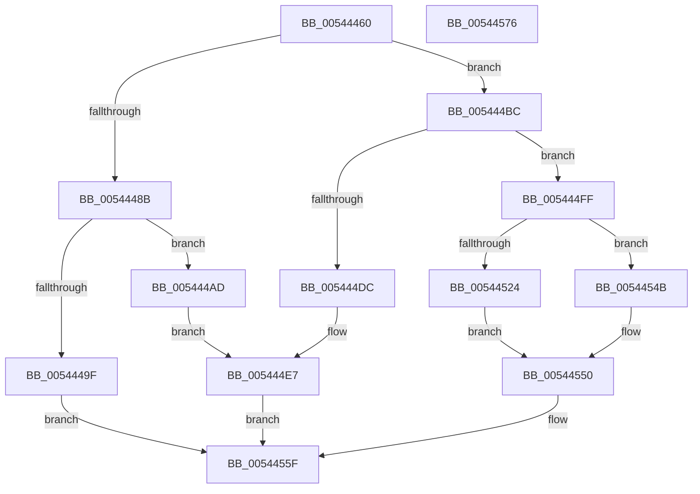

# HalpInterruptRequestInterrupt

- RVA: `0x00544460`–`0x00544577` (길이 `279` bytes)
- VA: `0x0000000140544460`
- 실행 섹션: `.text`
- PDB 이름 있음: `예`; PDB Function 태그: `아니요`
- unwind 정보 RVA: `0x000A7960`
- 디코드: `76`개 명령, `279/279` bytes 표시
- 미해석 바이트: `0` (있으면 어셈블리에 `.byte`로 보존)

> 이 문서는 커널 이미지의 기계어와 PDB 기호를 분석해 생성했습니다. 4번과 5번은 함수 원형과 자료형을 바이너리 사용 방식에서 추정한 C 해석이며 원본 소스 복구 결과는 아닙니다.

## 1. Dependencies

- 직접 호출 지점: **8**; 고유 호출 대상: **7**
- 직접 호출자로 확인된 함수: **0**
- RIP 상대 이미지 참조: **3**

### Outgoing calls
- `0x0054447E` → [HalpInterruptFindLinesForGsiRange](../2D/HalpInterruptFindLinesForGsiRange_function_002D204C.md) (function, `0x002D204C`)
- `0x00544496` → [guard_dispatch_icall](../6B/guard_dispatch_icall_function_006BAAD0.md) (function, `0x006BAAD0`)
- `0x005444A1` → [HalpInterruptRequestSecondaryInterrupt](../55/HalpInterruptRequestSecondaryInterrupt_function_005570A8.md) (function, `0x005570A8`)
- `0x005444CF` → [HalpInterruptLookupController](../2D/HalpInterruptLookupController_function_002D20D4.md) (function, `0x002D20D4`)
- `0x005444F3` → [HalpInterruptSetProblemEx](../48/HalpInterruptSetProblemEx_function_0048AC8C.md) (function, `0x0048AC8C`)
- `0x00544506` → [HalpAcquireHighLevelLock](../2D/HalpAcquireHighLevelLock_function_002D2390.md) (function, `0x002D2390`)
- `0x00544542` → [guard_dispatch_icall](../6B/guard_dispatch_icall_function_006BAAD0.md) (function, `0x006BAAD0`)
- `0x0054455A` → [HalpReleaseHighLevelLock](../2D/HalpReleaseHighLevelLock_function_002D1C58.md) (function, `0x002D1C58`)

### Direct callers
- 이 함수 시작 RVA로 연결되는 직접 call은 확인되지 않았습니다. 간접 호출은 완전히 역산할 수 없습니다.

### Static image references
- `0x0054448B` → RVA `0x00E009E0` (`.data`; read)
- `0x005444EA` → RVA `0x00023C30` (`.rdata`; read)
- `0x005444FF` → RVA `0x00FC19A8` (`.data`; read)

## 2. Other-region calls and transfers

- 다른 실행 섹션으로 향하는 call: **0**
- 별도 외부 분기/꼬리 이동을 확인하지 못했습니다.

## 3. Assembly (complete function range)

```asm
00544460  48 8B C4                        mov rax, rsp
00544463  48 89 58 08                     mov qword ptr [rax + 8], rbx
00544467  48 89 68 18                     mov qword ptr [rax + 0x18], rbp
0054446B  48 89 70 20                     mov qword ptr [rax + 0x20], rsi
0054446F  57                              push rdi
00544470  48 83 EC 30                     sub rsp, 0x30
00544474  48 83 60 10 00                  and qword ptr [rax + 0x10], 0
00544479  8D 51 01                        lea edx, [rcx + 1]
0054447C  8B D9                           mov ebx, ecx
0054447E  E8 C9 DB D8 FF                  call 0x1402d204c
00544483  48 8B F8                        mov rdi, rax
00544486  48 85 C0                        test rax, rax
00544489  75 31                           jne 0x1405444bc
0054448B  48 8B 05 4E C5 8B 00            mov rax, qword ptr [rip + 0x8bc54e]
00544492  8B D1                           mov edx, ecx
00544494  33 C9                           xor ecx, ecx
00544496  E8 35 66 17 00                  call 0x1406baad0
0054449B  84 C0                           test al, al
0054449D  74 0E                           je 0x1405444ad
0054449F  8B CB                           mov ecx, ebx
005444A1  E8 02 2C 01 00                  call 0x1405570a8
005444A6  8B D8                           mov ebx, eax
005444A8  E9 B2 00 00 00                  jmp 0x14054455f
005444AD  C7 44 24 20 A0 10 00 00         mov dword ptr [rsp + 0x20], 0x10a0
005444B5  BA 12 00 00 00                  mov edx, 0x12
005444BA  EB 2B                           jmp 0x1405444e7
005444BC  8B 48 10                        mov ecx, dword ptr [rax + 0x10]
005444BF  89 4C 24 48                     mov dword ptr [rsp + 0x48], ecx
005444C3  8B 50 14                        mov edx, dword ptr [rax + 0x14]
005444C6  2B 50 1C                        sub edx, dword ptr [rax + 0x1c]
005444C9  03 D3                           add edx, ebx
005444CB  89 54 24 4C                     mov dword ptr [rsp + 0x4c], edx
005444CF  E8 00 DC D8 FF                  call 0x1402d20d4
005444D4  48 8B F0                        mov rsi, rax
005444D7  48 85 C0                        test rax, rax
005444DA  75 23                           jne 0x1405444ff
005444DC  C7 44 24 20 B0 10 00 00         mov dword ptr [rsp + 0x20], 0x10b0
005444E4  8D 50 11                        lea edx, [rax + 0x11]
005444E7  45 33 C0                        xor r8d, r8d
005444EA  4C 8D 0D 3F F7 AD FF            lea r9, [rip - 0x5208c1]
005444F1  33 C9                           xor ecx, ecx
005444F3  E8 94 67 F4 FF                  call 0x14048ac8c
005444F8  BB 0D 00 00 C0                  mov ebx, 0xc000000d
005444FD  EB 60                           jmp 0x14054455f
005444FF  48 8D 0D A2 D4 A7 00            lea rcx, [rip + 0xa7d4a2]
00544506  E8 85 DE D8 FF                  call 0x1402d2390
0054450B  2B 5F 1C                        sub ebx, dword ptr [rdi + 0x1c]
0054450E  40 8A E8                        mov bpl, al
00544511  8B CB                           mov ecx, ebx
00544513  4C 6B C9 38                     imul r9, rcx, 0x38
00544517  4C 03 4F 28                     add r9, qword ptr [rdi + 0x28]
0054451B  41 8B 49 0C                     mov ecx, dword ptr [r9 + 0xc]
0054451F  F6 C1 10                        test cl, 0x10
00544522  74 27                           je 0x14054454b
00544524  48 8B 46 78                     mov rax, qword ptr [rsi + 0x78]
00544528  49 8D 49 10                     lea rcx, [r9 + 0x10]
0054452C  48 89 4C 24 20                  mov qword ptr [rsp + 0x20], rcx
00544531  4D 8D 41 18                     lea r8, [r9 + 0x18]
00544535  48 8B 4E 10                     mov rcx, qword ptr [rsi + 0x10]
00544539  48 8D 54 24 48                  lea rdx, [rsp + 0x48]
0054453E  45 8B 49 30                     mov r9d, dword ptr [r9 + 0x30]
00544542  E8 89 65 17 00                  call 0x1406baad0
00544547  8B D8                           mov ebx, eax
00544549  EB 05                           jmp 0x140544550
0054454B  BB 0D 00 00 C0                  mov ebx, 0xc000000d
00544550  40 8A D5                        mov dl, bpl
00544553  48 8D 0D 4E D4 A7 00            lea rcx, [rip + 0xa7d44e]
0054455A  E8 F9 D6 D8 FF                  call 0x1402d1c58
0054455F  48 8B 6C 24 50                  mov rbp, qword ptr [rsp + 0x50]
00544564  8B C3                           mov eax, ebx
00544566  48 8B 5C 24 40                  mov rbx, qword ptr [rsp + 0x40]
0054456B  48 8B 74 24 58                  mov rsi, qword ptr [rsp + 0x58]
00544570  48 83 C4 30                     add rsp, 0x30
00544574  5F                              pop rdi
00544575  C3                              ret
00544576  CC                              int3
```

## 4. C-style interpretation (structured pseudocode)

```c
__int64 __fastcall HalpInterruptRequestInterrupt(__int64 a1, __int64 a2, int a3)
{
    __int64 result;
    __int64 v_rbx;
    __int64 v_rsp;
    unsigned int v_stack_m18;
    unsigned int v_stack_p10;
    unsigned int v_stack_p14;
    unsigned __int64 v_stack_p18;
    unsigned __int64 v_stack_p20;
    unsigned __int64 v_stack_p8;

    *(unsigned __int64 *)(v_rsp + 8) = v_rbx;
    *(unsigned __int64 *)(v_rsp + 24) = v_rbp;
    *(unsigned __int64 *)(v_rsp + 32) = v_rsi;
    v_rsp = (v_rsp) - (48);
    result = HalpInterruptFindLinesForGsiRange(a1, a1 + 1, a3, a4);
    if (result != 0) goto loc_005444BC;
    a1 = 0;
    result = guard_dispatch_icall(a1, (unsigned int)((unsigned int)(a1)), a3, a4);
    if ((unsigned __int8)(result) == 0) goto loc_005444AD;
    result = HalpInterruptRequestSecondaryInterrupt((unsigned int)((unsigned int)((unsigned int)((unsigned int)(a1)))), (unsigned int)((unsigned int)(a1)), a3, a4);
    goto loc_0054455F;
loc_005444AD:
    v_stack_m18 = 0x10A0ULL;
    goto loc_005444E7;
loc_005444BC:
    v_stack_p10 = (unsigned int)((unsigned int)(*(unsigned int *)(result + 16)));
    a2 = (unsigned int)(((unsigned int)(*(unsigned int *)(result + 20))) - (*(unsigned int *)(result + 28)));
    a2 = (unsigned int)((a2) + ((unsigned int)((unsigned int)((unsigned int)(result)))));
    v_stack_p14 = (unsigned int)(a2);
    result = HalpInterruptLookupController((unsigned int)(*(unsigned int *)(result + 16)), a2, a3, a4);
    if (result != 0) goto loc_005444FF;
    v_stack_m18 = 0x10B0ULL;
loc_005444E7:
    a3 = 0;
    a1 = 0;
    result = HalpInterruptSetProblemEx(a1, result + 17, a3, v_rip - 5376193);
    goto loc_0054455F;
loc_005444FF:
    result = HalpAcquireHighLevelLock(v_rip + 10998946, result + 17, a3, v_rip - 5376193);
    v_rbx = (unsigned int)(((unsigned int)(0xC000000DULL)) - (*(unsigned int *)(result + 28)));
    a4 = (v_rip - 5376193) * ((unsigned int)((unsigned int)(v_rbx)));
    a4 = (a4) + (*(unsigned __int64 *)(result + 40));
    if ((((unsigned __int8)((unsigned int)(*(unsigned int *)(a4 + 12)))) & (16)) == 0) goto loc_0054454B;
    v_stack_m18 = a4 + 16;
    result = guard_dispatch_icall(*(unsigned __int64 *)(result + 16), v_stack_p10, a4 + 24, (unsigned int)(*(unsigned int *)(a4 + 48)));
    goto loc_00544550;
loc_0054454B:
loc_00544550:
    result = HalpReleaseHighLevelLock(v_rip + 10998862, (unsigned __int8)((unsigned __int8)(result)), a4 + 24, (unsigned int)(*(unsigned int *)(a4 + 48)));
loc_0054455F:
    v_rsp = (v_rsp) + (48);
    return (unsigned int)((unsigned int)((unsigned int)(0xC000000DULL)));
}
```

## 5. (Beta) C Style

```c
int64_t HalpInterruptRequestInterrupt(void *Arg1, int64_t Arg2, int32_t Arg3)
{
    uint8_t *arg1 = (uint8_t *)Arg1;

    int64_t result;
    int64_t local_rbx;
    int64_t local_rsp;
    uint32_t v_stack_m18;
    uint32_t v_stack_p10;
    uint32_t v_stack_p14;
    uint64_t v_stack_p18;
    uint64_t v_stack_p20;
    uint64_t v_stack_p8;

    *(uint64_t *)(local_rsp + 0x8) = local_rbx;
    *(uint64_t *)(local_rsp + 0x18) = local_rbp;
    *(uint64_t *)(local_rsp + 0x20) = local_rsi;
    local_rsp = (local_rsp) - (48);
    result = HalpInterruptFindLinesForGsiRange(Arg1, Arg1 + 1, Arg3, a4);
    if (result != 0) goto loc_005444BC;
    Arg1 = 0;
    result = guard_dispatch_icall(Arg1, (uint32_t)((uint32_t)(Arg1)), Arg3, a4);
    if ((uint8_t)(result) == 0) goto loc_005444AD;
    result = HalpInterruptRequestSecondaryInterrupt((uint32_t)((uint32_t)((uint32_t)((uint32_t)(Arg1)))), (uint32_t)((uint32_t)(Arg1)), Arg3, a4);
    goto loc_0054455F;
loc_005444AD:
    v_stack_m18 = 0x10A0ULL;
    goto loc_005444E7;
loc_005444BC:
    v_stack_p10 = (uint32_t)((uint32_t)(*(uint32_t *)(result + 0x10)));
    Arg2 = (uint32_t)(((uint32_t)(*(uint32_t *)(result + 0x14))) - (*(uint32_t *)(result + 0x1C)));
    Arg2 = (uint32_t)((Arg2) + ((uint32_t)((uint32_t)((uint32_t)(result)))));
    v_stack_p14 = (uint32_t)(Arg2);
    result = HalpInterruptLookupController((uint32_t)(*(uint32_t *)(result + 0x10)), Arg2, Arg3, a4);
    if (result != 0) goto loc_005444FF;
    v_stack_m18 = 0x10B0ULL;
loc_005444E7:
    Arg3 = 0;
    Arg1 = 0;
    result = HalpInterruptSetProblemEx(Arg1, result + 17, Arg3, v_rip - 5376193);
    goto loc_0054455F;
loc_005444FF:
    result = HalpAcquireHighLevelLock(v_rip + 10998946, result + 17, Arg3, v_rip - 5376193);
    local_rbx = (uint32_t)(((uint32_t)(0xC000000DULL)) - (*(uint32_t *)(result + 0x1C)));
    a4 = (v_rip - 5376193) * ((uint32_t)((uint32_t)(local_rbx)));
    a4 = (a4) + (*(uint64_t *)(result + 0x28));
    if ((((uint8_t)((uint32_t)(*(uint32_t *)(a4 + 0xC)))) & (16)) == 0) goto loc_0054454B;
    v_stack_m18 = a4 + 16;
    result = guard_dispatch_icall(*(uint64_t *)(result + 0x10), v_stack_p10, a4 + 24, (uint32_t)(*(uint32_t *)(a4 + 0x30)));
    goto loc_00544550;
loc_0054454B:
loc_00544550:
    result = HalpReleaseHighLevelLock(v_rip + 10998862, (uint8_t)((uint8_t)(result)), a4 + 24, (uint32_t)(*(uint32_t *)(a4 + 0x30)));
loc_0054455F:
    local_rsp = (local_rsp) + (48);
    return (uint32_t)((uint32_t)((uint32_t)(0xC000000DULL)));
}
```

### 관측된 메모리 오프셋

구조체 형식이 확인되지 않은 접근은 인자 기준의 오프셋으로만 기록했습니다.

| 기준 인자 | 오프셋 표현 | 폭 (bit) | 접근 |
|---|---:|---:|---|
| `Arg1` | `+ 0x1` | `32` | `R` |

## 6. Execution-region graph

[열기: 2D/3D 그래프와 함수 탐색 컨트롤 패널](../../../control-panel.html?section=text&rva=0x00544460&view=graph)

- 2D 그래프는 위에서 아래로 흐르고, 3D 그래프는 빈 공간을 드래그해 회전합니다. Shift+드래그는 이동, 휠은 확대·축소, 함수 노드 선택은 대상 보고서 이동입니다.

### Static fallback


