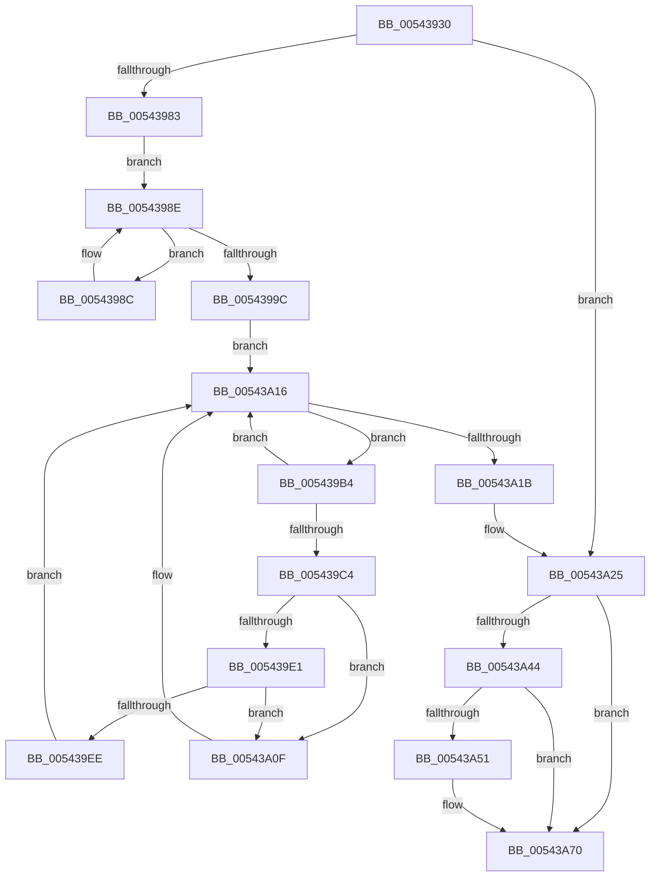

# HalpInterruptResetThisProcessor

- RVA: `0x00543930`–`0x00543A89` (길이 `345` bytes)
- VA: `0x0000000140543930`
- 실행 섹션: `.text`
- PDB 이름 있음: `예`; PDB Function 태그: `아니요`
- unwind 정보 RVA: `0x000C3C10`
- 디코드: `81`개 명령, `345/345` bytes 표시
- 미해석 바이트: `0` (있으면 어셈블리에 `.byte`로 보존)

> 이 문서는 커널 이미지의 기계어와 PDB 기호를 분석해 생성했습니다. 4번과 5번은 함수 원형과 자료형을 바이너리 사용 방식에서 추정한 C 해석이며 원본 소스 복구 결과는 아닙니다.

## 1. Dependencies

- 직접 호출 지점: **12**; 고유 호출 대상: **7**
- 직접 호출자로 확인된 함수: **1**
- RIP 상대 이미지 참조: **7**

### Outgoing calls
- `0x0054394D` → [HalpDisableInterrupts](../25/HalpDisableInterrupts_function_002521A0.md) (function, `0x002521A0`)
- `0x00543959` → [HalpInterruptInitializeLocalUnit](../55/HalpInterruptInitializeLocalUnit_function_00557A2C.md) (function, `0x00557A2C`)
- `0x00543976` → [HalpInterruptSetProblemEx](../48/HalpInterruptSetProblemEx_function_0048AC8C.md) (function, `0x0048AC8C`)
- `0x0054399F` → [KeStallExecutionProcessor](../44/KeStallExecutionProcessor_function_0044F620.md) (function, `0x0044F620`)
- `0x005439D0` → [HalpInterruptInitializeController](../55/HalpInterruptInitializeController_function_00557914.md) (function, `0x00557914`)
- `0x005439E5` → [guard_dispatch_icall](../6B/guard_dispatch_icall_function_006BAAD0.md) (function, `0x006BAAD0`)
- `0x00543A08` → [HalpInterruptSetProblemEx](../48/HalpInterruptSetProblemEx_function_0048AC8C.md) (function, `0x0048AC8C`)
- `0x00543A20` → [KeStallExecutionProcessor](../44/KeStallExecutionProcessor_function_0044F620.md) (function, `0x0044F620`)
- `0x00543A2C` → [guard_dispatch_icall](../6B/guard_dispatch_icall_function_006BAAD0.md) (function, `0x006BAAD0`)
- `0x00543A48` → [guard_dispatch_icall](../6B/guard_dispatch_icall_function_006BAAD0.md) (function, `0x006BAAD0`)
- `0x00543A6B` → [HalpInterruptSetProblemEx](../48/HalpInterruptSetProblemEx_function_0048AC8C.md) (function, `0x0048AC8C`)
- `0x00543A83` → [HalpPowerWriteResetCommand](HalpPowerWriteResetCommand_function_00546744.md) (function, `0x00546744`)

### Direct callers
- [HalpInterruptRebootService](../55/HalpInterruptRebootService_function_0055B850.md) at `0x0055B88F`

### Static image references
- `0x00543952` → RVA `0x00E101F0` (`.data`; read)
- `0x00543969` → RVA `0x00023AE0` (`.rdata`; read)
- `0x00543983` → RVA `0x00E0A774` (`.data`; read/write)
- `0x005439A4` → RVA `0x00FC38F0` (`.data`; read)
- `0x005439EE` → RVA `0x000250A0` (`.rdata`; read)
- `0x00543A25` → RVA `0x00E002D0` (`.data`; read)
- `0x00543A76` → RVA `0x00E0A774` (`.data`; read)

## 2. Other-region calls and transfers

- 다른 실행 섹션으로 향하는 call: **0**
- 별도 외부 분기/꼬리 이동을 확인하지 못했습니다.

## 3. Assembly (complete function range)

```asm
00543930  48 89 5C 24 08                  mov qword ptr [rsp + 8], rbx
00543935  48 89 74 24 10                  mov qword ptr [rsp + 0x10], rsi
0054393A  48 89 7C 24 18                  mov qword ptr [rsp + 0x18], rdi
0054393F  41 56                           push r14
00543941  48 83 EC 30                     sub rsp, 0x30
00543945  65 8B 34 25 A4 01 00 00         mov esi, dword ptr gs:[0x1a4]
0054394D  E8 4E E8 D0 FF                  call 0x1402521a0
00543952  48 8B 0D 97 C8 8C 00            mov rcx, qword ptr [rip + 0x8cc897]
00543959  E8 CE 40 01 00                  call 0x140557a2c
0054395E  45 33 C0                        xor r8d, r8d
00543961  C7 44 24 20 E4 03 00 00         mov dword ptr [rsp + 0x20], 0x3e4
00543969  4C 8D 0D 70 01 AE FF            lea r9, [rip - 0x51fe90]
00543970  33 C9                           xor ecx, ecx
00543972  41 8D 50 0C                     lea edx, [r8 + 0xc]
00543976  E8 11 73 F4 FF                  call 0x14048ac8c
0054397B  85 F6                           test esi, esi
0054397D  0F 85 A2 00 00 00               jne 0x140543a25
00543983  F0 FF 0D EA 6D 8C 00            lock dec dword ptr [rip + 0x8c6dea]
0054398A  EB 02                           jmp 0x14054398e
0054398C  F3 90                           pause
0054398E  33 C0                           xor eax, eax
00543990  F0 0F C1 05 DC 6D 8C 00         lock xadd dword ptr [rip + 0x8c6ddc], eax
00543998  85 C0                           test eax, eax
0054399A  75 F0                           jne 0x14054398c
0054399C  8D 48 64                        lea ecx, [rax + 0x64]
0054399F  E8 7C BC F0 FF                  call 0x14044f620
005439A4  48 8B 3D 45 FF A7 00            mov rdi, qword ptr [rip + 0xa7ff45]
005439AB  4C 8D 35 3E FF A7 00            lea r14, [rip + 0xa7ff3e]
005439B2  EB 62                           jmp 0x140543a16
005439B4  48 8B DF                        mov rbx, rdi
005439B7  48 8B 3F                        mov rdi, qword ptr [rdi]
005439BA  8B 83 F8 00 00 00               mov eax, dword ptr [rbx + 0xf8]
005439C0  A8 01                           test al, 1
005439C2  74 52                           je 0x140543a16
005439C4  83 E0 FE                        and eax, 0xfffffffe
005439C7  48 8B CB                        mov rcx, rbx
005439CA  89 83 F8 00 00 00               mov dword ptr [rbx + 0xf8], eax
005439D0  E8 3F 3F 01 00                  call 0x140557914
005439D5  48 8B 83 B0 00 00 00            mov rax, qword ptr [rbx + 0xb0]
005439DC  48 85 C0                        test rax, rax
005439DF  74 2E                           je 0x140543a0f
005439E1  48 8B 4B 10                     mov rcx, qword ptr [rbx + 0x10]
005439E5  E8 E6 70 17 00                  call 0x1406baad0
005439EA  85 C0                           test eax, eax
005439EC  79 21                           jns 0x140543a0f
005439EE  4C 8D 0D AB 16 AE FF            lea r9, [rip - 0x51e955]
005439F5  C7 44 24 20 F1 0B 00 00         mov dword ptr [rsp + 0x20], 0xbf1
005439FD  44 8B C0                        mov r8d, eax
00543A00  BA 23 00 00 00                  mov edx, 0x23
00543A05  48 8B CB                        mov rcx, rbx
00543A08  E8 7F 72 F4 FF                  call 0x14048ac8c
00543A0D  EB 07                           jmp 0x140543a16
00543A0F  83 A3 F8 00 00 00 FE            and dword ptr [rbx + 0xf8], 0xfffffffe
00543A16  49 3B FE                        cmp rdi, r14
00543A19  75 99                           jne 0x1405439b4
00543A1B  B9 64 00 00 00                  mov ecx, 0x64
00543A20  E8 FB BB F0 FF                  call 0x14044f620
00543A25  48 8B 05 A4 C8 8B 00            mov rax, qword ptr [rip + 0x8bc8a4]
00543A2C  E8 9F 70 17 00                  call 0x1406baad0
00543A31  48 8B 1D B8 C7 8C 00            mov rbx, qword ptr [rip + 0x8cc7b8]
00543A38  48 8B 83 A8 00 00 00            mov rax, qword ptr [rbx + 0xa8]
00543A3F  48 85 C0                        test rax, rax
00543A42  74 2C                           je 0x140543a70
00543A44  48 8B 4B 10                     mov rcx, qword ptr [rbx + 0x10]
00543A48  E8 83 70 17 00                  call 0x1406baad0
00543A4D  85 C0                           test eax, eax
00543A4F  79 1F                           jns 0x140543a70
00543A51  4C 8D 0D 48 16 AE FF            lea r9, [rip - 0x51e9b8]
00543A58  C7 44 24 20 22 0C 00 00         mov dword ptr [rsp + 0x20], 0xc22
00543A60  44 8B C0                        mov r8d, eax
00543A63  BA 22 00 00 00                  mov edx, 0x22
00543A68  48 8B CB                        mov rcx, rbx
00543A6B  E8 1C 72 F4 FF                  call 0x14048ac8c
00543A70  8B C6                           mov eax, esi
00543A72  8B CE                           mov ecx, esi
00543A74  F7 D8                           neg eax
00543A76  48 8D 05 F7 6C 8C 00            lea rax, [rip + 0x8c6cf7]
00543A7D  48 1B D2                        sbb rdx, rdx
00543A80  48 23 D0                        and rdx, rax
00543A83  E8 BC 2C 00 00                  call 0x140546744
00543A88  CC                              int3
```

## 4. C-style interpretation (structured pseudocode)

```c
__int64 __fastcall HalpInterruptResetThisProcessor(__int64 a1, __int64 a2, int a3)
{
    __int64 result;
    __int64 v_rsp;
    unsigned int v_stack_m18;
    unsigned __int64 v_stack_p10;
    unsigned __int64 v_stack_p18;
    unsigned __int64 v_stack_p8;

    v_stack_p8 = v_rbx;
    v_stack_p10 = v_rsi;
    v_stack_p18 = v_rdi;
    v_rsp = (v_rsp) - (48);
    result = HalpDisableInterrupts(a1, a2, a3, a4);
    result = HalpInterruptInitializeLocalUnit(*(unsigned __int64 *)(v_rip + 9226391), a2, a3, a4);
    a3 = 0;
    v_stack_m18 = 996;
    a1 = 0;
    result = HalpInterruptSetProblemEx(a1, a3 + 12, a3, v_rip - 5373584);
    if ((unsigned int)((unsigned int)(*(unsigned int *)(gs_base + (0 + 420)))) != 0) goto loc_00543A25;
    goto loc_0054398E;
loc_0054398C:
loc_0054398E:
    result = 0;
    if (0 != 0) goto loc_0054398C;
    result = KeStallExecutionProcessor(result + 100, a3 + 12, a3, v_rip - 5373584);
    goto loc_00543A16;
loc_005439B4:
    if ((((unsigned __int8)((unsigned int)(*(unsigned int *)(*(unsigned __int64 *)(v_rip + 11009861) + 248)))) & (1)) == 0) goto loc_00543A16;
    result = (unsigned int)(((unsigned int)(*(unsigned int *)(*(unsigned __int64 *)(v_rip + 11009861) + 248))) & (0xFFFFFFFEULL));
    *(unsigned int *)(*(unsigned __int64 *)(v_rip + 11009861) + 248) = (unsigned int)(result);
    result = HalpInterruptInitializeController(*(unsigned __int64 *)(v_rip + 11009861), a3 + 12, a3, v_rip - 5373584);
    if (*(unsigned __int64 *)(*(unsigned __int64 *)(v_rip + 11009861) + 176) == 0) goto loc_00543A0F;
    result = guard_dispatch_icall(*(unsigned __int64 *)(*(unsigned __int64 *)(v_rip + 11009861) + 16), a3 + 12, a3, v_rip - 5373584);
    if (!sign_flag) goto loc_00543A0F;
    v_stack_m18 = 0xBF1ULL;
    result = HalpInterruptSetProblemEx(*(unsigned __int64 *)(v_rip + 11009861), 35, (unsigned int)((unsigned int)(result)), v_rip - 5368149);
    goto loc_00543A16;
loc_00543A0F:
loc_00543A16:
    if ((*(unsigned __int64 *)(*(unsigned __int64 *)(v_rip + 11009861))) != (v_rip + 11009854)) goto loc_005439B4;
    result = KeStallExecutionProcessor(100, 35, (unsigned int)((unsigned int)(result)), v_rip - 5368149);
loc_00543A25:
    result = guard_dispatch_icall(100, 35, (unsigned int)((unsigned int)(result)), v_rip - 5368149);
    if (*(unsigned __int64 *)(*(unsigned __int64 *)(v_rip + 9226168) + 168) == 0) goto loc_00543A70;
    result = guard_dispatch_icall(*(unsigned __int64 *)(*(unsigned __int64 *)(v_rip + 9226168) + 16), 35, (unsigned int)((unsigned int)(result)), v_rip - 5368149);
    if (sign_flag) {
        a4 = v_rip - 5368248;
        v_stack_m18 = 0xC22ULL;
        a3 = (unsigned int)(result);
        a2 = 34;
        a1 = *(unsigned __int64 *)(v_rip + 9226168);
        result = HalpInterruptSetProblemEx(a1, a2, a3, a4);
    }
    result = (unsigned int)(-((unsigned int)((unsigned int)((unsigned int)(*(unsigned int *)(gs_base + (0 + 420)))))));
    a2 = (a2) & (v_rip + 9202935);
    result = HalpPowerWriteResetCommand((unsigned int)((unsigned int)((unsigned int)(*(unsigned int *)(gs_base + (0 + 420))))), a2, a3, a4);
    return result;
}
```

## 5. (Beta) C Style

```c
int64_t HalpInterruptResetThisProcessor(int64_t Arg1, int64_t Arg2, int32_t Arg3)
{
    int64_t result;
    int64_t local_rsp;
    uint32_t v_stack_m18;
    uint64_t v_stack_p10;
    uint64_t v_stack_p18;
    uint64_t v_stack_p8;

    v_stack_p8 = local_rbx;
    v_stack_p10 = local_rsi;
    v_stack_p18 = local_rdi;
    local_rsp = (local_rsp) - (48);
    result = HalpDisableInterrupts(Arg1, Arg2, Arg3, a4);
    result = HalpInterruptInitializeLocalUnit(*(uint64_t *)(v_rip + 0x8CC897), Arg2, Arg3, a4);
    Arg3 = 0;
    v_stack_m18 = 996;
    Arg1 = 0;
    result = HalpInterruptSetProblemEx(Arg1, Arg3 + 12, Arg3, v_rip - 5373584);
    if ((uint32_t)((uint32_t)(*(uint32_t *)(gs_base + (0 + 0x1A4)))) != 0) goto loc_00543A25;
    goto loc_0054398E;
loc_0054398C:
loc_0054398E:
    result = 0;
    if (0 != 0) goto loc_0054398C;
    result = KeStallExecutionProcessor(result + 100, Arg3 + 12, Arg3, v_rip - 5373584);
    goto loc_00543A16;
loc_005439B4:
    if ((((uint8_t)((uint32_t)(*(uint32_t *)(*(uint64_t *)(v_rip + 0xA7FF45) + 0xF8)))) & (1)) == 0) goto loc_00543A16;
    result = (uint32_t)(((uint32_t)(*(uint32_t *)(*(uint64_t *)(v_rip + 0xA7FF45) + 0xF8))) & (0xFFFFFFFEULL));
    *(uint32_t *)(*(uint64_t *)(v_rip + 0xA7FF45) + 0xF8) = (uint32_t)(result);
    result = HalpInterruptInitializeController(*(uint64_t *)(v_rip + 0xA7FF45), Arg3 + 12, Arg3, v_rip - 5373584);
    if (*(uint64_t *)(*(uint64_t *)(v_rip + 0xA7FF45) + 0xB0) == 0) goto loc_00543A0F;
    result = guard_dispatch_icall(*(uint64_t *)(*(uint64_t *)(v_rip + 0xA7FF45) + 0x10), Arg3 + 12, Arg3, v_rip - 5373584);
    if (!sign_flag) goto loc_00543A0F;
    v_stack_m18 = 0xBF1ULL;
    result = HalpInterruptSetProblemEx(*(uint64_t *)(v_rip + 0xA7FF45), 35, (uint32_t)((uint32_t)(result)), v_rip - 5368149);
    goto loc_00543A16;
loc_00543A0F:
loc_00543A16:
    if ((*(uint64_t *)(*(uint64_t *)(v_rip + 0xA7FF45))) != (v_rip + 11009854)) goto loc_005439B4;
    result = KeStallExecutionProcessor(100, 35, (uint32_t)((uint32_t)(result)), v_rip - 5368149);
loc_00543A25:
    result = guard_dispatch_icall(100, 35, (uint32_t)((uint32_t)(result)), v_rip - 5368149);
    if (*(uint64_t *)(*(uint64_t *)(v_rip + 0x8CC7B8) + 0xA8) == 0) goto loc_00543A70;
    result = guard_dispatch_icall(*(uint64_t *)(*(uint64_t *)(v_rip + 0x8CC7B8) + 0x10), 35, (uint32_t)((uint32_t)(result)), v_rip - 5368149);
    if (sign_flag) {
        a4 = v_rip - 5368248;
        v_stack_m18 = 0xC22ULL;
        Arg3 = (uint32_t)(result);
        Arg2 = 34;
        Arg1 = *(uint64_t *)(v_rip + 0x8CC7B8);
        result = HalpInterruptSetProblemEx(Arg1, Arg2, Arg3, a4);
    }
    result = (uint32_t)(-((uint32_t)((uint32_t)((uint32_t)(*(uint32_t *)(gs_base + (0 + 0x1A4)))))));
    Arg2 = (Arg2) & (v_rip + 9202935);
    result = HalpPowerWriteResetCommand((uint32_t)((uint32_t)((uint32_t)(*(uint32_t *)(gs_base + (0 + 0x1A4))))), Arg2, Arg3, a4);
    return result;
}
```

## 6. Execution-region graph

[열기: 2D/3D 그래프와 함수 탐색 컨트롤 패널](../../../control-panel.html?section=text&rva=0x00543930&view=graph)

- 2D 그래프는 위에서 아래로 흐르고, 3D 그래프는 빈 공간을 드래그해 회전합니다. Shift+드래그는 이동, 휠은 확대·축소, 함수 노드 선택은 대상 보고서 이동입니다.

### Static fallback


