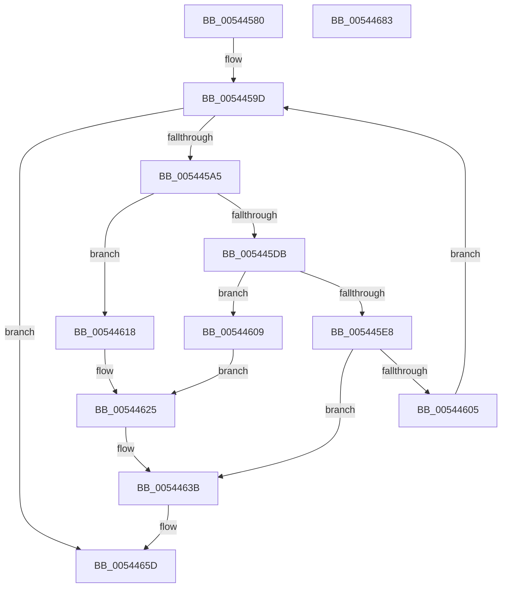

# HalpInterruptRestoreClock

- RVA: `0x00544580`–`0x00544684` (길이 `260` bytes)
- VA: `0x0000000140544580`
- 실행 섹션: `.text`
- PDB 이름 있음: `예`; PDB Function 태그: `아니요`
- unwind 정보 RVA: `0x00097BC4`
- 디코드: `65`개 명령, `260/260` bytes 표시
- 미해석 바이트: `0` (있으면 어셈블리에 `.byte`로 보존)

> 이 문서는 커널 이미지의 기계어와 PDB 기호를 분석해 생성했습니다. 4번과 5번은 함수 원형과 자료형을 바이너리 사용 방식에서 추정한 C 해석이며 원본 소스 복구 결과는 아닙니다.

## 1. Dependencies

- 직접 호출 지점: **8**; 고유 호출 대상: **8**
- 직접 호출자로 확인된 함수: **1**
- RIP 상대 이미지 참조: **5**

### Outgoing calls
- `0x005445BF` → [HalpInterruptApplyOverrides](../2D/HalpInterruptApplyOverrides_function_002D2CE0.md) (function, `0x002D2CE0`)
- `0x005445CE` → [HalpInterruptFindLines](../2D/HalpInterruptFindLines_function_002D2C88.md) (function, `0x002D2C88`)
- `0x005445DE` → [HalpInterruptLookupController](../2D/HalpInterruptLookupController_function_002D20D4.md) (function, `0x002D20D4`)
- `0x005445FC` → [HalpInterruptSetLineStateInternal](../2D/HalpInterruptSetLineStateInternal_function_002D2104.md) (function, `0x002D2104`)
- `0x00544631` → [HalpInterruptSetProblemEx](../48/HalpInterruptSetProblemEx_function_0048AC8C.md) (function, `0x0048AC8C`)
- `0x00544657` → [KeBugCheckEx](../4F/KeBugCheckEx_function_004FD660.md) (function, `0x004FD660`)
- `0x00544667` → [HalpTimerGetInternalData](../20/HalpTimerGetInternalData_function_00209500.md) (function, `0x00209500`)
- `0x00544673` → [guard_dispatch_icall](../6B/guard_dispatch_icall_function_006BAAD0.md) (function, `0x006BAAD0`)

### Direct callers
- [HalpPostSleepMP](../../pagelk/B5/HalpPostSleepMP_function_00B5ECC4.md) at `0x00B5EDEA`

### Static image references
- `0x00544595` → RVA `0x00E10344` (`.data`; read)
- `0x005445A5` → RVA `0x00FC22C8` (`.data`; read)
- `0x00544625` → RVA `0x00023C30` (`.rdata`; read)
- `0x0054463B` → RVA `0x00F90694` (`.data`; read)
- `0x0054465D` → RVA `0x00FC40F0` (`.data`; read)

## 2. Other-region calls and transfers

- 다른 실행 섹션으로 향하는 call: **0**
- 별도 외부 분기/꼬리 이동을 확인하지 못했습니다.

## 3. Assembly (complete function range)

```asm
00544580  48 89 5C 24 18                  mov qword ptr [rsp + 0x18], rbx
00544585  57                              push rdi
00544586  48 83 EC 30                     sub rsp, 0x30
0054458A  48 83 64 24 48 00               and qword ptr [rsp + 0x48], 0
00544590  83 64 24 40 00                  and dword ptr [rsp + 0x40], 0
00544595  8B 3D A9 BD 8C 00               mov edi, dword ptr [rip + 0x8cbda9]
0054459B  33 DB                           xor ebx, ebx
0054459D  3B DF                           cmp ebx, edi
0054459F  0F 83 B8 00 00 00               jae 0x14054465d
005445A5  48 8D 0D 1C DD A7 00            lea rcx, [rip + 0xa7dd1c]
005445AC  45 33 C0                        xor r8d, r8d
005445AF  48 8B 04 D9                     mov rax, qword ptr [rcx + rbx*8]
005445B3  33 D2                           xor edx, edx
005445B5  48 8D 4C 24 48                  lea rcx, [rsp + 0x48]
005445BA  48 89 44 24 48                  mov qword ptr [rsp + 0x48], rax
005445BF  E8 1C E7 D8 FF                  call 0x1402d2ce0
005445C4  48 8D 54 24 40                  lea rdx, [rsp + 0x40]
005445C9  48 8D 4C 24 48                  lea rcx, [rsp + 0x48]
005445CE  E8 B5 E6 D8 FF                  call 0x1402d2c88
005445D3  4C 8B C8                        mov r9, rax
005445D6  48 85 C0                        test rax, rax
005445D9  74 3D                           je 0x140544618
005445DB  8B 48 10                        mov ecx, dword ptr [rax + 0x10]
005445DE  E8 F1 DA D8 FF                  call 0x1402d20d4
005445E3  48 85 C0                        test rax, rax
005445E6  74 21                           je 0x140544609
005445E8  8B 4C 24 40                     mov ecx, dword ptr [rsp + 0x40]
005445EC  48 8D 54 24 48                  lea rdx, [rsp + 0x48]
005445F1  4C 6B C1 38                     imul r8, rcx, 0x38
005445F5  48 8B C8                        mov rcx, rax
005445F8  4D 03 41 28                     add r8, qword ptr [r9 + 0x28]
005445FC  E8 03 DB D8 FF                  call 0x1402d2104
00544601  85 C0                           test eax, eax
00544603  78 36                           js 0x14054463b
00544605  FF C3                           inc ebx
00544607  EB 94                           jmp 0x14054459d
00544609  C7 44 24 20 13 08 00 00         mov dword ptr [rsp + 0x20], 0x813
00544611  BA 11 00 00 00                  mov edx, 0x11
00544616  EB 0D                           jmp 0x140544625
00544618  C7 44 24 20 05 08 00 00         mov dword ptr [rsp + 0x20], 0x805
00544620  BA 12 00 00 00                  mov edx, 0x12
00544625  4C 8D 0D 04 F6 AD FF            lea r9, [rip - 0x5209fc]
0054462C  45 33 C0                        xor r8d, r8d
0054462F  33 C9                           xor ecx, ecx
00544631  E8 56 66 F4 FF                  call 0x14048ac8c
00544636  B8 0E 00 00 C0                  mov eax, 0xc000000e
0054463B  4C 63 05 52 C0 A4 00            movsxd r8, dword ptr [rip + 0xa4c052]
00544642  B9 5C 00 00 00                  mov ecx, 0x5c
00544647  48 98                           cdqe
00544649  BA 00 02 00 00                  mov edx, 0x200
0054464E  48 89 44 24 20                  mov qword ptr [rsp + 0x20], rax
00544653  44 8D 49 A6                     lea r9d, [rcx - 0x5a]
00544657  E8 04 90 FB FF                  call 0x1404fd660
0054465C  CC                              int3
0054465D  48 8B 15 8C FA A7 00            mov rdx, qword ptr [rip + 0xa7fa8c]
00544664  48 8B CA                        mov rcx, rdx
00544667  E8 94 4E CC FF                  call 0x140209500
0054466C  48 8B C8                        mov rcx, rax
0054466F  48 8B 42 78                     mov rax, qword ptr [rdx + 0x78]
00544673  E8 58 64 17 00                  call 0x1406baad0
00544678  48 8B 5C 24 50                  mov rbx, qword ptr [rsp + 0x50]
0054467D  48 83 C4 30                     add rsp, 0x30
00544681  5F                              pop rdi
00544682  C3                              ret
00544683  CC                              int3
```

## 4. C-style interpretation (structured pseudocode)

```c
__int64 __fastcall HalpInterruptRestoreClock(__int64 a1, int a2, int a3)
{
    __int64 result;
    __int64 v_rbx;
    __int64 v_rsp;
    unsigned int v_stack_m18;
    unsigned __int64 v_stack_p10;
    unsigned __int64 v_stack_p18;
    unsigned int v_stack_p8;

    v_stack_p18 = v_rbx;
    v_rsp = (v_rsp) - (48);
    v_rbx = 0;
loc_0054459D:
    if (0 >= ((unsigned int)((unsigned int)(*(unsigned int *)(v_rip + 9223593))))) goto loc_0054465D;
    a3 = 0;
    a2 = 0;
    v_stack_p10 = *(unsigned __int64 *)(v_rip + 11001116 + v_rbx * 8);
    result = HalpInterruptApplyOverrides(v_stack_p10, a2, a3, a4);
    result = HalpInterruptFindLines(v_stack_p10, v_stack_p8, a3, a4);
    if (result == 0) goto loc_00544618;
    result = HalpInterruptLookupController((unsigned int)(*(unsigned int *)(result + 16)), v_stack_p8, a3, result);
    if (result == 0) goto loc_00544609;
    a3 = (a3) * ((unsigned int)(v_stack_p8));
    a3 = (a3) + (*(unsigned __int64 *)(result + 40));
    result = HalpInterruptSetLineStateInternal(result, v_stack_p10, a3, result);
    if (sign_flag) goto loc_0054463B;
    v_rbx = (unsigned int)((v_rbx) + 1);
    goto loc_0054459D;
loc_00544609:
    v_stack_m18 = 0x813ULL;
    goto loc_00544625;
loc_00544618:
    v_stack_m18 = 0x805ULL;
loc_00544625:
    a3 = 0;
    a1 = 0;
    result = HalpInterruptSetProblemEx(a1, 18, a3, v_rip - 5376508);
loc_0054463B:
    v_stack_m18 = (unsigned int)(0xC000000EULL);
    result = KeBugCheckEx(92, 512, (int)(*(unsigned int *)(v_rip + 10797138)), 92 - 90);
loc_0054465D:
    result = HalpTimerGetInternalData(*(unsigned __int64 *)(v_rip + 11008652), *(unsigned __int64 *)(v_rip + 11008652), (int)(*(unsigned int *)(v_rip + 10797138)), 92 - 90);
    result = guard_dispatch_icall(result, *(unsigned __int64 *)(v_rip + 11008652), (int)(*(unsigned int *)(v_rip + 10797138)), 92 - 90);
    v_rsp = (v_rsp) + (48);
    return result;
}
```

## 5. (Beta) C Style

```c
int64_t HalpInterruptRestoreClock(int64_t Arg1, int32_t Arg2, int32_t Arg3)
{
    int64_t result;
    int64_t local_rbx;
    int64_t local_rsp;
    uint32_t v_stack_m18;
    uint64_t v_stack_p10;
    uint64_t v_stack_p18;
    uint32_t v_stack_p8;

    v_stack_p18 = local_rbx;
    local_rsp = (local_rsp) - (48);
    local_rbx = 0;
loc_0054459D:
    if (0 >= ((uint32_t)((uint32_t)(*(uint32_t *)(v_rip + 0x8CBDA9))))) goto loc_0054465D;
    Arg3 = 0;
    Arg2 = 0;
    v_stack_p10 = *(uint64_t *)(v_rip + 0xA7DD1C + local_rbx * 8);
    result = HalpInterruptApplyOverrides(v_stack_p10, Arg2, Arg3, a4);
    result = HalpInterruptFindLines(v_stack_p10, v_stack_p8, Arg3, a4);
    if (result == 0) goto loc_00544618;
    result = HalpInterruptLookupController((uint32_t)(*(uint32_t *)(result + 0x10)), v_stack_p8, Arg3, result);
    if (result == 0) goto loc_00544609;
    Arg3 = (Arg3) * ((uint32_t)(v_stack_p8));
    Arg3 = (Arg3) + (*(uint64_t *)(result + 0x28));
    result = HalpInterruptSetLineStateInternal(result, v_stack_p10, Arg3, result);
    if (sign_flag) goto loc_0054463B;
    local_rbx = (uint32_t)((local_rbx) + 1);
    goto loc_0054459D;
loc_00544609:
    v_stack_m18 = 0x813ULL;
    goto loc_00544625;
loc_00544618:
    v_stack_m18 = 0x805ULL;
loc_00544625:
    Arg3 = 0;
    Arg1 = 0;
    result = HalpInterruptSetProblemEx(Arg1, 18, Arg3, v_rip - 5376508);
loc_0054463B:
    v_stack_m18 = (uint32_t)(0xC000000EULL);
    result = KeBugCheckEx(92, 512, (int32_t)(*(uint32_t *)(v_rip + 0xA4C052)), 92 - 90);
loc_0054465D:
    result = HalpTimerGetInternalData(*(uint64_t *)(v_rip + 0xA7FA8C), *(uint64_t *)(v_rip + 0xA7FA8C), (int32_t)(*(uint32_t *)(v_rip + 0xA4C052)), 92 - 90);
    result = guard_dispatch_icall(result, *(uint64_t *)(v_rip + 0xA7FA8C), (int32_t)(*(uint32_t *)(v_rip + 0xA4C052)), 92 - 90);
    local_rsp = (local_rsp) + (48);
    return result;
}
```

## 6. Execution-region graph

[열기: 2D/3D 그래프와 함수 탐색 컨트롤 패널](../../../control-panel.html?section=text&rva=0x00544580&view=graph)

- 2D 그래프는 위에서 아래로 흐르고, 3D 그래프는 빈 공간을 드래그해 회전합니다. Shift+드래그는 이동, 휠은 확대·축소, 함수 노드 선택은 대상 보고서 이동입니다.

### Static fallback


