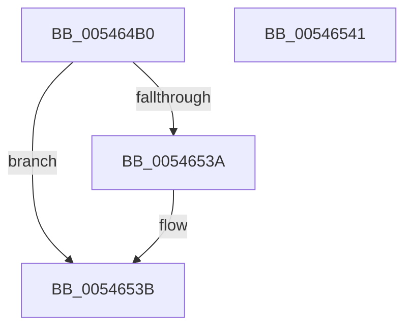

# HalpInterruptSendIpiToPhysicalTarget

- RVA: `0x005464B0`–`0x00546542` (길이 `146` bytes)
- VA: `0x00000001405464B0`
- 실행 섹션: `.text`
- PDB 이름 있음: `예`; PDB Function 태그: `아니요`
- unwind 정보 RVA: `0x000C3CD8`
- 디코드: `36`개 명령, `146/146` bytes 표시
- 미해석 바이트: `0` (있으면 어셈블리에 `.byte`로 보존)

> 이 문서는 커널 이미지의 기계어와 PDB 기호를 분석해 생성했습니다. 4번과 5번은 함수 원형과 자료형을 바이너리 사용 방식에서 추정한 C 해석이며 원본 소스 복구 결과는 아닙니다.

## 1. Dependencies

- 직접 호출 지점: **2**; 고유 호출 대상: **2**
- 직접 호출자로 확인된 함수: **5**
- RIP 상대 이미지 참조: **2**

### Outgoing calls
- `0x00546502` → [HalpDisableInterrupts](../25/HalpDisableInterrupts_function_002521A0.md) (function, `0x002521A0`)
- `0x00546531` → [guard_dispatch_icall](../6B/guard_dispatch_icall_function_006BAAD0.md) (function, `0x006BAAD0`)

### Direct callers
- [HalpBlkPoReadPerfIoPort](../56/HalpBlkPoReadPerfIoPort_function_0056E2E0.md) at `0x0056E372`
- [HalpBlkPoReadPerfMsr](../56/HalpBlkPoReadPerfMsr_function_0056E3F0.md) at `0x0056E475`
- [HalpBlkPoRegisterIdleState](../56/HalpBlkPoRegisterIdleState_function_0056E4F0.md) at `0x0056E56B`
- [HalpBlkPoWritePerfIoPort](../56/HalpBlkPoWritePerfIoPort_function_0056E5C0.md) at `0x0056E64E`
- [HalpBlkPoWritePerfMsr](../56/HalpBlkPoWritePerfMsr_function_0056E6B0.md) at `0x0056E729`

### Static image references
- `0x005464D2` → RVA `0x00E102D8` (`.data`; read)
- `0x005464F7` → RVA `0x00E101F0` (`.data`; read)

## 2. Other-region calls and transfers

- 다른 실행 섹션으로 향하는 call: **0**
- 별도 외부 분기/꼬리 이동을 확인하지 못했습니다.

## 3. Assembly (complete function range)

```asm
005464B0  4C 89 44 24 18                  mov qword ptr [rsp + 0x18], r8
005464B5  53                              push rbx
005464B6  48 83 EC 50                     sub rsp, 0x50
005464BA  83 4C 24 70 FF                  or dword ptr [rsp + 0x70], 0xffffffff
005464BF  33 C0                           xor eax, eax
005464C1  48 89 44 24 40                  mov qword ptr [rsp + 0x40], rax
005464C6  0F 57 C0                        xorps xmm0, xmm0
005464C9  0F 11 44 24 30                  movups xmmword ptr [rsp + 0x30], xmm0
005464CE  89 4C 24 38                     mov dword ptr [rsp + 0x38], ecx
005464D2  48 8B 0D FF 9D 8C 00            mov rcx, qword ptr [rip + 0x8c9dff]
005464D9  C7 44 24 30 04 00 00 00         mov dword ptr [rsp + 0x30], 4
005464E1  C7 44 24 74 01 00 00 00         mov dword ptr [rsp + 0x74], 1
005464E9  8B 41 14                        mov eax, dword ptr [rcx + 0x14]
005464EC  89 44 24 7C                     mov dword ptr [rsp + 0x7c], eax
005464F0  8B 41 10                        mov eax, dword ptr [rcx + 0x10]
005464F3  89 44 24 78                     mov dword ptr [rsp + 0x78], eax
005464F7  48 8B 05 F2 9C 8C 00            mov rax, qword ptr [rip + 0x8c9cf2]
005464FE  4C 8B 50 78                     mov r10, qword ptr [rax + 0x78]
00546502  E8 99 BC D0 FF                  call 0x1402521a0
00546507  48 8B 0D E2 9C 8C 00            mov rcx, qword ptr [rip + 0x8c9ce2]
0054650E  4C 8D 44 24 30                  lea r8, [rsp + 0x30]
00546513  8A D8                           mov bl, al
00546515  48 8D 54 24 78                  lea rdx, [rsp + 0x78]
0054651A  48 8D 44 24 70                  lea rax, [rsp + 0x70]
0054651F  41 B9 E1 00 00 00               mov r9d, 0xe1
00546525  48 89 44 24 20                  mov qword ptr [rsp + 0x20], rax
0054652A  49 8B C2                        mov rax, r10
0054652D  48 8B 49 10                     mov rcx, qword ptr [rcx + 0x10]
00546531  E8 9A 45 17 00                  call 0x1406baad0
00546536  84 DB                           test bl, bl
00546538  74 01                           je 0x14054653b
0054653A  FB                              sti
0054653B  48 83 C4 50                     add rsp, 0x50
0054653F  5B                              pop rbx
00546540  C3                              ret
00546541  CC                              int3
```

## 4. C-style interpretation (structured pseudocode)

```c
__int64 __fastcall HalpInterruptSendIpiToPhysicalTarget(int a1, __int64 a2, __int64 a3)
{
    __int64 result;
    __int64 v_rsp;
    unsigned __int64 v_stack_m18;
    unsigned int v_stack_m20;
    unsigned __int64 v_stack_m28;
    unsigned __int64 v_stack_m38;
    unsigned __int64 v_stack_p18;
    unsigned int v_stack_p1C;
    unsigned int v_stack_p20;
    unsigned int v_stack_p24;

    v_stack_p18 = a3;
    v_rsp = (v_rsp) - (80);
    result = 0;
    v_stack_m18 = 0;
    v_stack_m28 = v_xmm0;
    v_stack_m20 = a1;
    v_stack_m28 = 4;
    v_stack_p1C = 1;
    v_stack_p24 = (unsigned int)((unsigned int)(*(unsigned int *)(*(unsigned __int64 *)(v_rip + 9215487) + 20)));
    v_stack_p20 = (unsigned int)((unsigned int)(*(unsigned int *)(*(unsigned __int64 *)(v_rip + 9215487) + 16)));
    result = HalpDisableInterrupts(*(unsigned __int64 *)(v_rip + 9215487), a2, a3, a4);
    v_stack_m38 = v_stack_p18;
    result = guard_dispatch_icall(*(unsigned __int64 *)(*(unsigned __int64 *)(v_rip + 9215202) + 16), v_stack_p20, v_stack_m28, 225);
    if ((unsigned __int8)((unsigned __int8)(result)) != 0) {
    }
    v_rsp = (v_rsp) + (80);
    return result;
}
```

## 5. (Beta) C Style

```c
int64_t HalpInterruptSendIpiToPhysicalTarget(int32_t Arg1, int64_t Arg2, int64_t Arg3)
{
    int64_t result;
    int64_t local_rsp;
    uint64_t v_stack_m18;
    uint32_t v_stack_m20;
    uint64_t v_stack_m28;
    uint64_t v_stack_m38;
    uint64_t v_stack_p18;
    uint32_t v_stack_p1C;
    uint32_t v_stack_p20;
    uint32_t v_stack_p24;

    v_stack_p18 = Arg3;
    local_rsp = (local_rsp) - (80);
    result = 0;
    v_stack_m18 = 0;
    v_stack_m28 = v_xmm0;
    v_stack_m20 = Arg1;
    v_stack_m28 = 4;
    v_stack_p1C = 1;
    v_stack_p24 = (uint32_t)((uint32_t)(*(uint32_t *)(*(uint64_t *)(v_rip + 0x8C9DFF) + 0x14)));
    v_stack_p20 = (uint32_t)((uint32_t)(*(uint32_t *)(*(uint64_t *)(v_rip + 0x8C9DFF) + 0x10)));
    result = HalpDisableInterrupts(*(uint64_t *)(v_rip + 0x8C9DFF), Arg2, Arg3, a4);
    v_stack_m38 = v_stack_p18;
    result = guard_dispatch_icall(*(uint64_t *)(*(uint64_t *)(v_rip + 0x8C9CE2) + 0x10), v_stack_p20, v_stack_m28, 225);
    if ((uint8_t)((uint8_t)(result)) != 0) {
    }
    local_rsp = (local_rsp) + (80);
    return result;
}
```

## 6. Execution-region graph

[열기: 2D/3D 그래프와 함수 탐색 컨트롤 패널](../../../control-panel.html?section=text&rva=0x005464B0&view=graph)

- 2D 그래프는 위에서 아래로 흐르고, 3D 그래프는 빈 공간을 드래그해 회전합니다. Shift+드래그는 이동, 휠은 확대·축소, 함수 노드 선택은 대상 보고서 이동입니다.

### Static fallback


