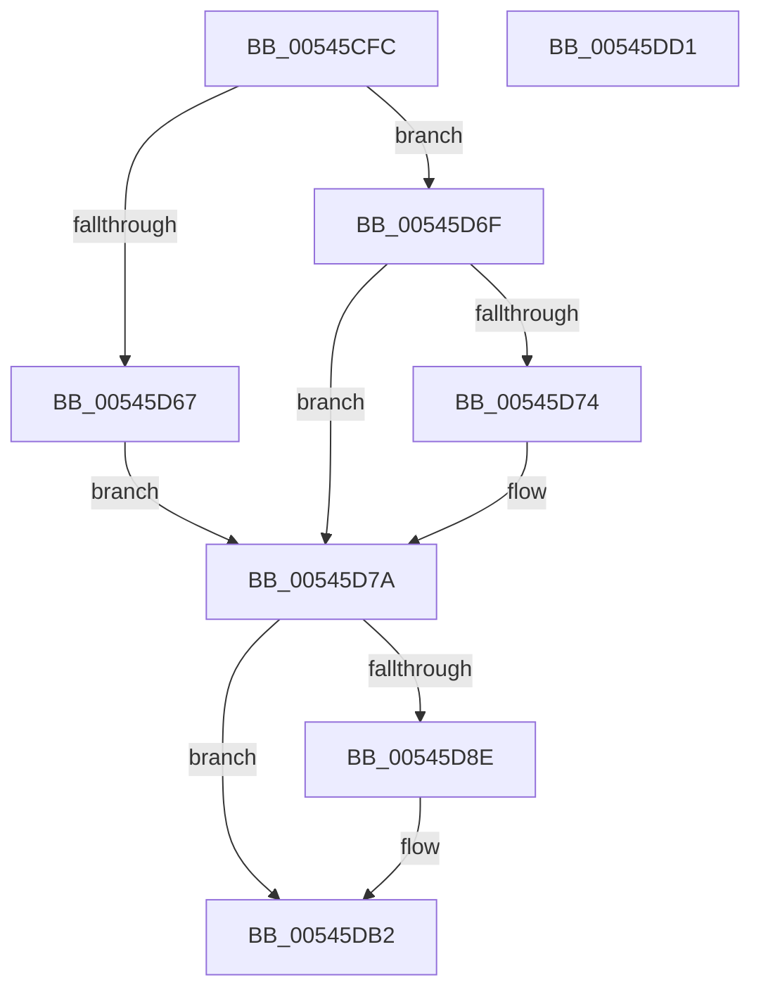

# HalpInterruptServiceActiveBoth

- RVA: `0x00545CFC`–`0x00545DD2` (길이 `214` bytes)
- VA: `0x0000000140545CFC`
- 실행 섹션: `.text`
- PDB 이름 있음: `예`; PDB Function 태그: `아니요`
- unwind 정보 RVA: `0x000717F8`
- 디코드: `56`개 명령, `214/214` bytes 표시
- 미해석 바이트: `0` (있으면 어셈블리에 `.byte`로 보존)

> 이 문서는 커널 이미지의 기계어와 PDB 기호를 분석해 생성했습니다. 4번과 5번은 함수 원형과 자료형을 바이너리 사용 방식에서 추정한 C 해석이며 원본 소스 복구 결과는 아닙니다.

## 1. Dependencies

- 직접 호출 지점: **6**; 고유 호출 대상: **6**
- 직접 호출자로 확인된 함수: **1**
- RIP 상대 이미지 참조: **1**

### Outgoing calls
- `0x00545D20` → [HalpInterruptFindLinesForGsiRange](../2D/HalpInterruptFindLinesForGsiRange_function_002D204C.md) (function, `0x002D204C`)
- `0x00545D49` → [HalpInterruptLookupController](../2D/HalpInterruptLookupController_function_002D20D4.md) (function, `0x002D20D4`)
- `0x00545D58` → [HalpAcquireHighLevelLock](../2D/HalpAcquireHighLevelLock_function_002D2390.md) (function, `0x002D2390`)
- `0x00545D85` → [HalpInterruptSetLineStateInternal](../2D/HalpInterruptSetLineStateInternal_function_002D2104.md) (function, `0x002D2104`)
- `0x00545DAC` → [KeBugCheckEx](../4F/KeBugCheckEx_function_004FD660.md) (function, `0x004FD660`)
- `0x00545DBC` → [HalpReleaseHighLevelLock](../2D/HalpReleaseHighLevelLock_function_002D1C58.md) (function, `0x002D1C58`)

### Direct callers
- [HalPerformEndOfInterrupt](../41/HalPerformEndOfInterrupt_function_00418E20.md) at `0x00418E50`

### Static image references
- `0x00545D4E` → RVA `0x00FC19A8` (`.data`; read)

## 2. Other-region calls and transfers

- 다른 실행 섹션으로 향하는 call: **0**
- 별도 외부 분기/꼬리 이동을 확인하지 못했습니다.

## 3. Assembly (complete function range)

```asm
00545CFC  48 89 5C 24 10                  mov qword ptr [rsp + 0x10], rbx
00545D01  48 89 74 24 18                  mov qword ptr [rsp + 0x18], rsi
00545D06  57                              push rdi
00545D07  48 83 EC 30                     sub rsp, 0x30
00545D0B  48 8B 81 A0 00 00 00            mov rax, qword ptr [rcx + 0xa0]
00545D12  48 83 64 24 40 00               and qword ptr [rsp + 0x40], 0
00545D18  8B 58 40                        mov ebx, dword ptr [rax + 0x40]
00545D1B  8B CB                           mov ecx, ebx
00545D1D  8D 53 01                        lea edx, [rbx + 1]
00545D20  E8 27 C3 D8 FF                  call 0x1402d204c
00545D25  8B 48 10                        mov ecx, dword ptr [rax + 0x10]
00545D28  89 4C 24 40                     mov dword ptr [rsp + 0x40], ecx
00545D2C  44 8B 40 14                     mov r8d, dword ptr [rax + 0x14]
00545D30  44 2B 40 1C                     sub r8d, dword ptr [rax + 0x1c]
00545D34  44 03 C3                        add r8d, ebx
00545D37  44 89 44 24 44                  mov dword ptr [rsp + 0x44], r8d
00545D3C  2B 58 1C                        sub ebx, dword ptr [rax + 0x1c]
00545D3F  8B D3                           mov edx, ebx
00545D41  48 6B DA 38                     imul rbx, rdx, 0x38
00545D45  48 03 58 28                     add rbx, qword ptr [rax + 0x28]
00545D49  E8 86 C3 D8 FF                  call 0x1402d20d4
00545D4E  48 8D 0D 53 BC A7 00            lea rcx, [rip + 0xa7bc53]
00545D55  48 8B F8                        mov rdi, rax
00545D58  E8 33 C6 D8 FF                  call 0x1402d2390
00545D5D  8B 0B                           mov ecx, dword ptr [rbx]
00545D5F  40 8A F0                        mov sil, al
00545D62  83 F9 01                        cmp ecx, 1
00545D65  75 08                           jne 0x140545d6f
00545D67  C7 03 02 00 00 00               mov dword ptr [rbx], 2
00545D6D  EB 0B                           jmp 0x140545d7a
00545D6F  83 F9 02                        cmp ecx, 2
00545D72  75 06                           jne 0x140545d7a
00545D74  C7 03 01 00 00 00               mov dword ptr [rbx], 1
00545D7A  4C 8B C3                        mov r8, rbx
00545D7D  48 8D 54 24 40                  lea rdx, [rsp + 0x40]
00545D82  48 8B CF                        mov rcx, rdi
00545D85  E8 7A C3 D8 FF                  call 0x1402d2104
00545D8A  85 C0                           test eax, eax
00545D8C  79 24                           jns 0x140545db2
00545D8E  48 63 44 24 44                  movsxd rax, dword ptr [rsp + 0x44]
00545D93  4C 8B CF                        mov r9, rdi
00545D96  4C 63 87 F0 00 00 00            movsxd r8, dword ptr [rdi + 0xf0]
00545D9D  BA 05 02 00 00                  mov edx, 0x205
00545DA2  B9 5C 00 00 00                  mov ecx, 0x5c
00545DA7  48 89 44 24 20                  mov qword ptr [rsp + 0x20], rax
00545DAC  E8 AF 78 FB FF                  call 0x1404fd660
00545DB1  CC                              int3
00545DB2  40 8A D6                        mov dl, sil
00545DB5  48 8D 0D EC BB A7 00            lea rcx, [rip + 0xa7bbec]
00545DBC  E8 97 BE D8 FF                  call 0x1402d1c58
00545DC1  48 8B 5C 24 48                  mov rbx, qword ptr [rsp + 0x48]
00545DC6  48 8B 74 24 50                  mov rsi, qword ptr [rsp + 0x50]
00545DCB  48 83 C4 30                     add rsp, 0x30
00545DCF  5F                              pop rdi
00545DD0  C3                              ret
00545DD1  CC                              int3
```

## 4. C-style interpretation (structured pseudocode)

```c
__int64 __fastcall HalpInterruptServiceActiveBoth(__int64 a1)
{
    __int64 result;
    __int64 v_rbx;
    __int64 v_rsp;
    unsigned __int64 v_stack_m18;
    unsigned __int64 v_stack_p10;
    unsigned __int64 v_stack_p18;
    unsigned __int64 v_stack_p8;
    unsigned int v_stack_pC;

    v_stack_p10 = v_rbx;
    v_stack_p18 = v_rsi;
    v_rsp = (v_rsp) - (48);
    result = HalpInterruptFindLinesForGsiRange((unsigned int)((unsigned int)((unsigned int)(*(unsigned int *)(*(unsigned __int64 *)(a1 + 160) + 64)))), (unsigned int)(*(unsigned int *)(*(unsigned __int64 *)(a1 + 160) + 64)) + 1, a3, a4);
    v_stack_p8 = (unsigned int)((unsigned int)(*(unsigned int *)(result + 16)));
    a3 = (unsigned int)(((unsigned int)(*(unsigned int *)(result + 20))) - (*(unsigned int *)(result + 28)));
    a3 = (unsigned int)((a3) + ((unsigned int)((unsigned int)(*(unsigned int *)(*(unsigned __int64 *)(a1 + 160) + 64)))));
    v_stack_pC = (unsigned int)(a3);
    v_rbx = (unsigned int)(((unsigned int)(*(unsigned int *)(*(unsigned __int64 *)(a1 + 160) + 64))) - (*(unsigned int *)(result + 28)));
    v_rbx = (v_rbx) * ((unsigned int)((unsigned int)(v_rbx)));
    v_rbx = (v_rbx) + (*(unsigned __int64 *)(result + 40));
    result = HalpInterruptLookupController((unsigned int)(*(unsigned int *)(result + 16)), (unsigned int)((unsigned int)(v_rbx)), a3, a4);
    result = HalpAcquireHighLevelLock(v_rip + 10992723, (unsigned int)((unsigned int)(v_rbx)), a3, a4);
    if (((unsigned int)((unsigned int)(*(unsigned int *)(v_rbx)))) != 1) goto loc_00545D6F;
    *(unsigned int *)(v_rbx) = 2;
    goto loc_00545D7A;
loc_00545D6F:
    if (((unsigned int)((unsigned int)(*(unsigned int *)(v_rbx)))) == 2) {
        *(unsigned int *)(v_rbx) = 1;
    }
    result = HalpInterruptSetLineStateInternal(result, v_stack_p8, v_rbx, a4);
    if (sign_flag) {
        result = (int)(v_stack_pC);
        a4 = result;
        a3 = (int)(*(unsigned int *)(result + 240));
        a2 = 517;
        a1 = 92;
        v_stack_m18 = result;
        result = KeBugCheckEx(a1, a2, a3, a4);
    }
    result = HalpReleaseHighLevelLock(v_rip + 10992620, (unsigned __int8)((unsigned __int8)(result)), a3, a4);
    v_rsp = (v_rsp) + (48);
    return result;
}
```

## 5. (Beta) C Style

```c
int64_t HalpInterruptServiceActiveBoth(void *Arg1)
{
    uint8_t *arg1 = (uint8_t *)Arg1;

    int64_t result;
    int64_t local_rbx;
    int64_t local_rsp;
    uint64_t v_stack_m18;
    uint64_t v_stack_p10;
    uint64_t v_stack_p18;
    uint64_t v_stack_p8;
    uint32_t v_stack_pC;

    v_stack_p10 = local_rbx;
    v_stack_p18 = local_rsi;
    local_rsp = (local_rsp) - (48);
    result = HalpInterruptFindLinesForGsiRange((uint32_t)((uint32_t)((uint32_t)(*(uint32_t *)(*(uint64_t *)(arg1 + 0xA0) + 0x40)))), (uint32_t)(*(uint32_t *)(*(uint64_t *)(arg1 + 0xA0) + 0x40)) + 1, a3, a4);
    v_stack_p8 = (uint32_t)((uint32_t)(*(uint32_t *)(result + 0x10)));
    a3 = (uint32_t)(((uint32_t)(*(uint32_t *)(result + 0x14))) - (*(uint32_t *)(result + 0x1C)));
    a3 = (uint32_t)((a3) + ((uint32_t)((uint32_t)(*(uint32_t *)(*(uint64_t *)(arg1 + 0xA0) + 0x40)))));
    v_stack_pC = (uint32_t)(a3);
    local_rbx = (uint32_t)(((uint32_t)(*(uint32_t *)(*(uint64_t *)(arg1 + 0xA0) + 0x40))) - (*(uint32_t *)(result + 0x1C)));
    local_rbx = (local_rbx) * ((uint32_t)((uint32_t)(local_rbx)));
    local_rbx = (local_rbx) + (*(uint64_t *)(result + 0x28));
    result = HalpInterruptLookupController((uint32_t)(*(uint32_t *)(result + 0x10)), (uint32_t)((uint32_t)(local_rbx)), a3, a4);
    result = HalpAcquireHighLevelLock(v_rip + 10992723, (uint32_t)((uint32_t)(local_rbx)), a3, a4);
    if (((uint32_t)((uint32_t)(*(uint32_t *)(local_rbx)))) != 1) goto loc_00545D6F;
    *(uint32_t *)(local_rbx) = 2;
    goto loc_00545D7A;
loc_00545D6F:
    if (((uint32_t)((uint32_t)(*(uint32_t *)(local_rbx)))) == 2) {
        *(uint32_t *)(local_rbx) = 1;
    }
    result = HalpInterruptSetLineStateInternal(result, v_stack_p8, local_rbx, a4);
    if (sign_flag) {
        result = (int32_t)(v_stack_pC);
        a4 = result;
        a3 = (int32_t)(*(uint32_t *)(result + 0xF0));
        a2 = 517;
        Arg1 = 92;
        v_stack_m18 = result;
        result = KeBugCheckEx(Arg1, a2, a3, a4);
    }
    result = HalpReleaseHighLevelLock(v_rip + 10992620, (uint8_t)((uint8_t)(result)), a3, a4);
    local_rsp = (local_rsp) + (48);
    return result;
}
```

### 관측된 메모리 오프셋

구조체 형식이 확인되지 않은 접근은 인자 기준의 오프셋으로만 기록했습니다.

| 기준 인자 | 오프셋 표현 | 폭 (bit) | 접근 |
|---|---:|---:|---|
| `Arg1` | `+ 0xA0` | `64` | `R` |

## 6. Execution-region graph

[열기: 2D/3D 그래프와 함수 탐색 컨트롤 패널](../../../control-panel.html?section=text&rva=0x00545CFC&view=graph)

- 2D 그래프는 위에서 아래로 흐르고, 3D 그래프는 빈 공간을 드래그해 회전합니다. Shift+드래그는 이동, 휠은 확대·축소, 함수 노드 선택은 대상 보고서 이동입니다.

### Static fallback


