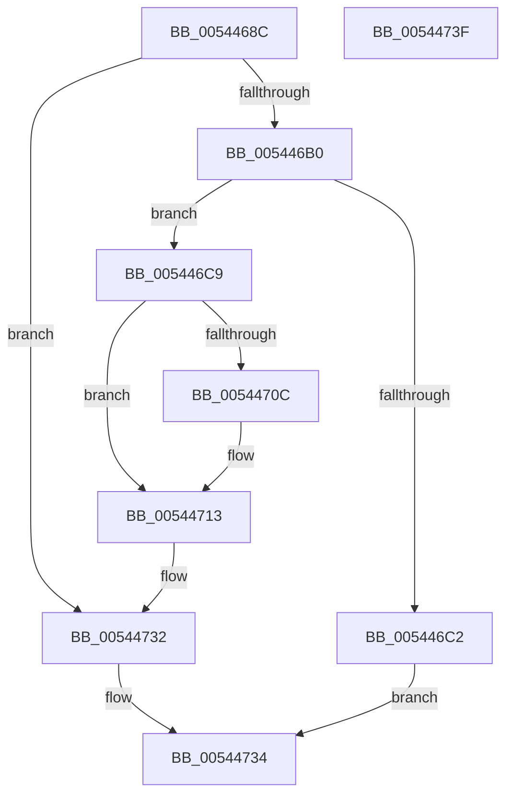

# HalpInterruptSetLineSpecificOverride

- RVA: `0x0054468C`–`0x00544740` (길이 `180` bytes)
- VA: `0x000000014054468C`
- 실행 섹션: `.text`
- PDB 이름 있음: `예`; PDB Function 태그: `아니요`
- unwind 정보 RVA: `0x0005CAAC`
- 디코드: `44`개 명령, `180/180` bytes 표시
- 미해석 바이트: `0` (있으면 어셈블리에 `.byte`로 보존)

> 이 문서는 커널 이미지의 기계어와 PDB 기호를 분석해 생성했습니다. 4번과 5번은 함수 원형과 자료형을 바이너리 사용 방식에서 추정한 C 해석이며 원본 소스 복구 결과는 아닙니다.

## 1. Dependencies

- 직접 호출 지점: **4**; 고유 호출 대상: **4**
- 직접 호출자로 확인된 함수: **1**
- RIP 상대 이미지 참조: **4**

### Outgoing calls
- `0x005446A1` → [HalpInterruptGsiToLine](../2D/HalpInterruptGsiToLine_function_002D2DD0.md) (function, `0x002D2DD0`)
- `0x005446B5` → [HalpMmAllocCtxAlloc](../3E/HalpMmAllocCtxAlloc_function_003E10B8.md) (function, `0x003E10B8`)
- `0x005446F4` → [HalpAcquireHighLevelLock](../2D/HalpAcquireHighLevelLock_function_002D2390.md) (function, `0x002D2390`)
- `0x0054472D` → [HalpReleaseHighLevelLock](../2D/HalpReleaseHighLevelLock_function_002D1C58.md) (function, `0x002D1C58`)

### Direct callers
- [HalpPiix4Detect](../../pagelk/B7/HalpPiix4Detect_function_00B79E00.md) at `0x00B7A1F4`
- [HalpPiix4Detect](../../pagelk/B7/HalpPiix4Detect_function_00B79E00.md) at `0x00B7A1FE`

### Static image references
- `0x005446CD` → RVA `0x00F906F0` (`.data`; read)
- `0x005446F9` → RVA `0x00F906E8` (`.data`; read)
- `0x00544700` → RVA `0x00F906E0` (`.data`; read)
- `0x00544726` → RVA `0x00F906E8` (`.data`; write)

## 2. Other-region calls and transfers

- 다른 실행 섹션으로 향하는 call: **0**
- 별도 외부 분기/꼬리 이동을 확인하지 못했습니다.

## 3. Assembly (complete function range)

```asm
0054468C  48 89 5C 24 08                  mov qword ptr [rsp + 8], rbx
00544691  57                              push rdi
00544692  48 83 EC 20                     sub rsp, 0x20
00544696  48 83 64 24 48 00               and qword ptr [rsp + 0x48], 0
0054469C  48 8D 54 24 48                  lea rdx, [rsp + 0x48]
005446A1  E8 2A E7 D8 FF                  call 0x1402d2dd0
005446A6  8B F8                           mov edi, eax
005446A8  85 C0                           test eax, eax
005446AA  0F 88 82 00 00 00               js 0x140544732
005446B0  BA 28 00 00 00                  mov edx, 0x28
005446B5  E8 FE C9 E9 FF                  call 0x1403e10b8
005446BA  48 8B D8                        mov rbx, rax
005446BD  48 85 C0                        test rax, rax
005446C0  75 07                           jne 0x1405446c9
005446C2  B8 9A 00 00 C0                  mov eax, 0xc000009a
005446C7  EB 6B                           jmp 0x140544734
005446C9  48 83 20 00                     and qword ptr [rax], 0
005446CD  48 8D 0D 1C C0 A4 00            lea rcx, [rip + 0xa4c01c]
005446D4  48 83 60 08 00                  and qword ptr [rax + 8], 0
005446D9  48 8B 44 24 48                  mov rax, qword ptr [rsp + 0x48]
005446DE  48 89 43 10                     mov qword ptr [rbx + 0x10], rax
005446E2  48 89 43 18                     mov qword ptr [rbx + 0x18], rax
005446E6  C7 43 24 02 00 00 00            mov dword ptr [rbx + 0x24], 2
005446ED  C7 43 20 01 00 00 00            mov dword ptr [rbx + 0x20], 1
005446F4  E8 97 DC D8 FF                  call 0x1402d2390
005446F9  48 8B 0D E8 BF A4 00            mov rcx, qword ptr [rip + 0xa4bfe8]
00544700  48 8D 15 D9 BF A4 00            lea rdx, [rip + 0xa4bfd9]
00544707  48 39 11                        cmp qword ptr [rcx], rdx
0054470A  74 07                           je 0x140544713
0054470C  B9 03 00 00 00                  mov ecx, 3
00544711  CD 29                           int 0x29
00544713  48 89 13                        mov qword ptr [rbx], rdx
00544716  8A D0                           mov dl, al
00544718  48 89 4B 08                     mov qword ptr [rbx + 8], rcx
0054471C  48 89 19                        mov qword ptr [rcx], rbx
0054471F  48 8D 0D CA BF A4 00            lea rcx, [rip + 0xa4bfca]
00544726  48 89 1D BB BF A4 00            mov qword ptr [rip + 0xa4bfbb], rbx
0054472D  E8 26 D5 D8 FF                  call 0x1402d1c58
00544732  8B C7                           mov eax, edi
00544734  48 8B 5C 24 30                  mov rbx, qword ptr [rsp + 0x30]
00544739  48 83 C4 20                     add rsp, 0x20
0054473D  5F                              pop rdi
0054473E  C3                              ret
0054473F  CC                              int3
```

## 4. C-style interpretation (structured pseudocode)

```c
__int64 __fastcall HalpInterruptSetLineSpecificOverride(void)
{
    __int64 result;
    __int64 v_rsp;
    unsigned __int64 v_stack_p20;
    unsigned __int64 v_stack_p8;

    v_stack_p8 = v_rbx;
    v_rsp = (v_rsp) - (32);
    result = HalpInterruptGsiToLine(a1, v_stack_p20, a3, a4);
    if (sign_flag) goto loc_00544732;
    result = HalpMmAllocCtxAlloc(a1, 40, a3, a4);
    if (result != 0) goto loc_005446C9;
    goto loc_00544734;
loc_005446C9:
    *(unsigned __int64 *)(result + 16) = v_stack_p20;
    *(unsigned __int64 *)(result + 24) = v_stack_p20;
    *(unsigned int *)(result + 36) = 2;
    *(unsigned int *)(result + 32) = 1;
    result = HalpAcquireHighLevelLock(v_rip + 10797084, 40, a3, a4);
    if ((*(unsigned __int64 *)(*(unsigned __int64 *)(v_rip + 10797032))) != (v_rip + 10797017)) {
        a1 = 3;
    }
    *(unsigned __int64 *)(result) = v_rip + 10797017;
    *(unsigned __int64 *)(result + 8) = a1;
    *(unsigned __int64 *)(a1) = result;
    *(unsigned __int64 *)(v_rip + 10796987) = result;
    result = HalpReleaseHighLevelLock(v_rip + 10797002, (unsigned __int8)(result), a3, a4);
loc_00544732:
loc_00544734:
    v_rsp = (v_rsp) + (32);
    return (unsigned int)((unsigned int)((unsigned int)((unsigned int)(result))));
}
```

## 5. (Beta) C Style

```c
void HalpInterruptSetLineSpecificOverride(void)
{
    int64_t result;
    int64_t local_rsp;
    uint64_t v_stack_p20;
    uint64_t v_stack_p8;

    v_stack_p8 = local_rbx;
    local_rsp = (local_rsp) - (32);
    result = HalpInterruptGsiToLine(a1, v_stack_p20, a3, a4);
    if (sign_flag) goto loc_00544732;
    result = HalpMmAllocCtxAlloc(a1, 40, a3, a4);
    if (result != 0) goto loc_005446C9;
    goto loc_00544734;
loc_005446C9:
    *(uint64_t *)(result + 0x10) = v_stack_p20;
    *(uint64_t *)(result + 0x18) = v_stack_p20;
    *(uint32_t *)(result + 0x24) = 2;
    *(uint32_t *)(result + 0x20) = 1;
    result = HalpAcquireHighLevelLock(v_rip + 10797084, 40, a3, a4);
    if ((*(uint64_t *)(*(uint64_t *)(v_rip + 0xA4BFE8))) != (v_rip + 10797017)) {
        a1 = 3;
    }
    *(uint64_t *)(result) = v_rip + 10797017;
    *(uint64_t *)(result + 0x8) = a1;
    *(uint64_t *)(a1) = result;
    *(uint64_t *)(v_rip + 0xA4BFBB) = result;
    result = HalpReleaseHighLevelLock(v_rip + 10797002, (uint8_t)(result), a3, a4);
loc_00544732:
loc_00544734:
    local_rsp = (local_rsp) + (32);
    return (uint32_t)((uint32_t)((uint32_t)((uint32_t)(result))));
}
```

## 6. Execution-region graph

[열기: 2D/3D 그래프와 함수 탐색 컨트롤 패널](../../../control-panel.html?section=text&rva=0x0054468C&view=graph)

- 2D 그래프는 위에서 아래로 흐르고, 3D 그래프는 빈 공간을 드래그해 회전합니다. Shift+드래그는 이동, 휠은 확대·축소, 함수 노드 선택은 대상 보고서 이동입니다.

### Static fallback


