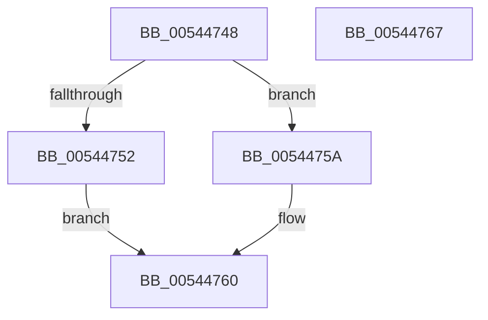

# HalpInterruptSetMsiOverride

- RVA: `0x00544748`–`0x00544768` (길이 `32` bytes)
- VA: `0x0000000140544748`
- 실행 섹션: `.text`
- PDB 이름 있음: `예`; PDB Function 태그: `아니요`
- unwind 정보 RVA: `0x000DB714`
- 디코드: `11`개 명령, `32/32` bytes 표시
- 미해석 바이트: `0` (있으면 어셈블리에 `.byte`로 보존)

> 이 문서는 커널 이미지의 기계어와 PDB 기호를 분석해 생성했습니다. 4번과 5번은 함수 원형과 자료형을 바이너리 사용 방식에서 추정한 C 해석이며 원본 소스 복구 결과는 아닙니다.

## 1. Dependencies

- 직접 호출 지점: **0**; 고유 호출 대상: **0**
- 직접 호출자로 확인된 함수: **2**
- RIP 상대 이미지 참조: **2**

### Outgoing calls
- 직접 디코드된 call 명령이 없습니다.

### Direct callers
- [HalpPiix4Detect](../../pagelk/B7/HalpPiix4Detect_function_00B79E00.md) at `0x00B7A09A`
- [HalpMiscGetParameters](../../init/C1/HalpMiscGetParameters_function_00C1FD30.md) at `0x00C1FF55`

### Static image references
- `0x00544748` → RVA `0x00E101CC` (`.data`; read)
- `0x00544760` → RVA `0x00E101CC` (`.data`; write)

## 2. Other-region calls and transfers

- 다른 실행 섹션으로 향하는 call: **0**
- 별도 외부 분기/꼬리 이동을 확인하지 못했습니다.

## 3. Assembly (complete function range)

```asm
00544748  8B 05 7E BA 8C 00               mov eax, dword ptr [rip + 0x8cba7e]
0054474E  84 C9                           test cl, cl
00544750  74 08                           je 0x14054475a
00544752  83 E0 FD                        and eax, 0xfffffffd
00544755  83 C8 01                        or eax, 1
00544758  EB 06                           jmp 0x140544760
0054475A  83 E0 FE                        and eax, 0xfffffffe
0054475D  83 C8 02                        or eax, 2
00544760  89 05 66 BA 8C 00               mov dword ptr [rip + 0x8cba66], eax
00544766  C3                              ret
00544767  CC                              int3
```

## 4. C-style interpretation (structured pseudocode)

```c
__int64 __fastcall HalpInterruptSetMsiOverride(unsigned __int8 a1)
{
    __int64 result;

    if (a1 == 0) goto loc_0054475A;
    result = (unsigned int)(((unsigned int)(*(unsigned int *)(v_rip + 9222782))) & (0xFFFFFFFDULL));
    result = (unsigned int)((result) | (1));
    goto loc_00544760;
loc_0054475A:
    result = (unsigned int)((result) & (0xFFFFFFFEULL));
    result = (unsigned int)((result) | (2));
loc_00544760:
    *(unsigned int *)(v_rip + 9222758) = (unsigned int)(result);
    return result;
}
```

## 5. (Beta) C Style

```c
int64_t HalpInterruptSetMsiOverride(uint8_t Arg1)
{
    int64_t result;

    if (Arg1 == 0) goto loc_0054475A;
    result = (uint32_t)(((uint32_t)(*(uint32_t *)(v_rip + 0x8CBA7E))) & (0xFFFFFFFDULL));
    result = (uint32_t)((result) | (1));
    goto loc_00544760;
loc_0054475A:
    result = (uint32_t)((result) & (0xFFFFFFFEULL));
    result = (uint32_t)((result) | (2));
loc_00544760:
    *(uint32_t *)(v_rip + 0x8CBA66) = (uint32_t)(result);
    return result;
}
```

## 6. Execution-region graph

[열기: 2D/3D 그래프와 함수 탐색 컨트롤 패널](../../../control-panel.html?section=text&rva=0x00544748&view=graph)

- 2D 그래프는 위에서 아래로 흐르고, 3D 그래프는 빈 공간을 드래그해 회전합니다. Shift+드래그는 이동, 휠은 확대·축소, 함수 노드 선택은 대상 보고서 이동입니다.

### Static fallback


