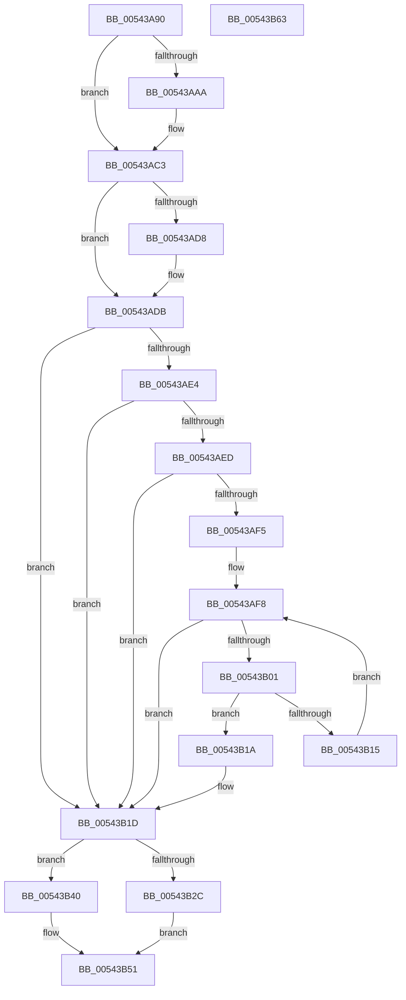

# HalpInterruptSetProcessorStartContext

- RVA: `0x00543A90`–`0x00543B64` (길이 `212` bytes)
- VA: `0x0000000140543A90`
- 실행 섹션: `.text`
- PDB 이름 있음: `예`; PDB Function 태그: `아니요`
- unwind 정보 RVA: `0x00060BC4`
- 디코드: `57`개 명령, `212/212` bytes 표시
- 미해석 바이트: `0` (있으면 어셈블리에 `.byte`로 보존)

> 이 문서는 커널 이미지의 기계어와 PDB 기호를 분석해 생성했습니다. 4번과 5번은 함수 원형과 자료형을 바이너리 사용 방식에서 추정한 C 해석이며 원본 소스 복구 결과는 아닙니다.

## 1. Dependencies

- 직접 호출 지점: **4**; 고유 호출 대상: **4**
- 직접 호출자로 확인된 함수: **2**
- RIP 상대 이미지 참조: **6**

### Outgoing calls
- `0x00543ABE` → [memcpy](../6C/memcpy_function_006C6840.md) (function, `0x006C6840`)
- `0x00543AC3` → [KeForceEnableNx](../../pagelk/B6/KeForceEnableNx_function_00B67C80.md) (function, `0x00B67C80`)
- `0x00543ADB` → [Feature_ProcessorStartupCacheFlushOptimization__private_IsEnabledDeviceUsageNoInline](Feature_ProcessorStartupCacheFlushOptimization__private_IsEnabledDeviceUsageNoInline_function_00543D04.md) (function, `0x00543D04`)
- `0x00543AE4` → [HalpInterruptIsProcessorCacheFlushOptimizationSupported](../55/HalpInterruptIsProcessorCacheFlushOptimizationSupported_function_0055A884.md) (function, `0x0055A884`)

### Direct callers
- [HalpSetupRealModeResume](../6A/HalpSetupRealModeResume_function_006ACC60.md) at `0x006ACC83`
- [HalpInterruptStartProcessor](../../pagelk/B5/HalpInterruptStartProcessor_function_00B5BEF0.md) at `0x00B5BFF7`

### Static image references
- `0x00543AAA` → RVA `0x00FC3E40` (`.data`; read)
- `0x00543ACF` → RVA `0x00FC3E18` (`.data`; read)
- `0x00543AF8` → RVA `0x00F905F4` (`.data`; read)
- `0x00543B01` → RVA `0x00F905F8` (`.data`; read)
- `0x00543B33` → RVA `0x00F90548` (`.data`; read)
- `0x00543B47` → RVA `0x00FC1A8C` (`.data`; read)

## 2. Other-region calls and transfers

- 다른 실행 섹션으로 향하는 call: **1**
  - `0x00543AC3` → [KeForceEnableNx](../../pagelk/B6/KeForceEnableNx_function_00B67C80.md) (`.text` → `PAGELK`)
- 별도 외부 분기/꼬리 이동을 확인하지 못했습니다.

## 3. Assembly (complete function range)

```asm
00543A90  48 89 5C 24 08                  mov qword ptr [rsp + 8], rbx
00543A95  48 89 74 24 10                  mov qword ptr [rsp + 0x10], rsi
00543A9A  57                              push rdi
00543A9B  48 83 EC 20                     sub rsp, 0x20
00543A9F  41 8B F9                        mov edi, r9d
00543AA2  41 8A F0                        mov sil, r8b
00543AA5  48 85 D2                        test rdx, rdx
00543AA8  74 19                           je 0x140543ac3
00543AAA  48 8B 0D 8F 03 A8 00            mov rcx, qword ptr [rip + 0xa8038f]
00543AB1  41 B8 C0 05 00 00               mov r8d, 0x5c0
00543AB7  48 81 C1 90 00 00 00            add rcx, 0x90
00543ABE  E8 7D 2D 18 00                  call 0x1406c6840
00543AC3  E8 B8 41 62 00                  call 0x140b67c80
00543AC8  33 DB                           xor ebx, ebx
00543ACA  84 C0                           test al, al
00543ACC  0F 95 C3                        setne bl
00543ACF  80 3D 42 03 A8 00 00            cmp byte ptr [rip + 0xa80342], 0
00543AD6  74 03                           je 0x140543adb
00543AD8  83 CB 04                        or ebx, 4
00543ADB  E8 24 02 00 00                  call 0x140543d04
00543AE0  85 C0                           test eax, eax
00543AE2  74 39                           je 0x140543b1d
00543AE4  E8 9B 6D 01 00                  call 0x14055a884
00543AE9  84 C0                           test al, al
00543AEB  74 30                           je 0x140543b1d
00543AED  83 CB 08                        or ebx, 8
00543AF0  83 FF FF                        cmp edi, -1
00543AF3  74 28                           je 0x140543b1d
00543AF5  45 33 C0                        xor r8d, r8d
00543AF8  44 3B 05 F5 CA A4 00            cmp r8d, dword ptr [rip + 0xa4caf5]
00543AFF  73 1C                           jae 0x140543b1d
00543B01  48 8B 0D F0 CA A4 00            mov rcx, qword ptr [rip + 0xa4caf0]
00543B08  42 8B 44 C1 04                  mov eax, dword ptr [rcx + r8*8 + 4]
00543B0D  23 C7                           and eax, edi
00543B0F  42 3B 04 C1                     cmp eax, dword ptr [rcx + r8*8]
00543B13  74 05                           je 0x140543b1a
00543B15  41 FF C0                        inc r8d
00543B18  EB DE                           jmp 0x140543af8
00543B1A  83 CB 10                        or ebx, 0x10
00543B1D  48 8B 05 1C 03 A8 00            mov rax, qword ptr [rip + 0xa8031c]
00543B24  89 58 08                        mov dword ptr [rax + 8], ebx
00543B27  40 84 F6                        test sil, sil
00543B2A  74 14                           je 0x140543b40
00543B2C  48 8B 0D 0D 03 A8 00            mov rcx, qword ptr [rip + 0xa8030d]
00543B33  48 8B 05 0E CA A4 00            mov rax, qword ptr [rip + 0xa4ca0e]
00543B3A  48 89 41 58                     mov qword ptr [rcx + 0x58], rax
00543B3E  EB 11                           jmp 0x140543b51
00543B40  48 8B 05 F9 02 A8 00            mov rax, qword ptr [rip + 0xa802f9]
00543B47  8B 0D 3F DF A7 00               mov ecx, dword ptr [rip + 0xa7df3f]
00543B4D  48 89 48 58                     mov qword ptr [rax + 0x58], rcx
00543B51  48 8B 5C 24 30                  mov rbx, qword ptr [rsp + 0x30]
00543B56  33 C0                           xor eax, eax
00543B58  48 8B 74 24 38                  mov rsi, qword ptr [rsp + 0x38]
00543B5D  48 83 C4 20                     add rsp, 0x20
00543B61  5F                              pop rdi
00543B62  C3                              ret
00543B63  CC                              int3
```

## 4. C-style interpretation (structured pseudocode)

```c
__int64 __fastcall HalpInterruptSetProcessorStartContext(__int64 a1, __int64 a2, unsigned __int8 a3, int a4)
{
    __int64 result;
    __int64 v_rbx;
    __int64 v_rsp;
    unsigned __int64 v_stack_p10;
    unsigned __int64 v_stack_p8;

    v_stack_p8 = v_rbx;
    v_stack_p10 = v_rsi;
    v_rsp = (v_rsp) - (32);
    if (a2 != 0) {
        a1 = *(unsigned __int64 *)(v_rip + 11010959);
        a3 = 0x5C0ULL;
        a1 = (a1) + (144);
        result = memcpy(a1, a2, a3, a4);
    }
    result = KeForceEnableNx(a1, a2, a3, a4);
    v_rbx = 0;
    v_rbx = ((unsigned __int8)(result) != 0) ? 1 : 0;
    if ((*(unsigned __int8 *)(v_rip + 11010882)) != 0) {
        v_rbx = (unsigned int)((v_rbx) | (4));
    }
    result = Feature_ProcessorStartupCacheFlushOptimization__private_IsEnabledDeviceUsageNoInline(a1, a2, a3, a4);
    if ((unsigned int)(result) == 0) goto loc_00543B1D;
    result = HalpInterruptIsProcessorCacheFlushOptimizationSupported(a1, a2, a3, a4);
    if ((unsigned __int8)(result) == 0) goto loc_00543B1D;
    v_rbx = (unsigned int)((v_rbx) | (8));
    if (((unsigned int)((unsigned int)(a4))) == -1) goto loc_00543B1D;
    a3 = 0;
loc_00543AF8:
    if (0 >= (*(unsigned int *)(v_rip + 10799861))) goto loc_00543B1D;
    result = (unsigned int)(((unsigned int)(*(unsigned int *)(*(unsigned __int64 *)(v_rip + 10799856) + a3 * 8 + 4))) & ((unsigned int)((unsigned int)(a4))));
    if (((unsigned int)(result)) == (*(unsigned int *)(*(unsigned __int64 *)(v_rip + 10799856) + a3 * 8))) goto loc_00543B1A;
    a3 = (unsigned int)((a3) + 1);
    goto loc_00543AF8;
loc_00543B1A:
    v_rbx = (unsigned int)((v_rbx) | (16));
loc_00543B1D:
    *(unsigned int *)(*(unsigned __int64 *)(v_rip + 11010844) + 8) = (unsigned int)(v_rbx);
    if (a3 == 0) goto loc_00543B40;
    *(unsigned __int64 *)(*(unsigned __int64 *)(v_rip + 11010829) + 88) = *(unsigned __int64 *)(v_rip + 10799630);
    goto loc_00543B51;
loc_00543B40:
    *(unsigned __int64 *)(*(unsigned __int64 *)(v_rip + 11010809) + 88) = (unsigned int)(*(unsigned int *)(v_rip + 11001663));
loc_00543B51:
    result = 0;
    v_rsp = (v_rsp) + (32);
    return result;
}
```

## 5. (Beta) C Style

```c
int64_t HalpInterruptSetProcessorStartContext(int64_t Arg1, int64_t Arg2, uint8_t Arg3, int32_t Arg4)
{
    int64_t result;
    int64_t local_rbx;
    int64_t local_rsp;
    uint64_t v_stack_p10;
    uint64_t v_stack_p8;

    v_stack_p8 = local_rbx;
    v_stack_p10 = local_rsi;
    local_rsp = (local_rsp) - (32);
    if (Arg2 != 0) {
        Arg1 = *(uint64_t *)(v_rip + 0xA8038F);
        Arg3 = 0x5C0ULL;
        Arg1 = (Arg1) + (144);
        result = memcpy(Arg1, Arg2, Arg3, Arg4);
    }
    result = KeForceEnableNx(Arg1, Arg2, Arg3, Arg4);
    local_rbx = 0;
    local_rbx = ((uint8_t)(result) != 0) ? 1 : 0;
    if ((*(uint8_t *)(v_rip + 0xA80342)) != 0) {
        local_rbx = (uint32_t)((local_rbx) | (4));
    }
    result = Feature_ProcessorStartupCacheFlushOptimization__private_IsEnabledDeviceUsageNoInline(Arg1, Arg2, Arg3, Arg4);
    if ((uint32_t)(result) == 0) goto loc_00543B1D;
    result = HalpInterruptIsProcessorCacheFlushOptimizationSupported(Arg1, Arg2, Arg3, Arg4);
    if ((uint8_t)(result) == 0) goto loc_00543B1D;
    local_rbx = (uint32_t)((local_rbx) | (8));
    if (((uint32_t)((uint32_t)(Arg4))) == -1) goto loc_00543B1D;
    Arg3 = 0;
loc_00543AF8:
    if (0 >= (*(uint32_t *)(v_rip + 0xA4CAF5))) goto loc_00543B1D;
    result = (uint32_t)(((uint32_t)(*(uint32_t *)(*(uint64_t *)(v_rip + 0xA4CAF0) + Arg3 * 8 + 0x4))) & ((uint32_t)((uint32_t)(Arg4))));
    if (((uint32_t)(result)) == (*(uint32_t *)(*(uint64_t *)(v_rip + 0xA4CAF0) + Arg3 * 8))) goto loc_00543B1A;
    Arg3 = (uint32_t)((Arg3) + 1);
    goto loc_00543AF8;
loc_00543B1A:
    local_rbx = (uint32_t)((local_rbx) | (16));
loc_00543B1D:
    *(uint32_t *)(*(uint64_t *)(v_rip + 0xA8031C) + 0x8) = (uint32_t)(local_rbx);
    if (Arg3 == 0) goto loc_00543B40;
    *(uint64_t *)(*(uint64_t *)(v_rip + 0xA8030D) + 0x58) = *(uint64_t *)(v_rip + 0xA4CA0E);
    goto loc_00543B51;
loc_00543B40:
    *(uint64_t *)(*(uint64_t *)(v_rip + 0xA802F9) + 0x58) = (uint32_t)(*(uint32_t *)(v_rip + 0xA7DF3F));
loc_00543B51:
    result = 0;
    local_rsp = (local_rsp) + (32);
    return result;
}
```

## 6. Execution-region graph

[열기: 2D/3D 그래프와 함수 탐색 컨트롤 패널](../../../control-panel.html?section=text&rva=0x00543A90&view=graph)

- 2D 그래프는 위에서 아래로 흐르고, 3D 그래프는 빈 공간을 드래그해 회전합니다. Shift+드래그는 이동, 휠은 확대·축소, 함수 노드 선택은 대상 보고서 이동입니다.

### Static fallback


