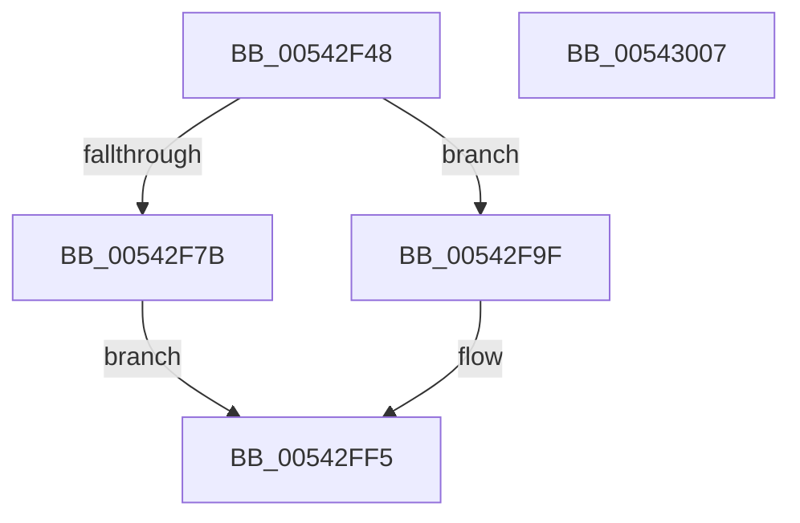

# HalpInterruptSetRemappedLineStateInternal

- RVA: `0x00542F48`–`0x00543008` (길이 `192` bytes)
- VA: `0x0000000140542F48`
- 실행 섹션: `.text`
- PDB 이름 있음: `예`; PDB Function 태그: `아니요`
- unwind 정보 RVA: `0x000794E0`
- 디코드: `49`개 명령, `192/192` bytes 표시
- 미해석 바이트: `0` (있으면 어셈블리에 `.byte`로 보존)

> 이 문서는 커널 이미지의 기계어와 PDB 기호를 분석해 생성했습니다. 4번과 5번은 함수 원형과 자료형을 바이너리 사용 방식에서 추정한 C 해석이며 원본 소스 복구 결과는 아닙니다.

## 1. Dependencies

- 직접 호출 지점: **3**; 고유 호출 대상: **3**
- 직접 호출자로 확인된 함수: **3**
- RIP 상대 이미지 참조: **1**

### Outgoing calls
- `0x00542F6E` → [HalpInterruptFindLines](../2D/HalpInterruptFindLines_function_002D2C88.md) (function, `0x002D2C88`)
- `0x00542F93` → [HalpInterruptSetProblemEx](../48/HalpInterruptSetProblemEx_function_0048AC8C.md) (function, `0x0048AC8C`)
- `0x00542FDA` → [HalpInterruptGetPriority](../2D/HalpInterruptGetPriority_function_002D3558.md) (function, `0x002D3558`)

### Direct callers
- [HalpInterruptRemap](HalpInterruptRemap_function_00542AE4.md) at `0x00542F27`
- [HalpTimerInitializeHypervisorTimer](HalpTimerInitializeHypervisorTimer_function_0054B8F4.md) at `0x0054BB64`
- [sub_006FA83C](../6F/Unknown_function_006FA83C.md) at `0x006FAA77`

### Static image references
- `0x00542F7B` → RVA `0x00010AA8` (`.rdata`; read)

## 2. Other-region calls and transfers

- 다른 실행 섹션으로 향하는 call: **0**
- 별도 외부 분기/꼬리 이동을 확인하지 못했습니다.

## 3. Assembly (complete function range)

```asm
00542F48  48 89 5C 24 08                  mov qword ptr [rsp + 8], rbx
00542F4D  48 89 74 24 10                  mov qword ptr [rsp + 0x10], rsi
00542F52  57                              push rdi
00542F53  48 83 EC 30                     sub rsp, 0x30
00542F57  48 8B C2                        mov rax, rdx
00542F5A  48 8B F9                        mov rdi, rcx
00542F5D  33 DB                           xor ebx, ebx
00542F5F  48 8D 54 24 58                  lea rdx, [rsp + 0x58]
00542F64  48 8B C8                        mov rcx, rax
00542F67  89 5C 24 58                     mov dword ptr [rsp + 0x58], ebx
00542F6B  49 8B F0                        mov rsi, r8
00542F6E  E8 15 FD D8 FF                  call 0x1402d2c88
00542F73  4C 8B D8                        mov r11, rax
00542F76  48 85 C0                        test rax, rax
00542F79  75 24                           jne 0x140542f9f
00542F7B  4C 8D 0D 26 DB AC FF            lea r9, [rip - 0x5324da]
00542F82  C7 44 24 20 FB 0C 00 00         mov dword ptr [rsp + 0x20], 0xcfb
00542F8A  45 33 C0                        xor r8d, r8d
00542F8D  8D 53 12                        lea edx, [rbx + 0x12]
00542F90  48 8B CF                        mov rcx, rdi
00542F93  E8 F4 7C F4 FF                  call 0x14048ac8c
00542F98  BB 0D 00 00 C0                  mov ebx, 0xc000000d
00542F9D  EB 56                           jmp 0x140542ff5
00542F9F  48 8B 48 28                     mov rcx, qword ptr [rax + 0x28]
00542FA3  0F 10 06                        movups xmm0, xmmword ptr [rsi]
00542FA6  44 8B 54 24 58                  mov r10d, dword ptr [rsp + 0x58]
00542FAB  4D 6B CA 38                     imul r9, r10, 0x38
00542FAF  42 0F 11 04 09                  movups xmmword ptr [rcx + r9], xmm0
00542FB4  0F 10 4E 10                     movups xmm1, xmmword ptr [rsi + 0x10]
00542FB8  42 0F 11 4C 09 10               movups xmmword ptr [rcx + r9 + 0x10], xmm1
00542FBE  0F 10 46 20                     movups xmm0, xmmword ptr [rsi + 0x20]
00542FC2  42 0F 11 44 09 20               movups xmmword ptr [rcx + r9 + 0x20], xmm0
00542FC8  F2 0F 10 4E 30                  movsd xmm1, qword ptr [rsi + 0x30]
00542FCD  F2 42 0F 11 4C 09 30            movsd qword ptr [rcx + r9 + 0x30], xmm1
00542FD4  48 8B CF                        mov rcx, rdi
00542FD7  8B 56 30                        mov edx, dword ptr [rsi + 0x30]
00542FDA  E8 79 05 D9 FF                  call 0x1402d3558
00542FDF  49 8B 4B 28                     mov rcx, qword ptr [r11 + 0x28]
00542FE3  4D 03 D2                        add r10, r10
00542FE6  42 89 44 09 34                  mov dword ptr [rcx + r9 + 0x34], eax
00542FEB  49 8B 4B 30                     mov rcx, qword ptr [r11 + 0x30]
00542FEF  42 C6 44 D1 0C 01               mov byte ptr [rcx + r10*8 + 0xc], 1
00542FF5  48 8B 74 24 48                  mov rsi, qword ptr [rsp + 0x48]
00542FFA  8B C3                           mov eax, ebx
00542FFC  48 8B 5C 24 40                  mov rbx, qword ptr [rsp + 0x40]
00543001  48 83 C4 30                     add rsp, 0x30
00543005  5F                              pop rdi
00543006  C3                              ret
00543007  CC                              int3
```

## 4. C-style interpretation (structured pseudocode)

```c
__int64 __fastcall HalpInterruptSetRemappedLineStateInternal(__int64 a1, __int64 a2, __int64 a3)
{
    __int64 result;
    __int64 v_r10;
    __int64 v_rbx;
    __int64 v_rsp;
    unsigned int v_stack_m18;
    unsigned __int64 v_stack_p10;
    unsigned __int64 v_stack_p20;
    unsigned __int64 v_stack_p8;

    v_stack_p8 = v_rbx;
    v_stack_p10 = v_rsi;
    v_rsp = (v_rsp) - (48);
    v_rbx = 0;
    v_stack_p20 = 0;
    result = HalpInterruptFindLines(a2, v_stack_p20, a3, a4);
    if (result != 0) goto loc_00542F9F;
    v_stack_m18 = 0xCFBULL;
    a3 = 0;
    result = HalpInterruptSetProblemEx(a1, v_rbx + 18, a3, v_rip - 5448922);
    goto loc_00542FF5;
loc_00542F9F:
    a4 = (v_rip - 5448922) * ((unsigned int)(v_stack_p20));
    *(unsigned __int64 *)(*(unsigned __int64 *)(result + 40) + a4 * 1) = v_xmm0;
    *(unsigned __int64 *)(*(unsigned __int64 *)(result + 40) + a4 * 1 + 16) = v_xmm1;
    *(unsigned __int64 *)(*(unsigned __int64 *)(result + 40) + a4 * 1 + 32) = v_xmm0;
    *(unsigned __int64 *)(*(unsigned __int64 *)(result + 40) + a4 * 1 + 48) = v_xmm1;
    result = HalpInterruptGetPriority(a1, (unsigned int)(*(unsigned int *)(a3 + 48)), a3, a4);
    v_r10 = ((unsigned int)(v_stack_p20)) + ((unsigned int)(v_stack_p20));
    *(unsigned int *)(*(unsigned __int64 *)(result + 40) + a4 * 1 + 52) = (unsigned int)(result);
    *(unsigned __int8 *)(*(unsigned __int64 *)(result + 48) + v_r10 * 8 + 12) = 1;
loc_00542FF5:
    v_rsp = (v_rsp) + (48);
    return (unsigned int)((unsigned int)((unsigned int)(0xC000000DULL)));
}
```

## 5. (Beta) C Style

```c
int64_t HalpInterruptSetRemappedLineStateInternal(int64_t Arg1, int64_t Arg2, void *Arg3)
{
    uint8_t *arg3 = (uint8_t *)Arg3;

    int64_t result;
    int64_t local_r10;
    int64_t local_rbx;
    int64_t local_rsp;
    uint32_t v_stack_m18;
    uint64_t v_stack_p10;
    uint64_t v_stack_p20;
    uint64_t v_stack_p8;

    v_stack_p8 = local_rbx;
    v_stack_p10 = local_rsi;
    local_rsp = (local_rsp) - (48);
    local_rbx = 0;
    v_stack_p20 = 0;
    result = HalpInterruptFindLines(Arg2, v_stack_p20, Arg3, a4);
    if (result != 0) goto loc_00542F9F;
    v_stack_m18 = 0xCFBULL;
    Arg3 = 0;
    result = HalpInterruptSetProblemEx(Arg1, local_rbx + 18, Arg3, v_rip - 5448922);
    goto loc_00542FF5;
loc_00542F9F:
    a4 = (v_rip - 5448922) * ((uint32_t)(v_stack_p20));
    *(uint64_t *)(*(uint64_t *)(result + 0x28) + a4 * 1) = v_xmm0;
    *(uint64_t *)(*(uint64_t *)(result + 0x28) + a4 * 1 + 0x10) = v_xmm1;
    *(uint64_t *)(*(uint64_t *)(result + 0x28) + a4 * 1 + 0x20) = v_xmm0;
    *(uint64_t *)(*(uint64_t *)(result + 0x28) + a4 * 1 + 0x30) = v_xmm1;
    result = HalpInterruptGetPriority(Arg1, (uint32_t)(*(uint32_t *)(arg3 + 0x30)), Arg3, a4);
    local_r10 = ((uint32_t)(v_stack_p20)) + ((uint32_t)(v_stack_p20));
    *(uint32_t *)(*(uint64_t *)(result + 0x28) + a4 * 1 + 0x34) = (uint32_t)(result);
    *(uint8_t *)(*(uint64_t *)(result + 0x30) + local_r10 * 8 + 0xC) = 1;
loc_00542FF5:
    local_rsp = (local_rsp) + (48);
    return (uint32_t)((uint32_t)((uint32_t)(0xC000000DULL)));
}
```

### 관측된 메모리 오프셋

구조체 형식이 확인되지 않은 접근은 인자 기준의 오프셋으로만 기록했습니다.

| 기준 인자 | 오프셋 표현 | 폭 (bit) | 접근 |
|---|---:|---:|---|
| `Arg3` | `+ 0x0` | `128` | `R` |
| `Arg3` | `+ 0x10` | `128` | `R` |
| `Arg3` | `+ 0x20` | `128` | `R` |
| `Arg3` | `+ 0x30` | `32` | `R` |
| `Arg3` | `+ 0x30` | `64` | `R` |

## 6. Execution-region graph

[열기: 2D/3D 그래프와 함수 탐색 컨트롤 패널](../../../control-panel.html?section=text&rva=0x00542F48&view=graph)

- 2D 그래프는 위에서 아래로 흐르고, 3D 그래프는 빈 공간을 드래그해 회전합니다. Shift+드래그는 이동, 휠은 확대·축소, 함수 노드 선택은 대상 보고서 이동입니다.

### Static fallback


