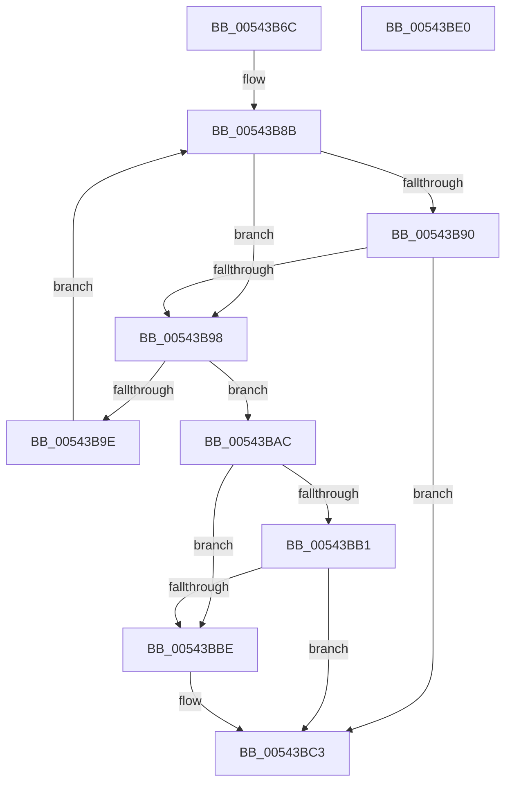

# HalpInterruptWaitForProcessorStartUp

- RVA: `0x00543B6C`–`0x00543BE1` (길이 `117` bytes)
- VA: `0x0000000140543B6C`
- 실행 섹션: `.text`
- PDB 이름 있음: `예`; PDB Function 태그: `아니요`
- unwind 정보 RVA: `0x0005C954`
- 디코드: `34`개 명령, `117/117` bytes 표시
- 미해석 바이트: `0` (있으면 어셈블리에 `.byte`로 보존)

> 이 문서는 커널 이미지의 기계어와 PDB 기호를 분석해 생성했습니다. 4번과 5번은 함수 원형과 자료형을 바이너리 사용 방식에서 추정한 C 해석이며 원본 소스 복구 결과는 아닙니다.

## 1. Dependencies

- 직접 호출 지점: **1**; 고유 호출 대상: **1**
- 직접 호출자로 확인된 함수: **1**
- RIP 상대 이미지 참조: **1**

### Outgoing calls
- `0x00543BA3` → [KeStallExecutionProcessor](../44/KeStallExecutionProcessor_function_0044F620.md) (function, `0x0044F620`)

### Direct callers
- [HalpInterruptStartProcessor](../../pagelk/B5/HalpInterruptStartProcessor_function_00B5BEF0.md) at `0x00B5C0A7`

### Static image references
- `0x00543BCF` → RVA `0x00FC3E2C` (`.data`; write)

## 2. Other-region calls and transfers

- 다른 실행 섹션으로 향하는 call: **0**
- 별도 외부 분기/꼬리 이동을 확인하지 못했습니다.

## 3. Assembly (complete function range)

```asm
00543B6C  48 89 5C 24 08                  mov qword ptr [rsp + 8], rbx
00543B71  48 89 6C 24 10                  mov qword ptr [rsp + 0x10], rbp
00543B76  48 89 74 24 18                  mov qword ptr [rsp + 0x18], rsi
00543B7B  57                              push rdi
00543B7C  48 83 EC 20                     sub rsp, 0x20
00543B80  33 DB                           xor ebx, ebx
00543B82  40 8A F2                        mov sil, dl
00543B85  48 8B E9                        mov rbp, rcx
00543B88  8D 7B 02                        lea edi, [rbx + 2]
00543B8B  40 84 F6                        test sil, sil
00543B8E  75 08                           jne 0x140543b98
00543B90  81 FB 10 27 00 00               cmp ebx, 0x2710
00543B96  73 2B                           jae 0x140543bc3
00543B98  80 7D 00 00                     cmp byte ptr [rbp], 0
00543B9C  75 0E                           jne 0x140543bac
00543B9E  B9 E8 03 00 00                  mov ecx, 0x3e8
00543BA3  E8 78 BA F0 FF                  call 0x14044f620
00543BA8  FF C3                           inc ebx
00543BAA  EB DF                           jmp 0x140543b8b
00543BAC  40 84 F6                        test sil, sil
00543BAF  75 0D                           jne 0x140543bbe
00543BB1  BF 03 00 00 00                  mov edi, 3
00543BB6  81 FB 90 01 00 00               cmp ebx, 0x190
00543BBC  73 05                           jae 0x140543bc3
00543BBE  BF 04 00 00 00                  mov edi, 4
00543BC3  48 8B 6C 24 38                  mov rbp, qword ptr [rsp + 0x38]
00543BC8  8B C7                           mov eax, edi
00543BCA  48 8B 74 24 40                  mov rsi, qword ptr [rsp + 0x40]
00543BCF  89 1D 57 02 A8 00               mov dword ptr [rip + 0xa80257], ebx
00543BD5  48 8B 5C 24 30                  mov rbx, qword ptr [rsp + 0x30]
00543BDA  48 83 C4 20                     add rsp, 0x20
00543BDE  5F                              pop rdi
00543BDF  C3                              ret
00543BE0  CC                              int3
```

## 4. C-style interpretation (structured pseudocode)

```c
__int64 __fastcall HalpInterruptWaitForProcessorStartUp(__int64 a1, unsigned __int8 a2)
{
    __int64 result;
    __int64 v_rbx;
    __int64 v_rdi;
    __int64 v_rsp;
    unsigned __int64 v_stack_p10;
    unsigned __int64 v_stack_p18;
    unsigned __int64 v_stack_p8;

    v_stack_p8 = v_rbx;
    v_stack_p10 = v_rbp;
    v_stack_p18 = v_rsi;
    v_rsp = (v_rsp) - (32);
    v_rbx = 0;
loc_00543B8B:
    if (a2 != 0) goto loc_00543B98;
    if (0 >= 0x2710ULL) goto loc_00543BC3;
loc_00543B98:
    if ((*(unsigned __int8 *)(a1)) != 0) goto loc_00543BAC;
    result = KeStallExecutionProcessor(1000, a2, a3, a4);
    v_rbx = (unsigned int)((v_rbx) + 1);
    goto loc_00543B8B;
loc_00543BAC:
    if (a2 != 0) goto loc_00543BBE;
    v_rdi = 3;
    if (((unsigned int)(v_rbx)) < 400) {
        v_rdi = 4;
    }
    *(unsigned int *)(v_rip + 11010647) = (unsigned int)(v_rbx);
    v_rsp = (v_rsp) + (32);
    return (unsigned int)((unsigned int)(v_rdi));
}
```

## 5. (Beta) C Style

```c
int64_t HalpInterruptWaitForProcessorStartUp(void *Arg1, uint8_t Arg2)
{
    uint8_t *arg1 = (uint8_t *)Arg1;

    int64_t result;
    int64_t local_rbx;
    int64_t local_rdi;
    int64_t local_rsp;
    uint64_t v_stack_p10;
    uint64_t v_stack_p18;
    uint64_t v_stack_p8;

    v_stack_p8 = local_rbx;
    v_stack_p10 = local_rbp;
    v_stack_p18 = local_rsi;
    local_rsp = (local_rsp) - (32);
    local_rbx = 0;
loc_00543B8B:
    if (Arg2 != 0) goto loc_00543B98;
    if (0 >= 0x2710ULL) goto loc_00543BC3;
loc_00543B98:
    if ((*(uint8_t *)(arg1)) != 0) goto loc_00543BAC;
    result = KeStallExecutionProcessor(1000, Arg2, a3, a4);
    local_rbx = (uint32_t)((local_rbx) + 1);
    goto loc_00543B8B;
loc_00543BAC:
    if (Arg2 != 0) goto loc_00543BBE;
    local_rdi = 3;
    if (((uint32_t)(local_rbx)) < 400) {
        local_rdi = 4;
    }
    *(uint32_t *)(v_rip + 0xA80257) = (uint32_t)(local_rbx);
    local_rsp = (local_rsp) + (32);
    return (uint32_t)((uint32_t)(local_rdi));
}
```

### 관측된 메모리 오프셋

구조체 형식이 확인되지 않은 접근은 인자 기준의 오프셋으로만 기록했습니다.

| 기준 인자 | 오프셋 표현 | 폭 (bit) | 접근 |
|---|---:|---:|---|
| `Arg1` | `+ 0x0` | `8` | `R` |

## 6. Execution-region graph

[열기: 2D/3D 그래프와 함수 탐색 컨트롤 패널](../../../control-panel.html?section=text&rva=0x00543B6C&view=graph)

- 2D 그래프는 위에서 아래로 흐르고, 3D 그래프는 빈 공간을 드래그해 회전합니다. Shift+드래그는 이동, 휠은 확대·축소, 함수 노드 선택은 대상 보고서 이동입니다.

### Static fallback


