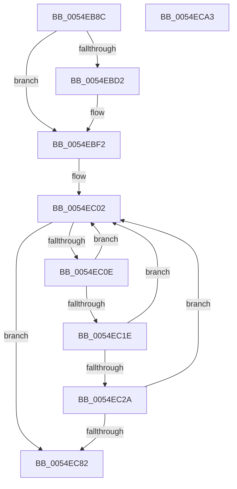

# HalpIommuAllocateRemappingTableEntry

- RVA: `0x0054EB8C`–`0x0054ECA4` (길이 `280` bytes)
- VA: `0x000000014054EB8C`
- 실행 섹션: `.text`
- PDB 이름 있음: `예`; PDB Function 태그: `아니요`
- unwind 정보 RVA: `0x000C4204`
- 디코드: `77`개 명령, `280/280` bytes 표시
- 미해석 바이트: `0` (있으면 어셈블리에 `.byte`로 보존)

> 이 문서는 커널 이미지의 기계어와 PDB 기호를 분석해 생성했습니다. 4번과 5번은 함수 원형과 자료형을 바이너리 사용 방식에서 추정한 C 해석이며 원본 소스 복구 결과는 아닙니다.

## 1. Dependencies

- 직접 호출 지점: **2**; 고유 호출 대상: **2**
- 직접 호출자로 확인된 함수: **1**
- RIP 상대 이미지 참조: **1**

### Outgoing calls
- `0x0054EBDD` → [HalpIommuConvertPciBusMasterDescriptorToDeviceId](HalpIommuConvertPciBusMasterDescriptorToDeviceId_function_0054ECAC.md) (function, `0x0054ECAC`)
- `0x0054EC74` → [guard_dispatch_icall](../6B/guard_dispatch_icall_function_006BAAD0.md) (function, `0x006BAAD0`)

### Direct callers
- [HalpIrtAllocateIndex](../../page/70/HalpIrtAllocateIndex_function_0070A9D4.md) at `0x0070ABD1`

### Static image references
- `0x0054EBF2` → RVA `0x00FC1740` (`.data`; read)

## 2. Other-region calls and transfers

- 다른 실행 섹션으로 향하는 call: **0**
- 별도 외부 분기/꼬리 이동을 확인하지 못했습니다.

## 3. Assembly (complete function range)

```asm
0054EB8C  4C 8B DC                        mov r11, rsp
0054EB8F  49 89 5B 08                     mov qword ptr [r11 + 8], rbx
0054EB93  49 89 6B 10                     mov qword ptr [r11 + 0x10], rbp
0054EB97  49 89 73 18                     mov qword ptr [r11 + 0x18], rsi
0054EB9B  49 89 7B 20                     mov qword ptr [r11 + 0x20], rdi
0054EB9F  41 54                           push r12
0054EBA1  41 56                           push r14
0054EBA3  41 57                           push r15
0054EBA5  48 83 EC 70                     sub rsp, 0x70
0054EBA9  33 C0                           xor eax, eax
0054EBAB  44 8B E1                        mov r12d, ecx
0054EBAE  48 8B 8C 24 B8 00 00 00         mov rcx, qword ptr [rsp + 0xb8]
0054EBB6  0F 57 C0                        xorps xmm0, xmm0
0054EBB9  33 FF                           xor edi, edi
0054EBBB  41 8B E9                        mov ebp, r9d
0054EBBE  45 8B F0                        mov r14d, r8d
0054EBC1  44 8B FA                        mov r15d, edx
0054EBC4  0F 11 44 24 50                  movups xmmword ptr [rsp + 0x50], xmm0
0054EBC9  49 89 43 D8                     mov qword ptr [r11 - 0x28], rax
0054EBCD  48 85 C9                        test rcx, rcx
0054EBD0  74 20                           je 0x14054ebf2
0054EBD2  8A 94 24 C0 00 00 00            mov dl, byte ptr [rsp + 0xc0]
0054EBD9  4D 8D 43 C8                     lea r8, [r11 - 0x38]
0054EBDD  E8 CA 00 00 00                  call 0x14054ecac
0054EBE2  39 7C 24 50                     cmp dword ptr [rsp + 0x50], edi
0054EBE6  4C 8D 44 24 50                  lea r8, [rsp + 0x50]
0054EBEB  4C 0F 44 C7                     cmove r8, rdi
0054EBEF  49 8B F8                        mov rdi, r8
0054EBF2  48 8B 1D 47 2B A7 00            mov rbx, qword ptr [rip + 0xa72b47]
0054EBF9  33 D2                           xor edx, edx
0054EBFB  8B B4 24 B0 00 00 00            mov esi, dword ptr [rsp + 0xb0]
0054EC02  48 8D 05 37 2B A7 00            lea rax, [rip + 0xa72b37]
0054EC09  48 3B D8                        cmp rbx, rax
0054EC0C  74 74                           je 0x14054ec82
0054EC0E  48 8B CB                        mov rcx, rbx
0054EC11  48 8B 1B                        mov rbx, qword ptr [rbx]
0054EC14  8B 81 D8 01 00 00               mov eax, dword ptr [rcx + 0x1d8]
0054EC1A  A8 40                           test al, 0x40
0054EC1C  74 E4                           je 0x14054ec02
0054EC1E  4C 8B 91 A0 00 00 00            mov r10, qword ptr [rcx + 0xa0]
0054EC25  4D 85 D2                        test r10, r10
0054EC28  74 D8                           je 0x14054ec02
0054EC2A  48 8B 49 10                     mov rcx, qword ptr [rcx + 0x10]
0054EC2E  40 8A D5                        mov dl, bpl
0054EC31  48 89 7C 24 40                  mov qword ptr [rsp + 0x40], rdi
0054EC36  41 B9 FF 00 00 00               mov r9d, 0xff
0054EC3C  80 E2 1F                        and dl, 0x1f
0054EC3F  89 74 24 38                     mov dword ptr [rsp + 0x38], esi
0054EC43  44 8B C5                        mov r8d, ebp
0054EC46  41 0F B7 C6                     movzx eax, r14w
0054EC4A  66 41 23 C1                     and ax, r9w
0054EC4E  41 C1 E8 05                     shr r8d, 5
0054EC52  41 80 E0 07                     and r8b, 7
0054EC56  45 8B CE                        mov r9d, r14d
0054EC59  44 88 44 24 30                  mov byte ptr [rsp + 0x30], r8b
0054EC5E  45 8B C7                        mov r8d, r15d
0054EC61  88 54 24 28                     mov byte ptr [rsp + 0x28], dl
0054EC65  41 8B D4                        mov edx, r12d
0054EC68  66 89 44 24 20                  mov word ptr [rsp + 0x20], ax
0054EC6D  49 8B C2                        mov rax, r10
0054EC70  41 C1 E9 08                     shr r9d, 8
0054EC74  E8 57 BE 16 00                  call 0x1406baad0
0054EC79  8B D0                           mov edx, eax
0054EC7B  3D E6 00 00 C0                  cmp eax, 0xc00000e6
0054EC80  74 80                           je 0x14054ec02
0054EC82  4C 8D 5C 24 70                  lea r11, [rsp + 0x70]
0054EC87  8B C2                           mov eax, edx
0054EC89  49 8B 5B 20                     mov rbx, qword ptr [r11 + 0x20]
0054EC8D  49 8B 6B 28                     mov rbp, qword ptr [r11 + 0x28]
0054EC91  49 8B 73 30                     mov rsi, qword ptr [r11 + 0x30]
0054EC95  49 8B 7B 38                     mov rdi, qword ptr [r11 + 0x38]
0054EC99  49 8B E3                        mov rsp, r11
0054EC9C  41 5F                           pop r15
0054EC9E  41 5E                           pop r14
0054ECA0  41 5C                           pop r12
0054ECA2  C3                              ret
0054ECA3  CC                              int3
```

## 4. C-style interpretation (structured pseudocode)

```c
__int64 __fastcall HalpIommuAllocateRemappingTableEntry(int a1, int a2, int a3, int a4, unsigned int a5, __int64 a6, unsigned __int8 a7)
{
    __int64 result;
    __int64 v_rdi;
    __int64 v_rsp;
    unsigned __int64 v_stack_m18;
    unsigned __int64 v_stack_m38;
    unsigned __int64 v_stack_m48;
    unsigned int v_stack_m50;
    unsigned __int8 v_stack_m58;
    unsigned __int8 v_stack_m60;
    unsigned __int16 v_stack_m68;

    *(unsigned __int64 *)(v_rsp + 8) = v_rbx;
    *(unsigned __int64 *)(v_rsp + 16) = v_rbp;
    *(unsigned __int64 *)(v_rsp + 24) = v_rsi;
    *(unsigned __int64 *)(v_rsp + 32) = v_rdi;
    v_rsp = (v_rsp) - (112);
    result = 0;
    v_rdi = 0;
    v_stack_m38 = v_xmm0;
    *(unsigned __int64 *)(v_rsp - 40) = 0;
    if (a6 != 0) {
        a2 = a7;
        a3 = v_rsp - 56;
        result = HalpIommuConvertPciBusMasterDescriptorToDeviceId(a6, a2, a3, a4);
        a3 = v_stack_m38;
        if (v_stack_m38 == 0) { a3 = 0; }
        v_rdi = a3;
    }
    a2 = 0;
loc_0054EC02:
    if ((*(unsigned __int64 *)(v_rip + 10955591)) == (v_rip + 10955575)) goto loc_0054EC82;
    if ((((unsigned __int8)((unsigned int)(*(unsigned int *)(*(unsigned __int64 *)(v_rip + 10955591) + 472)))) & (64)) == 0) goto loc_0054EC02;
    if (*(unsigned __int64 *)(*(unsigned __int64 *)(v_rip + 10955591) + 160) == 0) goto loc_0054EC02;
    v_stack_m48 = v_rdi;
    a2 = (unsigned __int8)(((unsigned __int8)((unsigned int)(a4))) & (31));
    v_stack_m50 = (unsigned int)((unsigned int)(a5));
    result = (unsigned __int16)(((unsigned __int16)((unsigned int)(a3))) & (255));
    a3 = (unsigned int)(((unsigned int)((unsigned int)((unsigned int)(a4)))) >> (5));
    a3 = (unsigned __int8)((a3) & (7));
    v_stack_m58 = (unsigned __int8)(a3);
    v_stack_m60 = (unsigned __int8)(a2);
    v_stack_m68 = (unsigned __int16)(result);
    a4 = (unsigned int)(((unsigned int)((unsigned int)((unsigned int)(a3)))) >> (8));
    result = guard_dispatch_icall(*(unsigned __int64 *)(*(unsigned __int64 *)(v_rip + 10955591) + 16), (unsigned int)((unsigned int)((unsigned int)(a1))), (unsigned int)((unsigned int)((unsigned int)(a2))), a4);
    if (((unsigned int)(result)) == 0xC00000E6ULL) goto loc_0054EC02;
loc_0054EC82:
    return (unsigned int)((unsigned int)((unsigned int)((unsigned int)(result))));
}
```

## 5. (Beta) C Style

```c
int64_t HalpIommuAllocateRemappingTableEntry(int32_t Arg1, int32_t Arg2, int32_t Arg3, int32_t Arg4, uint32_t Arg5, int64_t Arg6, uint8_t Arg7)
{
    int64_t result;
    int64_t local_rdi;
    int64_t local_rsp;
    uint64_t v_stack_m18;
    uint64_t v_stack_m38;
    uint64_t v_stack_m48;
    uint32_t v_stack_m50;
    uint8_t v_stack_m58;
    uint8_t v_stack_m60;
    uint16_t v_stack_m68;

    *(uint64_t *)(local_rsp + 0x8) = local_rbx;
    *(uint64_t *)(local_rsp + 0x10) = local_rbp;
    *(uint64_t *)(local_rsp + 0x18) = local_rsi;
    *(uint64_t *)(local_rsp + 0x20) = local_rdi;
    local_rsp = (local_rsp) - (112);
    result = 0;
    local_rdi = 0;
    v_stack_m38 = v_xmm0;
    *(uint64_t *)(local_rsp - 0x28) = 0;
    if (Arg6 != 0) {
        Arg2 = Arg7;
        Arg3 = local_rsp - 56;
        result = HalpIommuConvertPciBusMasterDescriptorToDeviceId(Arg6, Arg2, Arg3, Arg4);
        Arg3 = v_stack_m38;
        if (v_stack_m38 == 0) { Arg3 = 0; }
        local_rdi = Arg3;
    }
    Arg2 = 0;
loc_0054EC02:
    if ((*(uint64_t *)(v_rip + 0xA72B47)) == (v_rip + 10955575)) goto loc_0054EC82;
    if ((((uint8_t)((uint32_t)(*(uint32_t *)(*(uint64_t *)(v_rip + 0xA72B47) + 0x1D8)))) & (64)) == 0) goto loc_0054EC02;
    if (*(uint64_t *)(*(uint64_t *)(v_rip + 0xA72B47) + 0xA0) == 0) goto loc_0054EC02;
    v_stack_m48 = local_rdi;
    Arg2 = (uint8_t)(((uint8_t)((uint32_t)(Arg4))) & (31));
    v_stack_m50 = (uint32_t)((uint32_t)(Arg5));
    result = (uint16_t)(((uint16_t)((uint32_t)(Arg3))) & (255));
    Arg3 = (uint32_t)(((uint32_t)((uint32_t)((uint32_t)(Arg4)))) >> (5));
    Arg3 = (uint8_t)((Arg3) & (7));
    v_stack_m58 = (uint8_t)(Arg3);
    v_stack_m60 = (uint8_t)(Arg2);
    v_stack_m68 = (uint16_t)(result);
    Arg4 = (uint32_t)(((uint32_t)((uint32_t)((uint32_t)(Arg3)))) >> (8));
    result = guard_dispatch_icall(*(uint64_t *)(*(uint64_t *)(v_rip + 0xA72B47) + 0x10), (uint32_t)((uint32_t)((uint32_t)(Arg1))), (uint32_t)((uint32_t)((uint32_t)(Arg2))), Arg4);
    if (((uint32_t)(result)) == 0xC00000E6ULL) goto loc_0054EC02;
loc_0054EC82:
    return (uint32_t)((uint32_t)((uint32_t)((uint32_t)(result))));
}
```

## 6. Execution-region graph

[열기: 2D/3D 그래프와 함수 탐색 컨트롤 패널](../../../control-panel.html?section=text&rva=0x0054EB8C&view=graph)

- 2D 그래프는 위에서 아래로 흐르고, 3D 그래프는 빈 공간을 드래그해 회전합니다. Shift+드래그는 이동, 휠은 확대·축소, 함수 노드 선택은 대상 보고서 이동입니다.

### Static fallback


