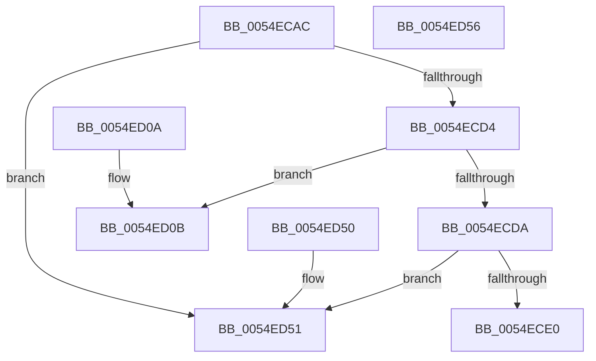

# HalpIommuConvertPciBusMasterDescriptorToDeviceId

- RVA: `0x0054ECAC`–`0x0054ED57` (길이 `171` bytes)
- VA: `0x000000014054ECAC`
- 실행 섹션: `.text`
- PDB 이름 있음: `예`; PDB Function 태그: `아니요`
- unwind 정보 RVA: `0x000DB714`
- 디코드: `53`개 명령, `171/171` bytes 표시
- 미해석 바이트: `0` (있으면 어셈블리에 `.byte`로 보존)

> 이 문서는 커널 이미지의 기계어와 PDB 기호를 분석해 생성했습니다. 4번과 5번은 함수 원형과 자료형을 바이너리 사용 방식에서 추정한 C 해석이며 원본 소스 복구 결과는 아닙니다.

## 1. Dependencies

- 직접 호출 지점: **0**; 고유 호출 대상: **0**
- 직접 호출자로 확인된 함수: **1**
- RIP 상대 이미지 참조: **0**

### Outgoing calls
- 직접 디코드된 call 명령이 없습니다.

### Direct callers
- [HalpIommuAllocateRemappingTableEntry](HalpIommuAllocateRemappingTableEntry_function_0054EB8C.md) at `0x0054EBDD`

### Static image references
- 디코드된 RIP-relative 메모리 참조가 없습니다.

## 2. Other-region calls and transfers

- 다른 실행 섹션으로 향하는 call: **0**
- 별도 외부 분기/꼬리 이동을 확인하지 못했습니다.

## 3. Assembly (complete function range)

```asm
0054ECAC  33 C0                           xor eax, eax
0054ECAE  0F 57 C0                        xorps xmm0, xmm0
0054ECB1  41 0F 11 00                     movups xmmword ptr [r8], xmm0
0054ECB5  49 89 40 10                     mov qword ptr [r8 + 0x10], rax
0054ECB9  4C 8B D1                        mov r10, rcx
0054ECBC  41 C7 00 01 00 00 00            mov dword ptr [r8], 1
0054ECC3  0F B7 41 04                     movzx eax, word ptr [rcx + 4]
0054ECC7  66 41 89 40 08                  mov word ptr [r8 + 8], ax
0054ECCC  44 8B 09                        mov r9d, dword ptr [rcx]
0054ECCF  45 85 C9                        test r9d, r9d
0054ECD2  74 7D                           je 0x14054ed51
0054ECD4  41 83 E9 01                     sub r9d, 1
0054ECD8  74 31                           je 0x14054ed0b
0054ECDA  41 83 F9 01                     cmp r9d, 1
0054ECDE  75 71                           jne 0x14054ed51
0054ECE0  8A 41 09                        mov al, byte ptr [rcx + 9]
0054ECE3  24 1F                           and al, 0x1f
0054ECE5  0F B6 C8                        movzx ecx, al
0054ECE8  41 0F B6 42 08                  movzx eax, byte ptr [r10 + 8]
0054ECED  66 C1 E0 05                     shl ax, 5
0054ECF1  66 0B C8                        or cx, ax
0054ECF4  41 8A 42 0A                     mov al, byte ptr [r10 + 0xa]
0054ECF8  24 07                           and al, 7
0054ECFA  66 C1 E1 03                     shl cx, 3
0054ECFE  0F B6 C0                        movzx eax, al
0054ED01  66 0B C8                        or cx, ax
0054ED04  66 41 89 48 0C                  mov word ptr [r8 + 0xc], cx
0054ED09  C3                              ret
0054ED0A  CC                              int3
0054ED0B  8A 41 09                        mov al, byte ptr [rcx + 9]
0054ED0E  80 E2 03                        and dl, 3
0054ED11  24 1F                           and al, 0x1f
0054ED13  0F B6 C8                        movzx ecx, al
0054ED16  41 0F B6 42 08                  movzx eax, byte ptr [r10 + 8]
0054ED1B  66 C1 E0 05                     shl ax, 5
0054ED1F  66 0B C8                        or cx, ax
0054ED22  41 8A 42 0A                     mov al, byte ptr [r10 + 0xa]
0054ED26  24 07                           and al, 7
0054ED28  66 C1 E1 03                     shl cx, 3
0054ED2C  0F B6 C0                        movzx eax, al
0054ED2F  66 0B C8                        or cx, ax
0054ED32  41 0F B7 40 0A                  movzx eax, word ptr [r8 + 0xa]
0054ED37  66 41 89 48 0C                  mov word ptr [r8 + 0xc], cx
0054ED3C  0F B6 CA                        movzx ecx, dl
0054ED3F  BA FC FF 00 00                  mov edx, 0xfffc
0054ED44  66 23 C2                        and ax, dx
0054ED47  66 0B C8                        or cx, ax
0054ED4A  66 41 89 48 0A                  mov word ptr [r8 + 0xa], cx
0054ED4F  C3                              ret
0054ED50  CC                              int3
0054ED51  41 83 20 00                     and dword ptr [r8], 0
0054ED55  C3                              ret
0054ED56  CC                              int3
```

## 4. C-style interpretation (structured pseudocode)

```c
__int64 __fastcall HalpIommuConvertPciBusMasterDescriptorToDeviceId(__int64 a1, unsigned __int8 a2, __int64 a3)
{
    __int64 result;

    result = 0;
    *(unsigned __int64 *)(a3) = v_xmm0;
    *(unsigned __int64 *)(a3 + 16) = 0;
    *(unsigned int *)(a3) = 1;
    *(unsigned __int16 *)(a3 + 8) = (unsigned __int16)(*(unsigned __int16 *)(a1 + 4));
    if ((unsigned int)((unsigned int)(*(unsigned int *)(a1))) == 0) goto loc_0054ED51;
    a4 = (unsigned int)(((unsigned int)(*(unsigned int *)(a1))) - (1));
    if (condition_is_equal) goto loc_0054ED0B;
    if (((unsigned int)(a4)) != 1) goto loc_0054ED51;
    result = (unsigned __int8)((*(unsigned __int8 *)(a1 + 9)) & (31));
    result = (unsigned __int16)((*(unsigned __int8 *)(a1 + 8)) << (5));
    a1 = (unsigned __int16)(((unsigned __int8)(result)) | ((unsigned __int16)(result)));
    result = (unsigned __int8)((*(unsigned __int8 *)(a1 + 10)) & (7));
    a1 = (unsigned __int16)((a1) << (3));
    a1 = (unsigned __int16)((a1) | ((unsigned __int16)((unsigned __int8)(result))));
    *(unsigned __int16 *)(a3 + 12) = (unsigned __int16)(a1);
    return (unsigned __int8)(result);
loc_0054ED0B:
    a2 = (unsigned __int8)((a2) & (3));
    result = (unsigned __int8)((*(unsigned __int8 *)(a1 + 9)) & (31));
    result = (unsigned __int16)((*(unsigned __int8 *)(a1 + 8)) << (5));
    a1 = (unsigned __int16)(((unsigned __int8)(result)) | ((unsigned __int16)(result)));
    result = (unsigned __int8)((*(unsigned __int8 *)(a1 + 10)) & (7));
    a1 = (unsigned __int16)((a1) << (3));
    a1 = (unsigned __int16)((a1) | ((unsigned __int16)((unsigned __int8)(result))));
    *(unsigned __int16 *)(a3 + 12) = (unsigned __int16)(a1);
    result = (unsigned __int16)((*(unsigned __int16 *)(a3 + 10)) & ((unsigned __int16)((unsigned int)(0xFFFCULL))));
    a1 = (unsigned __int16)((a2) | ((unsigned __int16)(result)));
    *(unsigned __int16 *)(a3 + 10) = (unsigned __int16)(a1);
    return result;
loc_0054ED51:
    return result;
}
```

## 5. (Beta) C Style

```c
int64_t HalpIommuConvertPciBusMasterDescriptorToDeviceId(void *Arg1, uint8_t Arg2, void *Arg3)
{
    uint8_t *arg1 = (uint8_t *)Arg1;
    uint8_t *arg3 = (uint8_t *)Arg3;

    int64_t result;

    result = 0;
    *(uint64_t *)(arg3) = v_xmm0;
    *(uint64_t *)(arg3 + 0x10) = 0;
    *(uint32_t *)(arg3) = 1;
    *(uint16_t *)(arg3 + 0x8) = (uint16_t)(*(uint16_t *)(arg1 + 0x4));
    if ((uint32_t)((uint32_t)(*(uint32_t *)(arg1))) == 0) goto loc_0054ED51;
    a4 = (uint32_t)(((uint32_t)(*(uint32_t *)(arg1))) - (1));
    if (condition_is_equal) goto loc_0054ED0B;
    if (((uint32_t)(a4)) != 1) goto loc_0054ED51;
    result = (uint8_t)((*(uint8_t *)(arg1 + 0x9)) & (31));
    result = (uint16_t)((*(uint8_t *)(arg1 + 0x8)) << (5));
    Arg1 = (uint16_t)(((uint8_t)(result)) | ((uint16_t)(result)));
    result = (uint8_t)((*(uint8_t *)(arg1 + 0xA)) & (7));
    Arg1 = (uint16_t)((Arg1) << (3));
    Arg1 = (uint16_t)((Arg1) | ((uint16_t)((uint8_t)(result))));
    *(uint16_t *)(arg3 + 0xC) = (uint16_t)(Arg1);
    return (uint8_t)(result);
loc_0054ED0B:
    Arg2 = (uint8_t)((Arg2) & (3));
    result = (uint8_t)((*(uint8_t *)(arg1 + 0x9)) & (31));
    result = (uint16_t)((*(uint8_t *)(arg1 + 0x8)) << (5));
    Arg1 = (uint16_t)(((uint8_t)(result)) | ((uint16_t)(result)));
    result = (uint8_t)((*(uint8_t *)(arg1 + 0xA)) & (7));
    Arg1 = (uint16_t)((Arg1) << (3));
    Arg1 = (uint16_t)((Arg1) | ((uint16_t)((uint8_t)(result))));
    *(uint16_t *)(arg3 + 0xC) = (uint16_t)(Arg1);
    result = (uint16_t)((*(uint16_t *)(arg3 + 0xA)) & ((uint16_t)((uint32_t)(0xFFFCULL))));
    Arg1 = (uint16_t)((Arg2) | ((uint16_t)(result)));
    *(uint16_t *)(arg3 + 0xA) = (uint16_t)(Arg1);
    return result;
loc_0054ED51:
    return result;
}
```

### 관측된 메모리 오프셋

구조체 형식이 확인되지 않은 접근은 인자 기준의 오프셋으로만 기록했습니다.

| 기준 인자 | 오프셋 표현 | 폭 (bit) | 접근 |
|---|---:|---:|---|
| `Arg1` | `+ 0x0` | `32` | `R` |
| `Arg1` | `+ 0x4` | `16` | `R` |
| `Arg1` | `+ 0x8` | `8` | `R` |
| `Arg1` | `+ 0x9` | `8` | `R` |
| `Arg1` | `+ 0xA` | `8` | `R` |
| `Arg3` | `+ 0x0` | `32` | `R/W` |
| `Arg3` | `+ 0x0` | `32` | `W` |
| `Arg3` | `+ 0x0` | `128` | `R` |
| `Arg3` | `+ 0x8` | `16` | `W` |
| `Arg3` | `+ 0xA` | `16` | `R` |
| `Arg3` | `+ 0xA` | `16` | `W` |
| `Arg3` | `+ 0xC` | `16` | `W` |
| `Arg3` | `+ 0x10` | `64` | `W` |

## 6. Execution-region graph

[열기: 2D/3D 그래프와 함수 탐색 컨트롤 패널](../../../control-panel.html?section=text&rva=0x0054ECAC&view=graph)

- 2D 그래프는 위에서 아래로 흐르고, 3D 그래프는 빈 공간을 드래그해 회전합니다. Shift+드래그는 이동, 휠은 확대·축소, 함수 노드 선택은 대상 보고서 이동입니다.

### Static fallback


