# HalpIommuDeleteDevice

- RVA: `0x0054F368`–`0x0054F52F` (길이 `455` bytes)
- VA: `0x000000014054F368`
- 실행 섹션: `.text`
- PDB 이름 있음: `예`; PDB Function 태그: `아니요`
- unwind 정보 RVA: `0x0008FC44`
- 디코드: `124`개 명령, `455/455` bytes 표시
- 미해석 바이트: `0` (있으면 어셈블리에 `.byte`로 보존)

> 이 문서는 커널 이미지의 기계어와 PDB 기호를 분석해 생성했습니다. 4번과 5번은 함수 원형과 자료형을 바이너리 사용 방식에서 추정한 C 해석이며 원본 소스 복구 결과는 아닙니다.

## 1. Dependencies

- 직접 호출 지점: **17**; 고유 호출 대상: **14**
- 직접 호출자로 확인된 함수: **10**
- RIP 상대 이미지 참조: **6**

### Outgoing calls
- `0x0054F398` → [KeAbPreAcquire](../21/KeAbPreAcquire_function_00210230.md) (function, `0x00210230`)
- `0x0054F3B1` → [ExfAcquirePushLockExclusiveEx](../20/ExfAcquirePushLockExclusiveEx_function_0020FC90.md) (function, `0x0020FC90`)
- `0x0054F3D7` → [KiRaiseIrqlProcessIrqlFlags](../4F/KiRaiseIrqlProcessIrqlFlags_function_004F56FC.md) (function, `0x004F56FC`)
- `0x0054F3E3` → [ExAcquireSpinLockExclusiveAtDpcLevel](../24/ExAcquireSpinLockExclusiveAtDpcLevel_function_00248E80.md) (function, `0x00248E80`)
- `0x0054F405` → [IidAreIdsStrictlyEqual](../6A/IidAreIdsStrictlyEqual_function_006A2BE4.md) (function, `0x006A2BE4`)
- `0x0054F43D` → [ExReleaseSpinLockExclusiveFromDpcLevel](../24/ExReleaseSpinLockExclusiveFromDpcLevel_function_002497E0.md) (function, `0x002497E0`)
- `0x0054F452` → [KiLowerIrqlProcessIrqlFlags](../4F/KiLowerIrqlProcessIrqlFlags_function_004F5698.md) (function, `0x004F5698`)
- `0x0054F475` → [ExfTryToWakePushLock](../26/ExfTryToWakePushLock_function_00265DD0.md) (function, `0x00265DD0`)
- `0x0054F47D` → [KeAbPostRelease](../2E/KeAbPostRelease_function_002E1600.md) (function, `0x002E1600`)
- `0x0054F4A3` → [HalpMmAllocCtxFree](../3E/HalpMmAllocCtxFree_function_003E1904.md) (function, `0x003E1904`)
- `0x0054F4AB` → [HalpMmAllocCtxFree](../3E/HalpMmAllocCtxFree_function_003E1904.md) (function, `0x003E1904`)
- `0x0054F4B3` → [IommupDeviceDisablePasidTaggedDma](../../page/70/IommupDeviceDisablePasidTaggedDma_function_007089A8.md) (function, `0x007089A8`)
- `0x0054F4C7` → [IommupHvUnregisterDeviceId](../56/IommupHvUnregisterDeviceId_function_00567878.md) (function, `0x00567878`)
- `0x0054F4DF` → [guard_dispatch_icall](../6B/guard_dispatch_icall_function_006BAAD0.md) (function, `0x006BAAD0`)
- `0x0054F4EC` → [HalpMmAllocCtxFree](../3E/HalpMmAllocCtxFree_function_003E1904.md) (function, `0x003E1904`)
- `0x0054F4FF` → [ObfDereferenceObjectWithTag](../2F/ObfDereferenceObjectWithTag_function_002F78E0.md) (function, `0x002F78E0`)
- `0x0054F50C` → [HalpMmAllocCtxFree](../3E/HalpMmAllocCtxFree_function_003E1904.md) (function, `0x003E1904`)

### Direct callers
- [HalpIommuUnblockDevice](../4C/HalpIommuUnblockDevice_function_004C6250.md) at `0x004C63D7`
- [HalpIommuUnblockDevice](../4C/HalpIommuUnblockDevice_function_004C6250.md) at `0x004C6429`
- [HalpIommuBlockDevice](../4C/HalpIommuBlockDevice_function_004CA150.md) at `0x004CA229`
- [IommuCreateAtsDevice](../56/IommuCreateAtsDevice_function_00564BB0.md) at `0x00564CF9`
- [IommuDeleteAtsDevice](../56/IommuDeleteAtsDevice_function_00564D30.md) at `0x00564D90`
- [IommuMapDevice](../56/IommuMapDevice_function_00565AB0.md) at `0x00565B6B`
- [IommuUnmapDevice](../56/IommuUnmapDevice_function_00566200.md) at `0x0056621A`
- [IommuDomainAttachDevice](../56/IommuDomainAttachDevice_function_00567960.md) at `0x00567B1E`
- [IommuDomainDetachDevice](../56/IommuDomainDetachDevice_function_00567D40.md) at `0x00567E3D`
- [IommuDeviceCreate](../../page/70/IommuDeviceCreate_function_0070D030.md) at `0x0070D09C`
- [IommuDeviceDelete](../../page/70/IommuDeviceDelete_function_0070D0D0.md) at `0x0070D23B`

### Static image references
- `0x0054F384` → RVA `0x00FC18C0` (`.data`; read)
- `0x0054F3CC` → RVA `0x00FC6D20` (`ALMOSTRO`; read)
- `0x0054F3DC` → RVA `0x00FC18E0` (`.data`; read)
- `0x0054F3E8` → RVA `0x00FC18D0` (`.data`; read)
- `0x0054F463` → RVA `0x00FC18C0` (`.data`; read/write)
- `0x0054F4B8` → RVA `0x00FC1710` (`.data`; read)

## 2. Other-region calls and transfers

- 다른 실행 섹션으로 향하는 call: **1**
  - `0x0054F4B3` → [IommupDeviceDisablePasidTaggedDma](../../page/70/IommupDeviceDisablePasidTaggedDma_function_007089A8.md) (`.text` → `PAGE`)
- 별도 외부 분기/꼬리 이동을 확인하지 못했습니다.

## 3. Assembly (complete function range)

```asm
0054F368  48 8B C4                        mov rax, rsp
0054F36B  48 89 58 08                     mov qword ptr [rax + 8], rbx
0054F36F  48 89 68 10                     mov qword ptr [rax + 0x10], rbp
0054F373  48 89 70 18                     mov qword ptr [rax + 0x18], rsi
0054F377  48 89 78 20                     mov qword ptr [rax + 0x20], rdi
0054F37B  41 57                           push r15
0054F37D  48 83 EC 20                     sub rsp, 0x20
0054F381  48 8B D9                        mov rbx, rcx
0054F384  4C 8D 3D 35 25 A7 00            lea r15, [rip + 0xa72535]
0054F38B  49 8B CF                        mov rcx, r15
0054F38E  45 33 C0                        xor r8d, r8d
0054F391  33 D2                           xor edx, edx
0054F393  40 32 ED                        xor bpl, bpl
0054F396  33 F6                           xor esi, esi
0054F398  E8 93 0E CC FF                  call 0x140210230
0054F39D  F0 49 0F BA 2F 00               lock bts qword ptr [r15], 0
0054F3A3  48 8B F8                        mov rdi, rax
0054F3A6  73 0E                           jae 0x14054f3b6
0054F3A8  4D 8B C7                        mov r8, r15
0054F3AB  48 8B D0                        mov rdx, rax
0054F3AE  49 8B CF                        mov rcx, r15
0054F3B1  E8 DA 08 CC FF                  call 0x14020fc90
0054F3B6  48 85 FF                        test rdi, rdi
0054F3B9  74 04                           je 0x14054f3bf
0054F3BB  C6 47 0A 01                     mov byte ptr [rdi + 0xa], 1
0054F3BF  44 0F 20 C7                     mov rdi, cr8
0054F3C3  BA 0F 00 00 00                  mov edx, 0xf
0054F3C8  44 0F 22 C2                     mov cr8, rdx
0054F3CC  39 35 4E 79 A7 00               cmp dword ptr [rip + 0xa7794e], esi
0054F3D2  74 08                           je 0x14054f3dc
0054F3D4  40 8A CF                        mov cl, dil
0054F3D7  E8 20 63 FA FF                  call 0x1404f56fc
0054F3DC  48 8D 0D FD 24 A7 00            lea rcx, [rip + 0xa724fd]
0054F3E3  E8 98 9A CF FF                  call 0x140248e80
0054F3E8  4C 8B 1D E1 24 A7 00            mov r11, qword ptr [rip + 0xa724e1]
0054F3EF  48 8D 05 DA 24 A7 00            lea rax, [rip + 0xa724da]
0054F3F6  4C 3B D8                        cmp r11, rax
0054F3F9  74 3B                           je 0x14054f436
0054F3FB  48 8B 13                        mov rdx, qword ptr [rbx]
0054F3FE  49 8B F3                        mov rsi, r11
0054F401  49 8B 4B 10                     mov rcx, qword ptr [r11 + 0x10]
0054F405  E8 DA 37 15 00                  call 0x1406a2be4
0054F40A  84 C0                           test al, al
0054F40C  74 07                           je 0x14054f415
0054F40E  41 83 43 20 FF                  add dword ptr [r11 + 0x20], -1
0054F413  74 05                           je 0x14054f41a
0054F415  4D 8B 1B                        mov r11, qword ptr [r11]
0054F418  EB D5                           jmp 0x14054f3ef
0054F41A  49 8B 0B                        mov rcx, qword ptr [r11]
0054F41D  4C 39 59 08                     cmp qword ptr [rcx + 8], r11
0054F421  75 6B                           jne 0x14054f48e
0054F423  49 8B 43 08                     mov rax, qword ptr [r11 + 8]
0054F427  4C 39 18                        cmp qword ptr [rax], r11
0054F42A  75 62                           jne 0x14054f48e
0054F42C  48 89 08                        mov qword ptr [rax], rcx
0054F42F  40 B5 01                        mov bpl, 1
0054F432  48 89 41 08                     mov qword ptr [rcx + 8], rax
0054F436  48 8D 0D A3 24 A7 00            lea rcx, [rip + 0xa724a3]
0054F43D  E8 9E A3 CF FF                  call 0x1402497e0
0054F442  83 3D D7 78 A7 00 00            cmp dword ptr [rip + 0xa778d7], 0
0054F449  74 0C                           je 0x14054f457
0054F44B  44 0F 20 C1                     mov rcx, cr8
0054F44F  40 8A D7                        mov dl, dil
0054F452  E8 41 62 FA FF                  call 0x1404f5698
0054F457  40 0F B6 C7                     movzx eax, dil
0054F45B  44 0F 22 C0                     mov cr8, rax
0054F45F  48 83 C8 FF                     or rax, 0xffffffffffffffff
0054F463  F0 48 0F C1 05 54 24 A7 00      lock xadd qword ptr [rip + 0xa72454], rax
0054F46C  24 06                           and al, 6
0054F46E  3C 02                           cmp al, 2
0054F470  75 08                           jne 0x14054f47a
0054F472  49 8B CF                        mov rcx, r15
0054F475  E8 56 69 D1 FF                  call 0x140265dd0
0054F47A  49 8B CF                        mov rcx, r15
0054F47D  E8 7E 21 D9 FF                  call 0x1402e1600
0054F482  40 84 ED                        test bpl, bpl
0054F485  75 0E                           jne 0x14054f495
0054F487  33 C0                           xor eax, eax
0054F489  E9 85 00 00 00                  jmp 0x14054f513
0054F48E  B9 03 00 00 00                  mov ecx, 3
0054F493  CD 29                           int 0x29
0054F495  48 85 F6                        test rsi, rsi
0054F498  74 16                           je 0x14054f4b0
0054F49A  48 8B 56 10                     mov rdx, qword ptr [rsi + 0x10]
0054F49E  48 85 D2                        test rdx, rdx
0054F4A1  74 05                           je 0x14054f4a8
0054F4A3  E8 5C 24 E9 FF                  call 0x1403e1904
0054F4A8  48 8B D6                        mov rdx, rsi
0054F4AB  E8 54 24 E9 FF                  call 0x1403e1904
0054F4B0  48 8B CB                        mov rcx, rbx
0054F4B3  E8 F0 94 1B 00                  call 0x1407089a8
0054F4B8  80 3D 51 22 A7 00 00            cmp byte ptr [rip + 0xa72251], 0
0054F4BF  8B F8                           mov edi, eax
0054F4C1  48 8B 4B 20                     mov rcx, qword ptr [rbx + 0x20]
0054F4C5  74 09                           je 0x14054f4d0
0054F4C7  E8 AC 83 01 00                  call 0x140567878
0054F4CC  8B F8                           mov edi, eax
0054F4CE  EB 14                           jmp 0x14054f4e4
0054F4D0  48 8B 41 60                     mov rax, qword ptr [rcx + 0x60]
0054F4D4  45 33 C0                        xor r8d, r8d
0054F4D7  48 8B 49 10                     mov rcx, qword ptr [rcx + 0x10]
0054F4DB  48 8B 53 28                     mov rdx, qword ptr [rbx + 0x28]
0054F4DF  E8 EC B5 16 00                  call 0x1406baad0
0054F4E4  48 8B 13                        mov rdx, qword ptr [rbx]
0054F4E7  48 85 D2                        test rdx, rdx
0054F4EA  74 05                           je 0x14054f4f1
0054F4EC  E8 13 24 E9 FF                  call 0x1403e1904
0054F4F1  48 8B 4B 08                     mov rcx, qword ptr [rbx + 8]
0054F4F5  48 85 C9                        test rcx, rcx
0054F4F8  74 0F                           je 0x14054f509
0054F4FA  BA 48 61 6C 44                  mov edx, 0x446c6148
0054F4FF  E8 DC 83 DA FF                  call 0x1402f78e0
0054F504  48 83 63 08 00                  and qword ptr [rbx + 8], 0
0054F509  48 8B D3                        mov rdx, rbx
0054F50C  E8 F3 23 E9 FF                  call 0x1403e1904
0054F511  8B C7                           mov eax, edi
0054F513  48 8B 5C 24 30                  mov rbx, qword ptr [rsp + 0x30]
0054F518  48 8B 6C 24 38                  mov rbp, qword ptr [rsp + 0x38]
0054F51D  48 8B 74 24 40                  mov rsi, qword ptr [rsp + 0x40]
0054F522  48 8B 7C 24 48                  mov rdi, qword ptr [rsp + 0x48]
0054F527  48 83 C4 20                     add rsp, 0x20
0054F52B  41 5F                           pop r15
0054F52D  C3                              ret
0054F52E  CC                              int3
```

## 4. C-style interpretation (structured pseudocode)

```c
__int64 __fastcall HalpIommuDeleteDevice(__int64 a1, int a2, int a3)
{
    __int64 result;
    __int64 v_rbp;
    __int64 v_rsi;
    __int64 v_rsp;
    unsigned __int64 v_stack_p10;
    unsigned __int64 v_stack_p18;
    unsigned __int64 v_stack_p20;
    unsigned __int64 v_stack_p8;

    *(unsigned __int64 *)(v_rsp + 8) = v_rbx;
    *(unsigned __int64 *)(v_rsp + 16) = v_rbp;
    *(unsigned __int64 *)(v_rsp + 24) = v_rsi;
    *(unsigned __int64 *)(v_rsp + 32) = v_rdi;
    v_rsp = (v_rsp) - (32);
    a3 = 0;
    a2 = 0;
    v_rbp = 0;
    v_rsi = 0;
    result = KeAbPreAcquire(v_rip + 10954037, a2, a3, a4);
    if (!(condition_is_above_or_equal)) {
        a3 = v_rip + 10954037;
        a2 = result;
        a1 = v_rip + 10954037;
        result = ExfAcquirePushLockExclusiveEx(a1, a2, a3, a4);
    }
    if (result != 0) {
        *(unsigned __int8 *)(result + 10) = 1;
    }
    if ((*(unsigned int *)(v_rip + 10975566)) != 0) {
        a1 = (unsigned __int8)(v_cr8);
        result = KiRaiseIrqlProcessIrqlFlags(a1, 15, a3, a4);
    }
    result = ExAcquireSpinLockExclusiveAtDpcLevel(v_rip + 10953981, 15, a3, a4);
loc_0054F3EF:
    if ((*(unsigned __int64 *)(v_rip + 10953953)) == (v_rip + 10953946)) goto loc_0054F436;
    result = IidAreIdsStrictlyEqual(*(unsigned __int64 *)(*(unsigned __int64 *)(v_rip + 10953953) + 16), *(unsigned __int64 *)(a1), a3, a4);
    if ((unsigned __int8)(result) == 0) goto loc_0054F415;
    if ((unsigned __int8)(result) == 0) goto loc_0054F41A;
loc_0054F415:
    goto loc_0054F3EF;
loc_0054F41A:
    if ((*(unsigned __int64 *)(*(unsigned __int64 *)(*(unsigned __int64 *)(*(unsigned __int64 *)(v_rip + 10953953))) + 8)) != (*(unsigned __int64 *)(*(unsigned __int64 *)(v_rip + 10953953)))) goto loc_0054F48E;
    if ((*(unsigned __int64 *)(*(unsigned __int64 *)(*(unsigned __int64 *)(*(unsigned __int64 *)(v_rip + 10953953)) + 8))) != (*(unsigned __int64 *)(*(unsigned __int64 *)(v_rip + 10953953)))) goto loc_0054F48E;
    *(unsigned __int64 *)(*(unsigned __int64 *)(*(unsigned __int64 *)(*(unsigned __int64 *)(v_rip + 10953953)) + 8)) = *(unsigned __int64 *)(*(unsigned __int64 *)(*(unsigned __int64 *)(v_rip + 10953953)));
    *(unsigned __int64 *)(*(unsigned __int64 *)(*(unsigned __int64 *)(*(unsigned __int64 *)(v_rip + 10953953))) + 8) = *(unsigned __int64 *)(*(unsigned __int64 *)(*(unsigned __int64 *)(v_rip + 10953953)) + 8);
loc_0054F436:
    result = ExReleaseSpinLockExclusiveFromDpcLevel(v_rip + 10953891, *(unsigned __int64 *)(a1), a3, a4);
    if ((*(unsigned int *)(v_rip + 10975447)) != 0) {
        a1 = 15;
        a2 = (unsigned __int8)(v_cr8);
        result = KiLowerIrqlProcessIrqlFlags(a1, a2, a3, a4);
    }
    result = ((unsigned __int8)(v_cr8)) | (-1);
    result = (unsigned __int8)((result) & (6));
    if (((unsigned __int8)(result)) == 2) {
        a1 = v_rip + 10954037;
        result = ExfTryToWakePushLock(a1, a2, a3, a4);
    }
    result = KeAbPostRelease(v_rip + 10954037, a2, a3, a4);
    if (1 != 0) goto loc_0054F495;
    result = 0;
    goto loc_0054F513;
loc_0054F48E:
loc_0054F495:
    if (*(unsigned __int64 *)(v_rip + 10953953) == 0) goto loc_0054F4B0;
    if (*(unsigned __int64 *)(*(unsigned __int64 *)(v_rip + 10953953) + 16) != 0) {
        result = HalpMmAllocCtxFree(3, *(unsigned __int64 *)(*(unsigned __int64 *)(v_rip + 10953953) + 16), a3, a4);
    }
    result = HalpMmAllocCtxFree(3, *(unsigned __int64 *)(v_rip + 10953953), a3, a4);
loc_0054F4B0:
    result = IommupDeviceDisablePasidTaggedDma(a1, *(unsigned __int64 *)(v_rip + 10953953), a3, a4);
    if ((*(unsigned __int8 *)(v_rip + 10953297)) == 0) goto loc_0054F4D0;
    result = IommupHvUnregisterDeviceId(*(unsigned __int64 *)(a1 + 32), *(unsigned __int64 *)(v_rip + 10953953), a3, a4);
    goto loc_0054F4E4;
loc_0054F4D0:
    a3 = 0;
    result = guard_dispatch_icall(*(unsigned __int64 *)(*(unsigned __int64 *)(a1 + 32) + 16), *(unsigned __int64 *)(a1 + 40), a3, a4);
loc_0054F4E4:
    if (*(unsigned __int64 *)(a1) != 0) {
        result = HalpMmAllocCtxFree(*(unsigned __int64 *)(*(unsigned __int64 *)(a1 + 32) + 16), *(unsigned __int64 *)(a1), a3, a4);
    }
    if (*(unsigned __int64 *)(a1 + 8) != 0) {
        a2 = 0x446C6148ULL;
        result = ObfDereferenceObjectWithTag(*(unsigned __int64 *)(a1 + 8), a2, a3, a4);
    }
    result = HalpMmAllocCtxFree(*(unsigned __int64 *)(a1 + 8), a1, a3, a4);
loc_0054F513:
    v_rsp = (v_rsp) + (32);
    return (unsigned int)((unsigned int)((unsigned int)((unsigned int)(result))));
}
```

## 5. (Beta) C Style

```c
int64_t HalpIommuDeleteDevice(void *Arg1, int32_t Arg2, int32_t Arg3)
{
    uint8_t *arg1 = (uint8_t *)Arg1;

    int64_t result;
    int64_t local_rbp;
    int64_t local_rsi;
    int64_t local_rsp;
    uint64_t v_stack_p10;
    uint64_t v_stack_p18;
    uint64_t v_stack_p20;
    uint64_t v_stack_p8;

    *(uint64_t *)(local_rsp + 0x8) = local_rbx;
    *(uint64_t *)(local_rsp + 0x10) = local_rbp;
    *(uint64_t *)(local_rsp + 0x18) = local_rsi;
    *(uint64_t *)(local_rsp + 0x20) = local_rdi;
    local_rsp = (local_rsp) - (32);
    Arg3 = 0;
    Arg2 = 0;
    local_rbp = 0;
    local_rsi = 0;
    result = KeAbPreAcquire(v_rip + 10954037, Arg2, Arg3, a4);
    if (!(condition_is_above_or_equal)) {
        Arg3 = v_rip + 10954037;
        Arg2 = result;
        Arg1 = v_rip + 10954037;
        result = ExfAcquirePushLockExclusiveEx(Arg1, Arg2, Arg3, a4);
    }
    if (result != 0) {
        *(uint8_t *)(result + 0xA) = 1;
    }
    if ((*(uint32_t *)(v_rip + 0xA7794E)) != 0) {
        Arg1 = (uint8_t)(v_cr8);
        result = KiRaiseIrqlProcessIrqlFlags(Arg1, 15, Arg3, a4);
    }
    result = ExAcquireSpinLockExclusiveAtDpcLevel(v_rip + 10953981, 15, Arg3, a4);
loc_0054F3EF:
    if ((*(uint64_t *)(v_rip + 0xA724E1)) == (v_rip + 10953946)) goto loc_0054F436;
    result = IidAreIdsStrictlyEqual(*(uint64_t *)(*(uint64_t *)(v_rip + 0xA724E1) + 0x10), *(uint64_t *)(arg1), Arg3, a4);
    if ((uint8_t)(result) == 0) goto loc_0054F415;
    if ((uint8_t)(result) == 0) goto loc_0054F41A;
loc_0054F415:
    goto loc_0054F3EF;
loc_0054F41A:
    if ((*(uint64_t *)(*(uint64_t *)(*(uint64_t *)(*(uint64_t *)(v_rip + 0xA724E1))) + 0x8)) != (*(uint64_t *)(*(uint64_t *)(v_rip + 0xA724E1)))) goto loc_0054F48E;
    if ((*(uint64_t *)(*(uint64_t *)(*(uint64_t *)(*(uint64_t *)(v_rip + 0xA724E1)) + 0x8))) != (*(uint64_t *)(*(uint64_t *)(v_rip + 0xA724E1)))) goto loc_0054F48E;
    *(uint64_t *)(*(uint64_t *)(*(uint64_t *)(*(uint64_t *)(v_rip + 0xA724E1)) + 0x8)) = *(uint64_t *)(*(uint64_t *)(*(uint64_t *)(v_rip + 0xA724E1)));
    *(uint64_t *)(*(uint64_t *)(*(uint64_t *)(*(uint64_t *)(v_rip + 0xA724E1))) + 0x8) = *(uint64_t *)(*(uint64_t *)(*(uint64_t *)(v_rip + 0xA724E1)) + 0x8);
loc_0054F436:
    result = ExReleaseSpinLockExclusiveFromDpcLevel(v_rip + 10953891, *(uint64_t *)(arg1), Arg3, a4);
    if ((*(uint32_t *)(v_rip + 0xA778D7)) != 0) {
        Arg1 = 15;
        Arg2 = (uint8_t)(v_cr8);
        result = KiLowerIrqlProcessIrqlFlags(Arg1, Arg2, Arg3, a4);
    }
    result = ((uint8_t)(v_cr8)) | (-1);
    result = (uint8_t)((result) & (6));
    if (((uint8_t)(result)) == 2) {
        Arg1 = v_rip + 10954037;
        result = ExfTryToWakePushLock(Arg1, Arg2, Arg3, a4);
    }
    result = KeAbPostRelease(v_rip + 10954037, Arg2, Arg3, a4);
    if (1 != 0) goto loc_0054F495;
    result = 0;
    goto loc_0054F513;
loc_0054F48E:
loc_0054F495:
    if (*(uint64_t *)(v_rip + 0xA724E1) == 0) goto loc_0054F4B0;
    if (*(uint64_t *)(*(uint64_t *)(v_rip + 0xA724E1) + 0x10) != 0) {
        result = HalpMmAllocCtxFree(3, *(uint64_t *)(*(uint64_t *)(v_rip + 0xA724E1) + 0x10), Arg3, a4);
    }
    result = HalpMmAllocCtxFree(3, *(uint64_t *)(v_rip + 0xA724E1), Arg3, a4);
loc_0054F4B0:
    result = IommupDeviceDisablePasidTaggedDma(Arg1, *(uint64_t *)(v_rip + 0xA724E1), Arg3, a4);
    if ((*(uint8_t *)(v_rip + 0xA72251)) == 0) goto loc_0054F4D0;
    result = IommupHvUnregisterDeviceId(*(uint64_t *)(arg1 + 0x20), *(uint64_t *)(v_rip + 0xA724E1), Arg3, a4);
    goto loc_0054F4E4;
loc_0054F4D0:
    Arg3 = 0;
    result = guard_dispatch_icall(*(uint64_t *)(*(uint64_t *)(arg1 + 0x20) + 0x10), *(uint64_t *)(arg1 + 0x28), Arg3, a4);
loc_0054F4E4:
    if (*(uint64_t *)(arg1) != 0) {
        result = HalpMmAllocCtxFree(*(uint64_t *)(*(uint64_t *)(arg1 + 0x20) + 0x10), *(uint64_t *)(arg1), Arg3, a4);
    }
    if (*(uint64_t *)(arg1 + 0x8) != 0) {
        Arg2 = 0x446C6148ULL;
        result = ObfDereferenceObjectWithTag(*(uint64_t *)(arg1 + 0x8), Arg2, Arg3, a4);
    }
    result = HalpMmAllocCtxFree(*(uint64_t *)(arg1 + 0x8), Arg1, Arg3, a4);
loc_0054F513:
    local_rsp = (local_rsp) + (32);
    return (uint32_t)((uint32_t)((uint32_t)((uint32_t)(result))));
}
```

### 관측된 메모리 오프셋

구조체 형식이 확인되지 않은 접근은 인자 기준의 오프셋으로만 기록했습니다.

| 기준 인자 | 오프셋 표현 | 폭 (bit) | 접근 |
|---|---:|---:|---|
| `Arg1` | `+ 0x0` | `64` | `R` |
| `Arg1` | `+ 0x8` | `64` | `R` |
| `Arg1` | `+ 0x8` | `64` | `R/W` |
| `Arg1` | `+ 0x20` | `64` | `R` |
| `Arg1` | `+ 0x28` | `64` | `R` |

## 6. Execution-region graph

[열기: 2D/3D 그래프와 함수 탐색 컨트롤 패널](../../../control-panel.html?section=text&rva=0x0054F368&view=graph)

- 2D 그래프는 위에서 아래로 흐르고, 3D 그래프는 빈 공간을 드래그해 회전합니다. Shift+드래그는 이동, 휠은 확대·축소, 함수 노드 선택은 대상 보고서 이동입니다.

### Static fallback

```mermaid
flowchart TD
  bb_0054F368[BB_0054F368]
  bb_0054F3A8[BB_0054F3A8]
  bb_0054F3B6[BB_0054F3B6]
  bb_0054F3BB[BB_0054F3BB]
  bb_0054F3BF[BB_0054F3BF]
  bb_0054F3D4[BB_0054F3D4]
  bb_0054F3DC[BB_0054F3DC]
  bb_0054F3EF[BB_0054F3EF]
  bb_0054F3FB[BB_0054F3FB]
  bb_0054F40E[BB_0054F40E]
  bb_0054F415[BB_0054F415]
  bb_0054F41A[BB_0054F41A]
  bb_0054F423[BB_0054F423]
  bb_0054F42C[BB_0054F42C]
  bb_0054F436[BB_0054F436]
  bb_0054F44B[BB_0054F44B]
  bb_0054F457[BB_0054F457]
  bb_0054F472[BB_0054F472]
  bb_0054F47A[BB_0054F47A]
  bb_0054F487[BB_0054F487]
  bb_0054F48E[BB_0054F48E]
  bb_0054F495[BB_0054F495]
  bb_0054F49A[BB_0054F49A]
  bb_0054F4A3[BB_0054F4A3]
  bb_0054F4A8[BB_0054F4A8]
  bb_0054F4B0[BB_0054F4B0]
  bb_0054F4C7[BB_0054F4C7]
  bb_0054F4D0[BB_0054F4D0]
  bb_0054F4E4[BB_0054F4E4]
  bb_0054F4EC[BB_0054F4EC]
  bb_0054F4F1[BB_0054F4F1]
  bb_0054F4FA[BB_0054F4FA]
  bb_0054F509[BB_0054F509]
  bb_0054F513[BB_0054F513]
  bb_0054F52E[BB_0054F52E]
  bb_0054F368 -->|branch| bb_0054F3B6
  bb_0054F368 -->|fallthrough| bb_0054F3A8
  bb_0054F3A8 -->|flow| bb_0054F3B6
  bb_0054F3B6 -->|branch| bb_0054F3BF
  bb_0054F3B6 -->|fallthrough| bb_0054F3BB
  bb_0054F3BB -->|flow| bb_0054F3BF
  bb_0054F3BF -->|branch| bb_0054F3DC
  bb_0054F3BF -->|fallthrough| bb_0054F3D4
  bb_0054F3D4 -->|flow| bb_0054F3DC
  bb_0054F3DC -->|flow| bb_0054F3EF
  bb_0054F3EF -->|branch| bb_0054F436
  bb_0054F3EF -->|fallthrough| bb_0054F3FB
  bb_0054F3FB -->|branch| bb_0054F415
  bb_0054F3FB -->|fallthrough| bb_0054F40E
  bb_0054F40E -->|branch| bb_0054F41A
  bb_0054F40E -->|fallthrough| bb_0054F415
  bb_0054F415 -->|branch| bb_0054F3EF
  bb_0054F41A -->|branch| bb_0054F48E
  bb_0054F41A -->|fallthrough| bb_0054F423
  bb_0054F423 -->|branch| bb_0054F48E
  bb_0054F423 -->|fallthrough| bb_0054F42C
  bb_0054F42C -->|flow| bb_0054F436
  bb_0054F436 -->|branch| bb_0054F457
  bb_0054F436 -->|fallthrough| bb_0054F44B
  bb_0054F44B -->|flow| bb_0054F457
  bb_0054F457 -->|branch| bb_0054F47A
  bb_0054F457 -->|fallthrough| bb_0054F472
  bb_0054F472 -->|flow| bb_0054F47A
  bb_0054F47A -->|branch| bb_0054F495
  bb_0054F47A -->|fallthrough| bb_0054F487
  bb_0054F487 -->|branch| bb_0054F513
  bb_0054F48E -->|flow| bb_0054F495
  bb_0054F495 -->|branch| bb_0054F4B0
  bb_0054F495 -->|fallthrough| bb_0054F49A
  bb_0054F49A -->|branch| bb_0054F4A8
  bb_0054F49A -->|fallthrough| bb_0054F4A3
  bb_0054F4A3 -->|flow| bb_0054F4A8
  bb_0054F4A8 -->|flow| bb_0054F4B0
  bb_0054F4B0 -->|branch| bb_0054F4D0
  bb_0054F4B0 -->|fallthrough| bb_0054F4C7
  bb_0054F4C7 -->|branch| bb_0054F4E4
  bb_0054F4D0 -->|flow| bb_0054F4E4
  bb_0054F4E4 -->|branch| bb_0054F4F1
  bb_0054F4E4 -->|fallthrough| bb_0054F4EC
  bb_0054F4EC -->|flow| bb_0054F4F1
  bb_0054F4F1 -->|branch| bb_0054F509
  bb_0054F4F1 -->|fallthrough| bb_0054F4FA
  bb_0054F4FA -->|flow| bb_0054F509
  bb_0054F509 -->|flow| bb_0054F513
```


