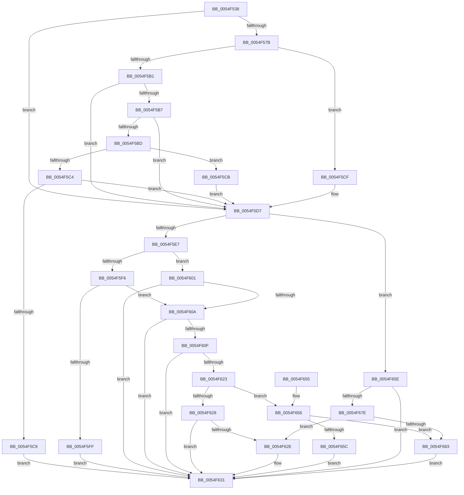

# HalpIommuDeviceGetDomainTypes

- RVA: `0x0054F538`–`0x0054F688` (길이 `336` bytes)
- VA: `0x000000014054F538`
- 실행 섹션: `.text`
- PDB 이름 있음: `예`; PDB Function 태그: `아니요`
- unwind 정보 RVA: `0x000C41E4`
- 디코드: `100`개 명령, `336/336` bytes 표시
- 미해석 바이트: `0` (있으면 어셈블리에 `.byte`로 보존)

> 이 문서는 커널 이미지의 기계어와 PDB 기호를 분석해 생성했습니다. 4번과 5번은 함수 원형과 자료형을 바이너리 사용 방식에서 추정한 C 해석이며 원본 소스 복구 결과는 아닙니다.

## 1. Dependencies

- 직접 호출 지점: **3**; 고유 호출 대상: **3**
- 직접 호출자로 확인된 함수: **5**
- RIP 상대 이미지 참조: **6**

### Outgoing calls
- `0x0054F5A8` → [IoGetDevicePropertyData](../../page/90/IoGetDevicePropertyData_function_009005E0.md) (function, `0x009005E0`)
- `0x0054F61A` → [guard_dispatch_icall](../6B/guard_dispatch_icall_function_006BAAD0.md) (function, `0x006BAAD0`)
- `0x0054F63A` → [_security_check_cookie](../6A/_security_check_cookie_function_006AC640.md) (function, `0x006AC640`)

### Direct callers
- [HalpIommuInvokeInterfaceStateChangeCallbacks](HalpIommuInvokeInterfaceStateChangeCallbacks_function_0054F708.md) at `0x0054F793`
- [IommuDeviceQueryDomainTypes](../56/IommuDeviceQueryDomainTypes_function_00567940.md) at `0x00567949`
- [IommuDomainAttachDeviceEx](../56/IommuDomainAttachDeviceEx_function_00567B60.md) at `0x00567B88`
- [IommuRegisterInterfaceStateChangeCallback](../56/IommuRegisterInterfaceStateChangeCallback_function_00568200.md) at `0x0056833D`
- [IommuDomainAttachPasidDevice](../../page/70/IommuDomainAttachPasidDevice_function_0070D2C0.md) at `0x0070D2E1`

### Static image references
- `0x0054F54F` → RVA `0x00E0A740` (`.data`; read)
- `0x0054F586` → RVA `0x000212F8` (`.rdata`; read)
- `0x0054F5D7` → RVA `0x00FC1710` (`.data`; read)
- `0x0054F5F6` → RVA `0x00FC1712` (`.data`; read)
- `0x0054F601` → RVA `0x00FC1711` (`.data`; read)
- `0x0054F60F` → RVA `0x00FC1D60` (`.data`; read)

## 2. Other-region calls and transfers

- 다른 실행 섹션으로 향하는 call: **1**
  - `0x0054F5A8` → [IoGetDevicePropertyData](../../page/90/IoGetDevicePropertyData_function_009005E0.md) (`.text` → `PAGE`)
- 별도 외부 분기/꼬리 이동을 확인하지 못했습니다.

## 3. Assembly (complete function range)

```asm
0054F538  4C 8B DC                        mov r11, rsp
0054F53B  49 89 5B 10                     mov qword ptr [r11 + 0x10], rbx
0054F53F  49 89 73 18                     mov qword ptr [r11 + 0x18], rsi
0054F543  49 89 7B 20                     mov qword ptr [r11 + 0x20], rdi
0054F547  55                              push rbp
0054F548  48 8B EC                        mov rbp, rsp
0054F54B  48 83 EC 70                     sub rsp, 0x70
0054F54F  48 8B 05 EA B1 8B 00            mov rax, qword ptr [rip + 0x8bb1ea]
0054F556  48 33 C4                        xor rax, rsp
0054F559  48 89 45 F0                     mov qword ptr [rbp - 0x10], rax
0054F55D  83 65 D0 00                     and dword ptr [rbp - 0x30], 0
0054F561  48 8B F1                        mov rsi, rcx
0054F564  48 8B 49 08                     mov rcx, qword ptr [rcx + 8]
0054F568  33 DB                           xor ebx, ebx
0054F56A  83 65 D4 00                     and dword ptr [rbp - 0x2c], 0
0054F56E  BF 02 00 00 00                  mov edi, 2
0054F573  89 7D D8                        mov dword ptr [rbp - 0x28], edi
0054F576  48 85 C9                        test rcx, rcx
0054F579  74 5C                           je 0x14054f5d7
0054F57B  48 8D 45 D0                     lea rax, [rbp - 0x30]
0054F57F  45 33 C9                        xor r9d, r9d
0054F582  49 89 43 C0                     mov qword ptr [r11 - 0x40], rax
0054F586  48 8D 15 6B 1D AD FF            lea rdx, [rip - 0x52e295]
0054F58D  48 8D 45 D4                     lea rax, [rbp - 0x2c]
0054F591  45 33 C0                        xor r8d, r8d
0054F594  49 89 43 B8                     mov qword ptr [r11 - 0x48], rax
0054F598  48 8D 45 D8                     lea rax, [rbp - 0x28]
0054F59C  49 89 43 B0                     mov qword ptr [r11 - 0x50], rax
0054F5A0  C7 44 24 20 04 00 00 00         mov dword ptr [rsp + 0x20], 4
0054F5A8  E8 33 10 3B 00                  call 0x1409005e0
0054F5AD  85 C0                           test eax, eax
0054F5AF  78 1E                           js 0x14054f5cf
0054F5B1  83 7D D0 07                     cmp dword ptr [rbp - 0x30], 7
0054F5B5  75 20                           jne 0x14054f5d7
0054F5B7  83 7D D4 04                     cmp dword ptr [rbp - 0x2c], 4
0054F5BB  75 1A                           jne 0x14054f5d7
0054F5BD  8B 4D D8                        mov ecx, dword ptr [rbp - 0x28]
0054F5C0  85 C9                           test ecx, ecx
0054F5C2  74 07                           je 0x14054f5cb
0054F5C4  83 F9 01                        cmp ecx, 1
0054F5C7  74 0E                           je 0x14054f5d7
0054F5C9  EB 66                           jmp 0x14054f631
0054F5CB  8B DF                           mov ebx, edi
0054F5CD  EB 08                           jmp 0x14054f5d7
0054F5CF  3D 34 00 00 C0                  cmp eax, 0xc0000034
0054F5D4  0F 44 DF                        cmove ebx, edi
0054F5D7  80 3D 32 21 A7 00 00            cmp byte ptr [rip + 0xa72132], 0
0054F5DE  40 8A BE 12 01 00 00            mov dil, byte ptr [rsi + 0x112]
0054F5E5  74 77                           je 0x14054f65e
0054F5E7  48 8B 0E                        mov rcx, qword ptr [rsi]
0054F5EA  0F 57 C0                        xorps xmm0, xmm0
0054F5ED  0F 11 45 E0                     movups xmmword ptr [rbp - 0x20], xmm0
0054F5F1  40 84 FF                        test dil, dil
0054F5F4  75 0B                           jne 0x14054f601
0054F5F6  40 38 3D 15 21 A7 00            cmp byte ptr [rip + 0xa72115], dil
0054F5FD  75 0B                           jne 0x14054f60a
0054F5FF  EB 30                           jmp 0x14054f631
0054F601  80 3D 09 21 A7 00 00            cmp byte ptr [rip + 0xa72109], 0
0054F608  74 27                           je 0x14054f631
0054F60A  83 39 01                        cmp dword ptr [rcx], 1
0054F60D  75 22                           jne 0x14054f631
0054F60F  48 8B 05 4A 27 A7 00            mov rax, qword ptr [rip + 0xa7274a]
0054F616  48 8D 55 E0                     lea rdx, [rbp - 0x20]
0054F61A  E8 B1 B4 16 00                  call 0x1406baad0
0054F61F  85 C0                           test eax, eax
0054F621  78 0E                           js 0x14054f631
0054F623  40 84 FF                        test dil, dil
0054F626  75 2E                           jne 0x14054f656
0054F628  F6 45 E0 10                     test byte ptr [rbp - 0x20], 0x10
0054F62C  74 03                           je 0x14054f631
0054F62E  83 CB 01                        or ebx, 1
0054F631  8B C3                           mov eax, ebx
0054F633  48 8B 4D F0                     mov rcx, qword ptr [rbp - 0x10]
0054F637  48 33 CC                        xor rcx, rsp
0054F63A  E8 01 D0 15 00                  call 0x1406ac640
0054F63F  4C 8D 5C 24 70                  lea r11, [rsp + 0x70]
0054F644  49 8B 5B 18                     mov rbx, qword ptr [r11 + 0x18]
0054F648  49 8B 73 20                     mov rsi, qword ptr [r11 + 0x20]
0054F64C  49 8B 7B 28                     mov rdi, qword ptr [r11 + 0x28]
0054F650  49 8B E3                        mov rsp, r11
0054F653  5D                              pop rbp
0054F654  C3                              ret
0054F655  CC                              int3
0054F656  F6 45 E0 20                     test byte ptr [rbp - 0x20], 0x20
0054F65A  75 27                           jne 0x14054f683
0054F65C  EB D3                           jmp 0x14054f631
0054F65E  40 8A C7                        mov al, dil
0054F661  F6 D8                           neg al
0054F663  48 8B 46 20                     mov rax, qword ptr [rsi + 0x20]
0054F667  1B D2                           sbb edx, edx
0054F669  83 E2 80                        and edx, 0xffffff80
0054F66C  81 C2 00 01 00 00               add edx, 0x100
0054F672  8B 88 D8 01 00 00               mov ecx, dword ptr [rax + 0x1d8]
0054F678  23 CA                           and ecx, edx
0054F67A  3B CA                           cmp ecx, edx
0054F67C  75 B3                           jne 0x14054f631
0054F67E  40 84 FF                        test dil, dil
0054F681  74 AB                           je 0x14054f62e
0054F683  83 CB 08                        or ebx, 8
0054F686  EB A9                           jmp 0x14054f631
```

## 4. C-style interpretation (structured pseudocode)

```c
__int64 __fastcall HalpIommuDeviceGetDomainTypes(__int64 a1, __int64 a2, int a3, int a4)
{
    __int64 result;
    __int64 v_rbx;
    __int64 v_rsp;
    unsigned __int64 v_stack_m18;
    unsigned __int64 v_stack_m28;
    unsigned int v_stack_m30;
    unsigned int v_stack_m34;
    unsigned int v_stack_m38;
    unsigned int v_stack_m58;
    unsigned __int64 v_stack_m8;

    *(unsigned __int64 *)(v_rsp + 16) = v_rbx;
    *(unsigned __int64 *)(v_rsp + 24) = v_rsi;
    *(unsigned __int64 *)(v_rsp + 32) = v_rdi;
    v_rsp = (v_rsp) - (112);
    result = (*(unsigned __int64 *)(v_rip + 9155050)) ^ (v_rsp);
    v_stack_m18 = result;
    v_rbx = 0;
    v_stack_m30 = 2;
    if (*(unsigned __int64 *)(a1 + 8) == 0) goto loc_0054F5D7;
    a4 = 0;
    *(unsigned __int64 *)(v_rsp - 64) = v_stack_m38;
    a3 = 0;
    *(unsigned __int64 *)(v_rsp - 72) = v_stack_m34;
    *(unsigned __int64 *)(v_rsp - 80) = v_stack_m30;
    v_stack_m58 = 4;
    result = IoGetDevicePropertyData(*(unsigned __int64 *)(a1 + 8), v_rip - 5431957, a3, a4);
    if (sign_flag) goto loc_0054F5CF;
    if (v_stack_m38 != 7) goto loc_0054F5D7;
    if (v_stack_m34 != 4) goto loc_0054F5D7;
    if ((unsigned int)((unsigned int)(v_stack_m30)) == 0) goto loc_0054F5CB;
    if (((unsigned int)((unsigned int)(v_stack_m30))) == 1) goto loc_0054F5D7;
    goto loc_0054F631;
loc_0054F5CB:
    goto loc_0054F5D7;
loc_0054F5CF:
    v_rbx = 2;
    if (((unsigned int)(result)) == 0xC0000034ULL) { v_rbx = 2; }
loc_0054F5D7:
    if ((*(unsigned __int8 *)(v_rip + 10953010)) == 0) goto loc_0054F65E;
    v_stack_m28 = v_xmm0;
    if ((unsigned __int8)(*(unsigned __int8 *)(a1 + 274)) != 0) goto loc_0054F601;
    if ((*(unsigned __int8 *)(v_rip + 10952981)) != ((unsigned __int8)(*(unsigned __int8 *)(a1 + 274)))) goto loc_0054F60A;
    goto loc_0054F631;
loc_0054F601:
    if ((*(unsigned __int8 *)(v_rip + 10952969)) == 0) goto loc_0054F631;
loc_0054F60A:
    if ((*(unsigned int *)(*(unsigned __int64 *)(a1))) != 1) goto loc_0054F631;
    result = guard_dispatch_icall(*(unsigned __int64 *)(a1), v_stack_m28, a3, a4);
    if (sign_flag) goto loc_0054F631;
    if ((unsigned __int8)(*(unsigned __int8 *)(a1 + 274)) != 0) goto loc_0054F656;
    if (((v_stack_m28) & (16)) != 0) {
        v_rbx = (unsigned int)((v_rbx) | (1));
    }
    a1 = (v_stack_m18) ^ (v_rsp);
    result = _security_check_cookie(a1, v_stack_m28, a3, a4);
    return result;
loc_0054F656:
    if (((v_stack_m28) & (32)) != 0) goto loc_0054F683;
    goto loc_0054F631;
loc_0054F65E:
    result = (unsigned __int8)(-((unsigned __int8)(*(unsigned __int64 *)(v_stack_m8 + 40))));
    a2 = (unsigned int)((v_stack_m28) & (0xFFFFFF80ULL));
    a2 = (unsigned int)((a2) + (256));
    a1 = (unsigned int)(((unsigned int)(*(unsigned int *)(*(unsigned __int64 *)(*(unsigned __int64 *)(v_stack_m8 + 32) + 32) + 472))) & ((unsigned int)(a2)));
    if (((unsigned int)(a1)) != ((unsigned int)(a2))) goto loc_0054F631;
    if ((unsigned __int8)(*(unsigned __int64 *)(v_stack_m8 + 40)) == 0) goto loc_0054F62E;
loc_0054F683:
    v_rbx = (unsigned int)((*(unsigned __int64 *)(v_stack_m8 + 24)) | (8));
    goto loc_0054F631;
}
```

## 5. (Beta) C Style

```c
int64_t HalpIommuDeviceGetDomainTypes(void *Arg1, int64_t Arg2, int32_t Arg3, int32_t Arg4)
{
    uint8_t *arg1 = (uint8_t *)Arg1;

    int64_t result;
    int64_t local_rbx;
    int64_t local_rsp;
    uint64_t v_stack_m18;
    uint64_t v_stack_m28;
    uint32_t v_stack_m30;
    uint32_t v_stack_m34;
    uint32_t v_stack_m38;
    uint32_t v_stack_m58;
    uint64_t v_stack_m8;

    *(uint64_t *)(local_rsp + 0x10) = local_rbx;
    *(uint64_t *)(local_rsp + 0x18) = local_rsi;
    *(uint64_t *)(local_rsp + 0x20) = local_rdi;
    local_rsp = (local_rsp) - (112);
    result = (*(uint64_t *)(v_rip + 0x8BB1EA)) ^ (local_rsp);
    v_stack_m18 = result;
    local_rbx = 0;
    v_stack_m30 = 2;
    if (*(uint64_t *)(arg1 + 0x8) == 0) goto loc_0054F5D7;
    Arg4 = 0;
    *(uint64_t *)(local_rsp - 0x40) = v_stack_m38;
    Arg3 = 0;
    *(uint64_t *)(local_rsp - 0x48) = v_stack_m34;
    *(uint64_t *)(local_rsp - 0x50) = v_stack_m30;
    v_stack_m58 = 4;
    result = IoGetDevicePropertyData(*(uint64_t *)(arg1 + 0x8), v_rip - 5431957, Arg3, Arg4);
    if (sign_flag) goto loc_0054F5CF;
    if (v_stack_m38 != 7) goto loc_0054F5D7;
    if (v_stack_m34 != 4) goto loc_0054F5D7;
    if ((uint32_t)((uint32_t)(v_stack_m30)) == 0) goto loc_0054F5CB;
    if (((uint32_t)((uint32_t)(v_stack_m30))) == 1) goto loc_0054F5D7;
    goto loc_0054F631;
loc_0054F5CB:
    goto loc_0054F5D7;
loc_0054F5CF:
    local_rbx = 2;
    if (((uint32_t)(result)) == 0xC0000034ULL) { local_rbx = 2; }
loc_0054F5D7:
    if ((*(uint8_t *)(v_rip + 0xA72132)) == 0) goto loc_0054F65E;
    v_stack_m28 = v_xmm0;
    if ((uint8_t)(*(uint8_t *)(arg1 + 0x112)) != 0) goto loc_0054F601;
    if ((*(uint8_t *)(v_rip + 0xA72115)) != ((uint8_t)(*(uint8_t *)(arg1 + 0x112)))) goto loc_0054F60A;
    goto loc_0054F631;
loc_0054F601:
    if ((*(uint8_t *)(v_rip + 0xA72109)) == 0) goto loc_0054F631;
loc_0054F60A:
    if ((*(uint32_t *)(*(uint64_t *)(arg1))) != 1) goto loc_0054F631;
    result = guard_dispatch_icall(*(uint64_t *)(arg1), v_stack_m28, Arg3, Arg4);
    if (sign_flag) goto loc_0054F631;
    if ((uint8_t)(*(uint8_t *)(arg1 + 0x112)) != 0) goto loc_0054F656;
    if (((v_stack_m28) & (16)) != 0) {
        local_rbx = (uint32_t)((local_rbx) | (1));
    }
    Arg1 = (v_stack_m18) ^ (local_rsp);
    result = _security_check_cookie(Arg1, v_stack_m28, Arg3, Arg4);
    return result;
loc_0054F656:
    if (((v_stack_m28) & (32)) != 0) goto loc_0054F683;
    goto loc_0054F631;
loc_0054F65E:
    result = (uint8_t)(-((uint8_t)(*(uint64_t *)(v_stack_m8 + 0x28))));
    Arg2 = (uint32_t)((v_stack_m28) & (0xFFFFFF80ULL));
    Arg2 = (uint32_t)((Arg2) + (256));
    Arg1 = (uint32_t)(((uint32_t)(*(uint32_t *)(*(uint64_t *)(*(uint64_t *)(v_stack_m8 + 0x20) + 0x20) + 0x1D8))) & ((uint32_t)(Arg2)));
    if (((uint32_t)(Arg1)) != ((uint32_t)(Arg2))) goto loc_0054F631;
    if ((uint8_t)(*(uint64_t *)(v_stack_m8 + 0x28)) == 0) goto loc_0054F62E;
loc_0054F683:
    local_rbx = (uint32_t)((*(uint64_t *)(v_stack_m8 + 0x18)) | (8));
    goto loc_0054F631;
}
```

### 관측된 메모리 오프셋

구조체 형식이 확인되지 않은 접근은 인자 기준의 오프셋으로만 기록했습니다.

| 기준 인자 | 오프셋 표현 | 폭 (bit) | 접근 |
|---|---:|---:|---|
| `Arg1` | `+ 0x0` | `64` | `R` |
| `Arg1` | `+ 0x8` | `64` | `R` |
| `Arg1` | `+ 0x20` | `64` | `R` |
| `Arg1` | `+ 0x112` | `8` | `R` |

## 6. Execution-region graph

[열기: 2D/3D 그래프와 함수 탐색 컨트롤 패널](../../../control-panel.html?section=text&rva=0x0054F538&view=graph)

- 2D 그래프는 위에서 아래로 흐르고, 3D 그래프는 빈 공간을 드래그해 회전합니다. Shift+드래그는 이동, 휠은 확대·축소, 함수 노드 선택은 대상 보고서 이동입니다.

### Static fallback


