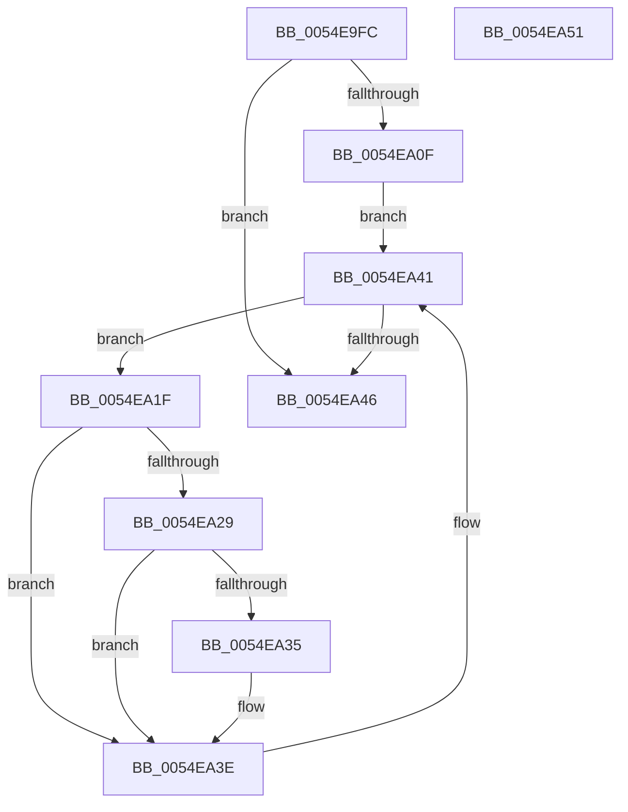

# HalpIommuEnableInterrupts

- RVA: `0x0054E9FC`–`0x0054EA52` (길이 `86` bytes)
- VA: `0x000000014054E9FC`
- 실행 섹션: `.text`
- PDB 이름 있음: `예`; PDB Function 태그: `아니요`
- unwind 정보 RVA: `0x0005CAAC`
- 디코드: `23`개 명령, `86/86` bytes 표시
- 미해석 바이트: `0` (있으면 어셈블리에 `.byte`로 보존)

> 이 문서는 커널 이미지의 기계어와 PDB 기호를 분석해 생성했습니다. 4번과 5번은 함수 원형과 자료형을 바이너리 사용 방식에서 추정한 C 해석이며 원본 소스 복구 결과는 아닙니다.

## 1. Dependencies

- 직접 호출 지점: **1**; 고유 호출 대상: **1**
- 직접 호출자로 확인된 함수: **1**
- RIP 상대 이미지 참조: **2**

### Outgoing calls
- `0x0054EA39` → [guard_dispatch_icall](../6B/guard_dispatch_icall_function_006BAAD0.md) (function, `0x006BAAD0`)

### Direct callers
- [HalpIommuInitSystem](../../pagelk/B5/HalpIommuInitSystem_function_00B5D7E0.md) at `0x00B5D93B`

### Static image references
- `0x0054EA06` → RVA `0x00FC1710` (`.data`; read)
- `0x0054EA0F` → RVA `0x00FC1740` (`.data`; read)

## 2. Other-region calls and transfers

- 다른 실행 섹션으로 향하는 call: **0**
- 별도 외부 분기/꼬리 이동을 확인하지 못했습니다.

## 3. Assembly (complete function range)

```asm
0054E9FC  48 89 5C 24 08                  mov qword ptr [rsp + 8], rbx
0054EA01  57                              push rdi
0054EA02  48 83 EC 20                     sub rsp, 0x20
0054EA06  80 3D 03 2D A7 00 00            cmp byte ptr [rip + 0xa72d03], 0
0054EA0D  75 37                           jne 0x14054ea46
0054EA0F  48 8B 1D 2A 2D A7 00            mov rbx, qword ptr [rip + 0xa72d2a]
0054EA16  48 8D 3D 23 2D A7 00            lea rdi, [rip + 0xa72d23]
0054EA1D  EB 22                           jmp 0x14054ea41
0054EA1F  48 83 BB 30 01 00 00 00         cmp qword ptr [rbx + 0x130], 0
0054EA27  74 15                           je 0x14054ea3e
0054EA29  48 8B 83 20 01 00 00            mov rax, qword ptr [rbx + 0x120]
0054EA30  48 85 C0                        test rax, rax
0054EA33  74 09                           je 0x14054ea3e
0054EA35  48 8B 4B 10                     mov rcx, qword ptr [rbx + 0x10]
0054EA39  E8 92 C0 16 00                  call 0x1406baad0
0054EA3E  48 8B 1B                        mov rbx, qword ptr [rbx]
0054EA41  48 3B DF                        cmp rbx, rdi
0054EA44  75 D9                           jne 0x14054ea1f
0054EA46  48 8B 5C 24 30                  mov rbx, qword ptr [rsp + 0x30]
0054EA4B  48 83 C4 20                     add rsp, 0x20
0054EA4F  5F                              pop rdi
0054EA50  C3                              ret
0054EA51  CC                              int3
```

## 4. C-style interpretation (structured pseudocode)

```c
__int64 __fastcall HalpIommuEnableInterrupts(void)
{
    __int64 result;
    __int64 v_rsp;
    unsigned __int64 v_stack_p8;

    v_stack_p8 = v_rbx;
    v_rsp = (v_rsp) - (32);
    if ((*(unsigned __int8 *)(v_rip + 10956035)) != 0) goto loc_0054EA46;
    goto loc_0054EA41;
loc_0054EA1F:
    if ((*(unsigned __int64 *)(*(unsigned __int64 *)(v_rip + 10956074) + 304)) == 0) goto loc_0054EA3E;
    result = *(unsigned __int64 *)(*(unsigned __int64 *)(v_rip + 10956074) + 288);
    if (*(unsigned __int64 *)(*(unsigned __int64 *)(v_rip + 10956074) + 288) != 0) {
        a1 = *(unsigned __int64 *)(*(unsigned __int64 *)(v_rip + 10956074) + 16);
        result = guard_dispatch_icall(a1, a2, a3, a4);
    }
loc_0054EA41:
    if ((*(unsigned __int64 *)(*(unsigned __int64 *)(v_rip + 10956074))) != (v_rip + 10956067)) goto loc_0054EA1F;
loc_0054EA46:
    v_rsp = (v_rsp) + (32);
    return result;
}
```

## 5. (Beta) C Style

```c
void HalpIommuEnableInterrupts(void)
{
    int64_t result;
    int64_t local_rsp;
    uint64_t v_stack_p8;

    v_stack_p8 = local_rbx;
    local_rsp = (local_rsp) - (32);
    if ((*(uint8_t *)(v_rip + 0xA72D03)) != 0) goto loc_0054EA46;
    goto loc_0054EA41;
loc_0054EA1F:
    if ((*(uint64_t *)(*(uint64_t *)(v_rip + 0xA72D2A) + 0x130)) == 0) goto loc_0054EA3E;
    result = *(uint64_t *)(*(uint64_t *)(v_rip + 0xA72D2A) + 0x120);
    if (*(uint64_t *)(*(uint64_t *)(v_rip + 0xA72D2A) + 0x120) != 0) {
        a1 = *(uint64_t *)(*(uint64_t *)(v_rip + 0xA72D2A) + 0x10);
        result = guard_dispatch_icall(a1, a2, a3, a4);
    }
loc_0054EA41:
    if ((*(uint64_t *)(*(uint64_t *)(v_rip + 0xA72D2A))) != (v_rip + 10956067)) goto loc_0054EA1F;
loc_0054EA46:
    local_rsp = (local_rsp) + (32);
    return result;
}
```

## 6. Execution-region graph

[열기: 2D/3D 그래프와 함수 탐색 컨트롤 패널](../../../control-panel.html?section=text&rva=0x0054E9FC&view=graph)

- 2D 그래프는 위에서 아래로 흐르고, 3D 그래프는 빈 공간을 드래그해 회전합니다. Shift+드래그는 이동, 휠은 확대·축소, 함수 노드 선택은 대상 보고서 이동입니다.

### Static fallback


