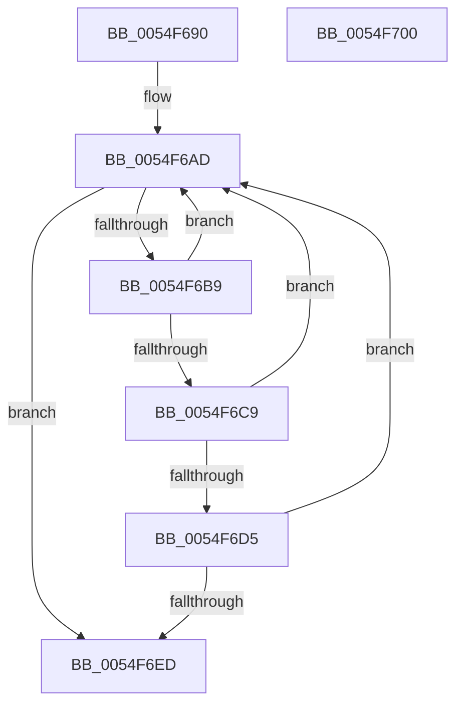

# HalpIommuFreeRemappingTableEntry

- RVA: `0x0054F690`–`0x0054F701` (길이 `113` bytes)
- VA: `0x000000014054F690`
- 실행 섹션: `.text`
- PDB 이름 있음: `예`; PDB Function 태그: `아니요`
- unwind 정보 RVA: `0x00060BC4`
- 디코드: `33`개 명령, `113/113` bytes 표시
- 미해석 바이트: `0` (있으면 어셈블리에 `.byte`로 보존)

> 이 문서는 커널 이미지의 기계어와 PDB 기호를 분석해 생성했습니다. 4번과 5번은 함수 원형과 자료형을 바이너리 사용 방식에서 추정한 C 해석이며 원본 소스 복구 결과는 아닙니다.

## 1. Dependencies

- 직접 호출 지점: **1**; 고유 호출 대상: **1**
- 직접 호출자로 확인된 함수: **1**
- RIP 상대 이미지 참조: **1**

### Outgoing calls
- `0x0054F6DE` → [guard_dispatch_icall](../6B/guard_dispatch_icall_function_006BAAD0.md) (function, `0x006BAAD0`)

### Direct callers
- [HalpIrtFreeIndex](../../page/70/HalpIrtFreeIndex_function_0070AE30.md) at `0x0070AEBB`

### Static image references
- `0x0054F69F` → RVA `0x00FC1740` (`.data`; read)

## 2. Other-region calls and transfers

- 다른 실행 섹션으로 향하는 call: **0**
- 별도 외부 분기/꼬리 이동을 확인하지 못했습니다.

## 3. Assembly (complete function range)

```asm
0054F690  48 89 5C 24 08                  mov qword ptr [rsp + 8], rbx
0054F695  48 89 74 24 10                  mov qword ptr [rsp + 0x10], rsi
0054F69A  57                              push rdi
0054F69B  48 83 EC 20                     sub rsp, 0x20
0054F69F  48 8B 1D 9A 20 A7 00            mov rbx, qword ptr [rip + 0xa7209a]
0054F6A6  8B FA                           mov edi, edx
0054F6A8  8B F1                           mov esi, ecx
0054F6AA  45 33 C0                        xor r8d, r8d
0054F6AD  48 8D 05 8C 20 A7 00            lea rax, [rip + 0xa7208c]
0054F6B4  48 3B D8                        cmp rbx, rax
0054F6B7  74 34                           je 0x14054f6ed
0054F6B9  48 8B CB                        mov rcx, rbx
0054F6BC  48 8B 1B                        mov rbx, qword ptr [rbx]
0054F6BF  8B 81 D8 01 00 00               mov eax, dword ptr [rcx + 0x1d8]
0054F6C5  A8 40                           test al, 0x40
0054F6C7  74 E4                           je 0x14054f6ad
0054F6C9  48 8B 81 A8 00 00 00            mov rax, qword ptr [rcx + 0xa8]
0054F6D0  48 85 C0                        test rax, rax
0054F6D3  74 D8                           je 0x14054f6ad
0054F6D5  48 8B 49 10                     mov rcx, qword ptr [rcx + 0x10]
0054F6D9  44 8B C7                        mov r8d, edi
0054F6DC  8B D6                           mov edx, esi
0054F6DE  E8 ED B3 16 00                  call 0x1406baad0
0054F6E3  44 8B C0                        mov r8d, eax
0054F6E6  3D E6 00 00 C0                  cmp eax, 0xc00000e6
0054F6EB  74 C0                           je 0x14054f6ad
0054F6ED  48 8B 5C 24 30                  mov rbx, qword ptr [rsp + 0x30]
0054F6F2  41 8B C0                        mov eax, r8d
0054F6F5  48 8B 74 24 38                  mov rsi, qword ptr [rsp + 0x38]
0054F6FA  48 83 C4 20                     add rsp, 0x20
0054F6FE  5F                              pop rdi
0054F6FF  C3                              ret
0054F700  CC                              int3
```

## 4. C-style interpretation (structured pseudocode)

```c
__int64 __fastcall HalpIommuFreeRemappingTableEntry(int a1, int a2, int a3)
{
    __int64 result;
    __int64 v_rsp;
    unsigned __int64 v_stack_p10;
    unsigned __int64 v_stack_p8;

    v_stack_p8 = v_rbx;
    v_stack_p10 = v_rsi;
    v_rsp = (v_rsp) - (32);
    a3 = 0;
loc_0054F6AD:
    if ((*(unsigned __int64 *)(v_rip + 10952858)) == (v_rip + 10952844)) goto loc_0054F6ED;
    if ((((unsigned __int8)((unsigned int)(*(unsigned int *)(*(unsigned __int64 *)(v_rip + 10952858) + 472)))) & (64)) == 0) goto loc_0054F6AD;
    if (*(unsigned __int64 *)(*(unsigned __int64 *)(v_rip + 10952858) + 168) == 0) goto loc_0054F6AD;
    result = guard_dispatch_icall(*(unsigned __int64 *)(*(unsigned __int64 *)(v_rip + 10952858) + 16), (unsigned int)((unsigned int)((unsigned int)(a1))), (unsigned int)((unsigned int)((unsigned int)(a2))), a4);
    if (((unsigned int)(result)) == 0xC00000E6ULL) goto loc_0054F6AD;
loc_0054F6ED:
    v_rsp = (v_rsp) + (32);
    return (unsigned int)((unsigned int)((unsigned int)((unsigned int)(result))));
}
```

## 5. (Beta) C Style

```c
int64_t HalpIommuFreeRemappingTableEntry(int32_t Arg1, int32_t Arg2, int32_t Arg3)
{
    int64_t result;
    int64_t local_rsp;
    uint64_t v_stack_p10;
    uint64_t v_stack_p8;

    v_stack_p8 = local_rbx;
    v_stack_p10 = local_rsi;
    local_rsp = (local_rsp) - (32);
    Arg3 = 0;
loc_0054F6AD:
    if ((*(uint64_t *)(v_rip + 0xA7209A)) == (v_rip + 10952844)) goto loc_0054F6ED;
    if ((((uint8_t)((uint32_t)(*(uint32_t *)(*(uint64_t *)(v_rip + 0xA7209A) + 0x1D8)))) & (64)) == 0) goto loc_0054F6AD;
    if (*(uint64_t *)(*(uint64_t *)(v_rip + 0xA7209A) + 0xA8) == 0) goto loc_0054F6AD;
    result = guard_dispatch_icall(*(uint64_t *)(*(uint64_t *)(v_rip + 0xA7209A) + 0x10), (uint32_t)((uint32_t)((uint32_t)(Arg1))), (uint32_t)((uint32_t)((uint32_t)(Arg2))), a4);
    if (((uint32_t)(result)) == 0xC00000E6ULL) goto loc_0054F6AD;
loc_0054F6ED:
    local_rsp = (local_rsp) + (32);
    return (uint32_t)((uint32_t)((uint32_t)((uint32_t)(result))));
}
```

## 6. Execution-region graph

[열기: 2D/3D 그래프와 함수 탐색 컨트롤 패널](../../../control-panel.html?section=text&rva=0x0054F690&view=graph)

- 2D 그래프는 위에서 아래로 흐르고, 3D 그래프는 빈 공간을 드래그해 회전합니다. Shift+드래그는 이동, 휠은 확대·축소, 함수 노드 선택은 대상 보고서 이동입니다.

### Static fallback


