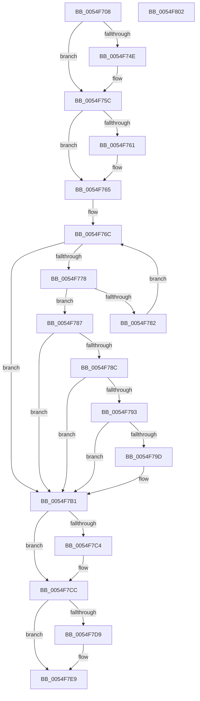

# HalpIommuInvokeInterfaceStateChangeCallbacks

- RVA: `0x0054F708`–`0x0054F803` (길이 `251` bytes)
- VA: `0x000000014054F708`
- 실행 섹션: `.text`
- PDB 이름 있음: `예`; PDB Function 태그: `아니요`
- unwind 정보 RVA: `0x000BEF48`
- 디코드: `75`개 명령, `251/251` bytes 표시
- 미해석 바이트: `0` (있으면 어셈블리에 `.byte`로 보존)

> 이 문서는 커널 이미지의 기계어와 PDB 기호를 분석해 생성했습니다. 4번과 5번은 함수 원형과 자료형을 바이너리 사용 방식에서 추정한 C 해석이며 원본 소스 복구 결과는 아닙니다.

## 1. Dependencies

- 직접 호출 지점: **6**; 고유 호출 대상: **6**
- 직접 호출자로 확인된 함수: **1**
- RIP 상대 이미지 참조: **3**

### Outgoing calls
- `0x0054F73E` → [KeAbPreAcquire](../21/KeAbPreAcquire_function_00210230.md) (function, `0x00210230`)
- `0x0054F757` → [ExfAcquirePushLockExclusiveEx](../20/ExfAcquirePushLockExclusiveEx_function_0020FC90.md) (function, `0x0020FC90`)
- `0x0054F793` → [HalpIommuDeviceGetDomainTypes](HalpIommuDeviceGetDomainTypes_function_0054F538.md) (function, `0x0054F538`)
- `0x0054F7C7` → [ExfTryToWakePushLock](../26/ExfTryToWakePushLock_function_00265DD0.md) (function, `0x00265DD0`)
- `0x0054F7CF` → [KeAbPostRelease](../2E/KeAbPostRelease_function_002E1600.md) (function, `0x002E1600`)
- `0x0054F7E4` → [guard_dispatch_icall](../6B/guard_dispatch_icall_function_006BAAD0.md) (function, `0x006BAAD0`)

### Direct callers
- [HalpNotifyIommuDomainPolicyChange](HalpNotifyIommuDomainPolicyChange_function_0054F810.md) at `0x0054F819`

### Static image references
- `0x0054F722` → RVA `0x00F8FA98` (`.data`; read)
- `0x0054F765` → RVA `0x00F8FAA0` (`.data`; read)
- `0x0054F7B5` → RVA `0x00F8FA98` (`.data`; read/write)

## 2. Other-region calls and transfers

- 다른 실행 섹션으로 향하는 call: **0**
- 별도 외부 분기/꼬리 이동을 확인하지 못했습니다.

## 3. Assembly (complete function range)

```asm
0054F708  48 8B C4                        mov rax, rsp
0054F70B  48 89 58 08                     mov qword ptr [rax + 8], rbx
0054F70F  48 89 68 10                     mov qword ptr [rax + 0x10], rbp
0054F713  48 89 70 20                     mov qword ptr [rax + 0x20], rsi
0054F717  57                              push rdi
0054F718  41 56                           push r14
0054F71A  41 57                           push r15
0054F71C  48 83 EC 20                     sub rsp, 0x20
0054F720  8B DA                           mov ebx, edx
0054F722  4C 8D 3D 6F 03 A4 00            lea r15, [rip + 0xa4036f]
0054F729  4C 8B F1                        mov r14, rcx
0054F72C  33 F6                           xor esi, esi
0054F72E  21 70 18                        and dword ptr [rax + 0x18], esi
0054F731  49 8B CF                        mov rcx, r15
0054F734  21 70 1C                        and dword ptr [rax + 0x1c], esi
0054F737  45 33 C0                        xor r8d, r8d
0054F73A  33 D2                           xor edx, edx
0054F73C  33 ED                           xor ebp, ebp
0054F73E  E8 ED 0A CC FF                  call 0x140210230
0054F743  F0 49 0F BA 2F 00               lock bts qword ptr [r15], 0
0054F749  48 8B F8                        mov rdi, rax
0054F74C  73 0E                           jae 0x14054f75c
0054F74E  4D 8B C7                        mov r8, r15
0054F751  48 8B D0                        mov rdx, rax
0054F754  49 8B CF                        mov rcx, r15
0054F757  E8 34 05 CC FF                  call 0x14020fc90
0054F75C  48 85 FF                        test rdi, rdi
0054F75F  74 04                           je 0x14054f765
0054F761  C6 47 0A 01                     mov byte ptr [rdi + 0xa], 1
0054F765  48 8B 3D 34 03 A4 00            mov rdi, qword ptr [rip + 0xa40334]
0054F76C  48 8D 05 2D 03 A4 00            lea rax, [rip + 0xa4032d]
0054F773  48 3B F8                        cmp rdi, rax
0054F776  74 39                           je 0x14054f7b1
0054F778  48 8B 4F 20                     mov rcx, qword ptr [rdi + 0x20]
0054F77C  4C 39 71 08                     cmp qword ptr [rcx + 8], r14
0054F780  74 05                           je 0x14054f787
0054F782  48 8B 3F                        mov rdi, qword ptr [rdi]
0054F785  EB E5                           jmp 0x14054f76c
0054F787  F6 C3 01                        test bl, 1
0054F78A  74 25                           je 0x14054f7b1
0054F78C  8B 47 28                        mov eax, dword ptr [rdi + 0x28]
0054F78F  A8 01                           test al, 1
0054F791  74 1E                           je 0x14054f7b1
0054F793  E8 A0 FD FF FF                  call 0x14054f538
0054F798  39 47 2C                        cmp dword ptr [rdi + 0x2c], eax
0054F79B  74 14                           je 0x14054f7b1
0054F79D  89 47 2C                        mov dword ptr [rdi + 0x2c], eax
0054F7A0  83 4C 24 50 01                  or dword ptr [rsp + 0x50], 1
0054F7A5  89 44 24 54                     mov dword ptr [rsp + 0x54], eax
0054F7A9  48 8B 77 10                     mov rsi, qword ptr [rdi + 0x10]
0054F7AD  48 8B 6F 18                     mov rbp, qword ptr [rdi + 0x18]
0054F7B1  48 83 C8 FF                     or rax, 0xffffffffffffffff
0054F7B5  F0 48 0F C1 05 DA 02 A4 00      lock xadd qword ptr [rip + 0xa402da], rax
0054F7BE  24 06                           and al, 6
0054F7C0  3C 02                           cmp al, 2
0054F7C2  75 08                           jne 0x14054f7cc
0054F7C4  49 8B CF                        mov rcx, r15
0054F7C7  E8 04 66 D1 FF                  call 0x140265dd0
0054F7CC  49 8B CF                        mov rcx, r15
0054F7CF  E8 2C 1E D9 FF                  call 0x1402e1600
0054F7D4  48 85 F6                        test rsi, rsi
0054F7D7  74 10                           je 0x14054f7e9
0054F7D9  48 8B D5                        mov rdx, rbp
0054F7DC  48 8D 4C 24 50                  lea rcx, [rsp + 0x50]
0054F7E1  48 8B C6                        mov rax, rsi
0054F7E4  E8 E7 B2 16 00                  call 0x1406baad0
0054F7E9  48 8B 5C 24 40                  mov rbx, qword ptr [rsp + 0x40]
0054F7EE  48 8B 6C 24 48                  mov rbp, qword ptr [rsp + 0x48]
0054F7F3  48 8B 74 24 58                  mov rsi, qword ptr [rsp + 0x58]
0054F7F8  48 83 C4 20                     add rsp, 0x20
0054F7FC  41 5F                           pop r15
0054F7FE  41 5E                           pop r14
0054F800  5F                              pop rdi
0054F801  C3                              ret
0054F802  CC                              int3
```

## 4. C-style interpretation (structured pseudocode)

```c
__int64 __fastcall HalpIommuInvokeInterfaceStateChangeCallbacks(__int64 a1, int a2, int a3)
{
    __int64 result;
    __int64 v_rbp;
    __int64 v_rsi;
    __int64 v_rsp;
    unsigned __int64 v_stack_p10;
    unsigned int v_stack_p18;
    unsigned int v_stack_p1C;
    unsigned __int64 v_stack_p20;
    unsigned __int64 v_stack_p8;

    *(unsigned __int64 *)(v_rsp + 8) = v_rbx;
    *(unsigned __int64 *)(v_rsp + 16) = v_rbp;
    *(unsigned __int64 *)(v_rsp + 32) = v_rsi;
    v_rsp = (v_rsp) - (32);
    v_rsi = 0;
    a3 = 0;
    a2 = 0;
    v_rbp = 0;
    result = KeAbPreAcquire(v_rip + 10748783, a2, a3, a4);
    if (!(condition_is_above_or_equal)) {
        a3 = v_rip + 10748783;
        a2 = result;
        a1 = v_rip + 10748783;
        result = ExfAcquirePushLockExclusiveEx(a1, a2, a3, a4);
    }
    if (result != 0) {
        *(unsigned __int8 *)(result + 10) = 1;
    }
loc_0054F76C:
    if ((*(unsigned __int64 *)(v_rip + 10748724)) == (v_rip + 10748717)) goto loc_0054F7B1;
    if ((*(unsigned __int64 *)(*(unsigned __int64 *)(*(unsigned __int64 *)(v_rip + 10748724) + 32) + 8)) == a1) goto loc_0054F787;
    goto loc_0054F76C;
loc_0054F787:
    if ((((unsigned __int8)((unsigned int)(a2))) & (1)) == 0) goto loc_0054F7B1;
    if ((((unsigned __int8)((unsigned int)(*(unsigned int *)(*(unsigned __int64 *)(*(unsigned __int64 *)(v_rip + 10748724)) + 40)))) & (1)) == 0) goto loc_0054F7B1;
    result = HalpIommuDeviceGetDomainTypes(*(unsigned __int64 *)(*(unsigned __int64 *)(v_rip + 10748724) + 32), a2, a3, a4);
    if ((*(unsigned int *)(*(unsigned __int64 *)(*(unsigned __int64 *)(v_rip + 10748724)) + 44)) != ((unsigned int)(result))) {
        *(unsigned int *)(*(unsigned __int64 *)(*(unsigned __int64 *)(v_rip + 10748724)) + 44) = (unsigned int)(result);
        v_stack_p1C = (unsigned int)(result);
        v_rsi = *(unsigned __int64 *)(*(unsigned __int64 *)(*(unsigned __int64 *)(v_rip + 10748724)) + 16);
        v_rbp = *(unsigned __int64 *)(*(unsigned __int64 *)(*(unsigned __int64 *)(v_rip + 10748724)) + 24);
    }
    result = (result) | (-1);
    result = (unsigned __int8)((result) & (6));
    if (((unsigned __int8)(result)) == 2) {
        a1 = v_rip + 10748783;
        result = ExfTryToWakePushLock(a1, a2, a3, a4);
    }
    result = KeAbPostRelease(v_rip + 10748783, a2, a3, a4);
    if (v_rsi != 0) {
        a2 = v_rbp;
        a1 = v_stack_p18;
        result = v_rsi;
        result = guard_dispatch_icall(a1, a2, a3, a4);
    }
    v_rsp = (v_rsp) + (32);
    return result;
}
```

## 5. (Beta) C Style

```c
int64_t HalpIommuInvokeInterfaceStateChangeCallbacks(int64_t Arg1, int32_t Arg2, int32_t Arg3)
{
    int64_t result;
    int64_t local_rbp;
    int64_t local_rsi;
    int64_t local_rsp;
    uint64_t v_stack_p10;
    uint32_t v_stack_p18;
    uint32_t v_stack_p1C;
    uint64_t v_stack_p20;
    uint64_t v_stack_p8;

    *(uint64_t *)(local_rsp + 0x8) = local_rbx;
    *(uint64_t *)(local_rsp + 0x10) = local_rbp;
    *(uint64_t *)(local_rsp + 0x20) = local_rsi;
    local_rsp = (local_rsp) - (32);
    local_rsi = 0;
    Arg3 = 0;
    Arg2 = 0;
    local_rbp = 0;
    result = KeAbPreAcquire(v_rip + 10748783, Arg2, Arg3, a4);
    if (!(condition_is_above_or_equal)) {
        Arg3 = v_rip + 10748783;
        Arg2 = result;
        Arg1 = v_rip + 10748783;
        result = ExfAcquirePushLockExclusiveEx(Arg1, Arg2, Arg3, a4);
    }
    if (result != 0) {
        *(uint8_t *)(result + 0xA) = 1;
    }
loc_0054F76C:
    if ((*(uint64_t *)(v_rip + 0xA40334)) == (v_rip + 10748717)) goto loc_0054F7B1;
    if ((*(uint64_t *)(*(uint64_t *)(*(uint64_t *)(v_rip + 0xA40334) + 0x20) + 0x8)) == Arg1) goto loc_0054F787;
    goto loc_0054F76C;
loc_0054F787:
    if ((((uint8_t)((uint32_t)(Arg2))) & (1)) == 0) goto loc_0054F7B1;
    if ((((uint8_t)((uint32_t)(*(uint32_t *)(*(uint64_t *)(*(uint64_t *)(v_rip + 0xA40334)) + 0x28)))) & (1)) == 0) goto loc_0054F7B1;
    result = HalpIommuDeviceGetDomainTypes(*(uint64_t *)(*(uint64_t *)(v_rip + 0xA40334) + 0x20), Arg2, Arg3, a4);
    if ((*(uint32_t *)(*(uint64_t *)(*(uint64_t *)(v_rip + 0xA40334)) + 0x2C)) != ((uint32_t)(result))) {
        *(uint32_t *)(*(uint64_t *)(*(uint64_t *)(v_rip + 0xA40334)) + 0x2C) = (uint32_t)(result);
        v_stack_p1C = (uint32_t)(result);
        local_rsi = *(uint64_t *)(*(uint64_t *)(*(uint64_t *)(v_rip + 0xA40334)) + 0x10);
        local_rbp = *(uint64_t *)(*(uint64_t *)(*(uint64_t *)(v_rip + 0xA40334)) + 0x18);
    }
    result = (result) | (-1);
    result = (uint8_t)((result) & (6));
    if (((uint8_t)(result)) == 2) {
        Arg1 = v_rip + 10748783;
        result = ExfTryToWakePushLock(Arg1, Arg2, Arg3, a4);
    }
    result = KeAbPostRelease(v_rip + 10748783, Arg2, Arg3, a4);
    if (local_rsi != 0) {
        Arg2 = local_rbp;
        Arg1 = v_stack_p18;
        result = local_rsi;
        result = guard_dispatch_icall(Arg1, Arg2, Arg3, a4);
    }
    local_rsp = (local_rsp) + (32);
    return result;
}
```

## 6. Execution-region graph

[열기: 2D/3D 그래프와 함수 탐색 컨트롤 패널](../../../control-panel.html?section=text&rva=0x0054F708&view=graph)

- 2D 그래프는 위에서 아래로 흐르고, 3D 그래프는 빈 공간을 드래그해 회전합니다. Shift+드래그는 이동, 휠은 확대·축소, 함수 노드 선택은 대상 보고서 이동입니다.

### Static fallback


