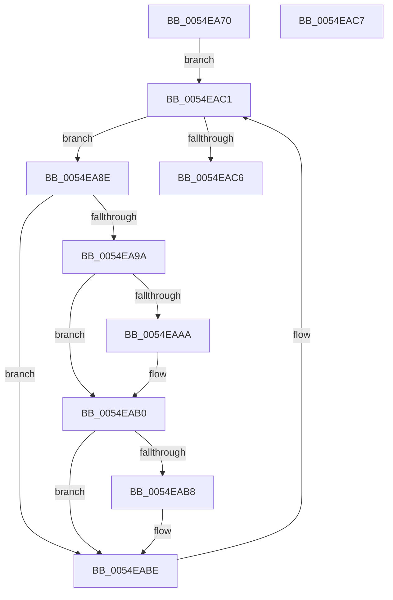

# HalpIommuUpdatePageTableLevel

- RVA: `0x0054EA70`–`0x0054EAC8` (길이 `88` bytes)
- VA: `0x000000014054EA70`
- 실행 섹션: `.text`
- PDB 이름 있음: `예`; PDB Function 태그: `아니요`
- unwind 정보 RVA: `0x000DB714`
- 디코드: `22`개 명령, `88/88` bytes 표시
- 미해석 바이트: `0` (있으면 어셈블리에 `.byte`로 보존)

> 이 문서는 커널 이미지의 기계어와 PDB 기호를 분석해 생성했습니다. 4번과 5번은 함수 원형과 자료형을 바이너리 사용 방식에서 추정한 C 해석이며 원본 소스 복구 결과는 아닙니다.

## 1. Dependencies

- 직접 호출 지점: **0**; 고유 호출 대상: **0**
- 직접 호출자로 확인된 함수: **1**
- RIP 상대 이미지 참조: **7**

### Outgoing calls
- 직접 디코드된 call 명령이 없습니다.

### Direct callers
- [HalpIommuInitializeAll](../../pagelk/B7/HalpIommuInitializeAll_function_00B7A684.md) at `0x00B7A922`

### Static image references
- `0x0054EA70` → RVA `0x00FC18F0` (`.data`; read/write)
- `0x0054EA77` → RVA `0x00FC1740` (`.data`; read)
- `0x0054EA7E` → RVA `0x00FC18EC` (`.data`; read/write)
- `0x0054EAA2` → RVA `0x00FC18F0` (`.data`; read)
- `0x0054EAAA` → RVA `0x00FC18F0` (`.data`; write)
- `0x0054EAB0` → RVA `0x00FC18EC` (`.data`; read)
- `0x0054EAB8` → RVA `0x00FC18EC` (`.data`; write)

## 2. Other-region calls and transfers

- 다른 실행 섹션으로 향하는 call: **0**
- 별도 외부 분기/꼬리 이동을 확인하지 못했습니다.

## 3. Assembly (complete function range)

```asm
0054EA70  83 25 79 2E A7 00 00            and dword ptr [rip + 0xa72e79], 0
0054EA77  4C 8D 05 C2 2C A7 00            lea r8, [rip + 0xa72cc2]
0054EA7E  83 0D 67 2E A7 00 FF            or dword ptr [rip + 0xa72e67], 0xffffffff
0054EA85  48 8B 0D B4 2C A7 00            mov rcx, qword ptr [rip + 0xa72cb4]
0054EA8C  EB 33                           jmp 0x14054eac1
0054EA8E  8B 81 D8 01 00 00               mov eax, dword ptr [rcx + 0x1d8]
0054EA94  0F BA E0 08                     bt eax, 8
0054EA98  73 24                           jae 0x14054eabe
0054EA9A  C1 E8 0D                        shr eax, 0xd
0054EA9D  83 E0 07                        and eax, 7
0054EAA0  FF C0                           inc eax
0054EAA2  3B 05 48 2E A7 00               cmp eax, dword ptr [rip + 0xa72e48]
0054EAA8  76 06                           jbe 0x14054eab0
0054EAAA  89 05 40 2E A7 00               mov dword ptr [rip + 0xa72e40], eax
0054EAB0  3B 05 36 2E A7 00               cmp eax, dword ptr [rip + 0xa72e36]
0054EAB6  73 06                           jae 0x14054eabe
0054EAB8  89 05 2E 2E A7 00               mov dword ptr [rip + 0xa72e2e], eax
0054EABE  48 8B 09                        mov rcx, qword ptr [rcx]
0054EAC1  49 3B C8                        cmp rcx, r8
0054EAC4  75 C8                           jne 0x14054ea8e
0054EAC6  C3                              ret
0054EAC7  CC                              int3
```

## 4. C-style interpretation (structured pseudocode)

```c
__int64 __fastcall HalpIommuUpdatePageTableLevel(void)
{
    __int64 result;

    goto loc_0054EAC1;
loc_0054EA8E:
    if (condition_is_above_or_equal) goto loc_0054EABE;
    result = (unsigned int)(((unsigned int)(*(unsigned int *)(*(unsigned __int64 *)(v_rip + 10955956) + 472))) >> (13));
    result = (unsigned int)((result) & (7));
    result = (unsigned int)((result) + 1);
    if (((unsigned int)(result)) >= = (*(unsigned int *)(v_rip + 10956360))) {
        *(unsigned int *)(v_rip + 10956352) = (unsigned int)(result);
    }
    if (((unsigned int)(result)) < (*(unsigned int *)(v_rip + 10956342))) {
        *(unsigned int *)(v_rip + 10956334) = (unsigned int)(result);
    }
loc_0054EAC1:
    if ((*(unsigned __int64 *)(*(unsigned __int64 *)(v_rip + 10955956))) != (v_rip + 10955970)) goto loc_0054EA8E;
    return result;
}
```

## 5. (Beta) C Style

```c
void HalpIommuUpdatePageTableLevel(void)
{
    int64_t result;

    goto loc_0054EAC1;
loc_0054EA8E:
    if (condition_is_above_or_equal) goto loc_0054EABE;
    result = (uint32_t)(((uint32_t)(*(uint32_t *)(*(uint64_t *)(v_rip + 0xA72CB4) + 0x1D8))) >> (13));
    result = (uint32_t)((result) & (7));
    result = (uint32_t)((result) + 1);
    if (((uint32_t)(result)) >= = (*(uint32_t *)(v_rip + 0xA72E48))) {
        *(uint32_t *)(v_rip + 0xA72E40) = (uint32_t)(result);
    }
    if (((uint32_t)(result)) < (*(uint32_t *)(v_rip + 0xA72E36))) {
        *(uint32_t *)(v_rip + 0xA72E2E) = (uint32_t)(result);
    }
loc_0054EAC1:
    if ((*(uint64_t *)(*(uint64_t *)(v_rip + 0xA72CB4))) != (v_rip + 10955970)) goto loc_0054EA8E;
    return result;
}
```

## 6. Execution-region graph

[열기: 2D/3D 그래프와 함수 탐색 컨트롤 패널](../../../control-panel.html?section=text&rva=0x0054EA70&view=graph)

- 2D 그래프는 위에서 아래로 흐르고, 3D 그래프는 빈 공간을 드래그해 회전합니다. Shift+드래그는 이동, 휠은 확대·축소, 함수 노드 선택은 대상 보고서 이동입니다.

### Static fallback


