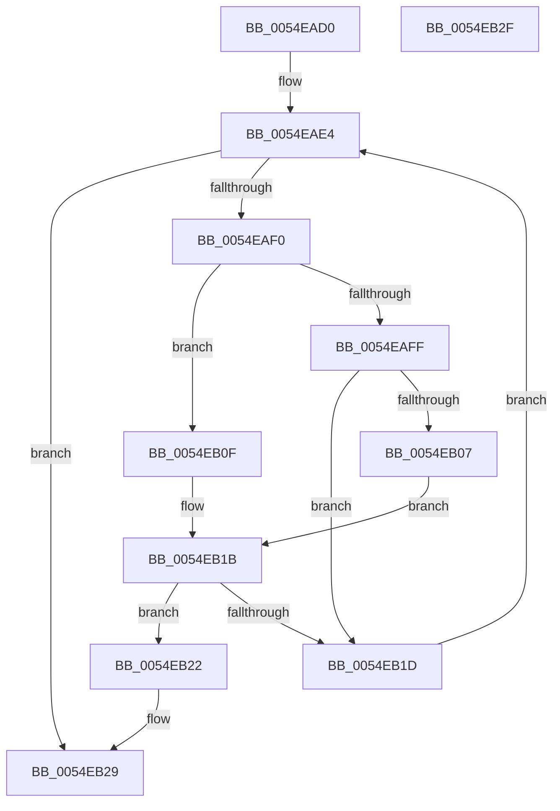

# HalpIommuUpdatePageWalkCapability

- RVA: `0x0054EAD0`–`0x0054EB30` (길이 `96` bytes)
- VA: `0x000000014054EAD0`
- 실행 섹션: `.text`
- PDB 이름 있음: `예`; PDB Function 태그: `아니요`
- unwind 정보 RVA: `0x0005CF00`
- 디코드: `25`개 명령, `96/96` bytes 표시
- 미해석 바이트: `0` (있으면 어셈블리에 `.byte`로 보존)

> 이 문서는 커널 이미지의 기계어와 PDB 기호를 분석해 생성했습니다. 4번과 5번은 함수 원형과 자료형을 바이너리 사용 방식에서 추정한 C 해석이며 원본 소스 복구 결과는 아닙니다.

## 1. Dependencies

- 직접 호출 지점: **1**; 고유 호출 대상: **1**
- 직접 호출자로 확인된 함수: **1**
- RIP 상대 이미지 참조: **2**

### Outgoing calls
- `0x0054EAF0` → [Feature_Test57481295__private_IsEnabledDeviceUsageNoInline](../4F/Feature_Test57481295__private_IsEnabledDeviceUsageNoInline_function_004F7B90.md) (function, `0x004F7B90`)

### Direct callers
- [HalpIommuInitializeAll](../../pagelk/B7/HalpIommuInitializeAll_function_00B7A684.md) at `0x00B7A91D`

### Static image references
- `0x0054EAD6` → RVA `0x00FC1740` (`.data`; read)
- `0x0054EADD` → RVA `0x00FC1910` (`.data`; write)

## 2. Other-region calls and transfers

- 다른 실행 섹션으로 향하는 call: **0**
- 별도 외부 분기/꼬리 이동을 확인하지 못했습니다.

## 3. Assembly (complete function range)

```asm
0054EAD0  40 53                           push rbx
0054EAD2  48 83 EC 20                     sub rsp, 0x20
0054EAD6  48 8B 1D 63 2C A7 00            mov rbx, qword ptr [rip + 0xa72c63]
0054EADD  C6 05 2C 2E A7 00 01            mov byte ptr [rip + 0xa72e2c], 1
0054EAE4  48 8D 05 55 2C A7 00            lea rax, [rip + 0xa72c55]
0054EAEB  48 3B D8                        cmp rbx, rax
0054EAEE  74 39                           je 0x14054eb29
0054EAF0  E8 9B 90 FA FF                  call 0x1404f7b90
0054EAF5  8B 8B D8 01 00 00               mov ecx, dword ptr [rbx + 0x1d8]
0054EAFB  85 C0                           test eax, eax
0054EAFD  74 10                           je 0x14054eb0f
0054EAFF  F7 C1 80 01 00 00               test ecx, 0x180
0054EB05  74 16                           je 0x14054eb1d
0054EB07  F7 C1 00 08 00 00               test ecx, 0x800
0054EB0D  EB 0C                           jmp 0x14054eb1b
0054EB0F  81 E1 00 09 00 00               and ecx, 0x900
0054EB15  81 F9 00 01 00 00               cmp ecx, 0x100
0054EB1B  74 05                           je 0x14054eb22
0054EB1D  48 8B 1B                        mov rbx, qword ptr [rbx]
0054EB20  EB C2                           jmp 0x14054eae4
0054EB22  C6 05 E7 2D A7 00 00            mov byte ptr [rip + 0xa72de7], 0
0054EB29  48 83 C4 20                     add rsp, 0x20
0054EB2D  5B                              pop rbx
0054EB2E  C3                              ret
0054EB2F  CC                              int3
```

## 4. C-style interpretation (structured pseudocode)

```c
__int64 __fastcall HalpIommuUpdatePageWalkCapability(void)
{
    __int64 result;
    __int64 v_rsp;

    v_rsp = (v_rsp) - (32);
    *(unsigned __int8 *)(v_rip + 10956332) = 1;
loc_0054EAE4:
    if ((*(unsigned __int64 *)(v_rip + 10955875)) == (v_rip + 10955861)) goto loc_0054EB29;
    result = Feature_Test57481295__private_IsEnabledDeviceUsageNoInline(a1, a2, a3, a4);
    if ((unsigned int)(result) == 0) goto loc_0054EB0F;
    if ((((unsigned int)((unsigned int)(*(unsigned int *)(*(unsigned __int64 *)(v_rip + 10955875) + 472)))) & (384)) == 0) goto loc_0054EB1D;
    goto loc_0054EB1B;
loc_0054EB0F:
    a1 = (unsigned int)(((unsigned int)(*(unsigned int *)(*(unsigned __int64 *)(v_rip + 10955875) + 472))) & (0x900ULL));
loc_0054EB1B:
    if (((unsigned int)(a1)) == 256) goto loc_0054EB22;
loc_0054EB1D:
    goto loc_0054EAE4;
loc_0054EB22:
    *(unsigned __int8 *)(v_rip + 10956263) = 0;
loc_0054EB29:
    v_rsp = (v_rsp) + (32);
    return result;
}
```

## 5. (Beta) C Style

```c
void HalpIommuUpdatePageWalkCapability(void)
{
    int64_t result;
    int64_t local_rsp;

    local_rsp = (local_rsp) - (32);
    *(uint8_t *)(v_rip + 0xA72E2C) = 1;
loc_0054EAE4:
    if ((*(uint64_t *)(v_rip + 0xA72C63)) == (v_rip + 10955861)) goto loc_0054EB29;
    result = Feature_Test57481295__private_IsEnabledDeviceUsageNoInline(a1, a2, a3, a4);
    if ((uint32_t)(result) == 0) goto loc_0054EB0F;
    if ((((uint32_t)((uint32_t)(*(uint32_t *)(*(uint64_t *)(v_rip + 0xA72C63) + 0x1D8)))) & (384)) == 0) goto loc_0054EB1D;
    goto loc_0054EB1B;
loc_0054EB0F:
    a1 = (uint32_t)(((uint32_t)(*(uint32_t *)(*(uint64_t *)(v_rip + 0xA72C63) + 0x1D8))) & (0x900ULL));
loc_0054EB1B:
    if (((uint32_t)(a1)) == 256) goto loc_0054EB22;
loc_0054EB1D:
    goto loc_0054EAE4;
loc_0054EB22:
    *(uint8_t *)(v_rip + 0xA72DE7) = 0;
loc_0054EB29:
    local_rsp = (local_rsp) + (32);
    return result;
}
```

## 6. Execution-region graph

[열기: 2D/3D 그래프와 함수 탐색 컨트롤 패널](../../../control-panel.html?section=text&rva=0x0054EAD0&view=graph)

- 2D 그래프는 위에서 아래로 흐르고, 3D 그래프는 빈 공간을 드래그해 회전합니다. Shift+드래그는 이동, 휠은 확대·축소, 함수 노드 선택은 대상 보고서 이동입니다.

### Static fallback


