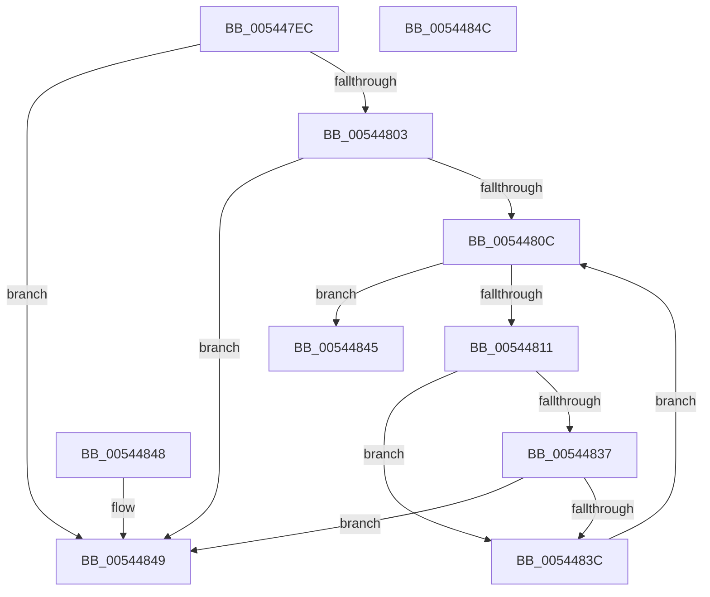

# HalpIsHeap64KRegionExecutable

- RVA: `0x005447EC`–`0x0054484D` (길이 `97` bytes)
- VA: `0x00000001405447EC`
- 실행 섹션: `.text`
- PDB 이름 있음: `예`; PDB Function 태그: `아니요`
- unwind 정보 RVA: `0x000DB714`
- 디코드: `26`개 명령, `97/97` bytes 표시
- 미해석 바이트: `0` (있으면 어셈블리에 `.byte`로 보존)

> 이 문서는 커널 이미지의 기계어와 PDB 기호를 분석해 생성했습니다. 4번과 5번은 함수 원형과 자료형을 바이너리 사용 방식에서 추정한 C 해석이며 원본 소스 복구 결과는 아닙니다.

## 1. Dependencies

- 직접 호출 지점: **0**; 고유 호출 대상: **0**
- 직접 호출자로 확인된 함수: **1**
- RIP 상대 이미지 참조: **2**

### Outgoing calls
- 직접 디코드된 call 명령이 없습니다.

### Direct callers
- [HalpMap](../3F/HalpMap_function_003F88F4.md) at `0x003F89CD`
- [HalpMap](../3F/HalpMap_function_003F88F4.md) at `0x003F89E4`

### Static image references
- `0x005447F3` → RVA `0x00E10210` (`.data`; read)
- `0x00544803` → RVA `0x00E10228` (`.data`; read)

## 2. Other-region calls and transfers

- 다른 실행 섹션으로 향하는 call: **0**
- 별도 외부 분기/꼬리 이동을 확인하지 못했습니다.

## 3. Assembly (complete function range)

```asm
005447EC  48 81 E1 00 00 FF FF            and rcx, 0xffffffffffff0000
005447F3  48 3B 0D 16 BA 8C 00            cmp rcx, qword ptr [rip + 0x8cba16]
005447FA  48 8D 91 00 00 01 00            lea rdx, [rcx + 0x10000]
00544801  72 46                           jb 0x140544849
00544803  48 3B 15 1E BA 8C 00            cmp rdx, qword ptr [rip + 0x8cba1e]
0054480A  77 3D                           ja 0x140544849
0054480C  48 3B CA                        cmp rcx, rdx
0054480F  73 34                           jae 0x140544845
00544811  48 8B C1                        mov rax, rcx
00544814  49 B8 FF FF FF FF 0F 00 00 00   movabs r8, 0xfffffffff
0054481E  48 C1 E8 0C                     shr rax, 0xc
00544822  49 23 C0                        and rax, r8
00544825  49 B8 00 00 00 00 80 F6 FF FF   movabs r8, 0xfffff68000000000
0054482F  49 8B 04 C0                     mov rax, qword ptr [r8 + rax*8]
00544833  A8 01                           test al, 1
00544835  74 05                           je 0x14054483c
00544837  48 85 C0                        test rax, rax
0054483A  79 0D                           jns 0x140544849
0054483C  48 81 C1 00 10 00 00            add rcx, 0x1000
00544843  EB C7                           jmp 0x14054480c
00544845  32 C0                           xor al, al
00544847  C3                              ret
00544848  CC                              int3
00544849  B0 01                           mov al, 1
0054484B  C3                              ret
0054484C  CC                              int3
```

## 4. C-style interpretation (structured pseudocode)

```c
__int64 __fastcall HalpIsHeap64KRegionExecutable(__int64 a1)
{
    __int64 result;

    a1 = (a1) & (0xFFFFFFFFFFFF0000ULL);
    if (a1 < (*(unsigned __int64 *)(v_rip + 9222678))) goto loc_00544849;
    if ((a1 + 65536) > (*(unsigned __int64 *)(v_rip + 9222686))) goto loc_00544849;
loc_0054480C:
    if (a1 >= (a1 + 65536)) goto loc_00544845;
    result = (a1) >> (12);
    result = (result) & (a3);
    if ((((unsigned __int8)(*(unsigned __int64 *)(a3 + result * 8))) & (1)) == 0) goto loc_0054483C;
    if (!sign_flag) goto loc_00544849;
loc_0054483C:
    a1 = (a1) + (0x1000ULL);
    goto loc_0054480C;
loc_00544845:
    result = 0;
    return result;
loc_00544849:
    return 1;
}
```

## 5. (Beta) C Style

```c
int64_t HalpIsHeap64KRegionExecutable(int64_t Arg1)
{
    int64_t result;

    Arg1 = (Arg1) & (0xFFFFFFFFFFFF0000ULL);
    if (Arg1 < (*(uint64_t *)(v_rip + 0x8CBA16))) goto loc_00544849;
    if ((Arg1 + 65536) > (*(uint64_t *)(v_rip + 0x8CBA1E))) goto loc_00544849;
loc_0054480C:
    if (Arg1 >= (Arg1 + 65536)) goto loc_00544845;
    result = (Arg1) >> (12);
    result = (result) & (a3);
    if ((((uint8_t)(*(uint64_t *)(a3 + result * 8))) & (1)) == 0) goto loc_0054483C;
    if (!sign_flag) goto loc_00544849;
loc_0054483C:
    Arg1 = (Arg1) + (0x1000ULL);
    goto loc_0054480C;
loc_00544845:
    result = 0;
    return result;
loc_00544849:
    return 1;
}
```

## 6. Execution-region graph

[열기: 2D/3D 그래프와 함수 탐색 컨트롤 패널](../../../control-panel.html?section=text&rva=0x005447EC&view=graph)

- 2D 그래프는 위에서 아래로 흐르고, 3D 그래프는 빈 공간을 드래그해 회전합니다. Shift+드래그는 이동, 휠은 확대·축소, 함수 노드 선택은 대상 보고서 이동입니다.

### Static fallback


