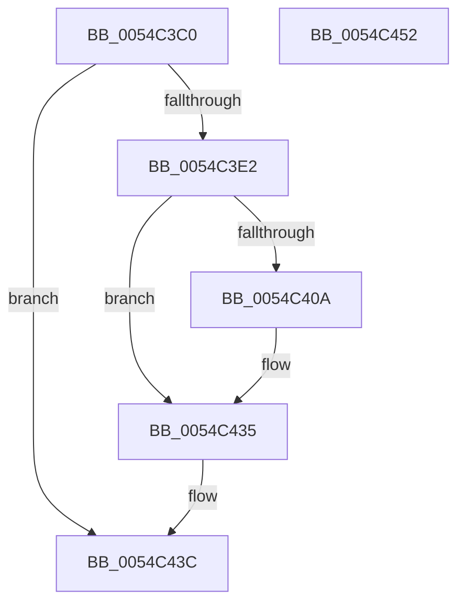

# HalpIsXboxNanovisorPresent

- RVA: `0x0054C3C0`–`0x0054C453` (길이 `147` bytes)
- VA: `0x000000014054C3C0`
- 실행 섹션: `.text`
- PDB 이름 있음: `예`; PDB Function 태그: `아니요`
- unwind 정보 RVA: `0x000B8838`
- 디코드: `41`개 명령, `147/147` bytes 표시
- 미해석 바이트: `0` (있으면 어셈블리에 `.byte`로 보존)

> 이 문서는 커널 이미지의 기계어와 PDB 기호를 분석해 생성했습니다. 4번과 5번은 함수 원형과 자료형을 바이너리 사용 방식에서 추정한 C 해석이며 원본 소스 복구 결과는 아닙니다.

## 1. Dependencies

- 직접 호출 지점: **1**; 고유 호출 대상: **1**
- 직접 호출자로 확인된 함수: **7**
- RIP 상대 이미지 참조: **3**

### Outgoing calls
- `0x0054C447` → [_security_check_cookie](../6A/_security_check_cookie_function_006AC640.md) (function, `0x006AC640`)

### Direct callers
- [HalpHvIsFrequencyAvailable](HalpHvIsFrequencyAvailable_function_0054C2B4.md) at `0x0054C2E9`
- [HalpHvStartVirtualProcessor](HalpHvStartVirtualProcessor_function_0054CF98.md) at `0x0054CFEA`
- [HalpHvVpStartEnabled](HalpHvVpStartEnabled_function_0054D0F4.md) at `0x0054D10B`
- [HalpApicSetupRegisterAccess](../55/HalpApicSetupRegisterAccess_function_005589F8.md) at `0x00558A27`
- [HalpHvStartProcessor](../55/HalpHvStartProcessor_function_0055A23C.md) at `0x0055A27E`
- [HaliAcpiMachineStateInit](../../page/70/HaliAcpiMachineStateInit_function_0070B730.md) at `0x0070B78F`
- [HalpMiscGetParameters](../../init/C1/HalpMiscGetParameters_function_00C1FD30.md) at `0x00C1FF93`

### Static image references
- `0x0054C3C6` → RVA `0x00E0A740` (`.data`; read)
- `0x0054C3D5` → RVA `0x00E0A801` (`.data`; read)
- `0x0054C435` → RVA `0x00E0A801` (`.data`; write)

## 2. Other-region calls and transfers

- 다른 실행 섹션으로 향하는 call: **0**
- 별도 외부 분기/꼬리 이동을 확인하지 못했습니다.

## 3. Assembly (complete function range)

```asm
0054C3C0  40 53                           push rbx
0054C3C2  48 83 EC 30                     sub rsp, 0x30
0054C3C6  48 8B 05 73 E3 8B 00            mov rax, qword ptr [rip + 0x8be373]
0054C3CD  48 33 C4                        xor rax, rsp
0054C3D0  48 89 44 24 20                  mov qword ptr [rsp + 0x20], rax
0054C3D5  44 8A 05 25 E4 8B 00            mov r8b, byte ptr [rip + 0x8be425]
0054C3DC  41 80 F8 FF                     cmp r8b, 0xff
0054C3E0  75 5A                           jne 0x14054c43c
0054C3E2  45 33 C0                        xor r8d, r8d
0054C3E5  33 C9                           xor ecx, ecx
0054C3E7  0F 57 C0                        xorps xmm0, xmm0
0054C3EA  0F 11 04 24                     movups xmmword ptr [rsp], xmm0
0054C3EE  45 8D 48 01                     lea r9d, [r8 + 1]
0054C3F2  41 8B C1                        mov eax, r9d
0054C3F5  0F A2                           cpuid
0054C3F7  89 04 24                        mov dword ptr [rsp], eax
0054C3FA  89 5C 24 04                     mov dword ptr [rsp + 4], ebx
0054C3FE  89 4C 24 08                     mov dword ptr [rsp + 8], ecx
0054C402  89 54 24 0C                     mov dword ptr [rsp + 0xc], edx
0054C406  85 C9                           test ecx, ecx
0054C408  79 2B                           jns 0x14054c435
0054C40A  0F 11 44 24 10                  movups xmmword ptr [rsp + 0x10], xmm0
0054C40F  33 C9                           xor ecx, ecx
0054C411  45 0F B6 C0                     movzx r8d, r8b
0054C415  B8 01 00 00 40                  mov eax, 0x40000001
0054C41A  0F A2                           cpuid
0054C41C  3D 58 62 6E 76                  cmp eax, 0x766e6258
0054C421  89 44 24 10                     mov dword ptr [rsp + 0x10], eax
0054C425  89 5C 24 14                     mov dword ptr [rsp + 0x14], ebx
0054C429  45 0F 44 C1                     cmove r8d, r9d
0054C42D  89 4C 24 18                     mov dword ptr [rsp + 0x18], ecx
0054C431  89 54 24 1C                     mov dword ptr [rsp + 0x1c], edx
0054C435  44 88 05 C5 E3 8B 00            mov byte ptr [rip + 0x8be3c5], r8b
0054C43C  41 8A C0                        mov al, r8b
0054C43F  48 8B 4C 24 20                  mov rcx, qword ptr [rsp + 0x20]
0054C444  48 33 CC                        xor rcx, rsp
0054C447  E8 F4 01 16 00                  call 0x1406ac640
0054C44C  48 83 C4 30                     add rsp, 0x30
0054C450  5B                              pop rbx
0054C451  C3                              ret
0054C452  CC                              int3
```

## 4. C-style interpretation (structured pseudocode)

```c
__int64 __fastcall HalpIsXboxNanovisorPresent(int a1, int a2)
{
    __int64 result;
    __int64 v_rsp;
    unsigned __int64 v_stack_m18;
    unsigned int v_stack_m1C;
    unsigned int v_stack_m20;
    unsigned int v_stack_m24;
    unsigned __int64 v_stack_m28;
    unsigned int v_stack_m2C;
    unsigned int v_stack_m30;
    unsigned int v_stack_m34;
    unsigned __int64 v_stack_m38;

    v_rsp = (v_rsp) - (48);
    result = (*(unsigned __int64 *)(v_rip + 9167731)) ^ (v_rsp);
    v_stack_m18 = result;
    if (((unsigned __int8)(*(unsigned __int8 *)(v_rip + 9167909))) != 255) goto loc_0054C43C;
    a3 = 0;
    a1 = 0;
    v_stack_m38 = v_xmm0;
    v_stack_m38 = (unsigned int)((unsigned int)((unsigned int)(a3 + 1)));
    v_stack_m34 = (unsigned int)(v_rbx);
    v_stack_m30 = 0;
    v_stack_m2C = a2;
    result = (unsigned int)((unsigned int)(a3 + 1));
    if (sign_flag) {
        v_stack_m28 = v_xmm0;
        a1 = 0;
        a3 = 0;
        result = 0x40000001ULL;
        v_stack_m28 = (unsigned int)(result);
        v_stack_m24 = (unsigned int)(v_rbx);
        if (((unsigned int)(result)) == 0x766E6258ULL) { a3 = (unsigned int)(a3 + 1); }
        v_stack_m20 = 0;
        v_stack_m1C = a2;
    }
    *(unsigned __int8 *)(v_rip + 9167813) = (unsigned __int8)(a3);
loc_0054C43C:
    a1 = (v_stack_m18) ^ (v_rsp);
    result = _security_check_cookie(a1, a2, a3, a3 + 1);
    v_rsp = (v_rsp) + (48);
    return result;
}
```

## 5. (Beta) C Style

```c
int64_t HalpIsXboxNanovisorPresent(int32_t Arg1, int32_t Arg2)
{
    int64_t result;
    int64_t local_rsp;
    uint64_t v_stack_m18;
    uint32_t v_stack_m1C;
    uint32_t v_stack_m20;
    uint32_t v_stack_m24;
    uint64_t v_stack_m28;
    uint32_t v_stack_m2C;
    uint32_t v_stack_m30;
    uint32_t v_stack_m34;
    uint64_t v_stack_m38;

    local_rsp = (local_rsp) - (48);
    result = (*(uint64_t *)(v_rip + 0x8BE373)) ^ (local_rsp);
    v_stack_m18 = result;
    if (((uint8_t)(*(uint8_t *)(v_rip + 0x8BE425))) != 255) goto loc_0054C43C;
    a3 = 0;
    Arg1 = 0;
    v_stack_m38 = v_xmm0;
    v_stack_m38 = (uint32_t)((uint32_t)((uint32_t)(a3 + 1)));
    v_stack_m34 = (uint32_t)(local_rbx);
    v_stack_m30 = 0;
    v_stack_m2C = Arg2;
    result = (uint32_t)((uint32_t)(a3 + 1));
    if (sign_flag) {
        v_stack_m28 = v_xmm0;
        Arg1 = 0;
        a3 = 0;
        result = 0x40000001ULL;
        v_stack_m28 = (uint32_t)(result);
        v_stack_m24 = (uint32_t)(local_rbx);
        if (((uint32_t)(result)) == 0x766E6258ULL) { a3 = (uint32_t)(a3 + 1); }
        v_stack_m20 = 0;
        v_stack_m1C = Arg2;
    }
    *(uint8_t *)(v_rip + 0x8BE3C5) = (uint8_t)(a3);
loc_0054C43C:
    Arg1 = (v_stack_m18) ^ (local_rsp);
    result = _security_check_cookie(Arg1, Arg2, a3, a3 + 1);
    local_rsp = (local_rsp) + (48);
    return result;
}
```

## 6. Execution-region graph

[열기: 2D/3D 그래프와 함수 탐색 컨트롤 패널](../../../control-panel.html?section=text&rva=0x0054C3C0&view=graph)

- 2D 그래프는 위에서 아래로 흐르고, 3D 그래프는 빈 공간을 드래그해 회전합니다. Shift+드래그는 이동, 휠은 확대·축소, 함수 노드 선택은 대상 보고서 이동입니다.

### Static fallback


