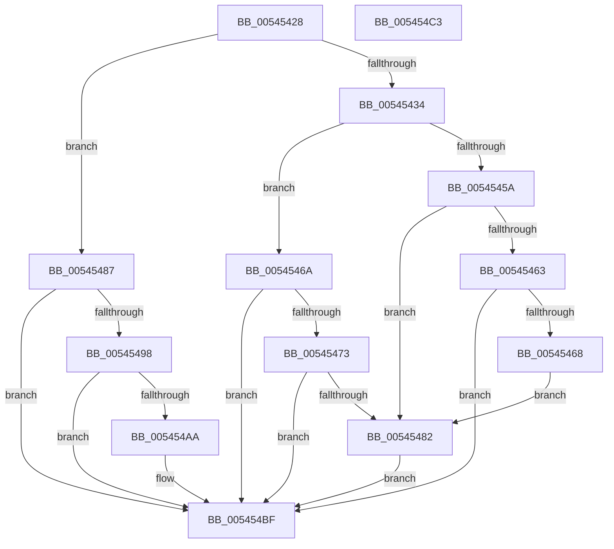

# HalpMcaAMDIsMemoryError

- RVA: `0x00545428`–`0x005454C4` (길이 `156` bytes)
- VA: `0x0000000140545428`
- 실행 섹션: `.text`
- PDB 이름 있음: `예`; PDB Function 태그: `아니요`
- unwind 정보 RVA: `0x000DB714`
- 디코드: `42`개 명령, `156/156` bytes 표시
- 미해석 바이트: `0` (있으면 어셈블리에 `.byte`로 보존)

> 이 문서는 커널 이미지의 기계어와 PDB 기호를 분석해 생성했습니다. 4번과 5번은 함수 원형과 자료형을 바이너리 사용 방식에서 추정한 C 해석이며 원본 소스 복구 결과는 아닙니다.

## 1. Dependencies

- 직접 호출 지점: **0**; 고유 호출 대상: **0**
- 직접 호출자로 확인된 함수: **2**
- RIP 상대 이미지 참조: **1**

### Outgoing calls
- 직접 디코드된 call 명령이 없습니다.

### Direct callers
- [HalpCreateMachineCheckErrorRecord](HalpCreateMachineCheckErrorRecord_function_00540B10.md) at `0x00540C55`
- [HalpMceRecoveryRequired](../55/HalpMceRecoveryRequired_function_0055637C.md) at `0x0055639A`

### Static image references
- `0x0054542B` → RVA `0x00E10258` (`.data`; read)

## 2. Other-region calls and transfers

- 다른 실행 섹션으로 향하는 call: **0**
- 별도 외부 분기/꼬리 이동을 확인하지 못했습니다.

## 3. Assembly (complete function range)

```asm
00545428  45 32 C0                        xor r8b, r8b
0054542B  44 38 05 26 AE 8C 00            cmp byte ptr [rip + 0x8cae26], r8b
00545432  74 53                           je 0x140545487
00545434  48 8B 41 48                     mov rax, qword ptr [rcx + 0x48]
00545438  B9 01 00 00 00                  mov ecx, 1
0054543D  48 8B D0                        mov rdx, rax
00545440  4C 8B C8                        mov r9, rax
00545443  48 C1 EA 20                     shr rdx, 0x20
00545447  81 E2 FF 0F 00 00               and edx, 0xfff
0054544D  49 C1 E9 30                     shr r9, 0x30
00545451  48 81 FA B0 00 00 00            cmp rdx, 0xb0
00545458  75 10                           jne 0x14054546a
0054545A  49 F7 C1 EF FF FF FF            test r9, -0x11
00545461  74 1F                           je 0x140545482
00545463  4C 3B C9                        cmp r9, rcx
00545466  75 57                           jne 0x1405454bf
00545468  EB 18                           jmp 0x140545482
0054546A  48 81 FA 96 00 00 00            cmp rdx, 0x96
00545471  75 4C                           jne 0x1405454bf
00545473  48 BA 00 00 00 00 00 00 01 00   movabs rdx, 0x1000000000000
0054547D  48 3B C2                        cmp rax, rdx
00545480  73 3D                           jae 0x1405454bf
00545482  44 8A C1                        mov r8b, cl
00545485  EB 38                           jmp 0x1405454bf
00545487  8B 41 28                        mov eax, dword ptr [rcx + 0x28]
0054548A  48 C1 E8 10                     shr rax, 0x10
0054548E  66 83 E0 1F                     and ax, 0x1f
00545492  83 79 24 04                     cmp dword ptr [rcx + 0x24], 4
00545496  75 27                           jne 0x1405454bf
00545498  B9 00 E8 00 00                  mov ecx, 0xe800
0054549D  66 23 D1                        and dx, cx
005454A0  B9 00 08 00 00                  mov ecx, 0x800
005454A5  66 3B D1                        cmp dx, cx
005454A8  75 15                           jne 0x1405454bf
005454AA  B9 F7 FF 00 00                  mov ecx, 0xfff7
005454AF  45 0F B6 C0                     movzx r8d, r8b
005454B3  66 85 C1                        test cx, ax
005454B6  B9 01 00 00 00                  mov ecx, 1
005454BB  44 0F 44 C1                     cmove r8d, ecx
005454BF  41 8A C0                        mov al, r8b
005454C2  C3                              ret
005454C3  CC                              int3
```

## 4. C-style interpretation (structured pseudocode)

```c
__int64 __fastcall HalpMcaAMDIsMemoryError(__int64 a1, __int64 a2, unsigned __int8 a3)
{
    __int64 result;

    a3 = 0;
    if ((*(unsigned __int8 *)(v_rip + 9219622)) == 0) goto loc_00545487;
    a2 = (*(unsigned __int64 *)(a1 + 72)) >> (32);
    a2 = (unsigned int)((a2) & (0xFFFULL));
    a4 = (*(unsigned __int64 *)(a1 + 72)) >> (48);
    if (a2 != 176) goto loc_0054546A;
    if (((a4) & (-17)) == 0) goto loc_00545482;
    if (a4 != 1) goto loc_005454BF;
    goto loc_00545482;
loc_0054546A:
    if (a2 != 150) goto loc_005454BF;
    if ((*(unsigned __int64 *)(a1 + 72)) >= a2) goto loc_005454BF;
loc_00545482:
    goto loc_005454BF;
loc_00545487:
    result = ((unsigned int)(*(unsigned int *)(1 + 40))) >> (16);
    result = (unsigned __int16)((result) & (31));
    if ((*(unsigned int *)(1 + 36)) != 4) goto loc_005454BF;
    a2 = (unsigned __int16)((a2) & ((unsigned __int16)((unsigned int)(0xE800ULL))));
    if (((unsigned __int16)(a2)) == ((unsigned __int16)((unsigned int)(0x800ULL)))) {
        a1 = 0xFFF7ULL;
        a3 = 1;
        a1 = 1;
        if ((((unsigned __int16)(a1)) & ((unsigned __int16)(result))) == 0) { a3 = (unsigned int)(a1); }
    }
    return a3;
}
```

## 5. (Beta) C Style

```c
int64_t HalpMcaAMDIsMemoryError(void *Arg1, int64_t Arg2, uint8_t Arg3)
{
    uint8_t *arg1 = (uint8_t *)Arg1;

    int64_t result;

    Arg3 = 0;
    if ((*(uint8_t *)(v_rip + 0x8CAE26)) == 0) goto loc_00545487;
    Arg2 = (*(uint64_t *)(arg1 + 0x48)) >> (32);
    Arg2 = (uint32_t)((Arg2) & (0xFFFULL));
    a4 = (*(uint64_t *)(arg1 + 0x48)) >> (48);
    if (Arg2 != 176) goto loc_0054546A;
    if (((a4) & (-17)) == 0) goto loc_00545482;
    if (a4 != 1) goto loc_005454BF;
    goto loc_00545482;
loc_0054546A:
    if (Arg2 != 150) goto loc_005454BF;
    if ((*(uint64_t *)(arg1 + 0x48)) >= Arg2) goto loc_005454BF;
loc_00545482:
    goto loc_005454BF;
loc_00545487:
    result = ((uint32_t)(*(uint32_t *)(1 + 0x28))) >> (16);
    result = (uint16_t)((result) & (31));
    if ((*(uint32_t *)(1 + 0x24)) != 4) goto loc_005454BF;
    Arg2 = (uint16_t)((Arg2) & ((uint16_t)((uint32_t)(0xE800ULL))));
    if (((uint16_t)(Arg2)) == ((uint16_t)((uint32_t)(0x800ULL)))) {
        Arg1 = 0xFFF7ULL;
        Arg3 = 1;
        Arg1 = 1;
        if ((((uint16_t)(Arg1)) & ((uint16_t)(result))) == 0) { Arg3 = (uint32_t)(Arg1); }
    }
    return Arg3;
}
```

### 관측된 메모리 오프셋

구조체 형식이 확인되지 않은 접근은 인자 기준의 오프셋으로만 기록했습니다.

| 기준 인자 | 오프셋 표현 | 폭 (bit) | 접근 |
|---|---:|---:|---|
| `Arg1` | `+ 0x24` | `32` | `R` |
| `Arg1` | `+ 0x28` | `32` | `R` |
| `Arg1` | `+ 0x48` | `64` | `R` |

## 6. Execution-region graph

[열기: 2D/3D 그래프와 함수 탐색 컨트롤 패널](../../../control-panel.html?section=text&rva=0x00545428&view=graph)

- 2D 그래프는 위에서 아래로 흐르고, 3D 그래프는 빈 공간을 드래그해 회전합니다. Shift+드래그는 이동, 휠은 확대·축소, 함수 노드 선택은 대상 보고서 이동입니다.

### Static fallback


