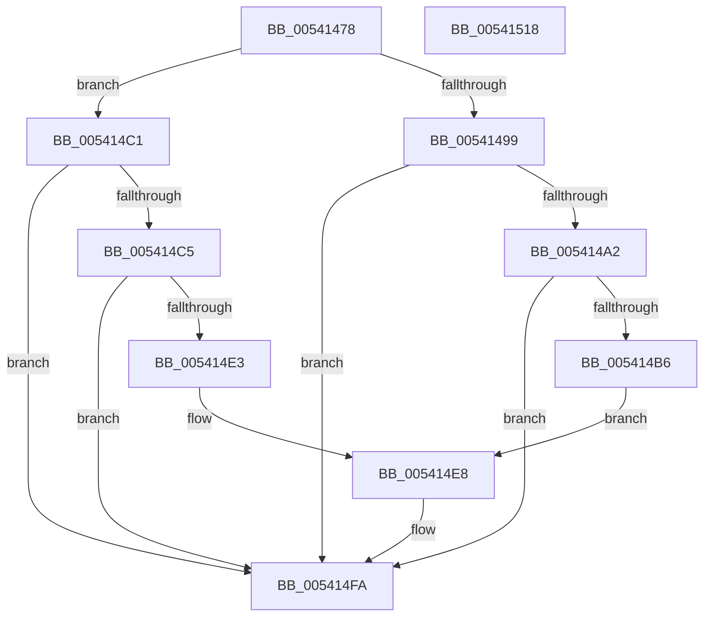

# HalpMcaClearError

- RVA: `0x00541478`–`0x00541519` (길이 `161` bytes)
- VA: `0x0000000140541478`
- 실행 섹션: `.text`
- PDB 이름 있음: `예`; PDB Function 태그: `아니요`
- unwind 정보 RVA: `0x00060BC4`
- 디코드: `45`개 명령, `161/161` bytes 표시
- 미해석 바이트: `0` (있으면 어셈블리에 `.byte`로 보존)

> 이 문서는 커널 이미지의 기계어와 PDB 기호를 분석해 생성했습니다. 4번과 5번은 함수 원형과 자료형을 바이너리 사용 방식에서 추정한 C 해석이며 원본 소스 복구 결과는 아닙니다.

## 1. Dependencies

- 직접 호출 지점: **5**; 고유 호출 대상: **4**
- 직접 호출자로 확인된 함수: **3**
- RIP 상대 이미지 참조: **3**

### Outgoing calls
- `0x00541490` → [HalpGetCpuVendor](../48/HalpGetCpuVendor_function_004879E4.md) (function, `0x004879E4`)
- `0x005414AA` → [HalpWheaReadMsrStatus](../48/HalpWheaReadMsrStatus_function_0048799C.md) (function, `0x0048799C`)
- `0x005414D7` → [guard_dispatch_icall](../6B/guard_dispatch_icall_function_006BAAD0.md) (function, `0x006BAAD0`)
- `0x005414F5` → [guard_dispatch_icall](../6B/guard_dispatch_icall_function_006BAAD0.md) (function, `0x006BAAD0`)
- `0x00541500` → [HalpWheaWriteMsrStatus](../48/HalpWheaWriteMsrStatus_function_004874C0.md) (function, `0x004874C0`)

### Direct callers
- [HalpMceHandlerCore](HalpMceHandlerCore_function_00542038.md) at `0x00542189`
- [sub_006F5696](../6F/Unknown_function_006F5696.md) at `0x006F56FC`
- [HalpHandlePreviousMcaErrorsOnProcessor](../../pagelk/B5/HalpHandlePreviousMcaErrorsOnProcessor_function_00B5BA2C.md) at `0x00B5BAB8`

### Static image references
- `0x00541499` → RVA `0x00E10258` (`.data`; read)
- `0x005414C5` → RVA `0x00FC1990` (`.data`; read)
- `0x005414E8` → RVA `0x00FC1980` (`.data`; read)

## 2. Other-region calls and transfers

- 다른 실행 섹션으로 향하는 call: **0**
- 별도 외부 분기/꼬리 이동을 확인하지 못했습니다.

## 3. Assembly (complete function range)

```asm
00541478  48 89 5C 24 08                  mov qword ptr [rsp + 8], rbx
0054147D  48 89 74 24 10                  mov qword ptr [rsp + 0x10], rsi
00541482  57                              push rdi
00541483  48 83 EC 20                     sub rsp, 0x20
00541487  8B 79 24                        mov edi, dword ptr [rcx + 0x24]
0054148A  48 8B DA                        mov rbx, rdx
0054148D  48 8B F1                        mov rsi, rcx
00541490  E8 4F 65 F4 FF                  call 0x1404879e4
00541495  3C 01                           cmp al, 1
00541497  75 28                           jne 0x1405414c1
00541499  80 3D B8 ED 8C 00 00            cmp byte ptr [rip + 0x8cedb8], 0
005414A0  74 58                           je 0x1405414fa
005414A2  45 33 C0                        xor r8d, r8d
005414A5  8B D7                           mov edx, edi
005414A7  48 8B CB                        mov rcx, rbx
005414AA  E8 ED 64 F4 FF                  call 0x14048799c
005414AF  48 0F BA E0 2C                  bt rax, 0x2c
005414B4  73 44                           jae 0x1405414fa
005414B6  C1 E7 04                        shl edi, 4
005414B9  8D 97 08 20 00 C0               lea edx, [rdi - 0x3fffdff8]
005414BF  EB 27                           jmp 0x1405414e8
005414C1  3C 02                           cmp al, 2
005414C3  75 35                           jne 0x1405414fa
005414C5  48 8B 05 C4 04 A8 00            mov rax, qword ptr [rip + 0xa804c4]
005414CC  45 33 C0                        xor r8d, r8d
005414CF  BA 79 01 00 00                  mov edx, 0x179
005414D4  48 8B CB                        mov rcx, rbx
005414D7  E8 F4 95 17 00                  call 0x1406baad0
005414DC  A9 00 00 FF 00                  test eax, 0xff0000
005414E1  76 17                           jbe 0x1405414fa
005414E3  BA 88 01 00 00                  mov edx, 0x188
005414E8  48 8B 05 91 04 A8 00            mov rax, qword ptr [rip + 0xa80491]
005414EF  45 33 C0                        xor r8d, r8d
005414F2  48 8B CB                        mov rcx, rbx
005414F5  E8 D6 95 17 00                  call 0x1406baad0
005414FA  8B 56 24                        mov edx, dword ptr [rsi + 0x24]
005414FD  48 8B CB                        mov rcx, rbx
00541500  E8 BB 5F F4 FF                  call 0x1404874c0
00541505  0F AE F0                        mfence
00541508  48 8B 5C 24 30                  mov rbx, qword ptr [rsp + 0x30]
0054150D  48 8B 74 24 38                  mov rsi, qword ptr [rsp + 0x38]
00541512  48 83 C4 20                     add rsp, 0x20
00541516  5F                              pop rdi
00541517  C3                              ret
00541518  CC                              int3
```

## 4. C-style interpretation (structured pseudocode)

```c
__int64 __fastcall HalpMcaClearError(__int64 a1, __int64 a2, int a3)
{
    __int64 result;
    __int64 v_rdi;
    __int64 v_rsp;
    unsigned __int64 v_stack_p10;
    unsigned __int64 v_stack_p8;

    v_stack_p8 = v_rbx;
    v_stack_p10 = v_rsi;
    v_rsp = (v_rsp) - (32);
    result = HalpGetCpuVendor(a1, a2, a3, a4);
    if (((unsigned __int8)(result)) != 1) goto loc_005414C1;
    if ((*(unsigned __int8 *)(v_rip + 9235896)) == 0) goto loc_005414FA;
    a3 = 0;
    result = HalpWheaReadMsrStatus(a2, (unsigned int)((unsigned int)((unsigned int)(*(unsigned int *)(a1 + 36)))), a3, a4);
    if (condition_is_above_or_equal) goto loc_005414FA;
    v_rdi = (unsigned int)(((unsigned int)(*(unsigned int *)(a1 + 36))) << (4));
    goto loc_005414E8;
loc_005414C1:
    if (((unsigned __int8)(result)) != 2) goto loc_005414FA;
    a3 = 0;
    result = guard_dispatch_icall(a2, 377, a3, a4);
    if (condition_is_below_or_equal) goto loc_005414FA;
loc_005414E8:
    a3 = 0;
    result = guard_dispatch_icall(a2, 392, a3, a4);
loc_005414FA:
    result = HalpWheaWriteMsrStatus(a2, (unsigned int)(*(unsigned int *)(a1 + 36)), a3, a4);
    v_rsp = (v_rsp) + (32);
    return result;
}
```

## 5. (Beta) C Style

```c
int64_t HalpMcaClearError(void *Arg1, int64_t Arg2, int32_t Arg3)
{
    uint8_t *arg1 = (uint8_t *)Arg1;

    int64_t result;
    int64_t local_rdi;
    int64_t local_rsp;
    uint64_t v_stack_p10;
    uint64_t v_stack_p8;

    v_stack_p8 = local_rbx;
    v_stack_p10 = local_rsi;
    local_rsp = (local_rsp) - (32);
    result = HalpGetCpuVendor(Arg1, Arg2, Arg3, a4);
    if (((uint8_t)(result)) != 1) goto loc_005414C1;
    if ((*(uint8_t *)(v_rip + 0x8CEDB8)) == 0) goto loc_005414FA;
    Arg3 = 0;
    result = HalpWheaReadMsrStatus(Arg2, (uint32_t)((uint32_t)((uint32_t)(*(uint32_t *)(arg1 + 0x24)))), Arg3, a4);
    if (condition_is_above_or_equal) goto loc_005414FA;
    local_rdi = (uint32_t)(((uint32_t)(*(uint32_t *)(arg1 + 0x24))) << (4));
    goto loc_005414E8;
loc_005414C1:
    if (((uint8_t)(result)) != 2) goto loc_005414FA;
    Arg3 = 0;
    result = guard_dispatch_icall(Arg2, 377, Arg3, a4);
    if (condition_is_below_or_equal) goto loc_005414FA;
loc_005414E8:
    Arg3 = 0;
    result = guard_dispatch_icall(Arg2, 392, Arg3, a4);
loc_005414FA:
    result = HalpWheaWriteMsrStatus(Arg2, (uint32_t)(*(uint32_t *)(arg1 + 0x24)), Arg3, a4);
    local_rsp = (local_rsp) + (32);
    return result;
}
```

### 관측된 메모리 오프셋

구조체 형식이 확인되지 않은 접근은 인자 기준의 오프셋으로만 기록했습니다.

| 기준 인자 | 오프셋 표현 | 폭 (bit) | 접근 |
|---|---:|---:|---|
| `Arg1` | `+ 0x24` | `32` | `R` |

## 6. Execution-region graph

[열기: 2D/3D 그래프와 함수 탐색 컨트롤 패널](../../../control-panel.html?section=text&rva=0x00541478&view=graph)

- 2D 그래프는 위에서 아래로 흐르고, 3D 그래프는 빈 공간을 드래그해 회전합니다. Shift+드래그는 이동, 휠은 확대·축소, 함수 노드 선택은 대상 보고서 이동입니다.

### Static fallback


