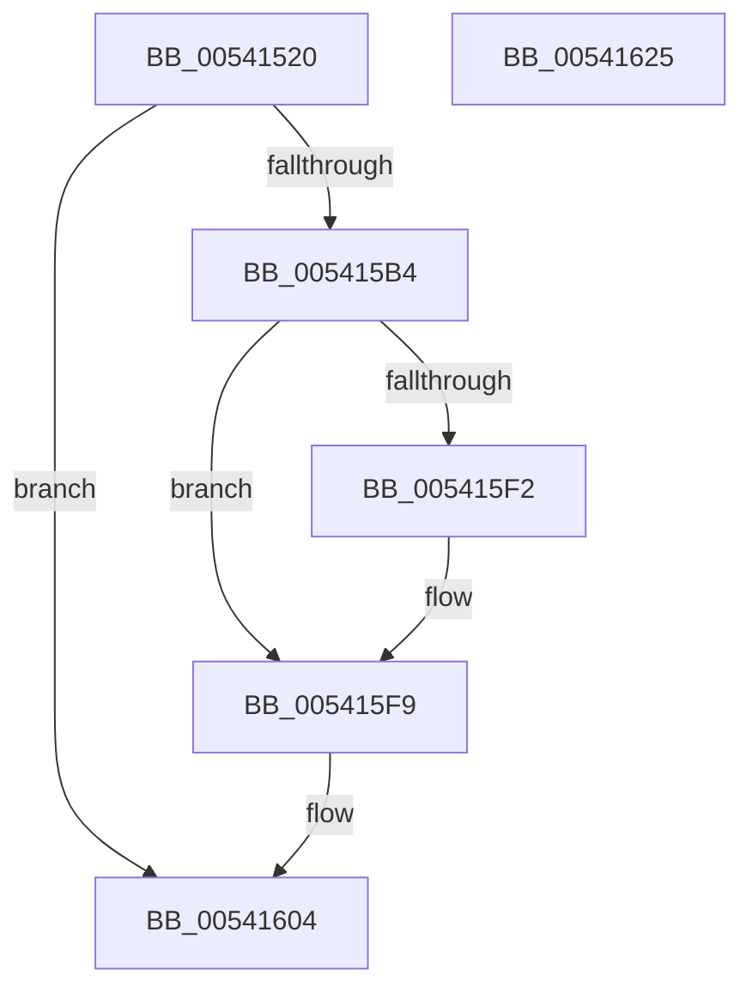

# HalpMcaExtendedLogGetL1DirectoryBase

- RVA: `0x00541520`–`0x00541626` (길이 `262` bytes)
- VA: `0x0000000140541520`
- 실행 섹션: `.text`
- PDB 이름 있음: `예`; PDB Function 태그: `아니요`
- unwind 정보 RVA: `0x000C3A08`
- 디코드: `65`개 명령, `262/262` bytes 표시
- 미해석 바이트: `0` (있으면 어셈블리에 `.byte`로 보존)

> 이 문서는 커널 이미지의 기계어와 PDB 기호를 분석해 생성했습니다. 4번과 5번은 함수 원형과 자료형을 바이너리 사용 방식에서 추정한 C 해석이며 원본 소스 복구 결과는 아닙니다.

## 1. Dependencies

- 직접 호출 지점: **6**; 고유 호출 대상: **5**
- 직접 호출자로 확인된 함수: **1**
- RIP 상대 이미지 참조: **3**

### Outgoing calls
- `0x00541576` → [RtlInitUnicodeString](../42/RtlInitUnicodeString_function_0042A780.md) (function, `0x0042A780`)
- `0x005415AB` → [ZwOpenKey](../6A/ZwOpenKey_function_006AD310.md) (function, `0x006AD310`)
- `0x005415BF` → [RtlInitUnicodeString](../42/RtlInitUnicodeString_function_0042A780.md) (function, `0x0042A780`)
- `0x005415E7` → [ZwQueryValueKey](../6A/ZwQueryValueKey_function_006AD3B0.md) (function, `0x006AD3B0`)
- `0x005415FD` → [ZwClose](../6A/ZwClose_function_006AD2B0.md) (function, `0x006AD2B0`)
- `0x0054160B` → [_security_check_cookie](../6A/_security_check_cookie_function_006AC640.md) (function, `0x006AC640`)

### Direct callers
- [HalpMcaExtendedLogInitialize](HalpMcaExtendedLogInitialize_function_0054162C.md) at `0x00541650`

### Static image references
- `0x00541537` → RVA `0x00E0A740` (`.data`; read)
- `0x00541547` → RVA `0x000239E0` (`.rdata`; read)
- `0x005415B4` → RVA `0x00023A68` (`.rdata`; read)

## 2. Other-region calls and transfers

- 다른 실행 섹션으로 향하는 call: **0**
- 별도 외부 분기/꼬리 이동을 확인하지 못했습니다.

## 3. Assembly (complete function range)

```asm
00541520  48 89 5C 24 10                  mov qword ptr [rsp + 0x10], rbx
00541525  48 89 7C 24 18                  mov qword ptr [rsp + 0x18], rdi
0054152A  55                              push rbp
0054152B  48 8D 6C 24 A9                  lea rbp, [rsp - 0x57]
00541530  48 81 EC B0 00 00 00            sub rsp, 0xb0
00541537  48 8B 05 02 92 8C 00            mov rax, qword ptr [rip + 0x8c9202]
0054153E  48 33 C4                        xor rax, rsp
00541541  48 89 45 4F                     mov qword ptr [rbp + 0x4f], rax
00541545  33 C0                           xor eax, eax
00541547  48 8D 15 92 24 AE FF            lea rdx, [rip - 0x51db6e]
0054154E  48 21 01                        and qword ptr [rcx], rax
00541551  48 8B F9                        mov rdi, rcx
00541554  21 45 23                        and dword ptr [rbp + 0x23], eax
00541557  48 8D 4D E7                     lea rcx, [rbp - 0x19]
0054155B  21 45 D7                        and dword ptr [rbp - 0x29], eax
0054155E  0F 57 C0                        xorps xmm0, xmm0
00541561  48 21 45 DF                     and qword ptr [rbp - 0x21], rax
00541565  0F 57 C9                        xorps xmm1, xmm1
00541568  89 45 0B                        mov dword ptr [rbp + 0xb], eax
0054156B  21 45 0B                        and dword ptr [rbp + 0xb], eax
0054156E  0F 11 45 E7                     movups xmmword ptr [rbp - 0x19], xmm0
00541572  0F 11 4D F7                     movups xmmword ptr [rbp - 9], xmm1
00541576  E8 05 92 EE FF                  call 0x14042a780
0054157B  48 83 65 0F 00                  and qword ptr [rbp + 0xf], 0
00541580  48 8D 45 E7                     lea rax, [rbp - 0x19]
00541584  0F 57 C0                        xorps xmm0, xmm0
00541587  48 89 45 17                     mov qword ptr [rbp + 0x17], rax
0054158B  4C 8D 45 07                     lea r8, [rbp + 7]
0054158F  C7 45 07 30 00 00 00            mov dword ptr [rbp + 7], 0x30
00541596  BA 19 00 02 00                  mov edx, 0x20019
0054159B  C7 45 1F 40 02 00 00            mov dword ptr [rbp + 0x1f], 0x240
005415A2  48 8D 4D DF                     lea rcx, [rbp - 0x21]
005415A6  F3 0F 7F 45 27                  movdqu xmmword ptr [rbp + 0x27], xmm0
005415AB  E8 60 BD 16 00                  call 0x1406ad310
005415B0  85 C0                           test eax, eax
005415B2  78 50                           js 0x140541604
005415B4  48 8D 15 AD 24 AE FF            lea rdx, [rip - 0x51db53]
005415BB  48 8D 4D F7                     lea rcx, [rbp - 9]
005415BF  E8 BC 91 EE FF                  call 0x14042a780
005415C4  48 8B 4D DF                     mov rcx, qword ptr [rbp - 0x21]
005415C8  48 8D 45 D7                     lea rax, [rbp - 0x29]
005415CC  48 89 44 24 28                  mov qword ptr [rsp + 0x28], rax
005415D1  4C 8D 4D 37                     lea r9, [rbp + 0x37]
005415D5  41 B8 02 00 00 00               mov r8d, 2
005415DB  C7 44 24 20 17 00 00 00         mov dword ptr [rsp + 0x20], 0x17
005415E3  48 8D 55 F7                     lea rdx, [rbp - 9]
005415E7  E8 C4 BD 16 00                  call 0x1406ad3b0
005415EC  8B D8                           mov ebx, eax
005415EE  85 C0                           test eax, eax
005415F0  78 07                           js 0x1405415f9
005415F2  48 8B 4D 43                     mov rcx, qword ptr [rbp + 0x43]
005415F6  48 89 0F                        mov qword ptr [rdi], rcx
005415F9  48 8B 4D DF                     mov rcx, qword ptr [rbp - 0x21]
005415FD  E8 AE BC 16 00                  call 0x1406ad2b0
00541602  8B C3                           mov eax, ebx
00541604  48 8B 4D 4F                     mov rcx, qword ptr [rbp + 0x4f]
00541608  48 33 CC                        xor rcx, rsp
0054160B  E8 30 B0 16 00                  call 0x1406ac640
00541610  4C 8D 9C 24 B0 00 00 00         lea r11, [rsp + 0xb0]
00541618  49 8B 5B 18                     mov rbx, qword ptr [r11 + 0x18]
0054161C  49 8B 7B 20                     mov rdi, qword ptr [r11 + 0x20]
00541620  49 8B E3                        mov rsp, r11
00541623  5D                              pop rbp
00541624  C3                              ret
00541625  CC                              int3
```

## 4. C-style interpretation (structured pseudocode)

```c
__int64 __fastcall HalpMcaExtendedLogGetL1DirectoryBase(__int64 a1)
{
    __int64 result;
    __int64 v_rsp;
    unsigned __int64 v_stack_m10;
    unsigned __int64 v_stack_m1C;
    unsigned __int64 v_stack_m28;
    unsigned __int64 v_stack_m38;
    unsigned int v_stack_m3C;
    unsigned int v_stack_m40;
    unsigned __int64 v_stack_m48;
    unsigned __int64 v_stack_m50;
    unsigned int v_stack_m54;
    unsigned __int64 v_stack_m58;
    unsigned __int64 v_stack_m5F;
    unsigned __int64 v_stack_m68;
    unsigned __int64 v_stack_m78;
    unsigned __int64 v_stack_m8;
    unsigned __int64 v_stack_m80;
    unsigned int v_stack_m88;
    unsigned __int64 v_stack_m90;
    unsigned int v_stack_m98;
    unsigned __int64 v_stack_p10;
    unsigned __int64 v_stack_p18;

    v_stack_p10 = v_rbx;
    v_stack_p18 = v_rdi;
    v_rsp = (v_rsp) - (176);
    result = (*(unsigned __int64 *)(v_rip + 9212418)) ^ (v_rsp);
    v_stack_m10 = result;
    result = 0;
    v_stack_m54 = 0;
    v_stack_m78 = v_xmm0;
    v_stack_m68 = v_xmm1;
    result = RtlInitUnicodeString(v_stack_m78, v_rip - 5364590, a3, a4);
    v_stack_m48 = v_stack_m78;
    v_stack_m58 = 48;
    v_stack_m40 = 576;
    v_stack_m38 = v_xmm0;
    result = ZwOpenKey(v_stack_m80, (unsigned int)(0x20019ULL), v_stack_m58, a4);
    if (sign_flag) goto loc_00541604;
    result = RtlInitUnicodeString(v_stack_m68, v_rip - 5364563, v_stack_m58, a4);
    v_stack_m90 = v_stack_m88;
    v_stack_m98 = 23;
    result = ZwQueryValueKey(v_stack_m80, v_stack_m68, 2, v_stack_m28);
    if (!(sign_flag)) {
        a1 = v_stack_m1C;
        *(unsigned __int64 *)(a1) = a1;
    }
    result = ZwClose(v_stack_m80, v_stack_m68, 2, v_stack_m28);
loc_00541604:
    a1 = (v_stack_m10) ^ (v_rsp);
    result = _security_check_cookie(a1, v_stack_m68, 2, v_stack_m28);
    return result;
}
```

## 5. (Beta) C Style

```c
int64_t HalpMcaExtendedLogGetL1DirectoryBase(void *Arg1)
{
    uint8_t *arg1 = (uint8_t *)Arg1;

    int64_t result;
    int64_t local_rsp;
    uint64_t v_stack_m10;
    uint64_t v_stack_m1C;
    uint64_t v_stack_m28;
    uint64_t v_stack_m38;
    uint32_t v_stack_m3C;
    uint32_t v_stack_m40;
    uint64_t v_stack_m48;
    uint64_t v_stack_m50;
    uint32_t v_stack_m54;
    uint64_t v_stack_m58;
    uint64_t v_stack_m5F;
    uint64_t v_stack_m68;
    uint64_t v_stack_m78;
    uint64_t v_stack_m8;
    uint64_t v_stack_m80;
    uint32_t v_stack_m88;
    uint64_t v_stack_m90;
    uint32_t v_stack_m98;
    uint64_t v_stack_p10;
    uint64_t v_stack_p18;

    v_stack_p10 = local_rbx;
    v_stack_p18 = local_rdi;
    local_rsp = (local_rsp) - (176);
    result = (*(uint64_t *)(v_rip + 0x8C9202)) ^ (local_rsp);
    v_stack_m10 = result;
    result = 0;
    v_stack_m54 = 0;
    v_stack_m78 = v_xmm0;
    v_stack_m68 = v_xmm1;
    result = RtlInitUnicodeString(v_stack_m78, v_rip - 5364590, a3, a4);
    v_stack_m48 = v_stack_m78;
    v_stack_m58 = 48;
    v_stack_m40 = 576;
    v_stack_m38 = v_xmm0;
    result = ZwOpenKey(v_stack_m80, (uint32_t)(0x20019ULL), v_stack_m58, a4);
    if (sign_flag) goto loc_00541604;
    result = RtlInitUnicodeString(v_stack_m68, v_rip - 5364563, v_stack_m58, a4);
    v_stack_m90 = v_stack_m88;
    v_stack_m98 = 23;
    result = ZwQueryValueKey(v_stack_m80, v_stack_m68, 2, v_stack_m28);
    if (!(sign_flag)) {
        Arg1 = v_stack_m1C;
        *(void **)(arg1) = Arg1;
    }
    result = ZwClose(v_stack_m80, v_stack_m68, 2, v_stack_m28);
loc_00541604:
    Arg1 = (v_stack_m10) ^ (local_rsp);
    result = _security_check_cookie(Arg1, v_stack_m68, 2, v_stack_m28);
    return result;
}
```

### 관측된 메모리 오프셋

구조체 형식이 확인되지 않은 접근은 인자 기준의 오프셋으로만 기록했습니다.

| 기준 인자 | 오프셋 표현 | 폭 (bit) | 접근 |
|---|---:|---:|---|
| `Arg1` | `+ 0x0` | `64` | `R/W` |
| `Arg1` | `+ 0x0` | `64` | `W` |

## 6. Execution-region graph

[열기: 2D/3D 그래프와 함수 탐색 컨트롤 패널](../../../control-panel.html?section=text&rva=0x00541520&view=graph)

- 2D 그래프는 위에서 아래로 흐르고, 3D 그래프는 빈 공간을 드래그해 회전합니다. Shift+드래그는 이동, 휠은 확대·축소, 함수 노드 선택은 대상 보고서 이동입니다.

### Static fallback


