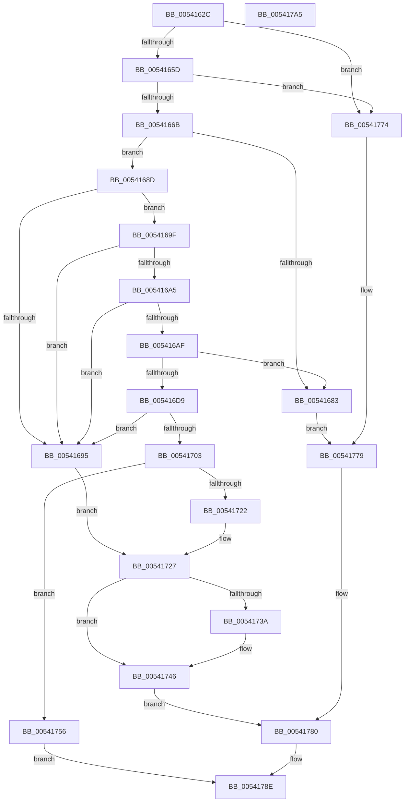

# HalpMcaExtendedLogInitialize

- RVA: `0x0054162C`–`0x005417A6` (길이 `378` bytes)
- VA: `0x000000014054162C`
- 실행 섹션: `.text`
- PDB 이름 있음: `예`; PDB Function 태그: `아니요`
- unwind 정보 RVA: `0x0006C8E8`
- 디코드: `97`개 명령, `378/378` bytes 표시
- 미해석 바이트: `0` (있으면 어셈블리에 `.byte`로 보존)

> 이 문서는 커널 이미지의 기계어와 PDB 기호를 분석해 생성했습니다. 4번과 5번은 함수 원형과 자료형을 바이너리 사용 방식에서 추정한 C 해석이며 원본 소스 복구 결과는 아닙니다.

## 1. Dependencies

- 직접 호출 지점: **7**; 고유 호출 대상: **3**
- 직접 호출자로 확인된 함수: **1**
- RIP 상대 이미지 참조: **9**

### Outgoing calls
- `0x00541650` → [HalpMcaExtendedLogGetL1DirectoryBase](HalpMcaExtendedLogGetL1DirectoryBase_function_00541520.md) (function, `0x00541520`)
- `0x00541676` → [MmMapIoSpaceEx](../32/MmMapIoSpaceEx_function_00327830.md) (function, `0x00327830`)
- `0x005416BB` → [MiUnmapContiguousMemory](../3F/MiUnmapContiguousMemory_function_003F7908.md) (function, `0x003F7908`)
- `0x005416CC` → [MmMapIoSpaceEx](../32/MmMapIoSpaceEx_function_00327830.md) (function, `0x00327830`)
- `0x00541711` → [MmMapIoSpaceEx](../32/MmMapIoSpaceEx_function_00327830.md) (function, `0x00327830`)
- `0x00541741` → [MiUnmapContiguousMemory](../3F/MiUnmapContiguousMemory_function_003F7908.md) (function, `0x003F7908`)
- `0x0054174F` → [MiUnmapContiguousMemory](../3F/MiUnmapContiguousMemory_function_003F7908.md) (function, `0x003F7908`)

### Direct callers
- [HalpInitializeMce](../../pagelk/B5/HalpInitializeMce_function_00B5BC04.md) at `0x00B5BC97`

### Static image references
- `0x005416D9` → RVA `0x00E3EBF0` (`.data`; write)
- `0x005416E3` → RVA `0x00E3EC00` (`.data`; write)
- `0x005416F7` → RVA `0x00E3EBF8` (`.data`; write)
- `0x00541716` → RVA `0x00E3EC10` (`.data`; write)
- `0x00541727` → RVA `0x00E3EC10` (`.data`; read)
- `0x0054172E` → RVA `0x00E100C0` (`.data`; write)
- `0x0054175A` → RVA `0x00E3EC08` (`.data`; write)
- `0x00541765` → RVA `0x00E3EC18` (`.data`; write)
- `0x00541782` → RVA `0x00E3EBF0` (`.data`; read)

## 2. Other-region calls and transfers

- 다른 실행 섹션으로 향하는 call: **0**
- 별도 외부 분기/꼬리 이동을 확인하지 못했습니다.

## 3. Assembly (complete function range)

```asm
0054162C  48 8B C4                        mov rax, rsp
0054162F  48 89 58 10                     mov qword ptr [rax + 0x10], rbx
00541633  48 89 68 18                     mov qword ptr [rax + 0x18], rbp
00541637  48 89 70 20                     mov qword ptr [rax + 0x20], rsi
0054163B  57                              push rdi
0054163C  48 83 EC 20                     sub rsp, 0x20
00541640  48 83 60 08 00                  and qword ptr [rax + 8], 0
00541645  48 8D 48 08                     lea rcx, [rax + 8]
00541649  BB 00 10 00 00                  mov ebx, 0x1000
0054164E  8B EB                           mov ebp, ebx
00541650  E8 CB FE FF FF                  call 0x140541520
00541655  85 C0                           test eax, eax
00541657  0F 88 17 01 00 00               js 0x140541774
0054165D  48 8B 7C 24 30                  mov rdi, qword ptr [rsp + 0x30]
00541662  48 85 FF                        test rdi, rdi
00541665  0F 84 09 01 00 00               je 0x140541774
0054166B  41 B8 04 02 00 00               mov r8d, 0x204
00541671  8B D3                           mov edx, ebx
00541673  48 8B CF                        mov rcx, rdi
00541676  E8 B5 61 DE FF                  call 0x140327830
0054167B  48 8B F0                        mov rsi, rax
0054167E  48 85 C0                        test rax, rax
00541681  75 0A                           jne 0x14054168d
00541683  BB 9A 00 00 C0                  mov ebx, 0xc000009a
00541688  E9 EC 00 00 00                  jmp 0x140541779
0054168D  81 38 00 01 00 00               cmp dword ptr [rax], 0x100
00541693  74 0A                           je 0x14054169f
00541695  BB BB 00 00 C0                  mov ebx, 0xc00000bb
0054169A  E9 88 00 00 00                  jmp 0x140541727
0054169F  83 78 04 40                     cmp dword ptr [rax + 4], 0x40
005416A3  75 F0                           jne 0x140541695
005416A5  48 8B 40 08                     mov rax, qword ptr [rax + 8]
005416A9  48 83 F8 40                     cmp rax, 0x40
005416AD  76 E6                           jbe 0x140541695
005416AF  41 B0 01                        mov r8b, 1
005416B2  48 8B D3                        mov rdx, rbx
005416B5  48 8B CE                        mov rcx, rsi
005416B8  48 8B E8                        mov rbp, rax
005416BB  E8 48 62 EB FF                  call 0x1403f7908
005416C0  41 B8 04 02 00 00               mov r8d, 0x204
005416C6  48 8B D5                        mov rdx, rbp
005416C9  48 8B CF                        mov rcx, rdi
005416CC  E8 5F 61 DE FF                  call 0x140327830
005416D1  48 8B F0                        mov rsi, rax
005416D4  48 85 C0                        test rax, rax
005416D7  74 AA                           je 0x140541683
005416D9  48 89 05 10 D5 8F 00            mov qword ptr [rip + 0x8fd510], rax
005416E0  8B 50 30                        mov edx, dword ptr [rax + 0x30]
005416E3  89 15 17 D5 8F 00               mov dword ptr [rip + 0x8fd517], edx
005416E9  8B 40 04                        mov eax, dword ptr [rax + 4]
005416EC  48 8B 4E 08                     mov rcx, qword ptr [rsi + 8]
005416F0  48 2B C8                        sub rcx, rax
005416F3  48 C1 E9 03                     shr rcx, 3
005416F7  48 89 0D FA D4 8F 00            mov qword ptr [rip + 0x8fd4fa], rcx
005416FE  48 3B CA                        cmp rcx, rdx
00541701  72 92                           jb 0x140541695
00541703  48 8B 4E 10                     mov rcx, qword ptr [rsi + 0x10]
00541707  41 B8 04 02 00 00               mov r8d, 0x204
0054170D  48 8B 56 18                     mov rdx, qword ptr [rsi + 0x18]
00541711  E8 1A 61 DE FF                  call 0x140327830
00541716  48 89 05 F3 D4 8F 00            mov qword ptr [rip + 0x8fd4f3], rax
0054171D  48 85 C0                        test rax, rax
00541720  75 34                           jne 0x140541756
00541722  BB 9A 00 00 C0                  mov ebx, 0xc000009a
00541727  48 8B 0D E2 D4 8F 00            mov rcx, qword ptr [rip + 0x8fd4e2]
0054172E  C6 05 8B E9 8C 00 00            mov byte ptr [rip + 0x8ce98b], 0
00541735  48 85 C9                        test rcx, rcx
00541738  74 0C                           je 0x140541746
0054173A  48 8B 56 18                     mov rdx, qword ptr [rsi + 0x18]
0054173E  41 B0 01                        mov r8b, 1
00541741  E8 C2 61 EB FF                  call 0x1403f7908
00541746  41 B0 01                        mov r8b, 1
00541749  48 8B D5                        mov rdx, rbp
0054174C  48 8B CE                        mov rcx, rsi
0054174F  E8 B4 61 EB FF                  call 0x1403f7908
00541754  EB 2A                           jmp 0x140541780
00541756  48 8B 46 10                     mov rax, qword ptr [rsi + 0x10]
0054175A  48 89 05 A7 D4 8F 00            mov qword ptr [rip + 0x8fd4a7], rax
00541761  48 8B 46 18                     mov rax, qword ptr [rsi + 0x18]
00541765  48 89 05 AC D4 8F 00            mov qword ptr [rip + 0x8fd4ac], rax
0054176C  83 4E 20 01                     or dword ptr [rsi + 0x20], 1
00541770  33 DB                           xor ebx, ebx
00541772  EB 1A                           jmp 0x14054178e
00541774  BB BB 00 00 C0                  mov ebx, 0xc00000bb
00541779  C6 05 40 E9 8C 00 00            mov byte ptr [rip + 0x8ce940], 0
00541780  33 C0                           xor eax, eax
00541782  48 8D 3D 67 D4 8F 00            lea rdi, [rip + 0x8fd467]
00541789  8D 48 30                        lea ecx, [rax + 0x30]
0054178C  F3 AA                           rep stosb byte ptr [rdi], al
0054178E  48 8B 6C 24 40                  mov rbp, qword ptr [rsp + 0x40]
00541793  8B C3                           mov eax, ebx
00541795  48 8B 5C 24 38                  mov rbx, qword ptr [rsp + 0x38]
0054179A  48 8B 74 24 48                  mov rsi, qword ptr [rsp + 0x48]
0054179F  48 83 C4 20                     add rsp, 0x20
005417A3  5F                              pop rdi
005417A4  C3                              ret
005417A5  CC                              int3
```

## 4. C-style interpretation (structured pseudocode)

```c
__int64 __fastcall HalpMcaExtendedLogInitialize(void)
{
    __int64 result;
    __int64 v_rbx;
    __int64 v_rsp;
    unsigned __int64 v_stack_p10;
    unsigned __int64 v_stack_p18;
    unsigned __int64 v_stack_p20;
    unsigned __int64 v_stack_p8;

    *(unsigned __int64 *)(v_rsp + 16) = v_rbx;
    *(unsigned __int64 *)(v_rsp + 24) = v_rbp;
    *(unsigned __int64 *)(v_rsp + 32) = v_rsi;
    v_rsp = (v_rsp) - (32);
    result = HalpMcaExtendedLogGetL1DirectoryBase(v_rsp + 8, a2, a3, a4);
    if (sign_flag) goto loc_00541774;
    if (v_stack_p8 == 0) goto loc_00541774;
    result = MmMapIoSpaceEx(v_stack_p8, (unsigned int)((unsigned int)((unsigned int)(0x1000ULL))), 516, a4);
    if (result != 0) goto loc_0054168D;
loc_00541683:
    goto loc_00541779;
loc_0054168D:
    if ((*(unsigned int *)(result)) == 256) goto loc_0054169F;
loc_00541695:
    goto loc_00541727;
loc_0054169F:
    if ((*(unsigned int *)(result + 4)) != 64) goto loc_00541695;
    if ((*(unsigned __int64 *)(result + 8)) <= 64) goto loc_00541695;
    result = MiUnmapContiguousMemory(result, (unsigned int)(0xC00000BBULL), 1, a4);
    result = MmMapIoSpaceEx(v_stack_p8, *(unsigned __int64 *)(result + 8), 516, a4);
    if (result == 0) goto loc_00541683;
    *(unsigned __int64 *)(v_rip + 9426192) = result;
    *(unsigned int *)(v_rip + 9426199) = (unsigned int)((unsigned int)(*(unsigned int *)(result + 48)));
    a1 = (*(unsigned __int64 *)(result + 8)) - ((unsigned int)(*(unsigned int *)(result + 4)));
    a1 = (a1) >> (3);
    *(unsigned __int64 *)(v_rip + 9426170) = a1;
    if (a1 < ((unsigned int)(*(unsigned int *)(result + 48)))) goto loc_00541695;
    result = MmMapIoSpaceEx(*(unsigned __int64 *)(result + 16), *(unsigned __int64 *)(result + 24), 516, a4);
    *(unsigned __int64 *)(v_rip + 9426163) = result;
    if (result != 0) goto loc_00541756;
loc_00541727:
    *(unsigned __int8 *)(v_rip + 9234827) = 0;
    if (*(unsigned __int64 *)(v_rip + 9426146) != 0) {
        a2 = *(unsigned __int64 *)(result + 24);
        a3 = 1;
        result = MiUnmapContiguousMemory(*(unsigned __int64 *)(v_rip + 9426146), a2, a3, a4);
    }
    result = MiUnmapContiguousMemory(result, *(unsigned __int64 *)(result + 8), 1, a4);
    goto loc_00541780;
loc_00541756:
    *(unsigned __int64 *)(v_rip + 9426087) = *(unsigned __int64 *)(result + 16);
    *(unsigned __int64 *)(v_rip + 9426092) = *(unsigned __int64 *)(result + 24);
    v_rbx = 0;
    goto loc_0054178E;
loc_00541774:
loc_00541779:
    *(unsigned __int8 *)(v_rip + 9234752) = 0;
loc_00541780:
    result = 0;
loc_0054178E:
    v_rsp = (v_rsp) + (32);
    return (unsigned int)((unsigned int)((unsigned int)(0xC00000BBULL)));
}
```

## 5. (Beta) C Style

```c
void HalpMcaExtendedLogInitialize(void)
{
    int64_t result;
    int64_t local_rbx;
    int64_t local_rsp;
    uint64_t v_stack_p10;
    uint64_t v_stack_p18;
    uint64_t v_stack_p20;
    uint64_t v_stack_p8;

    *(uint64_t *)(local_rsp + 0x10) = local_rbx;
    *(uint64_t *)(local_rsp + 0x18) = local_rbp;
    *(uint64_t *)(local_rsp + 0x20) = local_rsi;
    local_rsp = (local_rsp) - (32);
    result = HalpMcaExtendedLogGetL1DirectoryBase(local_rsp + 8, a2, a3, a4);
    if (sign_flag) goto loc_00541774;
    if (v_stack_p8 == 0) goto loc_00541774;
    result = MmMapIoSpaceEx(v_stack_p8, (uint32_t)((uint32_t)((uint32_t)(0x1000ULL))), 516, a4);
    if (result != 0) goto loc_0054168D;
loc_00541683:
    goto loc_00541779;
loc_0054168D:
    if ((*(uint32_t *)(result)) == 256) goto loc_0054169F;
loc_00541695:
    goto loc_00541727;
loc_0054169F:
    if ((*(uint32_t *)(result + 0x4)) != 64) goto loc_00541695;
    if ((*(uint64_t *)(result + 0x8)) <= 64) goto loc_00541695;
    result = MiUnmapContiguousMemory(result, (uint32_t)(0xC00000BBULL), 1, a4);
    result = MmMapIoSpaceEx(v_stack_p8, *(uint64_t *)(result + 0x8), 516, a4);
    if (result == 0) goto loc_00541683;
    *(uint64_t *)(v_rip + 0x8FD510) = result;
    *(uint32_t *)(v_rip + 0x8FD517) = (uint32_t)((uint32_t)(*(uint32_t *)(result + 0x30)));
    a1 = (*(uint64_t *)(result + 0x8)) - ((uint32_t)(*(uint32_t *)(result + 0x4)));
    a1 = (a1) >> (3);
    *(uint64_t *)(v_rip + 0x8FD4FA) = a1;
    if (a1 < ((uint32_t)(*(uint32_t *)(result + 0x30)))) goto loc_00541695;
    result = MmMapIoSpaceEx(*(uint64_t *)(result + 0x10), *(uint64_t *)(result + 0x18), 516, a4);
    *(uint64_t *)(v_rip + 0x8FD4F3) = result;
    if (result != 0) goto loc_00541756;
loc_00541727:
    *(uint8_t *)(v_rip + 0x8CE98B) = 0;
    if (*(uint64_t *)(v_rip + 0x8FD4E2) != 0) {
        a2 = *(uint64_t *)(result + 0x18);
        a3 = 1;
        result = MiUnmapContiguousMemory(*(uint64_t *)(v_rip + 0x8FD4E2), a2, a3, a4);
    }
    result = MiUnmapContiguousMemory(result, *(uint64_t *)(result + 0x8), 1, a4);
    goto loc_00541780;
loc_00541756:
    *(uint64_t *)(v_rip + 0x8FD4A7) = *(uint64_t *)(result + 0x10);
    *(uint64_t *)(v_rip + 0x8FD4AC) = *(uint64_t *)(result + 0x18);
    local_rbx = 0;
    goto loc_0054178E;
loc_00541774:
loc_00541779:
    *(uint8_t *)(v_rip + 0x8CE940) = 0;
loc_00541780:
    result = 0;
loc_0054178E:
    local_rsp = (local_rsp) + (32);
    return (uint32_t)((uint32_t)((uint32_t)(0xC00000BBULL)));
}
```

## 6. Execution-region graph

[열기: 2D/3D 그래프와 함수 탐색 컨트롤 패널](../../../control-panel.html?section=text&rva=0x0054162C&view=graph)

- 2D 그래프는 위에서 아래로 흐르고, 3D 그래프는 빈 공간을 드래그해 회전합니다. Shift+드래그는 이동, 휠은 확대·축소, 함수 노드 선택은 대상 보고서 이동입니다.

### Static fallback


