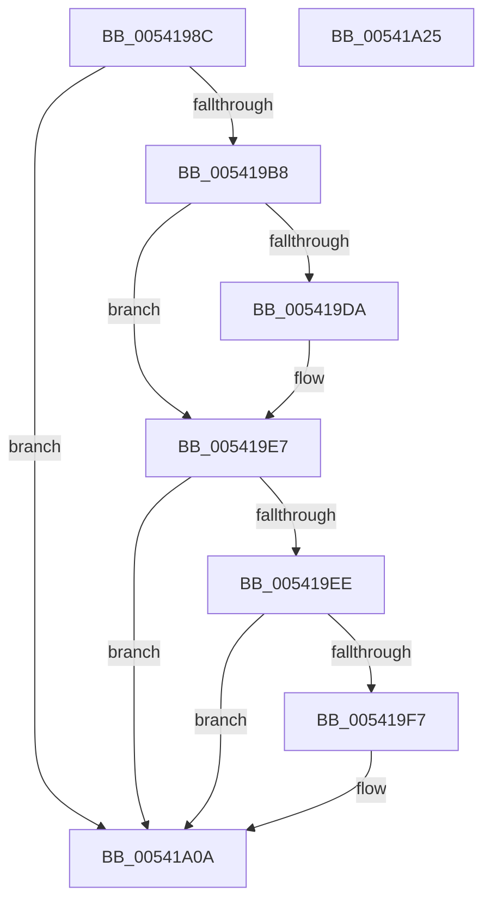

# HalpMcaPopulateErrorDataEx

- RVA: `0x0054198C`–`0x00541A26` (길이 `154` bytes)
- VA: `0x000000014054198C`
- 실행 섹션: `.text`
- PDB 이름 있음: `예`; PDB Function 태그: `아니요`
- unwind 정보 RVA: `0x0005E6B4`
- 디코드: `37`개 명령, `154/154` bytes 표시
- 미해석 바이트: `0` (있으면 어셈블리에 `.byte`로 보존)

> 이 문서는 커널 이미지의 기계어와 PDB 기호를 분석해 생성했습니다. 4번과 5번은 함수 원형과 자료형을 바이너리 사용 방식에서 추정한 C 해석이며 원본 소스 복구 결과는 아닙니다.

## 1. Dependencies

- 직접 호출 지점: **2**; 고유 호출 대상: **2**
- 직접 호출자로 확인된 함수: **1**
- RIP 상대 이미지 참조: **1**

### Outgoing calls
- `0x005419DA` → [HalpWheaReadMsrAddress](../55/HalpWheaReadMsrAddress_function_005559C0.md) (function, `0x005559C0`)
- `0x005419FD` → [HalpWheaReadMsrMisc](../48/HalpWheaReadMsrMisc_function_004872EC.md) (function, `0x004872EC`)

### Direct callers
- [HalpMcaPopulateErrorData](HalpMcaPopulateErrorData_function_005417AC.md) at `0x005417EF`

### Static image references
- `0x005419EE` → RVA `0x00E0F6B9` (`.data`; read)

## 2. Other-region calls and transfers

- 다른 실행 섹션으로 향하는 call: **0**
- 별도 외부 분기/꼬리 이동을 확인하지 못했습니다.

## 3. Assembly (complete function range)

```asm
0054198C  48 8B C4                        mov rax, rsp
0054198F  48 89 58 08                     mov qword ptr [rax + 8], rbx
00541993  48 89 68 10                     mov qword ptr [rax + 0x10], rbp
00541997  48 89 70 18                     mov qword ptr [rax + 0x18], rsi
0054199B  48 89 78 20                     mov qword ptr [rax + 0x20], rdi
0054199F  41 56                           push r14
005419A1  48 83 EC 20                     sub rsp, 0x20
005419A5  83 7C 24 50 20                  cmp dword ptr [rsp + 0x50], 0x20
005419AA  49 8B F1                        mov rsi, r9
005419AD  49 8B D8                        mov rbx, r8
005419B0  44 8B F2                        mov r14d, edx
005419B3  48 8B F9                        mov rdi, rcx
005419B6  73 52                           jae 0x140541a0a
005419B8  41 FF 81 24 01 00 00            inc dword ptr [r9 + 0x124]
005419BF  48 0F BA E3 3A                  bt rbx, 0x3a
005419C4  8B 6C 24 50                     mov ebp, dword ptr [rsp + 0x50]
005419C8  41 89 94 A9 28 01 00 00         mov dword ptr [r9 + rbp*4 + 0x128], edx
005419D0  49 89 9C E9 A8 01 00 00         mov qword ptr [r9 + rbp*8 + 0x1a8], rbx
005419D8  73 0D                           jae 0x1405419e7
005419DA  E8 E1 3F 01 00                  call 0x1405559c0
005419DF  48 89 84 EE A8 02 00 00         mov qword ptr [rsi + rbp*8 + 0x2a8], rax
005419E7  48 0F BA E3 3B                  bt rbx, 0x3b
005419EC  73 1C                           jae 0x140541a0a
005419EE  80 3D C4 DC 8C 00 00            cmp byte ptr [rip + 0x8cdcc4], 0
005419F5  74 13                           je 0x140541a0a
005419F7  41 8B D6                        mov edx, r14d
005419FA  48 8B CF                        mov rcx, rdi
005419FD  E8 EA 58 F4 FF                  call 0x1404872ec
00541A02  48 89 84 EE A8 03 00 00         mov qword ptr [rsi + rbp*8 + 0x3a8], rax
00541A0A  48 8B 5C 24 30                  mov rbx, qword ptr [rsp + 0x30]
00541A0F  48 8B 6C 24 38                  mov rbp, qword ptr [rsp + 0x38]
00541A14  48 8B 74 24 40                  mov rsi, qword ptr [rsp + 0x40]
00541A19  48 8B 7C 24 48                  mov rdi, qword ptr [rsp + 0x48]
00541A1E  48 83 C4 20                     add rsp, 0x20
00541A22  41 5E                           pop r14
00541A24  C3                              ret
00541A25  CC                              int3
```

## 4. C-style interpretation (structured pseudocode)

```c
__int64 __fastcall HalpMcaPopulateErrorDataEx(__int64 a1, int a2, __int64 a3, __int64 a4, unsigned int a5)
{
    __int64 result;
    __int64 v_rsp;
    unsigned __int64 v_stack_p10;
    unsigned __int64 v_stack_p18;
    unsigned __int64 v_stack_p20;
    unsigned __int64 v_stack_p8;

    *(unsigned __int64 *)(v_rsp + 8) = v_rbx;
    *(unsigned __int64 *)(v_rsp + 16) = v_rbp;
    *(unsigned __int64 *)(v_rsp + 24) = v_rsi;
    *(unsigned __int64 *)(v_rsp + 32) = v_rdi;
    v_rsp = (v_rsp) - (32);
    if (a5 >= 32) goto loc_00541A0A;
    *(unsigned int *)(a4 + (unsigned int)(a5) * 4 + 296) = a2;
    *(unsigned __int64 *)(a4 + (unsigned int)(a5) * 8 + 424) = a3;
    result = v_rsp;
    if (a5 < 32) {
        result = HalpWheaReadMsrAddress(a1, a2, a3, a4);
        *(unsigned __int64 *)(a4 + (unsigned int)(a5) * 8 + 680) = result;
    }
    if (a5 >= 32) goto loc_00541A0A;
    if ((*(unsigned __int8 *)(v_rip + 9231556)) != 0) {
        a2 = (unsigned int)((unsigned int)(a2));
        a1 = a1;
        result = HalpWheaReadMsrMisc(a1, a2, a3, a4);
        *(unsigned __int64 *)(a4 + (unsigned int)(a5) * 8 + 936) = result;
    }
    v_rsp = (v_rsp) + (32);
    return result;
}
```

## 5. (Beta) C Style

```c
int64_t HalpMcaPopulateErrorDataEx(int64_t Arg1, int32_t Arg2, int64_t Arg3, void *Arg4, uint32_t Arg5)
{
    uint8_t *arg4 = (uint8_t *)Arg4;

    int64_t result;
    int64_t local_rsp;
    uint64_t v_stack_p10;
    uint64_t v_stack_p18;
    uint64_t v_stack_p20;
    uint64_t v_stack_p8;

    *(uint64_t *)(local_rsp + 0x8) = local_rbx;
    *(uint64_t *)(local_rsp + 0x10) = local_rbp;
    *(uint64_t *)(local_rsp + 0x18) = local_rsi;
    *(uint64_t *)(local_rsp + 0x20) = local_rdi;
    local_rsp = (local_rsp) - (32);
    if (Arg5 >= 32) goto loc_00541A0A;
    *(uint32_t *)(arg4 + (uint32_t)(Arg5) * 4 + 0x128) = Arg2;
    *(uint64_t *)(arg4 + (uint32_t)(Arg5) * 8 + 0x1A8) = Arg3;
    result = local_rsp;
    if (Arg5 < 32) {
        result = HalpWheaReadMsrAddress(Arg1, Arg2, Arg3, Arg4);
        *(uint64_t *)(arg4 + (uint32_t)(Arg5) * 8 + 0x2A8) = result;
    }
    if (Arg5 >= 32) goto loc_00541A0A;
    if ((*(uint8_t *)(v_rip + 0x8CDCC4)) != 0) {
        Arg2 = (uint32_t)((uint32_t)(Arg2));
        Arg1 = Arg1;
        result = HalpWheaReadMsrMisc(Arg1, Arg2, Arg3, Arg4);
        *(uint64_t *)(arg4 + (uint32_t)(Arg5) * 8 + 0x3A8) = result;
    }
    local_rsp = (local_rsp) + (32);
    return result;
}
```

### 관측된 메모리 오프셋

구조체 형식이 확인되지 않은 접근은 인자 기준의 오프셋으로만 기록했습니다.

| 기준 인자 | 오프셋 표현 | 폭 (bit) | 접근 |
|---|---:|---:|---|
| `Arg4` | `+ 0x124` | `32` | `R/W` |
| `Arg4` | `+ 0x128 + rbp*4` | `32` | `W` |
| `Arg4` | `+ 0x1A8 + rbp*8` | `64` | `W` |
| `Arg4` | `+ 0x2A8 + rbp*8` | `64` | `W` |
| `Arg4` | `+ 0x3A8 + rbp*8` | `64` | `W` |

## 6. Execution-region graph

[열기: 2D/3D 그래프와 함수 탐색 컨트롤 패널](../../../control-panel.html?section=text&rva=0x0054198C&view=graph)

- 2D 그래프는 위에서 아래로 흐르고, 3D 그래프는 빈 공간을 드래그해 회전합니다. Shift+드래그는 이동, 휠은 확대·축소, 함수 노드 선택은 대상 보고서 이동입니다.

### Static fallback


