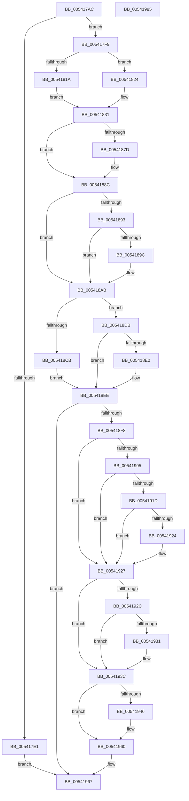

# HalpMcaPopulateErrorData

- RVA: `0x005417AC`–`0x00541986` (길이 `474` bytes)
- VA: `0x00000001405417AC`
- 실행 섹션: `.text`
- PDB 이름 있음: `예`; PDB Function 태그: `아니요`
- unwind 정보 RVA: `0x000C3AF8`
- 디코드: `127`개 명령, `474/474` bytes 표시
- 미해석 바이트: `0` (있으면 어셈블리에 `.byte`로 보존)

> 이 문서는 커널 이미지의 기계어와 PDB 기호를 분석해 생성했습니다. 4번과 5번은 함수 원형과 자료형을 바이너리 사용 방식에서 추정한 C 해석이며 원본 소스 복구 결과는 아닙니다.

## 1. Dependencies

- 직접 호출 지점: **12**; 고유 호출 대상: **9**
- 직접 호출자로 확인된 함수: **1**
- RIP 상대 이미지 참조: **3**

### Outgoing calls
- `0x005417EF` → [HalpMcaPopulateErrorDataEx](HalpMcaPopulateErrorDataEx_function_0054198C.md) (function, `0x0054198C`)
- `0x00541808` → [HalpGetCpuVendor](../48/HalpGetCpuVendor_function_004879E4.md) (function, `0x004879E4`)
- `0x00541846` → [HalpWheaGetApicId](HalpWheaGetApicId_function_005424D0.md) (function, `0x005424D0`)
- `0x00541861` → [guard_dispatch_icall](../6B/guard_dispatch_icall_function_006BAAD0.md) (function, `0x006BAAD0`)
- `0x00541883` → [HalpWheaReadMsrAddress](../55/HalpWheaReadMsrAddress_function_005559C0.md) (function, `0x005559C0`)
- `0x005418A2` → [HalpWheaReadMsrMisc](../48/HalpWheaReadMsrMisc_function_004872EC.md) (function, `0x004872EC`)
- `0x005418BD` → [guard_dispatch_icall](../6B/guard_dispatch_icall_function_006BAAD0.md) (function, `0x006BAAD0`)
- `0x005418D4` → [HalpReadExtendedMcaRegistersIntel](HalpReadExtendedMcaRegistersIntel_function_0054573C.md) (function, `0x0054573C`)
- `0x005418E9` → [HalpReadExtendedMcaRegistersAMD](HalpReadExtendedMcaRegistersAMD_function_005455B8.md) (function, `0x005455B8`)
- `0x00541914` → [HalpHvGetMachineCheckContext](HalpHvGetMachineCheckContext_function_0054CE14.md) (function, `0x0054CE14`)
- `0x0054193C` → [HalpGetCpuVendor](../48/HalpGetCpuVendor_function_004879E4.md) (function, `0x004879E4`)
- `0x00541958` → [guard_dispatch_icall](../6B/guard_dispatch_icall_function_006BAAD0.md) (function, `0x006BAAD0`)

### Direct callers
- [HalpMcaReadError](HalpMcaReadError_function_00541A2C.md) at `0x00541B6A`
- [HalpMcaReadError](HalpMcaReadError_function_00541A2C.md) at `0x00541C8E`

### Static image references
- `0x00541852` → RVA `0x00FC1990` (`.data`; read)
- `0x00541893` → RVA `0x00E0F6B9` (`.data`; read)
- `0x005418F8` → RVA `0x00FC1C48` (`.data`; read)

## 2. Other-region calls and transfers

- 다른 실행 섹션으로 향하는 call: **0**
- 별도 외부 분기/꼬리 이동을 확인하지 못했습니다.

## 3. Assembly (complete function range)

```asm
005417AC  48 89 5C 24 08                  mov qword ptr [rsp + 8], rbx
005417B1  48 89 6C 24 10                  mov qword ptr [rsp + 0x10], rbp
005417B6  48 89 74 24 18                  mov qword ptr [rsp + 0x18], rsi
005417BB  57                              push rdi
005417BC  41 54                           push r12
005417BE  41 55                           push r13
005417C0  41 56                           push r14
005417C2  41 57                           push r15
005417C4  48 83 EC 50                     sub rsp, 0x50
005417C8  8B 84 24 A8 00 00 00            mov eax, dword ptr [rsp + 0xa8]
005417CF  33 ED                           xor ebp, ebp
005417D1  4D 8B E9                        mov r13, r9
005417D4  49 8B F8                        mov rdi, r8
005417D7  44 8B FA                        mov r15d, edx
005417DA  48 8B D9                        mov rbx, rcx
005417DD  85 C0                           test eax, eax
005417DF  74 18                           je 0x1405417f9
005417E1  4C 8B 8C 24 A0 00 00 00         mov r9, qword ptr [rsp + 0xa0]
005417E9  FF C8                           dec eax
005417EB  89 44 24 20                     mov dword ptr [rsp + 0x20], eax
005417EF  E8 98 01 00 00                  call 0x14054198c
005417F4  E9 6E 01 00 00                  jmp 0x140541967
005417F9  4C 8B B4 24 A0 00 00 00         mov r14, qword ptr [rsp + 0xa0]
00541801  41 C7 06 04 00 00 00            mov dword ptr [r14], 4
00541808  E8 D7 61 F4 FF                  call 0x1404879e4
0054180D  41 BC 02 00 00 00               mov r12d, 2
00541813  8A D0                           mov dl, al
00541815  41 3A C4                        cmp al, r12b
00541818  75 0A                           jne 0x140541824
0054181A  41 C7 46 04 01 00 00 00         mov dword ptr [r14 + 4], 1
00541822  EB 0D                           jmp 0x140541831
00541824  80 FA 01                        cmp dl, 1
00541827  8B C5                           mov eax, ebp
00541829  41 0F 44 C4                     cmove eax, r12d
0054182D  41 89 46 04                     mov dword ptr [r14 + 4], eax
00541831  48 A1 14 00 00 00 80 F7 FF FF   movabs rax, qword ptr [0xfffff78000000014]
0054183B  48 8B CB                        mov rcx, rbx
0054183E  49 89 46 08                     mov qword ptr [r14 + 8], rax
00541842  41 89 5E 10                     mov dword ptr [r14 + 0x10], ebx
00541846  E8 85 0C 00 00                  call 0x1405424d0
0054184B  41 89 46 44                     mov dword ptr [r14 + 0x44], eax
0054184F  45 33 C0                        xor r8d, r8d
00541852  48 8B 05 37 01 A8 00            mov rax, qword ptr [rip + 0xa80137]
00541859  BA 7A 01 00 00                  mov edx, 0x17a
0054185E  48 8B CB                        mov rcx, rbx
00541861  E8 6A 92 17 00                  call 0x1406baad0
00541866  48 0F BA E7 3A                  bt rdi, 0x3a
0054186B  48 89 44 24 30                  mov qword ptr [rsp + 0x30], rax
00541870  48 8B F0                        mov rsi, rax
00541873  45 89 7E 24                     mov dword ptr [r14 + 0x24], r15d
00541877  49 89 7E 28                     mov qword ptr [r14 + 0x28], rdi
0054187B  73 0F                           jae 0x14054188c
0054187D  41 8B D7                        mov edx, r15d
00541880  48 8B CB                        mov rcx, rbx
00541883  E8 38 41 01 00                  call 0x1405559c0
00541888  49 89 46 30                     mov qword ptr [r14 + 0x30], rax
0054188C  48 0F BA E7 3B                  bt rdi, 0x3b
00541891  73 18                           jae 0x1405418ab
00541893  40 38 2D 1F DE 8C 00            cmp byte ptr [rip + 0x8cde1f], bpl
0054189A  74 0F                           je 0x1405418ab
0054189C  41 8B D7                        mov edx, r15d
0054189F  48 8B CB                        mov rcx, rbx
005418A2  E8 45 5A F4 FF                  call 0x1404872ec
005418A7  49 89 46 38                     mov qword ptr [r14 + 0x38], rax
005418AB  48 8B 05 DE 00 A8 00            mov rax, qword ptr [rip + 0xa800de]
005418B2  45 33 C0                        xor r8d, r8d
005418B5  BA 79 01 00 00                  mov edx, 0x179
005418BA  48 8B CB                        mov rcx, rbx
005418BD  E8 0E 92 17 00                  call 0x1406baad0
005418C2  41 8B 4E 04                     mov ecx, dword ptr [r14 + 4]
005418C6  83 F9 01                        cmp ecx, 1
005418C9  75 10                           jne 0x1405418db
005418CB  4D 8B CE                        mov r9, r14
005418CE  4C 8B C3                        mov r8, rbx
005418D1  48 8B C8                        mov rcx, rax
005418D4  E8 63 3E 00 00                  call 0x14054573c
005418D9  EB 13                           jmp 0x1405418ee
005418DB  41 3B CC                        cmp ecx, r12d
005418DE  75 0E                           jne 0x1405418ee
005418E0  4D 8B CE                        mov r9, r14
005418E3  4C 8B C3                        mov r8, rbx
005418E6  41 8B D7                        mov edx, r15d
005418E9  E8 CA 3C 00 00                  call 0x1405455b8
005418EE  8B 7C 24 30                     mov edi, dword ptr [rsp + 0x30]
005418F2  40 F6 C7 04                     test dil, 4
005418F6  74 6F                           je 0x140541967
005418F8  40 38 2D 49 03 A8 00            cmp byte ptr [rip + 0xa80349], bpl
005418FF  49 89 76 14                     mov qword ptr [r14 + 0x14], rsi
00541903  74 22                           je 0x140541927
00541905  0F 57 C0                        xorps xmm0, xmm0
00541908  48 8D 54 24 38                  lea rdx, [rsp + 0x38]
0054190D  8B CB                           mov ecx, ebx
0054190F  0F 11 44 24 38                  movups xmmword ptr [rsp + 0x38], xmm0
00541914  E8 FB B4 00 00                  call 0x14054ce14
00541919  85 C0                           test eax, eax
0054191B  78 0A                           js 0x140541927
0054191D  44 39 64 24 38                  cmp dword ptr [rsp + 0x38], r12d
00541922  74 03                           je 0x140541927
00541924  83 E7 FD                        and edi, 0xfffffffd
00541927  4D 85 ED                        test r13, r13
0054192A  74 10                           je 0x14054193c
0054192C  41 84 FC                        test r12b, dil
0054192F  74 0B                           je 0x14054193c
00541931  49 8B 85 68 01 00 00            mov rax, qword ptr [r13 + 0x168]
00541938  49 89 46 1C                     mov qword ptr [r14 + 0x1c], rax
0054193C  E8 A3 60 F4 FF                  call 0x1404879e4
00541941  41 3A C4                        cmp al, r12b
00541944  75 1A                           jne 0x140541960
00541946  48 8B 05 43 00 A8 00            mov rax, qword ptr [rip + 0xa80043]
0054194D  45 33 C0                        xor r8d, r8d
00541950  BA 79 01 00 00                  mov edx, 0x179
00541955  48 8B CB                        mov rcx, rbx
00541958  E8 73 91 17 00                  call 0x1406baad0
0054195D  48 8B E8                        mov rbp, rax
00541960  49 89 AE 08 01 00 00            mov qword ptr [r14 + 0x108], rbp
00541967  4C 8D 5C 24 50                  lea r11, [rsp + 0x50]
0054196C  49 8B 5B 30                     mov rbx, qword ptr [r11 + 0x30]
00541970  49 8B 6B 38                     mov rbp, qword ptr [r11 + 0x38]
00541974  49 8B 73 40                     mov rsi, qword ptr [r11 + 0x40]
00541978  49 8B E3                        mov rsp, r11
0054197B  41 5F                           pop r15
0054197D  41 5E                           pop r14
0054197F  41 5D                           pop r13
00541981  41 5C                           pop r12
00541983  5F                              pop rdi
00541984  C3                              ret
00541985  CC                              int3
```

## 4. C-style interpretation (structured pseudocode)

```c
__int64 __fastcall HalpMcaPopulateErrorData(__int64 a1, int a2, __int64 a3, __int64 a4, __int64 a5, unsigned int a6)
{
    __int64 result;
    __int64 v_rbp;
    __int64 v_rdi;
    __int64 v_rsp;
    unsigned __int64 v_stack_m28;
    unsigned __int64 v_stack_m40;
    unsigned __int64 v_stack_m48;
    unsigned int v_stack_m58;
    unsigned __int64 v_stack_p10;
    unsigned __int64 v_stack_p18;
    unsigned __int64 v_stack_p8;

    v_stack_p8 = v_rbx;
    v_stack_p10 = v_rbp;
    v_stack_p18 = v_rsi;
    v_rsp = (v_rsp) - (80);
    v_rbp = 0;
    if ((unsigned int)((unsigned int)(a6)) == 0) goto loc_005417F9;
    result = (unsigned int)(((unsigned int)(a6)) - 1);
    v_stack_m58 = (unsigned int)(result);
    result = HalpMcaPopulateErrorDataEx(a1, a2, a3, a5);
    goto loc_00541967;
loc_005417F9:
    *(unsigned int *)(a5) = 4;
    result = HalpGetCpuVendor(a1, a2, a3, a5);
    if (((unsigned __int8)(result)) != 2) goto loc_00541824;
    *(unsigned int *)(a5 + 4) = 1;
    goto loc_00541831;
loc_00541824:
    result = 0;
    if (((unsigned __int8)((unsigned __int8)(result))) == 1) { result = 2; }
    *(unsigned int *)(a5 + 4) = (unsigned int)(result);
loc_00541831:
    *(unsigned __int64 *)(a5 + 8) = result;
    *(unsigned int *)(a5 + 16) = (unsigned int)(a1);
    result = HalpWheaGetApicId(a1, (unsigned __int8)(result), a3, a5);
    *(unsigned int *)(a5 + 68) = (unsigned int)(result);
    a3 = 0;
    result = guard_dispatch_icall(a1, 378, a3, a5);
    v_stack_m48 = result;
    *(unsigned int *)(a5 + 36) = (unsigned int)((unsigned int)(a2));
    *(unsigned __int64 *)(a5 + 40) = 0;
    if (!(condition_is_above_or_equal)) {
        a2 = (unsigned int)((unsigned int)(a2));
        a1 = a1;
        result = HalpWheaReadMsrAddress(a1, a2, a3, a5);
        *(unsigned __int64 *)(a5 + 48) = result;
    }
    if (condition_is_above_or_equal) goto loc_005418AB;
    if ((*(unsigned __int8 *)(v_rip + 9231903)) != 0) {
        a2 = (unsigned int)((unsigned int)(a2));
        a1 = a1;
        result = HalpWheaReadMsrMisc(a1, a2, a3, a5);
        *(unsigned __int64 *)(a5 + 56) = result;
    }
    a3 = 0;
    result = guard_dispatch_icall(a1, 377, a3, a5);
    if (((unsigned int)((unsigned int)(*(unsigned int *)(a5 + 4)))) != 1) goto loc_005418DB;
    result = HalpReadExtendedMcaRegistersIntel(result, 377, a1, a5);
    goto loc_005418EE;
loc_005418DB:
    if (((unsigned int)(result)) == 2) {
        a4 = a5;
        a3 = a1;
        a2 = (unsigned int)((unsigned int)(a2));
        result = HalpReadExtendedMcaRegistersAMD(result, a2, a3, a4);
    }
    if ((((unsigned __int8)((unsigned int)(v_stack_m48))) & (4)) == 0) goto loc_00541967;
    *(unsigned __int64 *)(a5 + 20) = result;
    if ((*(unsigned __int8 *)(v_rip + 11010889)) == 0) goto loc_00541927;
    v_stack_m40 = v_xmm0;
    result = HalpHvGetMachineCheckContext((unsigned int)((unsigned int)(a1)), v_stack_m40, a3, a4);
    if (sign_flag) goto loc_00541927;
    v_rdi = (unsigned int)(v_stack_m48);
    if (v_stack_m40 != 2) {
        v_rdi = (unsigned int)(((unsigned int)(v_stack_m48)) & (0xFFFFFFFDULL));
    }
    if (a4 == 0) goto loc_0054193C;
    if (((2) & ((unsigned __int8)(v_rdi))) != 0) {
        result = *(unsigned __int64 *)(a4 + 360);
        *(unsigned __int64 *)(a5 + 28) = result;
    }
    result = HalpGetCpuVendor((unsigned int)((unsigned int)(a1)), v_stack_m40, a3, a4);
    if (((unsigned __int8)(result)) == 2) {
        result = *(unsigned __int64 *)(v_rip + 11010115);
        a3 = 0;
        a2 = 377;
        a1 = a1;
        result = guard_dispatch_icall(a1, a2, a3, a4);
        v_rbp = result;
    }
    *(unsigned __int64 *)(a5 + 264) = v_rbp;
loc_00541967:
    return result;
}
```

## 5. (Beta) C Style

```c
int64_t HalpMcaPopulateErrorData(int64_t Arg1, int32_t Arg2, int64_t Arg3, int64_t Arg4, void *Arg5, uint32_t Arg6)
{
    uint8_t *arg5 = (uint8_t *)Arg5;

    int64_t result;
    int64_t local_rbp;
    int64_t local_rdi;
    int64_t local_rsp;
    uint64_t v_stack_m28;
    uint64_t v_stack_m40;
    uint64_t v_stack_m48;
    uint32_t v_stack_m58;
    uint64_t v_stack_p10;
    uint64_t v_stack_p18;
    uint64_t v_stack_p8;

    v_stack_p8 = local_rbx;
    v_stack_p10 = local_rbp;
    v_stack_p18 = local_rsi;
    local_rsp = (local_rsp) - (80);
    local_rbp = 0;
    if ((uint32_t)((uint32_t)(Arg6)) == 0) goto loc_005417F9;
    result = (uint32_t)(((uint32_t)(Arg6)) - 1);
    v_stack_m58 = (uint32_t)(result);
    result = HalpMcaPopulateErrorDataEx(Arg1, Arg2, Arg3, Arg5);
    goto loc_00541967;
loc_005417F9:
    *(uint32_t *)(arg5) = 4;
    result = HalpGetCpuVendor(Arg1, Arg2, Arg3, Arg5);
    if (((uint8_t)(result)) != 2) goto loc_00541824;
    *(uint32_t *)(arg5 + 0x4) = 1;
    goto loc_00541831;
loc_00541824:
    result = 0;
    if (((uint8_t)((uint8_t)(result))) == 1) { result = 2; }
    *(uint32_t *)(arg5 + 0x4) = (uint32_t)(result);
loc_00541831:
    *(uint64_t *)(arg5 + 0x8) = result;
    *(uint32_t *)(arg5 + 0x10) = (uint32_t)(Arg1);
    result = HalpWheaGetApicId(Arg1, (uint8_t)(result), Arg3, Arg5);
    *(uint32_t *)(arg5 + 0x44) = (uint32_t)(result);
    Arg3 = 0;
    result = guard_dispatch_icall(Arg1, 378, Arg3, Arg5);
    v_stack_m48 = result;
    *(uint32_t *)(arg5 + 0x24) = (uint32_t)((uint32_t)(Arg2));
    *(uint64_t *)(arg5 + 0x28) = 0;
    if (!(condition_is_above_or_equal)) {
        Arg2 = (uint32_t)((uint32_t)(Arg2));
        Arg1 = Arg1;
        result = HalpWheaReadMsrAddress(Arg1, Arg2, Arg3, Arg5);
        *(uint64_t *)(arg5 + 0x30) = result;
    }
    if (condition_is_above_or_equal) goto loc_005418AB;
    if ((*(uint8_t *)(v_rip + 0x8CDE1F)) != 0) {
        Arg2 = (uint32_t)((uint32_t)(Arg2));
        Arg1 = Arg1;
        result = HalpWheaReadMsrMisc(Arg1, Arg2, Arg3, Arg5);
        *(uint64_t *)(arg5 + 0x38) = result;
    }
    Arg3 = 0;
    result = guard_dispatch_icall(Arg1, 377, Arg3, Arg5);
    if (((uint32_t)((uint32_t)(*(uint32_t *)(arg5 + 0x4)))) != 1) goto loc_005418DB;
    result = HalpReadExtendedMcaRegistersIntel(result, 377, Arg1, Arg5);
    goto loc_005418EE;
loc_005418DB:
    if (((uint32_t)(result)) == 2) {
        Arg4 = Arg5;
        Arg3 = Arg1;
        Arg2 = (uint32_t)((uint32_t)(Arg2));
        result = HalpReadExtendedMcaRegistersAMD(result, Arg2, Arg3, Arg4);
    }
    if ((((uint8_t)((uint32_t)(v_stack_m48))) & (4)) == 0) goto loc_00541967;
    *(uint64_t *)(arg5 + 0x14) = result;
    if ((*(uint8_t *)(v_rip + 0xA80349)) == 0) goto loc_00541927;
    v_stack_m40 = v_xmm0;
    result = HalpHvGetMachineCheckContext((uint32_t)((uint32_t)(Arg1)), v_stack_m40, Arg3, Arg4);
    if (sign_flag) goto loc_00541927;
    local_rdi = (uint32_t)(v_stack_m48);
    if (v_stack_m40 != 2) {
        local_rdi = (uint32_t)(((uint32_t)(v_stack_m48)) & (0xFFFFFFFDULL));
    }
    if (Arg4 == 0) goto loc_0054193C;
    if (((2) & ((uint8_t)(local_rdi))) != 0) {
        result = *(uint64_t *)(Arg4 + 0x168);
        *(uint64_t *)(arg5 + 0x1C) = result;
    }
    result = HalpGetCpuVendor((uint32_t)((uint32_t)(Arg1)), v_stack_m40, Arg3, Arg4);
    if (((uint8_t)(result)) == 2) {
        result = *(uint64_t *)(v_rip + 0xA80043);
        Arg3 = 0;
        Arg2 = 377;
        Arg1 = Arg1;
        result = guard_dispatch_icall(Arg1, Arg2, Arg3, Arg4);
        local_rbp = result;
    }
    *(uint64_t *)(arg5 + 0x108) = local_rbp;
loc_00541967:
    return result;
}
```

### 관측된 메모리 오프셋

구조체 형식이 확인되지 않은 접근은 인자 기준의 오프셋으로만 기록했습니다.

| 기준 인자 | 오프셋 표현 | 폭 (bit) | 접근 |
|---|---:|---:|---|
| `Arg5` | `+ 0x0` | `32` | `W` |
| `Arg5` | `+ 0x4` | `32` | `R` |
| `Arg5` | `+ 0x4` | `32` | `W` |
| `Arg5` | `+ 0x8` | `64` | `W` |
| `Arg5` | `+ 0x10` | `32` | `W` |
| `Arg5` | `+ 0x14` | `64` | `W` |
| `Arg5` | `+ 0x1C` | `64` | `W` |
| `Arg5` | `+ 0x24` | `32` | `W` |
| `Arg5` | `+ 0x28` | `64` | `W` |
| `Arg5` | `+ 0x30` | `64` | `W` |
| `Arg5` | `+ 0x38` | `64` | `W` |
| `Arg5` | `+ 0x44` | `32` | `W` |
| `Arg5` | `+ 0x108` | `64` | `W` |

## 6. Execution-region graph

[열기: 2D/3D 그래프와 함수 탐색 컨트롤 패널](../../../control-panel.html?section=text&rva=0x005417AC&view=graph)

- 2D 그래프는 위에서 아래로 흐르고, 3D 그래프는 빈 공간을 드래그해 회전합니다. Shift+드래그는 이동, 휠은 확대·축소, 함수 노드 선택은 대상 보고서 이동입니다.

### Static fallback


