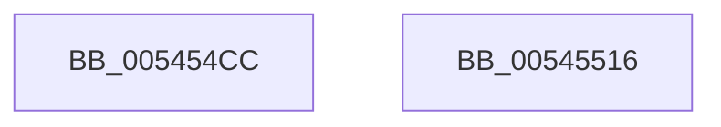

# HalpMcaProcessorBankConfigAmd

- RVA: `0x005454CC`–`0x00545517` (길이 `75` bytes)
- VA: `0x00000001405454CC`
- 실행 섹션: `.text`
- PDB 이름 있음: `예`; PDB Function 태그: `아니요`
- unwind 정보 RVA: `0x0005CAAC`
- 디코드: `21`개 명령, `75/75` bytes 표시
- 미해석 바이트: `0` (있으면 어셈블리에 `.byte`로 보존)

> 이 문서는 커널 이미지의 기계어와 PDB 기호를 분석해 생성했습니다. 4번과 5번은 함수 원형과 자료형을 바이너리 사용 방식에서 추정한 C 해석이며 원본 소스 복구 결과는 아닙니다.

## 1. Dependencies

- 직접 호출 지점: **2**; 고유 호출 대상: **1**
- 직접 호출자로 확인된 함수: **1**
- RIP 상대 이미지 참조: **2**

### Outgoing calls
- `0x005454EE` → [guard_dispatch_icall](../6B/guard_dispatch_icall_function_006BAAD0.md) (function, `0x006BAAD0`)
- `0x00545506` → [guard_dispatch_icall](../6B/guard_dispatch_icall_function_006BAAD0.md) (function, `0x006BAAD0`)

### Direct callers
- [HalpMcaProcessorBankConfig](../48/HalpMcaProcessorBankConfig_function_004872BC.md) at `0x004872D8`

### Static image references
- `0x005454D6` → RVA `0x00FC1990` (`.data`; read)
- `0x005454FF` → RVA `0x00FC1980` (`.data`; read)

## 2. Other-region calls and transfers

- 다른 실행 섹션으로 향하는 call: **0**
- 별도 외부 분기/꼬리 이동을 확인하지 못했습니다.

## 3. Assembly (complete function range)

```asm
005454CC  48 89 5C 24 08                  mov qword ptr [rsp + 8], rbx
005454D1  57                              push rdi
005454D2  48 83 EC 20                     sub rsp, 0x20
005454D6  48 8B 05 B3 C4 A7 00            mov rax, qword ptr [rip + 0xa7c4b3]
005454DD  45 33 C0                        xor r8d, r8d
005454E0  C1 E2 04                        shl edx, 4
005454E3  48 8B D9                        mov rbx, rcx
005454E6  8D BA 04 20 00 C0               lea edi, [rdx - 0x3fffdffc]
005454EC  8B D7                           mov edx, edi
005454EE  E8 DD 55 17 00                  call 0x1406baad0
005454F3  48 83 C8 05                     or rax, 5
005454F7  8B D7                           mov edx, edi
005454F9  4C 8B C0                        mov r8, rax
005454FC  48 8B CB                        mov rcx, rbx
005454FF  48 8B 05 7A C4 A7 00            mov rax, qword ptr [rip + 0xa7c47a]
00545506  E8 C5 55 17 00                  call 0x1406baad0
0054550B  48 8B 5C 24 30                  mov rbx, qword ptr [rsp + 0x30]
00545510  48 83 C4 20                     add rsp, 0x20
00545514  5F                              pop rdi
00545515  C3                              ret
00545516  CC                              int3
```

## 4. C-style interpretation (structured pseudocode)

```c
__int64 __fastcall HalpMcaProcessorBankConfigAmd(__int64 a1, int a2, int a3)
{
    __int64 result;
    __int64 v_rsp;
    unsigned __int64 v_stack_p8;

    v_stack_p8 = v_rbx;
    v_rsp = (v_rsp) - (32);
    a3 = 0;
    a2 = (unsigned int)((a2) << (4));
    result = guard_dispatch_icall(a1, (unsigned int)((unsigned int)(a2 - 1073733628)), a3, a4);
    result = (result) | (5);
    result = guard_dispatch_icall(a1, (unsigned int)((unsigned int)(a2 - 1073733628)), result, a4);
    v_rsp = (v_rsp) + (32);
    return result;
}
```

## 5. (Beta) C Style

```c
int64_t HalpMcaProcessorBankConfigAmd(int64_t Arg1, int32_t Arg2, int32_t Arg3)
{
    int64_t result;
    int64_t local_rsp;
    uint64_t v_stack_p8;

    v_stack_p8 = local_rbx;
    local_rsp = (local_rsp) - (32);
    Arg3 = 0;
    Arg2 = (uint32_t)((Arg2) << (4));
    result = guard_dispatch_icall(Arg1, (uint32_t)((uint32_t)(Arg2 - 1073733628)), Arg3, a4);
    result = (result) | (5);
    result = guard_dispatch_icall(Arg1, (uint32_t)((uint32_t)(Arg2 - 1073733628)), result, a4);
    local_rsp = (local_rsp) + (32);
    return result;
}
```

## 6. Execution-region graph

[열기: 2D/3D 그래프와 함수 탐색 컨트롤 패널](../../../control-panel.html?section=text&rva=0x005454CC&view=graph)

- 2D 그래프는 위에서 아래로 흐르고, 3D 그래프는 빈 공간을 드래그해 회전합니다. Shift+드래그는 이동, 휠은 확대·축소, 함수 노드 선택은 대상 보고서 이동입니다.

### Static fallback


