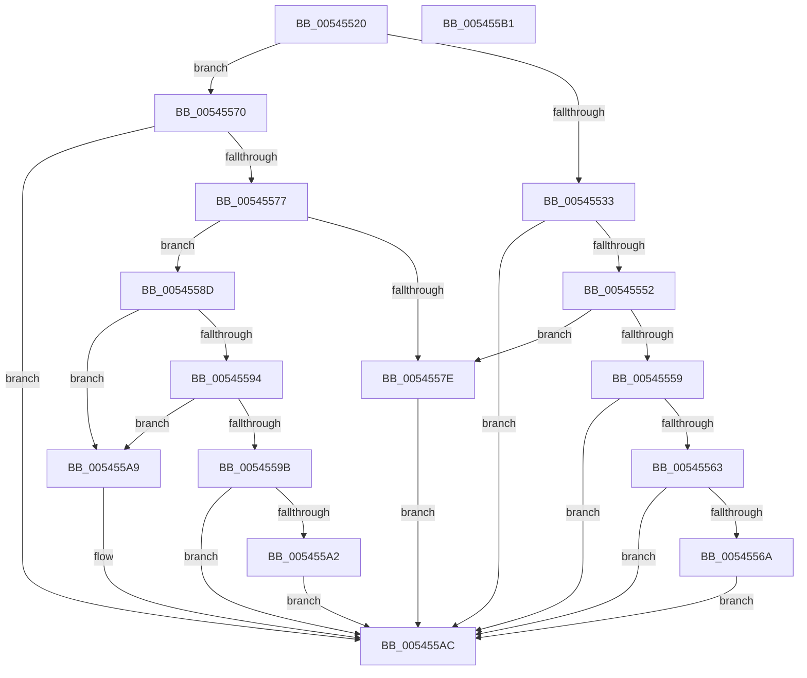

# HalpMcaReadErrorUncorrected

- RVA: `0x00545520`–`0x005455B2` (길이 `146` bytes)
- VA: `0x0000000140545520`
- 실행 섹션: `.text`
- PDB 이름 있음: `예`; PDB Function 태그: `아니요`
- unwind 정보 RVA: `0x0005C788`
- 디코드: `41`개 명령, `146/146` bytes 표시
- 미해석 바이트: `0` (있으면 어셈블리에 `.byte`로 보존)

> 이 문서는 커널 이미지의 기계어와 PDB 기호를 분석해 생성했습니다. 4번과 5번은 함수 원형과 자료형을 바이너리 사용 방식에서 추정한 C 해석이며 원본 소스 복구 결과는 아닙니다.

## 1. Dependencies

- 직접 호출 지점: **2**; 고유 호출 대상: **2**
- 직접 호출자로 확인된 함수: **1**
- RIP 상대 이미지 참조: **0**

### Outgoing calls
- `0x00545527` → [HalpGetCpuVendor](../48/HalpGetCpuVendor_function_004879E4.md) (function, `0x004879E4`)
- `0x00545586` → [HalpWheaWriteMsrStatus](../48/HalpWheaWriteMsrStatus_function_004874C0.md) (function, `0x004874C0`)

### Direct callers
- [HalpMcaReadError](HalpMcaReadError_function_00541A2C.md) at `0x00541B3D`

### Static image references
- 디코드된 RIP-relative 메모리 참조가 없습니다.

## 2. Other-region calls and transfers

- 다른 실행 섹션으로 향하는 call: **0**
- 별도 외부 분기/꼬리 이동을 확인하지 못했습니다.

## 3. Assembly (complete function range)

```asm
00545520  48 83 EC 28                     sub rsp, 0x28
00545524  4C 8B C9                        mov r9, rcx
00545527  E8 B8 24 F4 FF                  call 0x1404879e4
0054552C  4D 8B 01                        mov r8, qword ptr [r9]
0054552F  3C 01                           cmp al, 1
00545531  75 3D                           jne 0x140545570
00545533  48 B9 00 00 00 00 00 10 00 20   movabs rcx, 0x2000100000000000
0054553D  49 8B C0                        mov rax, r8
00545540  48 23 C1                        and rax, rcx
00545543  48 B9 00 00 00 00 00 00 00 20   movabs rcx, 0x2000000000000000
0054554D  48 3B C1                        cmp rax, rcx
00545550  75 5A                           jne 0x1405455ac
00545552  49 0F BA E0 3C                  bt r8, 0x3c
00545557  73 25                           jae 0x14054557e
00545559  49 0F BA E0 39                  bt r8, 0x39
0054555E  C6 02 01                        mov byte ptr [rdx], 1
00545561  72 49                           jb 0x1405455ac
00545563  41 80 79 08 00                  cmp byte ptr [r9 + 8], 0
00545568  74 42                           je 0x1405455ac
0054556A  C6 42 01 01                     mov byte ptr [rdx + 1], 1
0054556E  EB 3C                           jmp 0x1405455ac
00545570  49 0F BA E0 3D                  bt r8, 0x3d
00545575  73 35                           jae 0x1405455ac
00545577  49 0F BA E0 3C                  bt r8, 0x3c
0054557C  72 0F                           jb 0x14054558d
0054557E  41 8B 51 0C                     mov edx, dword ptr [r9 + 0xc]
00545582  49 8B 49 10                     mov rcx, qword ptr [r9 + 0x10]
00545586  E8 35 1F F4 FF                  call 0x1404874c0
0054558B  EB 1F                           jmp 0x1405455ac
0054558D  49 0F BA E0 39                  bt r8, 0x39
00545592  72 15                           jb 0x1405455a9
00545594  41 80 79 08 00                  cmp byte ptr [r9 + 8], 0
00545599  74 0E                           je 0x1405455a9
0054559B  49 0F BA E0 38                  bt r8, 0x38
005455A0  73 0A                           jae 0x1405455ac
005455A2  66 C7 02 01 01                  mov word ptr [rdx], 0x101
005455A7  EB 03                           jmp 0x1405455ac
005455A9  C6 02 01                        mov byte ptr [rdx], 1
005455AC  48 83 C4 28                     add rsp, 0x28
005455B0  C3                              ret
005455B1  CC                              int3
```

## 4. C-style interpretation (structured pseudocode)

```c
__int64 __fastcall HalpMcaReadErrorUncorrected(__int64 a1, __int64 a2)
{
    __int64 result;
    __int64 v_rsp;

    v_rsp = (v_rsp) - (40);
    result = HalpGetCpuVendor(a1, a2, a3, a1);
    if (((unsigned __int8)(result)) != 1) goto loc_00545570;
    result = (*(unsigned __int64 *)(a1)) & (a1);
    if (result != a1) goto loc_005455AC;
    if (result >= a1) goto loc_0054557E;
    *(unsigned __int8 *)(a2) = 1;
    if (result < a1) goto loc_005455AC;
    if ((*(unsigned __int8 *)(a1 + 8)) == 0) goto loc_005455AC;
    *(unsigned __int8 *)(a2 + 1) = 1;
    goto loc_005455AC;
loc_00545570:
    if ((*(unsigned __int8 *)(a1 + 8)) >= 0) goto loc_005455AC;
    if ((*(unsigned __int8 *)(a1 + 8)) < 0) goto loc_0054558D;
loc_0054557E:
    result = HalpWheaWriteMsrStatus(*(unsigned __int64 *)(a1 + 16), (unsigned int)(*(unsigned int *)(a1 + 12)), *(unsigned __int64 *)(a1), a1);
    goto loc_005455AC;
loc_0054558D:
    if ((*(unsigned __int8 *)(a1 + 8)) < 0) goto loc_005455A9;
    if ((*(unsigned __int8 *)(a1 + 8)) == 0) goto loc_005455A9;
    if ((*(unsigned __int8 *)(a1 + 8)) >= 0) goto loc_005455AC;
    *(unsigned __int16 *)((unsigned int)(*(unsigned int *)(a1 + 12))) = 257;
    goto loc_005455AC;
loc_005455A9:
    *(unsigned __int8 *)((unsigned int)(*(unsigned int *)(a1 + 12))) = 1;
loc_005455AC:
    v_rsp = (v_rsp) + (40);
    return result;
}
```

## 5. (Beta) C Style

```c
int64_t HalpMcaReadErrorUncorrected(int64_t Arg1, int64_t Arg2)
{
    int64_t result;
    int64_t local_rsp;

    local_rsp = (local_rsp) - (40);
    result = HalpGetCpuVendor(Arg1, Arg2, a3, Arg1);
    if (((uint8_t)(result)) != 1) goto loc_00545570;
    result = (*(uint64_t *)(Arg1)) & (Arg1);
    if (result != Arg1) goto loc_005455AC;
    if (result >= Arg1) goto loc_0054557E;
    *(uint8_t *)(Arg2) = 1;
    if (result < Arg1) goto loc_005455AC;
    if ((*(uint8_t *)(Arg1 + 0x8)) == 0) goto loc_005455AC;
    *(uint8_t *)(Arg2 + 0x1) = 1;
    goto loc_005455AC;
loc_00545570:
    if ((*(uint8_t *)(Arg1 + 0x8)) >= 0) goto loc_005455AC;
    if ((*(uint8_t *)(Arg1 + 0x8)) < 0) goto loc_0054558D;
loc_0054557E:
    result = HalpWheaWriteMsrStatus(*(uint64_t *)(Arg1 + 0x10), (uint32_t)(*(uint32_t *)(Arg1 + 0xC)), *(uint64_t *)(Arg1), Arg1);
    goto loc_005455AC;
loc_0054558D:
    if ((*(uint8_t *)(Arg1 + 0x8)) < 0) goto loc_005455A9;
    if ((*(uint8_t *)(Arg1 + 0x8)) == 0) goto loc_005455A9;
    if ((*(uint8_t *)(Arg1 + 0x8)) >= 0) goto loc_005455AC;
    *(uint16_t *)((uint32_t)(*(uint32_t *)(Arg1 + 0xC))) = 257;
    goto loc_005455AC;
loc_005455A9:
    *(uint8_t *)((uint32_t)(*(uint32_t *)(Arg1 + 0xC))) = 1;
loc_005455AC:
    local_rsp = (local_rsp) + (40);
    return result;
}
```

## 6. Execution-region graph

[열기: 2D/3D 그래프와 함수 탐색 컨트롤 패널](../../../control-panel.html?section=text&rva=0x00545520&view=graph)

- 2D 그래프는 위에서 아래로 흐르고, 3D 그래프는 빈 공간을 드래그해 회전합니다. Shift+드래그는 이동, 휠은 확대·축소, 함수 노드 선택은 대상 보고서 이동입니다.

### Static fallback


