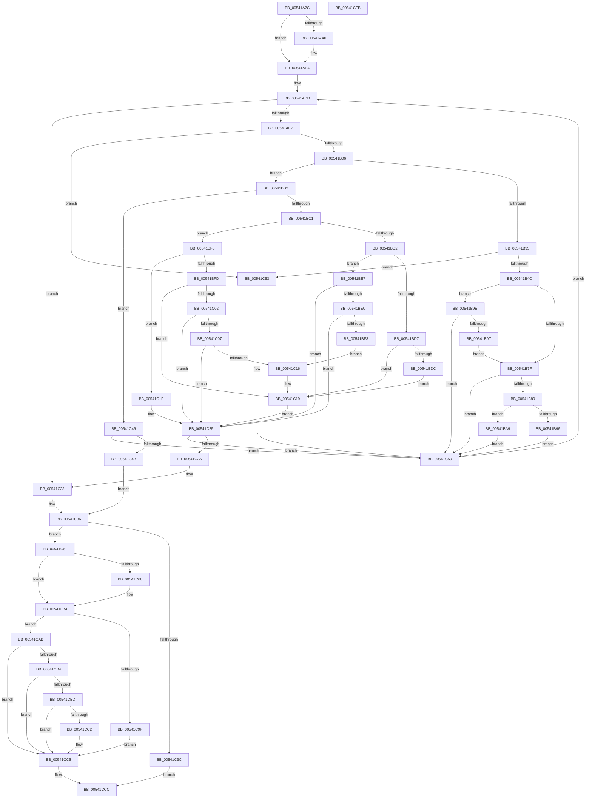

# HalpMcaReadError

- RVA: `0x00541A2C`–`0x00541CFC` (길이 `720` bytes)
- VA: `0x0000000140541A2C`
- 실행 섹션: `.text`
- PDB 이름 있음: `예`; PDB Function 태그: `아니요`
- unwind 정보 RVA: `0x000C3A88`
- 디코드: `201`개 명령, `720/720` bytes 표시
- 미해석 바이트: `0` (있으면 어셈블리에 `.byte`로 보존)

> 이 문서는 커널 이미지의 기계어와 PDB 기호를 분석해 생성했습니다. 4번과 5번은 함수 원형과 자료형을 바이너리 사용 방식에서 추정한 C 해석이며 원본 소스 복구 결과는 아닙니다.

## 1. Dependencies

- 직접 호출 지점: **9**; 고유 호출 대상: **7**
- 직접 호출자로 확인된 함수: **3**
- RIP 상대 이미지 참조: **4**

### Outgoing calls
- `0x00541ACB` → [memset](../6C/memset_function_006C6C40.md) (function, `0x006C6C40`)
- `0x00541AF5` → [HalpWheaReadMsrStatus](../48/HalpWheaReadMsrStatus_function_0048799C.md) (function, `0x0048799C`)
- `0x00541B3D` → [HalpMcaReadErrorUncorrected](HalpMcaReadErrorUncorrected_function_00545520.md) (function, `0x00545520`)
- `0x00541B6A` → [HalpMcaPopulateErrorData](HalpMcaPopulateErrorData_function_005417AC.md) (function, `0x005417AC`)
- `0x00541BC1` → [HalpGetCpuVendor](../48/HalpGetCpuVendor_function_004879E4.md) (function, `0x004879E4`)
- `0x00541C6F` → [HalpMcaStuckErrorCheck](../48/HalpMcaStuckErrorCheck_function_00487554.md) (function, `0x00487554`)
- `0x00541C8E` → [HalpMcaPopulateErrorData](HalpMcaPopulateErrorData_function_005417AC.md) (function, `0x005417AC`)
- `0x00541C93` → [HalpGetCpuVendor](../48/HalpGetCpuVendor_function_004879E4.md) (function, `0x004879E4`)
- `0x00541CD5` → [_security_check_cookie](../6A/_security_check_cookie_function_006AC640.md) (function, `0x006AC640`)

### Direct callers
- [HalpCmcPollProcessor](../48/HalpCmcPollProcessor_function_0048772C.md) at `0x004877C2`
- [HalpMceHandlerCore](HalpMceHandlerCore_function_00542038.md) at `0x00542106`
- [HalpHandlePreviousMcaErrorsOnProcessor](../../pagelk/B5/HalpHandlePreviousMcaErrorsOnProcessor_function_00B5BA2C.md) at `0x00B5BAD1`

### Static image references
- `0x00541A4F` → RVA `0x00E0A740` (`.data`; read)
- `0x00541A71` → RVA `0x00E100E0` (`.data`; read)
- `0x00541AAE` → RVA `0x00E100E0` (`.data`; write)
- `0x00541B06` → RVA `0x00E100B8` (`.data`; read)

## 2. Other-region calls and transfers

- 다른 실행 섹션으로 향하는 call: **0**
- 별도 외부 분기/꼬리 이동을 확인하지 못했습니다.

## 3. Assembly (complete function range)

```asm
00541A2C  48 8B C4                        mov rax, rsp
00541A2F  48 89 58 08                     mov qword ptr [rax + 8], rbx
00541A33  48 89 70 10                     mov qword ptr [rax + 0x10], rsi
00541A37  48 89 78 18                     mov qword ptr [rax + 0x18], rdi
00541A3B  55                              push rbp
00541A3C  41 54                           push r12
00541A3E  41 55                           push r13
00541A40  41 56                           push r14
00541A42  41 57                           push r15
00541A44  48 8D 68 A9                     lea rbp, [rax - 0x57]
00541A48  48 81 EC 90 00 00 00            sub rsp, 0x90
00541A4F  48 8B 05 EA 8C 8C 00            mov rax, qword ptr [rip + 0x8c8cea]
00541A56  48 33 C4                        xor rax, rsp
00541A59  48 89 45 1F                     mov qword ptr [rbp + 0x1f], rax
00541A5D  33 F6                           xor esi, esi
00541A5F  4C 89 4D EF                     mov qword ptr [rbp - 0x11], r9
00541A63  33 C0                           xor eax, eax
00541A65  4C 89 45 17                     mov qword ptr [rbp + 0x17], r8
00541A69  48 89 45 07                     mov qword ptr [rbp + 7], rax
00541A6D  41 83 CC FF                     or r12d, 0xffffffff
00541A71  8A 05 69 E6 8C 00               mov al, byte ptr [rip + 0x8ce669]
00541A77  0F 57 C0                        xorps xmm0, xmm0
00541A7A  48 89 55 E7                     mov qword ptr [rbp - 0x19], rdx
00541A7E  4C 8B CA                        mov r9, rdx
00541A81  89 4D DB                        mov dword ptr [rbp - 0x25], ecx
00541A84  8B DE                           mov ebx, esi
00541A86  66 89 75 D3                     mov word ptr [rbp - 0x2d], si
00541A8A  44 8A EE                        mov r13b, sil
00541A8D  C7 45 D7 01 00 00 00            mov dword ptr [rbp - 0x29], 1
00541A94  40 88 75 CF                     mov byte ptr [rbp - 0x31], sil
00541A98  0F 11 45 F7                     movups xmmword ptr [rbp - 9], xmm0
00541A9C  84 C0                           test al, al
00541A9E  75 14                           jne 0x140541ab4
00541AA0  B9 79 01 00 00                  mov ecx, 0x179
00541AA5  0F 32                           rdmsr
00541AA7  48 C1 E2 20                     shl rdx, 0x20
00541AAB  48 0B C2                        or rax, rdx
00541AAE  88 05 2C E6 8C 00               mov byte ptr [rip + 0x8ce62c], al
00541AB4  8A 05 26 E6 8C 00               mov al, byte ptr [rip + 0x8ce626]
00541ABA  33 D2                           xor edx, edx
00541ABC  0F B6 C0                        movzx eax, al
00541ABF  41 B8 A8 04 00 00               mov r8d, 0x4a8
00541AC5  49 8B C9                        mov rcx, r9
00541AC8  89 45 DF                        mov dword ptr [rbp - 0x21], eax
00541ACB  E8 70 51 18 00                  call 0x1406c6c40
00541AD0  48 8B 7D 7F                     mov rdi, qword ptr [rbp + 0x7f]
00541AD4  44 8B FE                        mov r15d, esi
00541AD7  41 BE 02 00 00 00               mov r14d, 2
00541ADD  44 3B 7D DF                     cmp r15d, dword ptr [rbp - 0x21]
00541AE1  0F 83 4C 01 00 00               jae 0x140541c33
00541AE7  4C 8D 45 0F                     lea r8, [rbp + 0xf]
00541AEB  48 89 75 0F                     mov qword ptr [rbp + 0xf], rsi
00541AEF  41 8B D7                        mov edx, r15d
00541AF2  48 8B CF                        mov rcx, rdi
00541AF5  E8 A2 5E F4 FF                  call 0x14048799c
00541AFA  48 8B D0                        mov rdx, rax
00541AFD  48 85 C0                        test rax, rax
00541B00  0F 89 4D 01 00 00               jns 0x140541c53
00541B06  44 8A 15 AB E5 8C 00            mov r10b, byte ptr [rip + 0x8ce5ab]
00541B0D  48 89 45 F7                     mov qword ptr [rbp - 9], rax
00541B11  8B 45 DB                        mov eax, dword ptr [rbp - 0x25]
00541B14  44 0F B6 C6                     movzx r8d, sil
00541B18  44 0F B6 CE                     movzx r9d, sil
00541B1C  44 88 55 FF                     mov byte ptr [rbp - 1], r10b
00541B20  48 89 7D 07                     mov qword ptr [rbp + 7], rdi
00541B24  44 89 7D 03                     mov dword ptr [rbp + 3], r15d
00541B28  44 88 45 D3                     mov byte ptr [rbp - 0x2d], r8b
00541B2C  44 88 4D D4                     mov byte ptr [rbp - 0x2c], r9b
00541B30  83 F8 10                        cmp eax, 0x10
00541B33  75 7D                           jne 0x140541bb2
00541B35  48 8D 55 D3                     lea rdx, [rbp - 0x2d]
00541B39  48 8D 4D F7                     lea rcx, [rbp - 9]
00541B3D  E8 DE 39 00 00                  call 0x140545520
00541B42  40 38 75 D3                     cmp byte ptr [rbp - 0x2d], sil
00541B46  0F 84 07 01 00 00               je 0x140541c53
00541B4C  8B 45 D7                        mov eax, dword ptr [rbp - 0x29]
00541B4F  41 8B D7                        mov edx, r15d
00541B52  4C 8B 4D EF                     mov r9, qword ptr [rbp - 0x11]
00541B56  48 8B CF                        mov rcx, rdi
00541B59  4C 8B 45 F7                     mov r8, qword ptr [rbp - 9]
00541B5D  89 44 24 28                     mov dword ptr [rsp + 0x28], eax
00541B61  48 8B 45 E7                     mov rax, qword ptr [rbp - 0x19]
00541B65  48 89 44 24 20                  mov qword ptr [rsp + 0x20], rax
00541B6A  E8 3D FC FF FF                  call 0x1405417ac
00541B6F  41 BB 01 00 00 00               mov r11d, 1
00541B75  44 01 5D D7                     add dword ptr [rbp - 0x29], r11d
00541B79  40 38 75 D4                     cmp byte ptr [rbp - 0x2c], sil
00541B7D  75 1F                           jne 0x140541b9e
00541B7F  40 38 75 CF                     cmp byte ptr [rbp - 0x31], sil
00541B83  0F 85 D0 00 00 00               jne 0x140541c59
00541B89  45 8B E7                        mov r12d, r15d
00541B8C  48 8B 5D F7                     mov rbx, qword ptr [rbp - 9]
00541B90  40 38 75 D4                     cmp byte ptr [rbp - 0x2c], sil
00541B94  74 13                           je 0x140541ba9
00541B96  45 8A EB                        mov r13b, r11b
00541B99  E9 BB 00 00 00                  jmp 0x140541c59
00541B9E  45 84 ED                        test r13b, r13b
00541BA1  0F 85 B2 00 00 00               jne 0x140541c59
00541BA7  EB D6                           jmp 0x140541b7f
00541BA9  44 88 5D CF                     mov byte ptr [rbp - 0x31], r11b
00541BAD  E9 A7 00 00 00                  jmp 0x140541c59
00541BB2  41 BB 01 00 00 00               mov r11d, 1
00541BB8  41 3B C3                        cmp eax, r11d
00541BBB  0F 85 85 00 00 00               jne 0x140541c46
00541BC1  E8 1E 5E F4 FF                  call 0x1404879e4
00541BC6  48 8B CA                        mov rcx, rdx
00541BC9  48 C1 E9 3D                     shr rcx, 0x3d
00541BCD  41 3A C3                        cmp al, r11b
00541BD0  75 23                           jne 0x140541bf5
00541BD2  41 84 CB                        test r11b, cl
00541BD5  75 10                           jne 0x140541be7
00541BD7  45 84 D2                        test r10b, r10b
00541BDA  74 3D                           je 0x140541c19
00541BDC  48 0F BA E2 2C                  bt rdx, 0x2c
00541BE1  45 0F 42 CB                     cmovb r9d, r11d
00541BE5  EB 32                           jmp 0x140541c19
00541BE7  45 84 D2                        test r10b, r10b
00541BEA  74 39                           je 0x140541c25
00541BEC  48 0F BA E2 39                  bt rdx, 0x39
00541BF1  72 32                           jb 0x140541c25
00541BF3  EB 21                           jmp 0x140541c16
00541BF5  49 23 CB                        and rcx, r11
00541BF8  41 3A C6                        cmp al, r14b
00541BFB  75 21                           jne 0x140541c1e
00541BFD  48 85 C9                        test rcx, rcx
00541C00  74 17                           je 0x140541c19
00541C02  45 84 D2                        test r10b, r10b
00541C05  74 1E                           je 0x140541c25
00541C07  48 B8 00 00 00 00 00 00 00 03   movabs rax, 0x300000000000000
00541C11  48 85 D0                        test rax, rdx
00541C14  75 0F                           jne 0x140541c25
00541C16  45 8A CB                        mov r9b, r11b
00541C19  45 8A C3                        mov r8b, r11b
00541C1C  EB 07                           jmp 0x140541c25
00541C1E  48 85 C9                        test rcx, rcx
00541C21  45 0F 44 C3                     cmove r8d, r11d
00541C25  45 84 C0                        test r8b, r8b
00541C28  74 2F                           je 0x140541c59
00541C2A  45 8B E7                        mov r12d, r15d
00541C2D  45 8A E9                        mov r13b, r9b
00541C30  48 8B DA                        mov rbx, rdx
00541C33  8B 45 DB                        mov eax, dword ptr [rbp - 0x25]
00541C36  41 83 FC FF                     cmp r12d, -1
00541C3A  75 25                           jne 0x140541c61
00541C3C  BE 25 02 00 C0                  mov esi, 0xc0000225
00541C41  E9 86 00 00 00                  jmp 0x140541ccc
00541C46  83 F8 11                        cmp eax, 0x11
00541C49  75 0E                           jne 0x140541c59
00541C4B  45 8B E7                        mov r12d, r15d
00541C4E  48 8B DA                        mov rbx, rdx
00541C51  EB E3                           jmp 0x140541c36
00541C53  41 BB 01 00 00 00               mov r11d, 1
00541C59  45 03 FB                        add r15d, r11d
00541C5C  E9 7C FE FF FF                  jmp 0x140541add
00541C61  83 F8 10                        cmp eax, 0x10
00541C64  74 0E                           je 0x140541c74
00541C66  4C 8B C7                        mov r8, rdi
00541C69  48 8B D3                        mov rdx, rbx
00541C6C  41 8B CC                        mov ecx, r12d
00541C6F  E8 E0 58 F4 FF                  call 0x140487554
00541C74  48 8B 45 E7                     mov rax, qword ptr [rbp - 0x19]
00541C78  4C 8B C3                        mov r8, rbx
00541C7B  4C 8B 4D EF                     mov r9, qword ptr [rbp - 0x11]
00541C7F  41 8B D4                        mov edx, r12d
00541C82  89 74 24 28                     mov dword ptr [rsp + 0x28], esi
00541C86  48 8B CF                        mov rcx, rdi
00541C89  48 89 44 24 20                  mov qword ptr [rsp + 0x20], rax
00541C8E  E8 19 FB FF FF                  call 0x1405417ac
00541C93  E8 4C 5D F4 FF                  call 0x1404879e4
00541C98  48 0F BA E3 3D                  bt rbx, 0x3d
00541C9D  73 0C                           jae 0x140541cab
00541C9F  45 84 ED                        test r13b, r13b
00541CA2  44 8B F6                        mov r14d, esi
00541CA5  41 0F 94 C6                     sete r14b
00541CA9  EB 1A                           jmp 0x140541cc5
00541CAB  B9 01 00 00 00                  mov ecx, 1
00541CB0  3A C1                           cmp al, cl
00541CB2  75 11                           jne 0x140541cc5
00541CB4  40 38 35 FD E3 8C 00            cmp byte ptr [rip + 0x8ce3fd], sil
00541CBB  74 08                           je 0x140541cc5
00541CBD  45 84 ED                        test r13b, r13b
00541CC0  74 03                           je 0x140541cc5
00541CC2  44 8B F6                        mov r14d, esi
00541CC5  48 8B 45 17                     mov rax, qword ptr [rbp + 0x17]
00541CC9  44 89 30                        mov dword ptr [rax], r14d
00541CCC  8B C6                           mov eax, esi
00541CCE  48 8B 4D 1F                     mov rcx, qword ptr [rbp + 0x1f]
00541CD2  48 33 CC                        xor rcx, rsp
00541CD5  E8 66 A9 16 00                  call 0x1406ac640
00541CDA  4C 8D 9C 24 90 00 00 00         lea r11, [rsp + 0x90]
00541CE2  49 8B 5B 30                     mov rbx, qword ptr [r11 + 0x30]
00541CE6  49 8B 73 38                     mov rsi, qword ptr [r11 + 0x38]
00541CEA  49 8B 7B 40                     mov rdi, qword ptr [r11 + 0x40]
00541CEE  49 8B E3                        mov rsp, r11
00541CF1  41 5F                           pop r15
00541CF3  41 5E                           pop r14
00541CF5  41 5D                           pop r13
00541CF7  41 5C                           pop r12
00541CF9  5D                              pop rbp
00541CFA  C3                              ret
00541CFB  CC                              int3
```

## 4. C-style interpretation (structured pseudocode)

```c
__int64 __fastcall HalpMcaReadError(int a1, __int64 a2, __int64 a3, __int64 a4)
{
    __int64 result;
    __int64 v_r12;
    __int64 v_r14;
    __int64 v_r15;
    __int64 v_rsi;
    __int64 v_rsp;
    unsigned __int64 v_stack_m28;
    unsigned int v_stack_m90;
    unsigned __int64 v_stack_m98;

    *(unsigned __int64 *)(v_rsp + 8) = v_rbx;
    *(unsigned __int64 *)(v_rsp + 16) = v_rsi;
    *(unsigned __int64 *)(v_rsp + 24) = v_rdi;
    v_rsp = (v_rsp) - (144);
    result = (*(unsigned __int64 *)(v_rip + 9211114)) ^ (v_rsp);
    *(unsigned __int64 *)(v_rsp - 87 + 31) = result;
    v_rsi = 0;
    *(unsigned __int64 *)(v_rsp - 87 - 17) = a4;
    result = 0;
    *(unsigned __int64 *)(v_rsp - 87 + 23) = a3;
    *(unsigned __int64 *)(v_rsp - 87 + 7) = 0;
    v_r12 = (unsigned int)((v_r12) | (0xFFFFFFFFULL));
    *(unsigned __int64 *)(v_rsp - 87 - 25) = a2;
    *(unsigned int *)(v_rsp - 87 - 37) = a1;
    *(unsigned __int16 *)(v_rsp - 87 - 45) = 0;
    *(unsigned int *)(v_rsp - 87 - 41) = 1;
    *(unsigned __int8 *)(v_rsp - 87 - 49) = 0;
    *(unsigned __int64 *)(v_rsp - 87 - 9) = v_xmm0;
    result = *(unsigned __int8 *)(v_rip + 9234025);
    if ((unsigned __int8)(*(unsigned __int8 *)(v_rip + 9234025)) == 0) {
        a1 = 377;
        a2 = (a2) << (32);
        result = (*(unsigned __int8 *)(v_rip + 9234025)) | (a2);
        *(unsigned __int8 *)(v_rip + 9233964) = (unsigned __int8)(result);
    }
    a2 = 0;
    *(unsigned int *)(v_rsp - 87 - 33) = (unsigned int)((unsigned __int8)(*(unsigned __int8 *)(v_rip + 9233958)));
    result = memset(0, a2, (unsigned int)(0x4A8ULL), a2);
loc_00541ADD:
    if (0 >= (*(unsigned int *)(v_rsp - 87 - 33))) goto loc_00541C33;
    *(unsigned __int64 *)(v_rsp - 87 + 15) = 0;
    result = HalpWheaReadMsrStatus(*(unsigned __int64 *)(v_rsp - 87 + 127), 0, v_rsp - 87 + 15, a2);
    if (!sign_flag) goto loc_00541C53;
    *(unsigned __int64 *)(v_rsp - 87 - 9) = result;
    *(unsigned __int8 *)(v_rsp - 87 - 1) = (unsigned __int8)(*(unsigned __int8 *)(v_rip + 9233835));
    *(unsigned __int64 *)(v_rsp - 87 + 7) = *(unsigned __int64 *)(v_rsp - 87 + 127);
    *(unsigned int *)(v_rsp - 87 + 3) = 0;
    *(unsigned __int8 *)(v_rsp - 87 - 45) = 0;
    *(unsigned __int8 *)(v_rsp - 87 - 44) = 0;
    if (((unsigned int)((unsigned int)(*(unsigned int *)(v_rsp - 87 - 37)))) != 16) goto loc_00541BB2;
    result = HalpMcaReadErrorUncorrected(v_rsp - 87 - 9, v_rsp - 87 - 45, 0, 0);
    if ((*(unsigned __int8 *)(v_rsp - 87 - 45)) == 0) goto loc_00541C53;
    v_stack_m90 = (unsigned int)((unsigned int)(*(unsigned int *)(v_rsp - 87 - 41)));
    v_stack_m98 = *(unsigned __int64 *)(v_rsp - 87 - 25);
    result = HalpMcaPopulateErrorData(*(unsigned __int64 *)(v_rsp - 87 + 127), 0, *(unsigned __int64 *)(v_rsp - 87 - 9), *(unsigned __int64 *)(v_rsp - 87 - 17));
    if ((*(unsigned __int8 *)(v_rsp - 87 - 44)) != 0) goto loc_00541B9E;
loc_00541B7F:
    if ((*(unsigned __int8 *)(v_rsp - 87 - 49)) != 0) goto loc_00541C59;
    if ((*(unsigned __int8 *)(v_rsp - 87 - 44)) == 0) goto loc_00541BA9;
    goto loc_00541C59;
loc_00541B9E:
    if (1 != 0) goto loc_00541C59;
    goto loc_00541B7F;
loc_00541BA9:
    *(unsigned __int8 *)(v_rsp - 87 - 49) = 1;
    goto loc_00541C59;
loc_00541BB2:
    if (((unsigned int)(result)) != 1) goto loc_00541C46;
    result = HalpGetCpuVendor(*(unsigned __int64 *)(v_rsp - 87 + 127), 0, *(unsigned __int64 *)(v_rsp - 87 - 9), *(unsigned __int64 *)(v_rsp - 87 - 17));
    a1 = (0) >> (61);
    if (((unsigned __int8)(result)) != 1) goto loc_00541BF5;
    if (((1) & ((unsigned __int8)(a1))) != 0) goto loc_00541BE7;
    if ((unsigned __int8)(*(unsigned __int8 *)(v_rip + 9233835)) == 0) goto loc_00541C19;
    a4 = *(unsigned __int64 *)(v_rsp - 87 - 17);
    if (condition_is_below) { a4 = 1; }
    goto loc_00541C19;
loc_00541BE7:
    if ((unsigned __int8)(*(unsigned __int8 *)(v_rip + 9233835)) == 0) goto loc_00541C25;
    if (condition_is_below) goto loc_00541C25;
    goto loc_00541C16;
loc_00541BF5:
    a1 = (a1) & (1);
    if (((unsigned __int8)(result)) != 2) goto loc_00541C1E;
    if (a1 == 0) goto loc_00541C19;
    if ((unsigned __int8)(*(unsigned __int8 *)(v_rip + 9233835)) == 0) goto loc_00541C25;
    if (((result) & (0)) != 0) goto loc_00541C25;
loc_00541C16:
loc_00541C19:
    goto loc_00541C25;
loc_00541C1E:
    a3 = 1;
    if (a1 == 0) { a3 = 1; }
loc_00541C25:
    if ((unsigned __int8)(a3) == 0) goto loc_00541C59;
loc_00541C33:
loc_00541C36:
    if (0 != -1) goto loc_00541C61;
    goto loc_00541CCC;
loc_00541C46:
    if (((unsigned int)((unsigned int)(*(unsigned int *)(v_rsp - 87 - 37)))) != 17) goto loc_00541C59;
    goto loc_00541C36;
loc_00541C53:
loc_00541C59:
    v_r15 = (unsigned int)((0) + (1));
    goto loc_00541ADD;
loc_00541C61:
    result = (unsigned int)(*(unsigned int *)(v_rsp - 87 - 37));
    if (((unsigned int)((unsigned int)(*(unsigned int *)(v_rsp - 87 - 37)))) != 16) {
        a3 = *(unsigned __int64 *)(v_rsp - 87 + 127);
        a2 = 0;
        a1 = 0;
        result = HalpMcaStuckErrorCheck(a1, a2, a3, 1);
    }
    v_stack_m90 = (unsigned int)((unsigned int)(0xC0000225ULL));
    v_stack_m98 = *(unsigned __int64 *)(v_rsp - 87 - 25);
    result = HalpMcaPopulateErrorData(*(unsigned __int64 *)(v_rsp - 87 + 127), 0, 0, *(unsigned __int64 *)(v_rsp - 87 - 17));
    result = HalpGetCpuVendor(*(unsigned __int64 *)(v_rsp - 87 + 127), 0, 0, *(unsigned __int64 *)(v_rsp - 87 - 17));
    if (((unsigned int)((unsigned int)(*(unsigned int *)(v_rsp - 87 - 37)))) >= 16) goto loc_00541CAB;
    v_r14 = (1 == 0) ? 1 : 0;
    goto loc_00541CC5;
loc_00541CAB:
    if (((unsigned __int8)(result)) != 1) goto loc_00541CC5;
    if ((*(unsigned __int8 *)(v_rip + 9233405)) == ((unsigned __int8)((unsigned int)(0xC0000225ULL)))) goto loc_00541CC5;
    if (1 != 0) {
        v_r14 = (unsigned int)((unsigned int)(0xC0000225ULL));
    }
    *(unsigned int *)(*(unsigned __int64 *)(v_rsp - 87 + 23)) = (unsigned int)(v_r14);
loc_00541CCC:
    a1 = (*(unsigned __int64 *)(v_rsp - 87 + 31)) ^ (v_rsp);
    result = _security_check_cookie(a1, 0, 0, *(unsigned __int64 *)(v_rsp - 87 - 17));
    return result;
}
```

## 5. (Beta) C Style

```c
int64_t HalpMcaReadError(int32_t Arg1, int64_t Arg2, int64_t Arg3, int64_t Arg4)
{
    int64_t result;
    int64_t local_r12;
    int64_t local_r14;
    int64_t local_r15;
    int64_t local_rsi;
    int64_t local_rsp;
    uint64_t v_stack_m28;
    uint32_t v_stack_m90;
    uint64_t v_stack_m98;

    *(uint64_t *)(local_rsp + 0x8) = local_rbx;
    *(uint64_t *)(local_rsp + 0x10) = local_rsi;
    *(uint64_t *)(local_rsp + 0x18) = local_rdi;
    local_rsp = (local_rsp) - (144);
    result = (*(uint64_t *)(v_rip + 0x8C8CEA)) ^ (local_rsp);
    *(uint64_t *)(local_rsp - 0x57 + 0x1F) = result;
    local_rsi = 0;
    *(uint64_t *)(local_rsp - 0x57 - 0x11) = Arg4;
    result = 0;
    *(uint64_t *)(local_rsp - 0x57 + 0x17) = Arg3;
    *(uint64_t *)(local_rsp - 0x57 + 0x7) = 0;
    local_r12 = (uint32_t)((local_r12) | (0xFFFFFFFFULL));
    *(uint64_t *)(local_rsp - 0x57 - 0x19) = Arg2;
    *(uint32_t *)(local_rsp - 0x57 - 0x25) = Arg1;
    *(uint16_t *)(local_rsp - 0x57 - 0x2D) = 0;
    *(uint32_t *)(local_rsp - 0x57 - 0x29) = 1;
    *(uint8_t *)(local_rsp - 0x57 - 0x31) = 0;
    *(uint64_t *)(local_rsp - 0x57 - 0x9) = v_xmm0;
    result = *(uint8_t *)(v_rip + 0x8CE669);
    if ((uint8_t)(*(uint8_t *)(v_rip + 0x8CE669)) == 0) {
        Arg1 = 377;
        Arg2 = (Arg2) << (32);
        result = (*(uint8_t *)(v_rip + 0x8CE669)) | (Arg2);
        *(uint8_t *)(v_rip + 0x8CE62C) = (uint8_t)(result);
    }
    Arg2 = 0;
    *(uint32_t *)(local_rsp - 0x57 - 0x21) = (uint32_t)((uint8_t)(*(uint8_t *)(v_rip + 0x8CE626)));
    result = memset(0, Arg2, (uint32_t)(0x4A8ULL), Arg2);
loc_00541ADD:
    if (0 >= (*(uint32_t *)(local_rsp - 0x57 - 0x21))) goto loc_00541C33;
    *(uint64_t *)(local_rsp - 0x57 + 0xF) = 0;
    result = HalpWheaReadMsrStatus(*(uint64_t *)(local_rsp - 0x57 + 0x7F), 0, local_rsp - 87 + 15, Arg2);
    if (!sign_flag) goto loc_00541C53;
    *(uint64_t *)(local_rsp - 0x57 - 0x9) = result;
    *(uint8_t *)(local_rsp - 0x57 - 0x1) = (uint8_t)(*(uint8_t *)(v_rip + 0x8CE5AB));
    *(uint64_t *)(local_rsp - 0x57 + 0x7) = *(uint64_t *)(local_rsp - 0x57 + 0x7F);
    *(uint32_t *)(local_rsp - 0x57 + 0x3) = 0;
    *(uint8_t *)(local_rsp - 0x57 - 0x2D) = 0;
    *(uint8_t *)(local_rsp - 0x57 - 0x2C) = 0;
    if (((uint32_t)((uint32_t)(*(uint32_t *)(local_rsp - 0x57 - 0x25)))) != 16) goto loc_00541BB2;
    result = HalpMcaReadErrorUncorrected(local_rsp - 87 - 9, local_rsp - 87 - 45, 0, 0);
    if ((*(uint8_t *)(local_rsp - 0x57 - 0x2D)) == 0) goto loc_00541C53;
    v_stack_m90 = (uint32_t)((uint32_t)(*(uint32_t *)(local_rsp - 0x57 - 0x29)));
    v_stack_m98 = *(uint64_t *)(local_rsp - 0x57 - 0x19);
    result = HalpMcaPopulateErrorData(*(uint64_t *)(local_rsp - 0x57 + 0x7F), 0, *(uint64_t *)(local_rsp - 0x57 - 0x9), *(uint64_t *)(local_rsp - 0x57 - 0x11));
    if ((*(uint8_t *)(local_rsp - 0x57 - 0x2C)) != 0) goto loc_00541B9E;
loc_00541B7F:
    if ((*(uint8_t *)(local_rsp - 0x57 - 0x31)) != 0) goto loc_00541C59;
    if ((*(uint8_t *)(local_rsp - 0x57 - 0x2C)) == 0) goto loc_00541BA9;
    goto loc_00541C59;
loc_00541B9E:
    if (1 != 0) goto loc_00541C59;
    goto loc_00541B7F;
loc_00541BA9:
    *(uint8_t *)(local_rsp - 0x57 - 0x31) = 1;
    goto loc_00541C59;
loc_00541BB2:
    if (((uint32_t)(result)) != 1) goto loc_00541C46;
    result = HalpGetCpuVendor(*(uint64_t *)(local_rsp - 0x57 + 0x7F), 0, *(uint64_t *)(local_rsp - 0x57 - 0x9), *(uint64_t *)(local_rsp - 0x57 - 0x11));
    Arg1 = (0) >> (61);
    if (((uint8_t)(result)) != 1) goto loc_00541BF5;
    if (((1) & ((uint8_t)(Arg1))) != 0) goto loc_00541BE7;
    if ((uint8_t)(*(uint8_t *)(v_rip + 0x8CE5AB)) == 0) goto loc_00541C19;
    Arg4 = *(uint64_t *)(local_rsp - 0x57 - 0x11);
    if (condition_is_below) { Arg4 = 1; }
    goto loc_00541C19;
loc_00541BE7:
    if ((uint8_t)(*(uint8_t *)(v_rip + 0x8CE5AB)) == 0) goto loc_00541C25;
    if (condition_is_below) goto loc_00541C25;
    goto loc_00541C16;
loc_00541BF5:
    Arg1 = (Arg1) & (1);
    if (((uint8_t)(result)) != 2) goto loc_00541C1E;
    if (Arg1 == 0) goto loc_00541C19;
    if ((uint8_t)(*(uint8_t *)(v_rip + 0x8CE5AB)) == 0) goto loc_00541C25;
    if (((result) & (0)) != 0) goto loc_00541C25;
loc_00541C16:
loc_00541C19:
    goto loc_00541C25;
loc_00541C1E:
    Arg3 = 1;
    if (Arg1 == 0) { Arg3 = 1; }
loc_00541C25:
    if ((uint8_t)(Arg3) == 0) goto loc_00541C59;
loc_00541C33:
loc_00541C36:
    if (0 != -1) goto loc_00541C61;
    goto loc_00541CCC;
loc_00541C46:
    if (((uint32_t)((uint32_t)(*(uint32_t *)(local_rsp - 0x57 - 0x25)))) != 17) goto loc_00541C59;
    goto loc_00541C36;
loc_00541C53:
loc_00541C59:
    local_r15 = (uint32_t)((0) + (1));
    goto loc_00541ADD;
loc_00541C61:
    result = (uint32_t)(*(uint32_t *)(local_rsp - 0x57 - 0x25));
    if (((uint32_t)((uint32_t)(*(uint32_t *)(local_rsp - 0x57 - 0x25)))) != 16) {
        Arg3 = *(uint64_t *)(local_rsp - 0x57 + 0x7F);
        Arg2 = 0;
        Arg1 = 0;
        result = HalpMcaStuckErrorCheck(Arg1, Arg2, Arg3, 1);
    }
    v_stack_m90 = (uint32_t)((uint32_t)(0xC0000225ULL));
    v_stack_m98 = *(uint64_t *)(local_rsp - 0x57 - 0x19);
    result = HalpMcaPopulateErrorData(*(uint64_t *)(local_rsp - 0x57 + 0x7F), 0, 0, *(uint64_t *)(local_rsp - 0x57 - 0x11));
    result = HalpGetCpuVendor(*(uint64_t *)(local_rsp - 0x57 + 0x7F), 0, 0, *(uint64_t *)(local_rsp - 0x57 - 0x11));
    if (((uint32_t)((uint32_t)(*(uint32_t *)(local_rsp - 0x57 - 0x25)))) >= 16) goto loc_00541CAB;
    local_r14 = (1 == 0) ? 1 : 0;
    goto loc_00541CC5;
loc_00541CAB:
    if (((uint8_t)(result)) != 1) goto loc_00541CC5;
    if ((*(uint8_t *)(v_rip + 0x8CE3FD)) == ((uint8_t)((uint32_t)(0xC0000225ULL)))) goto loc_00541CC5;
    if (1 != 0) {
        local_r14 = (uint32_t)((uint32_t)(0xC0000225ULL));
    }
    *(uint32_t *)(*(uint64_t *)(local_rsp - 0x57 + 0x17)) = (uint32_t)(local_r14);
loc_00541CCC:
    Arg1 = (*(uint64_t *)(local_rsp - 0x57 + 0x1F)) ^ (local_rsp);
    result = _security_check_cookie(Arg1, 0, 0, *(uint64_t *)(local_rsp - 0x57 - 0x11));
    return result;
}
```

## 6. Execution-region graph

[열기: 2D/3D 그래프와 함수 탐색 컨트롤 패널](../../../control-panel.html?section=text&rva=0x00541A2C&view=graph)

- 2D 그래프는 위에서 아래로 흐르고, 3D 그래프는 빈 공간을 드래그해 회전합니다. Shift+드래그는 이동, 휠은 확대·축소, 함수 노드 선택은 대상 보고서 이동입니다.

### Static fallback


