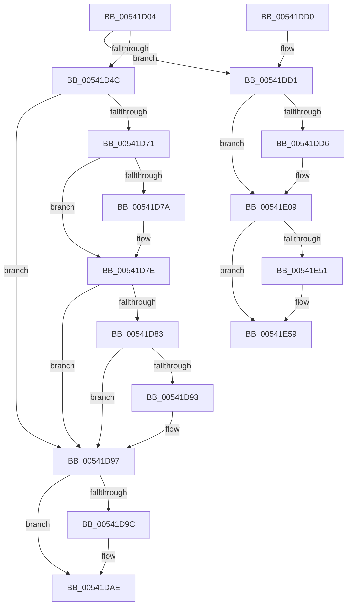

# HalpMcaReportError

- RVA: `0x00541D04`–`0x00541E61` (길이 `349` bytes)
- VA: `0x0000000140541D04`
- 실행 섹션: `.text`
- PDB 이름 있음: `예`; PDB Function 태그: `아니요`
- unwind 정보 RVA: `0x000C3A68`
- 디코드: `95`개 명령, `349/349` bytes 표시
- 미해석 바이트: `0` (있으면 어셈블리에 `.byte`로 보존)

> 이 문서는 커널 이미지의 기계어와 PDB 기호를 분석해 생성했습니다. 4번과 5번은 함수 원형과 자료형을 바이너리 사용 방식에서 추정한 C 해석이며 원본 소스 복구 결과는 아닙니다.

## 1. Dependencies

- 직접 호출 지점: **12**; 고유 호출 대상: **9**
- 직접 호출자로 확인된 함수: **5**
- RIP 상대 이미지 참조: **4**

### Outgoing calls
- `0x00541D3E` → [memset](../6C/memset_function_006C6C40.md) (function, `0x006C6C40`)
- `0x00541D56` → [WheapGetErrorSource](../49/WheapGetErrorSource_function_0049554C.md) (function, `0x0049554C`)
- `0x00541D68` → [HalpGetCpuVendor](../48/HalpGetCpuVendor_function_004879E4.md) (function, `0x004879E4`)
- `0x00541D8A` → [HalpShouldRecoveryBeAttempted](../55/HalpShouldRecoveryBeAttempted_function_0055644C.md) (function, `0x0055644C`)
- `0x00541DA2` → `PSHED.dll!PshedRetrieveErrorInfo` (import, 간접 대상; import `PSHED.dll!PshedRetrieveErrorInfo`)
- `0x00541DB1` → [WheaReportHwError](../4E/WheaReportHwError_function_004ED200.md) (function, `0x004ED200`)
- `0x00541DBD` → [_security_check_cookie](../6A/_security_check_cookie_function_006AC640.md) (function, `0x006AC640`)
- `0x00541DDE` → [HalpTranslateToLegacyMcaException](HalpTranslateToLegacyMcaException_function_00542360.md) (function, `0x00542360`)
- `0x00541E03` → [KeBugCheckEx](../4F/KeBugCheckEx_function_004FD660.md) (function, `0x004FD660`)
- `0x00541E13` → [memset](../6C/memset_function_006C6C40.md) (function, `0x006C6C40`)
- `0x00541E53` → [KeBugCheckEx](../4F/KeBugCheckEx_function_004FD660.md) (function, `0x004FD660`)
- `0x00541E5B` → [KeBugCheckEx](../4F/KeBugCheckEx_function_004FD660.md) (function, `0x004FD660`)

### Direct callers
- [HalpMceHandlerCore](HalpMceHandlerCore_function_00542038.md) at `0x0054216B`
- [HalpMceHandlerWithRendezvous](HalpMceHandlerWithRendezvous_function_005421E0.md) at `0x00542286`
- [HalpMceHandlerWithRendezvous](HalpMceHandlerWithRendezvous_function_005421E0.md) at `0x005422F7`
- [HalHandleMcheck](HalHandleMcheck_function_00544D40.md) at `0x00544D8B`
- [sub_006F5696](../6F/Unknown_function_006F5696.md) at `0x006F56EB`
- [HalpHandlePreviousMcaErrorsOnProcessor](../../pagelk/B5/HalpHandlePreviousMcaErrorsOnProcessor_function_00B5BA2C.md) at `0x00B5BAAD`

### Static image references
- `0x00541D17` → RVA `0x00E0A740` (`.data`; read)
- `0x00541D4F` → RVA `0x00EEF018` (`.data`; read)
- `0x00541D71` → RVA `0x00E10258` (`.data`; read)
- `0x00541DA2` → RVA `0x00151150` (`PSHED.dll!PshedRetrieveErrorInfo (IAT)`; read)

## 2. Other-region calls and transfers

- 다른 실행 섹션으로 향하는 call: **0**
- 별도 외부 분기/꼬리 이동을 확인하지 못했습니다.

## 3. Assembly (complete function range)

```asm
00541D04  40 55                           push rbp
00541D06  53                              push rbx
00541D07  56                              push rsi
00541D08  57                              push rdi
00541D09  41 57                           push r15
00541D0B  48 8D 6C 24 C0                  lea rbp, [rsp - 0x40]
00541D10  48 81 EC 40 01 00 00            sub rsp, 0x140
00541D17  48 8B 05 22 8A 8C 00            mov rax, qword ptr [rip + 0x8c8a22]
00541D1E  48 33 C4                        xor rax, rsp
00541D21  48 89 45 30                     mov qword ptr [rbp + 0x30], rax
00541D25  49 8B D8                        mov rbx, r8
00541D28  48 8B F2                        mov rsi, rdx
00541D2B  48 8B F9                        mov rdi, rcx
00541D2E  41 BF 00 01 00 00               mov r15d, 0x100
00541D34  45 8B C7                        mov r8d, r15d
00541D37  48 8D 4C 24 30                  lea rcx, [rsp + 0x30]
00541D3C  33 D2                           xor edx, edx
00541D3E  E8 FD 4E 18 00                  call 0x1406c6c40
00541D43  48 85 FF                        test rdi, rdi
00541D46  0F 84 85 00 00 00               je 0x140541dd1
00541D4C  8B 57 18                        mov edx, dword ptr [rdi + 0x18]
00541D4F  48 8D 0D C2 D2 9A 00            lea rcx, [rip + 0x9ad2c2]
00541D56  E8 F1 37 F5 FF                  call 0x14049554c
00541D5B  48 8D 48 60                     lea rcx, [rax + 0x60]
00541D5F  48 F7 D8                        neg rax
00541D62  4D 1B C0                        sbb r8, r8
00541D65  4C 23 C1                        and r8, rcx
00541D68  E8 77 5C F4 FF                  call 0x1404879e4
00541D6D  3C 01                           cmp al, 1
00541D6F  75 26                           jne 0x140541d97
00541D71  80 3D E0 E4 8C 00 00            cmp byte ptr [rip + 0x8ce4e0], 0
00541D78  74 04                           je 0x140541d7e
00541D7A  83 4F 0C 40                     or dword ptr [rdi + 0xc], 0x40
00541D7E  48 85 F6                        test rsi, rsi
00541D81  74 14                           je 0x140541d97
00541D83  8B 4E 04                        mov ecx, dword ptr [rsi + 4]
00541D86  48 8D 56 28                     lea rdx, [rsi + 0x28]
00541D8A  E8 BD 46 01 00                  call 0x14055644c
00541D8F  84 C0                           test al, al
00541D91  75 04                           jne 0x140541d97
00541D93  44 09 7F 0C                     or dword ptr [rdi + 0xc], r15d
00541D97  4D 85 C0                        test r8, r8
00541D9A  74 12                           je 0x140541dae
00541D9C  49 8B D0                        mov rdx, r8
00541D9F  48 8B CF                        mov rcx, rdi
00541DA2  48 FF 15 A7 F3 C0 FF            call qword ptr [rip - 0x3f0c59]
00541DA9  0F 1F 44 00 00                  nop dword ptr [rax + rax]
00541DAE  48 8B CF                        mov rcx, rdi
00541DB1  E8 4A B4 FA FF                  call 0x1404ed200
00541DB6  48 8B 4D 30                     mov rcx, qword ptr [rbp + 0x30]
00541DBA  48 33 CC                        xor rcx, rsp
00541DBD  E8 7E A8 16 00                  call 0x1406ac640
00541DC2  48 81 C4 40 01 00 00            add rsp, 0x140
00541DC9  41 5F                           pop r15
00541DCB  5F                              pop rdi
00541DCC  5E                              pop rsi
00541DCD  5B                              pop rbx
00541DCE  5D                              pop rbp
00541DCF  C3                              ret
00541DD0  CC                              int3
00541DD1  48 85 F6                        test rsi, rsi
00541DD4  74 33                           je 0x140541e09
00541DD6  48 8D 54 24 30                  lea rdx, [rsp + 0x30]
00541DDB  48 8B CE                        mov rcx, rsi
00541DDE  E8 7D 05 00 00                  call 0x140542360
00541DE3  4C 8B 4C 24 50                  mov r9, qword ptr [rsp + 0x50]
00541DE8  4C 8D 44 24 30                  lea r8, [rsp + 0x30]
00541DED  0F B6 54 24 48                  movzx edx, byte ptr [rsp + 0x48]
00541DF2  B9 9C 00 00 00                  mov ecx, 0x9c
00541DF7  41 8B C1                        mov eax, r9d
00541DFA  49 C1 E9 20                     shr r9, 0x20
00541DFE  48 89 44 24 20                  mov qword ptr [rsp + 0x20], rax
00541E03  E8 58 B8 FB FF                  call 0x1404fd660
00541E08  CC                              int3
00541E09  4D 8B C7                        mov r8, r15
00541E0C  48 8D 4C 24 30                  lea rcx, [rsp + 0x30]
00541E11  33 D2                           xor edx, edx
00541E13  E8 28 4E 18 00                  call 0x1406c6c40
00541E18  48 83 64 24 20 00               and qword ptr [rsp + 0x20], 0
00541E1E  4C 8D 44 24 30                  lea r8, [rsp + 0x30]
00541E23  48 B8 14 00 00 00 80 F7 FF FF   movabs rax, 0xfffff78000000014
00541E2D  C7 44 24 30 01 00 00 00         mov dword ptr [rsp + 0x30], 1
00541E35  45 33 C9                        xor r9d, r9d
00541E38  B9 9C 00 00 00                  mov ecx, 0x9c
00541E3D  48 8B 00                        mov rax, qword ptr [rax]
00541E40  48 89 44 24 38                  mov qword ptr [rsp + 0x38], rax
00541E45  89 5C 24 40                     mov dword ptr [rsp + 0x40], ebx
00541E49  81 FB 00 00 00 80               cmp ebx, 0x80000000
00541E4F  76 08                           jbe 0x140541e59
00541E51  8B D3                           mov edx, ebx
00541E53  E8 08 B8 FB FF                  call 0x1404fd660
00541E58  CC                              int3
00541E59  33 D2                           xor edx, edx
00541E5B  E8 00 B8 FB FF                  call 0x1404fd660
00541E60  CC                              int3
```

## 4. C-style interpretation (structured pseudocode)

```c
__int64 __fastcall HalpMcaReportError(__int64 a1, __int64 a2, __int64 a3)
{
    __int64 result;
    __int64 v_rsp;
    unsigned __int64 v_stack_m138;
    unsigned __int64 v_stack_m38;
    unsigned __int64 v_stack_m68;
    unsigned __int64 v_stack_p20;
    unsigned __int64 v_stack_p30;
    unsigned __int64 v_stack_p38;
    unsigned int v_stack_p40;
    unsigned __int8 v_stack_p48;
    unsigned __int64 v_stack_p50;

    v_rsp = (v_rsp) - (320);
    result = (*(unsigned __int64 *)(v_rip + 9210402)) ^ (v_rsp);
    v_stack_m38 = result;
    a2 = 0;
    result = memset(v_stack_m138, a2, 256, a4);
    if (a1 == 0) goto loc_00541DD1;
    result = WheapGetErrorSource(v_rip + 10146498, (unsigned int)(*(unsigned int *)(a1 + 24)), 256, a4);
    result = -(result);
    a3 = (256) & (result + 96);
    result = HalpGetCpuVendor(result + 96, (unsigned int)(*(unsigned int *)(a1 + 24)), a3, a4);
    if (((unsigned __int8)(result)) != 1) goto loc_00541D97;
    if ((*(unsigned __int8 *)(v_rip + 9233632)) != 0) {
    }
    if (0 == 0) goto loc_00541D97;
    result = HalpShouldRecoveryBeAttempted((unsigned int)(*(unsigned int *)(a2 + 4)), a2 + 40, a3, a4);
    if ((unsigned __int8)(result) == 0) {
    }
    if (a3 != 0) {
        a2 = a3;
        a1 = a1;
        result = PSHED_dll_PshedRetrieveErrorInfo(a1, a2, a3, a4);
    }
    result = WheaReportHwError(a1, a2, a3, a4);
    a1 = (v_stack_m38) ^ (v_rsp);
    result = _security_check_cookie(a1, a2, a3, a4);
    v_rsp = (v_rsp) + (320);
    return result;
loc_00541DD1:
    if (a2 != 0) {
        a2 = v_stack_p30;
        a1 = a2;
        result = HalpTranslateToLegacyMcaException(a1, a2, a3, a4);
        a4 = v_stack_p50;
        a3 = v_stack_p30;
        a2 = v_stack_p48;
        a1 = 156;
        result = (unsigned int)(a4);
        a4 = (a4) >> (32);
        v_stack_p20 = result;
        result = KeBugCheckEx(a1, a2, a3, a4);
    }
    a2 = 0;
    result = memset(v_stack_p30, a2, 256, a4);
    v_stack_p30 = 1;
    a4 = 0;
    v_stack_p38 = *(unsigned __int64 *)(result);
    v_stack_p40 = (unsigned int)(a3);
    result = *(unsigned __int64 *)(result);
    if (((unsigned int)(a3)) >= = 0x80000000ULL) {
        a2 = (unsigned int)(a3);
        result = KeBugCheckEx(156, a2, v_stack_p30, a4);
    }
    a2 = 0;
    result = KeBugCheckEx(156, a2, v_stack_p30, a4);
    return result;
}
```

## 5. (Beta) C Style

```c
int64_t HalpMcaReportError(int64_t Arg1, int64_t Arg2, int64_t Arg3)
{
    int64_t result;
    int64_t local_rsp;
    uint64_t v_stack_m138;
    uint64_t v_stack_m38;
    uint64_t v_stack_m68;
    uint64_t v_stack_p20;
    uint64_t v_stack_p30;
    uint64_t v_stack_p38;
    uint32_t v_stack_p40;
    uint8_t v_stack_p48;
    uint64_t v_stack_p50;

    local_rsp = (local_rsp) - (320);
    result = (*(uint64_t *)(v_rip + 0x8C8A22)) ^ (local_rsp);
    v_stack_m38 = result;
    Arg2 = 0;
    result = memset(v_stack_m138, Arg2, 256, a4);
    if (Arg1 == 0) goto loc_00541DD1;
    result = WheapGetErrorSource(v_rip + 10146498, (uint32_t)(*(uint32_t *)(Arg1 + 0x18)), 256, a4);
    result = -(result);
    Arg3 = (256) & (result + 96);
    result = HalpGetCpuVendor(result + 96, (uint32_t)(*(uint32_t *)(Arg1 + 0x18)), Arg3, a4);
    if (((uint8_t)(result)) != 1) goto loc_00541D97;
    if ((*(uint8_t *)(v_rip + 0x8CE4E0)) != 0) {
    }
    if (0 == 0) goto loc_00541D97;
    result = HalpShouldRecoveryBeAttempted((uint32_t)(*(uint32_t *)(Arg2 + 0x4)), Arg2 + 40, Arg3, a4);
    if ((uint8_t)(result) == 0) {
    }
    if (Arg3 != 0) {
        Arg2 = Arg3;
        Arg1 = Arg1;
        result = kernel_indirect_call(Arg1, Arg2, Arg3, a4);
    }
    result = WheaReportHwError(Arg1, Arg2, Arg3, a4);
    Arg1 = (v_stack_m38) ^ (local_rsp);
    result = _security_check_cookie(Arg1, Arg2, Arg3, a4);
    local_rsp = (local_rsp) + (320);
    return result;
loc_00541DD1:
    if (Arg2 != 0) {
        Arg2 = v_stack_p30;
        Arg1 = Arg2;
        result = HalpTranslateToLegacyMcaException(Arg1, Arg2, Arg3, a4);
        a4 = v_stack_p50;
        Arg3 = v_stack_p30;
        Arg2 = v_stack_p48;
        Arg1 = 156;
        result = (uint32_t)(a4);
        a4 = (a4) >> (32);
        v_stack_p20 = result;
        result = KeBugCheckEx(Arg1, Arg2, Arg3, a4);
    }
    Arg2 = 0;
    result = memset(v_stack_p30, Arg2, 256, a4);
    v_stack_p30 = 1;
    a4 = 0;
    v_stack_p38 = *(uint64_t *)(result);
    v_stack_p40 = (uint32_t)(Arg3);
    result = *(uint64_t *)(result);
    if (((uint32_t)(Arg3)) >= = 0x80000000ULL) {
        Arg2 = (uint32_t)(Arg3);
        result = KeBugCheckEx(156, Arg2, v_stack_p30, a4);
    }
    Arg2 = 0;
    result = KeBugCheckEx(156, Arg2, v_stack_p30, a4);
    return result;
}
```

## 6. Execution-region graph

[열기: 2D/3D 그래프와 함수 탐색 컨트롤 패널](../../../control-panel.html?section=text&rva=0x00541D04&view=graph)

- 2D 그래프는 위에서 아래로 흐르고, 3D 그래프는 빈 공간을 드래그해 회전합니다. Shift+드래그는 이동, 휠은 확대·축소, 함수 노드 선택은 대상 보고서 이동입니다.

### Static fallback


