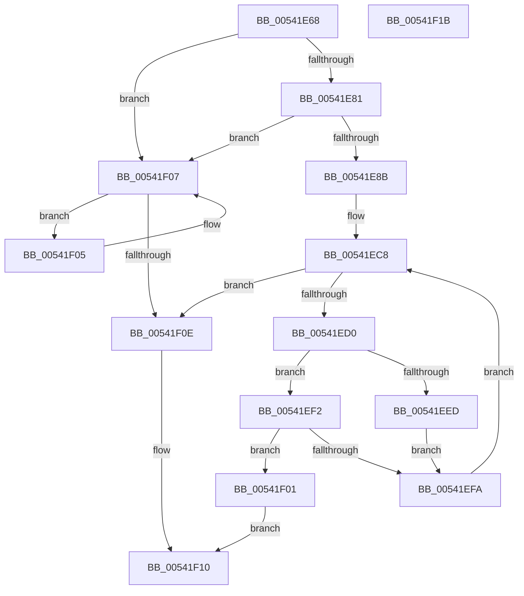

# HalpMceBarrierWait

- RVA: `0x00541E68`–`0x00541F1C` (길이 `180` bytes)
- VA: `0x0000000140541E68`
- 실행 섹션: `.text`
- PDB 이름 있음: `예`; PDB Function 태그: `아니요`
- unwind 정보 RVA: `0x000950EC`
- 디코드: `55`개 명령, `180/180` bytes 표시
- 미해석 바이트: `0` (있으면 어셈블리에 `.byte`로 보존)

> 이 문서는 커널 이미지의 기계어와 PDB 기호를 분석해 생성했습니다. 4번과 5번은 함수 원형과 자료형을 바이너리 사용 방식에서 추정한 C 해석이며 원본 소스 복구 결과는 아닙니다.

## 1. Dependencies

- 직접 호출 지점: **0**; 고유 호출 대상: **0**
- 직접 호출자로 확인된 함수: **1**
- RIP 상대 이미지 참조: **1**

### Outgoing calls
- 직접 디코드된 call 명령이 없습니다.

### Direct callers
- [HalpMceHandlerWithRendezvous](HalpMceHandlerWithRendezvous_function_005421E0.md) at `0x0054226C`
- [HalpMceHandlerWithRendezvous](HalpMceHandlerWithRendezvous_function_005421E0.md) at `0x0054229A`
- [HalpMceHandlerWithRendezvous](HalpMceHandlerWithRendezvous_function_005421E0.md) at `0x005422D3`
- [HalpMceHandlerWithRendezvous](HalpMceHandlerWithRendezvous_function_005421E0.md) at `0x0054230B`

### Static image references
- `0x00541E81` → RVA `0x00E0F6D0` (`.data`; read)

## 2. Other-region calls and transfers

- 다른 실행 섹션으로 향하는 call: **0**
- 별도 외부 분기/꼬리 이동을 확인하지 못했습니다.

## 3. Assembly (complete function range)

```asm
00541E68  48 89 5C 24 08                  mov qword ptr [rsp + 8], rbx
00541E6D  48 89 7C 24 10                  mov qword ptr [rsp + 0x10], rdi
00541E72  44 8B D2                        mov r10d, edx
00541E75  4C 8B D9                        mov r11, rcx
00541E78  45 85 C0                        test r8d, r8d
00541E7B  0F 84 86 00 00 00               je 0x140541f07
00541E81  8A 05 49 D8 8C 00               mov al, byte ptr [rip + 0x8cd849]
00541E87  84 C0                           test al, al
00541E89  75 7C                           jne 0x140541f07
00541E8B  65 48 8B 04 25 18 00 00 00      mov rax, qword ptr gs:[0x18]
00541E94  4D 63 C0                        movsxd r8, r8d
00541E97  4C 0F AF 80 C0 00 00 00         imul r8, qword ptr [rax + 0xc0]
00541E9F  48 B8 77 BE 9F 1A 2F DD 24 06   movabs rax, 0x624dd2f1a9fbe77
00541EA9  49 F7 E0                        mul r8
00541EAC  4C 2B C2                        sub r8, rdx
00541EAF  49 D1 E8                        shr r8, 1
00541EB2  4C 03 C2                        add r8, rdx
00541EB5  49 C1 E8 09                     shr r8, 9
00541EB9  0F 31                           rdtsc
00541EBB  48 C1 E2 20                     shl rdx, 0x20
00541EBF  48 0B C2                        or rax, rdx
00541EC2  48 8B D8                        mov rbx, rax
00541EC5  48 8B F8                        mov rdi, rax
00541EC8  41 8B 0B                        mov ecx, dword ptr [r11]
00541ECB  41 3B CA                        cmp ecx, r10d
00541ECE  7D 3E                           jge 0x140541f0e
00541ED0  0F 31                           rdtsc
00541ED2  48 C1 E2 20                     shl rdx, 0x20
00541ED6  49 8B C8                        mov rcx, r8
00541ED9  48 0B C2                        or rax, rdx
00541EDC  48 D1 E9                        shr rcx, 1
00541EDF  48 8B D0                        mov rdx, rax
00541EE2  4C 8B C8                        mov r9, rax
00541EE5  48 2B D7                        sub rdx, rdi
00541EE8  48 3B D1                        cmp rdx, rcx
00541EEB  76 05                           jbe 0x140541ef2
00541EED  48 8B D8                        mov rbx, rax
00541EF0  EB 08                           jmp 0x140541efa
00541EF2  48 2B C3                        sub rax, rbx
00541EF5  49 3B C0                        cmp rax, r8
00541EF8  77 07                           ja 0x140541f01
00541EFA  49 8B F9                        mov rdi, r9
00541EFD  F3 90                           pause
00541EFF  EB C7                           jmp 0x140541ec8
00541F01  32 C0                           xor al, al
00541F03  EB 0B                           jmp 0x140541f10
00541F05  F3 90                           pause
00541F07  8B 01                           mov eax, dword ptr [rcx]
00541F09  41 3B C2                        cmp eax, r10d
00541F0C  7C F7                           jl 0x140541f05
00541F0E  B0 01                           mov al, 1
00541F10  48 8B 5C 24 08                  mov rbx, qword ptr [rsp + 8]
00541F15  48 8B 7C 24 10                  mov rdi, qword ptr [rsp + 0x10]
00541F1A  C3                              ret
00541F1B  CC                              int3
```

## 4. C-style interpretation (structured pseudocode)

```c
__int64 __fastcall HalpMceBarrierWait(__int64 a1, __int64 a2, int a3)
{
    __int64 result;
    unsigned __int64 v_stack_p10;
    unsigned __int64 v_stack_p8;

    v_stack_p8 = v_rbx;
    v_stack_p10 = v_rdi;
    if (a3 == 0) goto loc_00541F07;
    if ((unsigned __int8)(*(unsigned __int8 *)(v_rip + 9230409)) != 0) goto loc_00541F07;
    a3 = ((int)(a3)) * (*(unsigned __int64 *)(*(unsigned __int64 *)(gs_base + (0 + 24)) + 192));
    a3 = (a3) - (a2);
    a3 = (a3) >> (1);
    a3 = (a3) + (a2);
    a3 = (a3) >> (9);
    a2 = (a2) << (32);
    result = (*(unsigned __int64 *)(gs_base + (0 + 24))) | (a2);
loc_00541EC8:
    if (((unsigned int)((unsigned int)(*(unsigned int *)(a1)))) >= ((unsigned int)((unsigned int)((unsigned int)(a2))))) goto loc_00541F0E;
    a2 = (a2) << (32);
    result = (result) | (a2);
    a1 = (a3) >> (1);
    a2 = (result) - (result);
    if (a2 <= a1) goto loc_00541EF2;
    goto loc_00541EFA;
loc_00541EF2:
    result = (result) - (result);
    if (result > a3) goto loc_00541F01;
loc_00541EFA:
    goto loc_00541EC8;
loc_00541F01:
    result = 0;
    goto loc_00541F10;
loc_00541F05:
loc_00541F07:
    if (((unsigned int)((unsigned int)(*(unsigned int *)(a1)))) < ((unsigned int)((unsigned int)((unsigned int)(a2))))) goto loc_00541F05;
loc_00541F0E:
loc_00541F10:
    return 1;
}
```

## 5. (Beta) C Style

```c
int64_t HalpMceBarrierWait(void *Arg1, int64_t Arg2, int32_t Arg3)
{
    uint8_t *arg1 = (uint8_t *)Arg1;

    int64_t result;
    uint64_t v_stack_p10;
    uint64_t v_stack_p8;

    v_stack_p8 = local_rbx;
    v_stack_p10 = local_rdi;
    if (Arg3 == 0) goto loc_00541F07;
    if ((uint8_t)(*(uint8_t *)(v_rip + 0x8CD849)) != 0) goto loc_00541F07;
    Arg3 = ((int32_t)(Arg3)) * (*(uint64_t *)(*(uint64_t *)(gs_base + (0 + 0x18)) + 0xC0));
    Arg3 = (Arg3) - (Arg2);
    Arg3 = (Arg3) >> (1);
    Arg3 = (Arg3) + (Arg2);
    Arg3 = (Arg3) >> (9);
    Arg2 = (Arg2) << (32);
    result = (*(uint64_t *)(gs_base + (0 + 0x18))) | (Arg2);
loc_00541EC8:
    if (((uint32_t)((uint32_t)(*(uint32_t *)(arg1)))) >= ((uint32_t)((uint32_t)((uint32_t)(Arg2))))) goto loc_00541F0E;
    Arg2 = (Arg2) << (32);
    result = (result) | (Arg2);
    Arg1 = (Arg3) >> (1);
    Arg2 = (result) - (result);
    if (Arg2 <= Arg1) goto loc_00541EF2;
    goto loc_00541EFA;
loc_00541EF2:
    result = (result) - (result);
    if (result > Arg3) goto loc_00541F01;
loc_00541EFA:
    goto loc_00541EC8;
loc_00541F01:
    result = 0;
    goto loc_00541F10;
loc_00541F05:
loc_00541F07:
    if (((uint32_t)((uint32_t)(*(uint32_t *)(arg1)))) < ((uint32_t)((uint32_t)((uint32_t)(Arg2))))) goto loc_00541F05;
loc_00541F0E:
loc_00541F10:
    return 1;
}
```

### 관측된 메모리 오프셋

구조체 형식이 확인되지 않은 접근은 인자 기준의 오프셋으로만 기록했습니다.

| 기준 인자 | 오프셋 표현 | 폭 (bit) | 접근 |
|---|---:|---:|---|
| `Arg1` | `+ 0x0` | `32` | `R` |

## 6. Execution-region graph

[열기: 2D/3D 그래프와 함수 탐색 컨트롤 패널](../../../control-panel.html?section=text&rva=0x00541E68&view=graph)

- 2D 그래프는 위에서 아래로 흐르고, 3D 그래프는 빈 공간을 드래그해 회전합니다. Shift+드래그는 이동, 휠은 확대·축소, 함수 노드 선택은 대상 보고서 이동입니다.

### Static fallback


