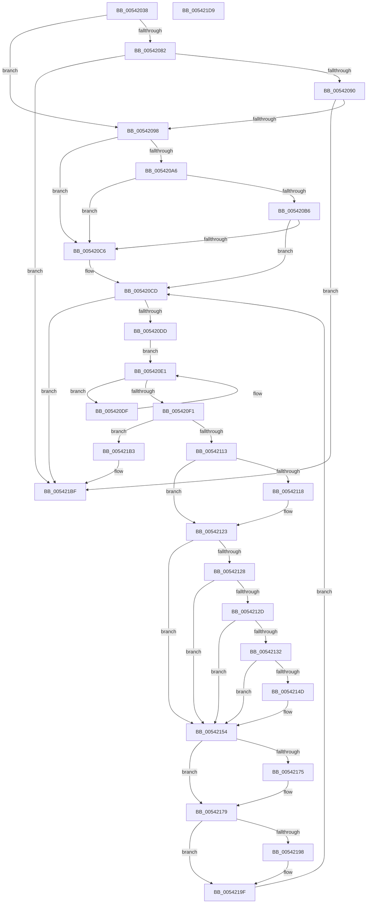

# HalpMceHandlerCore

- RVA: `0x00542038`–`0x005421DA` (길이 `418` bytes)
- VA: `0x0000000140542038`
- 실행 섹션: `.text`
- PDB 이름 있음: `예`; PDB Function 태그: `아니요`
- unwind 정보 RVA: `0x000C3AC8`
- 디코드: `117`개 명령, `418/418` bytes 표시
- 미해석 바이트: `0` (있으면 어셈블리에 `.byte`로 보존)

> 이 문서는 커널 이미지의 기계어와 PDB 기호를 분석해 생성했습니다. 4번과 5번은 함수 원형과 자료형을 바이너리 사용 방식에서 추정한 C 해석이며 원본 소스 복구 결과는 아닙니다.

## 1. Dependencies

- 직접 호출 지점: **10**; 고유 호출 대상: **9**
- 직접 호출자로 확인된 함수: **1**
- RIP 상대 이미지 참조: **7**

### Outgoing calls
- `0x00542078` → [guard_dispatch_icall](../6B/guard_dispatch_icall_function_006BAAD0.md) (function, `0x006BAAD0`)
- `0x005420A9` → [HalpGetMcaPcrContext](../48/HalpGetMcaPcrContext_function_00487A38.md) (function, `0x00487A38`)
- `0x005420D0` → [HalpMcaReadErrorPresence](../48/HalpMcaReadErrorPresence_function_004878D4.md) (function, `0x004878D4`)
- `0x005420E8` → [KxTryToAcquireSpinLock](../46/KxTryToAcquireSpinLock_function_0046BE18.md) (function, `0x0046BE18`)
- `0x00542106` → [HalpMcaReadError](HalpMcaReadError_function_00541A2C.md) (function, `0x00541A2C`)
- `0x00542144` → [WheaIsAltContextAllocPossible](../65/WheaIsAltContextAllocPossible_function_0065F320.md) (function, `0x0065F320`)
- `0x0054216B` → [HalpMcaReportError](HalpMcaReportError_function_00541D04.md) (function, `0x00541D04`)
- `0x00542189` → [HalpMcaClearError](HalpMcaClearError_function_00541478.md) (function, `0x00541478`)
- `0x005421A6` → [KxReleaseSpinLock](../20/KxReleaseSpinLock_function_00206670.md) (function, `0x00206670`)
- `0x005421BA` → [KxReleaseSpinLock](../20/KxReleaseSpinLock_function_00206670.md) (function, `0x00206670`)

### Direct callers
- [HalpMceHandler](HalpMceHandler_function_00541F24.md) at `0x00541F85`
- [HalpMceHandler](HalpMceHandler_function_00541F24.md) at `0x00541FCA`
- [HalpMceHandler](HalpMceHandler_function_00541F24.md) at `0x00541FFF`

### Static image references
- `0x0054205D` → RVA `0x00FC1990` (`.data`; read)
- `0x00542098` → RVA `0x00E0FC02` (`.data`; read)
- `0x005420C6` → RVA `0x00E0FC10` (`.data`; read)
- `0x005420E1` → RVA `0x00E100C8` (`.data`; read)
- `0x00542162` → RVA `0x00E0A770` (`.data`; write)
- `0x0054218E` → RVA `0x00E10250` (`.data`; read)
- `0x00542198` → RVA `0x00FC22E0` (`.data`; write)

## 2. Other-region calls and transfers

- 다른 실행 섹션으로 향하는 call: **0**
- 별도 외부 분기/꼬리 이동을 확인하지 못했습니다.

## 3. Assembly (complete function range)

```asm
00542038  48 8B C4                        mov rax, rsp
0054203B  48 89 58 08                     mov qword ptr [rax + 8], rbx
0054203F  48 89 68 18                     mov qword ptr [rax + 0x18], rbp
00542043  56                              push rsi
00542044  57                              push rdi
00542045  41 54                           push r12
00542047  41 56                           push r14
00542049  41 57                           push r15
0054204B  48 83 EC 30                     sub rsp, 0x30
0054204F  83 60 10 00                     and dword ptr [rax + 0x10], 0
00542053  49 8B D8                        mov rbx, r8
00542056  83 60 20 00                     and dword ptr [rax + 0x20], 0
0054205A  40 8A FA                        mov dil, dl
0054205D  48 8B 05 2C F9 A7 00            mov rax, qword ptr [rip + 0xa7f92c]
00542064  4C 8B E1                        mov r12, rcx
00542067  48 8B CB                        mov rcx, rbx
0054206A  45 33 C0                        xor r8d, r8d
0054206D  BA 7A 01 00 00                  mov edx, 0x17a
00542072  45 33 FF                        xor r15d, r15d
00542075  45 32 F6                        xor r14b, r14b
00542078  E8 53 8A 17 00                  call 0x1406baad0
0054207D  40 84 FF                        test dil, dil
00542080  74 16                           je 0x140542098
00542082  8B C8                           mov ecx, eax
00542084  80 E1 03                        and cl, 3
00542087  80 F9 01                        cmp cl, 1
0054208A  0F 84 2F 01 00 00               je 0x1405421bf
00542090  A8 04                           test al, 4
00542092  0F 84 27 01 00 00               je 0x1405421bf
00542098  8A 05 64 DB 8C 00               mov al, byte ptr [rip + 0x8cdb64]
0054209E  33 FF                           xor edi, edi
005420A0  33 F6                           xor esi, esi
005420A2  84 C0                           test al, al
005420A4  74 20                           je 0x1405420c6
005420A6  48 8B CB                        mov rcx, rbx
005420A9  E8 8A 59 F4 FF                  call 0x140487a38
005420AE  48 8B F8                        mov rdi, rax
005420B1  48 85 C0                        test rax, rax
005420B4  74 10                           je 0x1405420c6
005420B6  48 8B 30                        mov rsi, qword ptr [rax]
005420B9  4C 8B 78 20                     mov r15, qword ptr [rax + 0x20]
005420BD  48 8D 6E 50                     lea rbp, [rsi + 0x50]
005420C1  48 85 F6                        test rsi, rsi
005420C4  75 07                           jne 0x1405420cd
005420C6  48 8D 2D 43 DB 8C 00            lea rbp, [rip + 0x8cdb43]
005420CD  48 8B D3                        mov rdx, rbx
005420D0  E8 FF 57 F4 FF                  call 0x1404878d4
005420D5  85 C0                           test eax, eax
005420D7  0F 88 E2 00 00 00               js 0x1405421bf
005420DD  EB 02                           jmp 0x1405420e1
005420DF  F3 90                           pause
005420E1  48 8D 0D E0 DF 8C 00            lea rcx, [rip + 0x8cdfe0]
005420E8  E8 2B 9D F2 FF                  call 0x14046be18
005420ED  84 C0                           test al, al
005420EF  74 EE                           je 0x1405420df
005420F1  4D 8B CC                        mov r9, r12
005420F4  48 89 5C 24 20                  mov qword ptr [rsp + 0x20], rbx
005420F9  4C 8D 44 24 68                  lea r8, [rsp + 0x68]
005420FE  48 8B D5                        mov rdx, rbp
00542101  B9 10 00 00 00                  mov ecx, 0x10
00542106  E8 21 F9 FF FF                  call 0x140541a2c
0054210B  85 C0                           test eax, eax
0054210D  0F 88 A0 00 00 00               js 0x1405421b3
00542113  48 85 F6                        test rsi, rsi
00542116  74 0B                           je 0x140542123
00542118  8B 44 24 68                     mov eax, dword ptr [rsp + 0x68]
0054211C  83 66 0C 00                     and dword ptr [rsi + 0xc], 0
00542120  89 46 14                        mov dword ptr [rsi + 0x14], eax
00542123  4D 85 E4                        test r12, r12
00542126  74 2C                           je 0x140542154
00542128  4D 85 FF                        test r15, r15
0054212B  74 27                           je 0x140542154
0054212D  48 85 FF                        test rdi, rdi
00542130  74 22                           je 0x140542154
00542132  41 8A 17                        mov dl, byte ptr [r15]
00542135  4C 8D 44 24 78                  lea r8, [rsp + 0x78]
0054213A  83 67 28 00                     and dword ptr [rdi + 0x28], 0
0054213E  80 E2 10                        and dl, 0x10
00542141  49 8B CC                        mov rcx, r12
00542144  E8 D7 D1 11 00                  call 0x14065f320
00542149  84 C0                           test al, al
0054214B  75 07                           jne 0x140542154
0054214D  8B 44 24 78                     mov eax, dword ptr [rsp + 0x78]
00542151  89 47 28                        mov dword ptr [rdi + 0x28], eax
00542154  65 8B 04 25 A4 01 00 00         mov eax, dword ptr gs:[0x1a4]
0054215C  4C 8B C3                        mov r8, rbx
0054215F  48 8B D5                        mov rdx, rbp
00542162  89 05 08 86 8C 00               mov dword ptr [rip + 0x8c8608], eax
00542168  48 8B CE                        mov rcx, rsi
0054216B  E8 94 FB FF FF                  call 0x140541d04
00542170  48 85 FF                        test rdi, rdi
00542173  74 04                           je 0x140542179
00542175  83 67 28 00                     and dword ptr [rdi + 0x28], 0
00542179  48 8B D3                        mov rdx, rbx
0054217C  C7 05 EA 85 8C 00 00 08 00 00   mov dword ptr [rip + 0x8c85ea], 0x800
00542186  48 8B CD                        mov rcx, rbp
00542189  E8 EA F2 FF FF                  call 0x140541478
0054218E  48 83 3D BA E0 8C 00 00         cmp qword ptr [rip + 0x8ce0ba], 0
00542196  74 07                           je 0x14054219f
00542198  C6 05 41 01 A8 00 01            mov byte ptr [rip + 0xa80141], 1
0054219F  48 8D 0D 22 DF 8C 00            lea rcx, [rip + 0x8cdf22]
005421A6  E8 C5 44 CC FF                  call 0x140206670
005421AB  41 B6 01                        mov r14b, 1
005421AE  E9 1A FF FF FF                  jmp 0x1405420cd
005421B3  48 8D 0D 0E DF 8C 00            lea rcx, [rip + 0x8cdf0e]
005421BA  E8 B1 44 CC FF                  call 0x140206670
005421BF  48 8B 5C 24 60                  mov rbx, qword ptr [rsp + 0x60]
005421C4  41 8A C6                        mov al, r14b
005421C7  48 8B 6C 24 70                  mov rbp, qword ptr [rsp + 0x70]
005421CC  48 83 C4 30                     add rsp, 0x30
005421D0  41 5F                           pop r15
005421D2  41 5E                           pop r14
005421D4  41 5C                           pop r12
005421D6  5F                              pop rdi
005421D7  5E                              pop rsi
005421D8  C3                              ret
005421D9  CC                              int3
```

## 4. C-style interpretation (structured pseudocode)

```c
__int64 __fastcall HalpMceHandlerCore(__int64 a1, unsigned __int8 a2, __int64 a3)
{
    __int64 result;
    __int64 v_r14;
    __int64 v_r15;
    __int64 v_rbp;
    __int64 v_rdi;
    __int64 v_rsi;
    __int64 v_rsp;
    unsigned __int64 v_stack_m38;
    unsigned __int64 v_stack_p10;
    unsigned __int64 v_stack_p18;
    unsigned __int64 v_stack_p20;
    unsigned __int64 v_stack_p8;

    *(unsigned __int64 *)(v_rsp + 8) = v_rbx;
    *(unsigned __int64 *)(v_rsp + 24) = v_rbp;
    v_rsp = (v_rsp) - (48);
    a3 = 0;
    v_r15 = 0;
    v_r14 = 0;
    result = guard_dispatch_icall(a3, 378, a3, a4);
    if (a2 == 0) goto loc_00542098;
    a1 = (unsigned __int8)(((unsigned int)((unsigned int)(result))) & (3));
    if (((unsigned __int8)(a1)) == 1) goto loc_005421BF;
    if ((((unsigned __int8)(result)) & (4)) == 0) goto loc_005421BF;
loc_00542098:
    v_rdi = 0;
    v_rsi = 0;
    if ((unsigned __int8)(*(unsigned __int8 *)(v_rip + 9231204)) == 0) goto loc_005420C6;
    result = HalpGetMcaPcrContext(0, 378, a3, a4);
    if (result == 0) goto loc_005420C6;
    v_rbp = *(unsigned __int64 *)(result) + 80;
    if (*(unsigned __int64 *)(result) == 0) {
        v_rbp = v_rip + 9231171;
    }
    result = HalpMcaReadErrorPresence(0, 0, a3, a4);
    if (sign_flag) goto loc_005421BF;
    goto loc_005420E1;
loc_005420DF:
loc_005420E1:
    result = KxTryToAcquireSpinLock(v_rip + 9232352, 0, a3, a4);
    if ((unsigned __int8)(result) == 0) goto loc_005420DF;
    v_stack_m38 = 0;
    result = HalpMcaReadError(16, v_rbp, v_stack_p10, a1);
    if (sign_flag) goto loc_005421B3;
    if (*(unsigned __int64 *)(result) != 0) {
        result = v_stack_p10;
        *(unsigned int *)(*(unsigned __int64 *)(result) + 20) = (unsigned int)(result);
    }
    if (a1 == 0) goto loc_00542154;
    if (*(unsigned __int64 *)(result + 32) == 0) goto loc_00542154;
    if (result == 0) goto loc_00542154;
    a2 = (unsigned __int8)((*(unsigned __int8 *)(*(unsigned __int64 *)(result + 32))) & (16));
    result = WheaIsAltContextAllocPossible(a1, a2, v_stack_p20, a1);
    if ((unsigned __int8)(result) == 0) {
        result = v_stack_p20;
        *(unsigned int *)(result + 40) = (unsigned int)(result);
    }
    *(unsigned int *)(v_rip + 9209352) = (unsigned int)((unsigned int)(*(unsigned int *)(gs_base + (0 + 420))));
    result = HalpMcaReportError(*(unsigned __int64 *)(result), v_rbp, 0, a1);
    if (result != 0) {
    }
    *(unsigned int *)(v_rip + 9209322) = 0x800ULL;
    result = HalpMcaClearError(v_rbp, 0, 0, a1);
    if ((*(unsigned __int64 *)(v_rip + 9232570)) != 0) {
        *(unsigned __int8 *)(v_rip + 11010369) = 1;
    }
    result = KxReleaseSpinLock(v_rip + 9232162, 0, 0, a1);
    goto loc_005420CD;
loc_005421B3:
    result = KxReleaseSpinLock(v_rip + 9232142, 0, 0, a1);
loc_005421BF:
    v_rsp = (v_rsp) + (48);
    return 1;
}
```

## 5. (Beta) C Style

```c
int64_t HalpMceHandlerCore(int64_t Arg1, uint8_t Arg2, int64_t Arg3)
{
    int64_t result;
    int64_t local_r14;
    int64_t local_r15;
    int64_t local_rbp;
    int64_t local_rdi;
    int64_t local_rsi;
    int64_t local_rsp;
    uint64_t v_stack_m38;
    uint64_t v_stack_p10;
    uint64_t v_stack_p18;
    uint64_t v_stack_p20;
    uint64_t v_stack_p8;

    *(uint64_t *)(local_rsp + 0x8) = local_rbx;
    *(uint64_t *)(local_rsp + 0x18) = local_rbp;
    local_rsp = (local_rsp) - (48);
    Arg3 = 0;
    local_r15 = 0;
    local_r14 = 0;
    result = guard_dispatch_icall(Arg3, 378, Arg3, a4);
    if (Arg2 == 0) goto loc_00542098;
    Arg1 = (uint8_t)(((uint32_t)((uint32_t)(result))) & (3));
    if (((uint8_t)(Arg1)) == 1) goto loc_005421BF;
    if ((((uint8_t)(result)) & (4)) == 0) goto loc_005421BF;
loc_00542098:
    local_rdi = 0;
    local_rsi = 0;
    if ((uint8_t)(*(uint8_t *)(v_rip + 0x8CDB64)) == 0) goto loc_005420C6;
    result = HalpGetMcaPcrContext(0, 378, Arg3, a4);
    if (result == 0) goto loc_005420C6;
    local_rbp = *(uint64_t *)(result) + 80;
    if (*(uint64_t *)(result) == 0) {
        local_rbp = v_rip + 9231171;
    }
    result = HalpMcaReadErrorPresence(0, 0, Arg3, a4);
    if (sign_flag) goto loc_005421BF;
    goto loc_005420E1;
loc_005420DF:
loc_005420E1:
    result = KxTryToAcquireSpinLock(v_rip + 9232352, 0, Arg3, a4);
    if ((uint8_t)(result) == 0) goto loc_005420DF;
    v_stack_m38 = 0;
    result = HalpMcaReadError(16, local_rbp, v_stack_p10, Arg1);
    if (sign_flag) goto loc_005421B3;
    if (*(uint64_t *)(result) != 0) {
        result = v_stack_p10;
        *(uint32_t *)(*(uint64_t *)(result) + 0x14) = (uint32_t)(result);
    }
    if (Arg1 == 0) goto loc_00542154;
    if (*(uint64_t *)(result + 0x20) == 0) goto loc_00542154;
    if (result == 0) goto loc_00542154;
    Arg2 = (uint8_t)((*(uint8_t *)(*(uint64_t *)(result + 0x20))) & (16));
    result = WheaIsAltContextAllocPossible(Arg1, Arg2, v_stack_p20, Arg1);
    if ((uint8_t)(result) == 0) {
        result = v_stack_p20;
        *(uint32_t *)(result + 0x28) = (uint32_t)(result);
    }
    *(uint32_t *)(v_rip + 0x8C8608) = (uint32_t)((uint32_t)(*(uint32_t *)(gs_base + (0 + 0x1A4))));
    result = HalpMcaReportError(*(uint64_t *)(result), local_rbp, 0, Arg1);
    if (result != 0) {
    }
    *(uint32_t *)(v_rip + 0x8C85EA) = 0x800ULL;
    result = HalpMcaClearError(local_rbp, 0, 0, Arg1);
    if ((*(uint64_t *)(v_rip + 0x8CE0BA)) != 0) {
        *(uint8_t *)(v_rip + 0xA80141) = 1;
    }
    result = KxReleaseSpinLock(v_rip + 9232162, 0, 0, Arg1);
    goto loc_005420CD;
loc_005421B3:
    result = KxReleaseSpinLock(v_rip + 9232142, 0, 0, Arg1);
loc_005421BF:
    local_rsp = (local_rsp) + (48);
    return 1;
}
```

## 6. Execution-region graph

[열기: 2D/3D 그래프와 함수 탐색 컨트롤 패널](../../../control-panel.html?section=text&rva=0x00542038&view=graph)

- 2D 그래프는 위에서 아래로 흐르고, 3D 그래프는 빈 공간을 드래그해 회전합니다. Shift+드래그는 이동, 휠은 확대·축소, 함수 노드 선택은 대상 보고서 이동입니다.

### Static fallback


