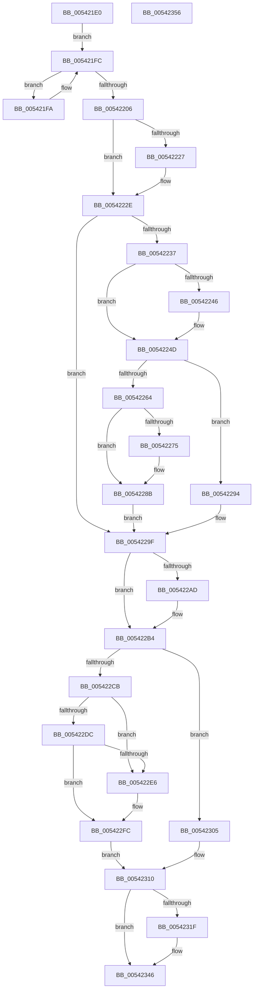

# HalpMceHandlerWithRendezvous

- RVA: `0x005421E0`–`0x00542357` (길이 `375` bytes)
- VA: `0x00000001405421E0`
- 실행 섹션: `.text`
- PDB 이름 있음: `예`; PDB Function 태그: `아니요`
- unwind 정보 RVA: `0x000C3AE4`
- 디코드: `95`개 명령, `375/375` bytes 표시
- 미해석 바이트: `0` (있으면 어셈블리에 `.byte`로 보존)

> 이 문서는 커널 이미지의 기계어와 PDB 기호를 분석해 생성했습니다. 4번과 5번은 함수 원형과 자료형을 바이너리 사용 방식에서 추정한 C 해석이며 원본 소스 복구 결과는 아닙니다.

## 1. Dependencies

- 직접 호출 지점: **9**; 고유 호출 대상: **4**
- 직접 호출자로 확인된 함수: **1**
- RIP 상대 이미지 참조: **12**

### Outgoing calls
- `0x0054220B` → [KeQueryActiveProcessorCountEx](../24/KeQueryActiveProcessorCountEx_function_00249EF0.md) (function, `0x00249EF0`)
- `0x0054223D` → [HalpMceHandler](HalpMceHandler_function_00541F24.md) (function, `0x00541F24`)
- `0x0054226C` → [HalpMceBarrierWait](HalpMceBarrierWait_function_00541E68.md) (function, `0x00541E68`)
- `0x00542286` → [HalpMcaReportError](HalpMcaReportError_function_00541D04.md) (function, `0x00541D04`)
- `0x0054229A` → [HalpMceBarrierWait](HalpMceBarrierWait_function_00541E68.md) (function, `0x00541E68`)
- `0x005422A4` → [HalpMceHandler](HalpMceHandler_function_00541F24.md) (function, `0x00541F24`)
- `0x005422D3` → [HalpMceBarrierWait](HalpMceBarrierWait_function_00541E68.md) (function, `0x00541E68`)
- `0x005422F7` → [HalpMcaReportError](HalpMcaReportError_function_00541D04.md) (function, `0x00541D04`)
- `0x0054230B` → [HalpMceBarrierWait](HalpMceBarrierWait_function_00541E68.md) (function, `0x00541E68`)

### Direct callers
- [HalpHandleMachineCheck](HalpHandleMachineCheck_function_005413C8.md) at `0x00541450`

### Static image references
- `0x005421FC` → RVA `0x00E100E1` (`.data`; read)
- `0x00542219` → RVA `0x00E0F6B4` (`.data`; read/write)
- `0x00542227` → RVA `0x00E100E1` (`.data`; write)
- `0x0054222E` → RVA `0x00E100B8` (`.data`; read)
- `0x00542246` → RVA `0x00E100D4` (`.data`; write)
- `0x0054224F` → RVA `0x00E100C4` (`.data`; read/write)
- `0x00542259` → RVA `0x00E100C4` (`.data`; read)
- `0x005422B6` → RVA `0x00E0F6E8` (`.data`; read/write)
- `0x005422C0` → RVA `0x00E0F6E8` (`.data`; read)
- `0x005422DC` → RVA `0x00E100D4` (`.data`; read)
- `0x00542326` → RVA `0x00E100C4` (`.data`; write)
- `0x00542330` → RVA `0x00E0F6E8` (`.data`; write)

## 2. Other-region calls and transfers

- 다른 실행 섹션으로 향하는 call: **0**
- 별도 외부 분기/꼬리 이동을 확인하지 못했습니다.

## 3. Assembly (complete function range)

```asm
005421E0  48 89 5C 24 08                  mov qword ptr [rsp + 8], rbx
005421E5  48 89 6C 24 18                  mov qword ptr [rsp + 0x18], rbp
005421EA  57                              push rdi
005421EB  48 83 EC 20                     sub rsp, 0x20
005421EF  48 83 64 24 38 00               and qword ptr [rsp + 0x38], 0
005421F5  48 8B F9                        mov rdi, rcx
005421F8  EB 02                           jmp 0x1405421fc
005421FA  F3 90                           pause
005421FC  8A 05 DF DE 8C 00               mov al, byte ptr [rip + 0x8cdedf]
00542202  84 C0                           test al, al
00542204  75 F4                           jne 0x1405421fa
00542206  B9 FF FF 00 00                  mov ecx, 0xffff
0054220B  E8 E0 7C D0 FF                  call 0x140249ef0
00542210  BD 01 00 00 00                  mov ebp, 1
00542215  8B D8                           mov ebx, eax
00542217  8B CD                           mov ecx, ebp
00542219  F0 0F C1 0D 93 D4 8C 00         lock xadd dword ptr [rip + 0x8cd493], ecx
00542221  03 CD                           add ecx, ebp
00542223  3B C8                           cmp ecx, eax
00542225  75 07                           jne 0x14054222e
00542227  40 88 2D B3 DE 8C 00            mov byte ptr [rip + 0x8cdeb3], bpl
0054222E  80 3D 83 DE 8C 00 00            cmp byte ptr [rip + 0x8cde83], 0
00542235  74 68                           je 0x14054229f
00542237  40 8A D5                        mov dl, bpl
0054223A  48 8B CF                        mov rcx, rdi
0054223D  E8 E2 FC FF FF                  call 0x140541f24
00542242  84 C0                           test al, al
00542244  74 07                           je 0x14054224d
00542246  40 88 2D 87 DE 8C 00            mov byte ptr [rip + 0x8cde87], bpl
0054224D  8B C5                           mov eax, ebp
0054224F  F0 0F C1 05 6D DE 8C 00         lock xadd dword ptr [rip + 0x8cde6d], eax
00542257  03 C5                           add eax, ebp
00542259  48 8D 0D 64 DE 8C 00            lea rcx, [rip + 0x8cde64]
00542260  3B C5                           cmp eax, ebp
00542262  75 30                           jne 0x140542294
00542264  41 B8 88 13 00 00               mov r8d, 0x1388
0054226A  8B D3                           mov edx, ebx
0054226C  E8 F7 FB FF FF                  call 0x140541e68
00542271  84 C0                           test al, al
00542273  75 16                           jne 0x14054228b
00542275  C7 44 24 38 02 00 00 80         mov dword ptr [rsp + 0x38], 0x80000002
0054227D  33 D2                           xor edx, edx
0054227F  4C 8B 44 24 38                  mov r8, qword ptr [rsp + 0x38]
00542284  33 C9                           xor ecx, ecx
00542286  E8 79 FA FF FF                  call 0x140541d04
0054228B  F0 01 2D 32 DE 8C 00            lock add dword ptr [rip + 0x8cde32], ebp
00542292  EB 0B                           jmp 0x14054229f
00542294  8D 53 01                        lea edx, [rbx + 1]
00542297  45 33 C0                        xor r8d, r8d
0054229A  E8 C9 FB FF FF                  call 0x140541e68
0054229F  33 D2                           xor edx, edx
005422A1  48 8B CF                        mov rcx, rdi
005422A4  E8 7B FC FF FF                  call 0x140541f24
005422A9  84 C0                           test al, al
005422AB  74 07                           je 0x1405422b4
005422AD  40 88 2D 20 DE 8C 00            mov byte ptr [rip + 0x8cde20], bpl
005422B4  8B C5                           mov eax, ebp
005422B6  F0 0F C1 05 2A D4 8C 00         lock xadd dword ptr [rip + 0x8cd42a], eax
005422BE  03 C5                           add eax, ebp
005422C0  48 8D 0D 21 D4 8C 00            lea rcx, [rip + 0x8cd421]
005422C7  3B C5                           cmp eax, ebp
005422C9  75 3A                           jne 0x140542305
005422CB  41 B8 88 13 00 00               mov r8d, 0x1388
005422D1  8B D3                           mov edx, ebx
005422D3  E8 90 FB FF FF                  call 0x140541e68
005422D8  84 C0                           test al, al
005422DA  74 0A                           je 0x1405422e6
005422DC  8A 05 F2 DD 8C 00               mov al, byte ptr [rip + 0x8cddf2]
005422E2  84 C0                           test al, al
005422E4  75 16                           jne 0x1405422fc
005422E6  C7 44 24 38 01 00 00 80         mov dword ptr [rsp + 0x38], 0x80000001
005422EE  33 D2                           xor edx, edx
005422F0  4C 8B 44 24 38                  mov r8, qword ptr [rsp + 0x38]
005422F5  33 C9                           xor ecx, ecx
005422F7  E8 08 FA FF FF                  call 0x140541d04
005422FC  F0 01 2D E5 D3 8C 00            lock add dword ptr [rip + 0x8cd3e5], ebp
00542303  EB 0B                           jmp 0x140542310
00542305  8D 53 01                        lea edx, [rbx + 1]
00542308  45 33 C0                        xor r8d, r8d
0054230B  E8 58 FB FF FF                  call 0x140541e68
00542310  83 C8 FF                        or eax, 0xffffffff
00542313  F0 0F C1 05 99 D3 8C 00         lock xadd dword ptr [rip + 0x8cd399], eax
0054231B  3B C5                           cmp eax, ebp
0054231D  75 27                           jne 0x140542346
0054231F  C6 05 AE DD 8C 00 00            mov byte ptr [rip + 0x8cddae], 0
00542326  C7 05 94 DD 8C 00 00 00 00 00   mov dword ptr [rip + 0x8cdd94], 0
00542330  C7 05 AE D3 8C 00 00 00 00 00   mov dword ptr [rip + 0x8cd3ae], 0
0054233A  F0 83 0C 24 00                  lock or dword ptr [rsp], 0
0054233F  C6 05 9B DD 8C 00 00            mov byte ptr [rip + 0x8cdd9b], 0
00542346  48 8B 5C 24 30                  mov rbx, qword ptr [rsp + 0x30]
0054234B  48 8B 6C 24 40                  mov rbp, qword ptr [rsp + 0x40]
00542350  48 83 C4 20                     add rsp, 0x20
00542354  5F                              pop rdi
00542355  C3                              ret
00542356  CC                              int3
```

## 4. C-style interpretation (structured pseudocode)

```c
__int64 __fastcall HalpMceHandlerWithRendezvous(__int64 a1)
{
    __int64 result;
    __int64 v_rsp;
    unsigned int v_stack_m28;
    unsigned __int64 v_stack_p10;
    unsigned __int64 v_stack_p18;
    unsigned __int64 v_stack_p8;

    v_stack_p8 = v_rbx;
    v_stack_p18 = v_rbp;
    v_rsp = (v_rsp) - (32);
    goto loc_005421FC;
loc_005421FA:
loc_005421FC:
    if ((unsigned __int8)(*(unsigned __int8 *)(v_rip + 9232095)) != 0) goto loc_005421FA;
    result = KeQueryActiveProcessorCountEx((unsigned int)(0xFFFFULL), a2, a3, a4);
    a1 = (unsigned int)((1) + (1));
    if (((unsigned int)(a1)) == ((unsigned int)(result))) {
        *(unsigned __int8 *)(v_rip + 9232051) = 1;
    }
    if ((*(unsigned __int8 *)(v_rip + 9232003)) == 0) goto loc_0054229F;
    result = HalpMceHandler(a1, 1, a3, a4);
    if ((unsigned __int8)(result) != 0) {
        *(unsigned __int8 *)(v_rip + 9232007) = 1;
    }
    result = (unsigned int)((1) + (1));
    if (((unsigned int)(result)) != 1) goto loc_00542294;
    result = HalpMceBarrierWait(v_rip + 9231972, (unsigned int)((unsigned int)((unsigned int)((unsigned int)(result)))), (unsigned int)(0x1388ULL), a4);
    if ((unsigned __int8)(result) == 0) {
        v_stack_p10 = 0x80000002ULL;
        a2 = 0;
        a3 = v_stack_p10;
        a1 = 0;
        result = HalpMcaReportError(a1, a2, a3, a4);
    }
    goto loc_0054229F;
loc_00542294:
    a3 = 0;
    result = HalpMceBarrierWait(a1, (unsigned int)((unsigned int)(result)) + 1, a3, a4);
loc_0054229F:
    a2 = 0;
    result = HalpMceHandler(0, a2, a3, a4);
    if ((unsigned __int8)(result) != 0) {
        *(unsigned __int8 *)(v_rip + 9231904) = 1;
    }
    result = (unsigned int)((1) + (1));
    if (((unsigned int)(result)) != 1) goto loc_00542305;
    result = HalpMceBarrierWait(v_rip + 9229345, (unsigned int)((unsigned int)((unsigned int)((unsigned int)(result)))), (unsigned int)(0x1388ULL), a4);
    if ((unsigned __int8)(result) == 0) goto loc_005422E6;
    result = *(unsigned __int8 *)(v_rip + 9231858);
    if ((unsigned __int8)(*(unsigned __int8 *)(v_rip + 9231858)) == 0) {
        v_stack_p10 = 0x80000001ULL;
        a2 = 0;
        a3 = v_stack_p10;
        a1 = 0;
        result = HalpMcaReportError(a1, a2, a3, a4);
    }
    goto loc_00542310;
loc_00542305:
    a3 = 0;
    result = HalpMceBarrierWait(a1, (unsigned int)((unsigned int)(result)) + 1, a3, a4);
loc_00542310:
    result = (unsigned int)((result) | (0xFFFFFFFFULL));
    if (((unsigned int)(result)) == 1) {
        *(unsigned __int8 *)(v_rip + 9231790) = 0;
        *(unsigned int *)(v_rip + 9231764) = 0;
        *(unsigned int *)(v_rip + 9229230) = 0;
        *(unsigned __int8 *)(v_rip + 9231771) = 0;
    }
    v_rsp = (v_rsp) + (32);
    return result;
}
```

## 5. (Beta) C Style

```c
int64_t HalpMceHandlerWithRendezvous(int64_t Arg1)
{
    int64_t result;
    int64_t local_rsp;
    uint32_t v_stack_m28;
    uint64_t v_stack_p10;
    uint64_t v_stack_p18;
    uint64_t v_stack_p8;

    v_stack_p8 = local_rbx;
    v_stack_p18 = local_rbp;
    local_rsp = (local_rsp) - (32);
    goto loc_005421FC;
loc_005421FA:
loc_005421FC:
    if ((uint8_t)(*(uint8_t *)(v_rip + 0x8CDEDF)) != 0) goto loc_005421FA;
    result = KeQueryActiveProcessorCountEx((uint32_t)(0xFFFFULL), a2, a3, a4);
    Arg1 = (uint32_t)((1) + (1));
    if (((uint32_t)(Arg1)) == ((uint32_t)(result))) {
        *(uint8_t *)(v_rip + 0x8CDEB3) = 1;
    }
    if ((*(uint8_t *)(v_rip + 0x8CDE83)) == 0) goto loc_0054229F;
    result = HalpMceHandler(Arg1, 1, a3, a4);
    if ((uint8_t)(result) != 0) {
        *(uint8_t *)(v_rip + 0x8CDE87) = 1;
    }
    result = (uint32_t)((1) + (1));
    if (((uint32_t)(result)) != 1) goto loc_00542294;
    result = HalpMceBarrierWait(v_rip + 9231972, (uint32_t)((uint32_t)((uint32_t)((uint32_t)(result)))), (uint32_t)(0x1388ULL), a4);
    if ((uint8_t)(result) == 0) {
        v_stack_p10 = 0x80000002ULL;
        a2 = 0;
        a3 = v_stack_p10;
        Arg1 = 0;
        result = HalpMcaReportError(Arg1, a2, a3, a4);
    }
    goto loc_0054229F;
loc_00542294:
    a3 = 0;
    result = HalpMceBarrierWait(Arg1, (uint32_t)((uint32_t)(result)) + 1, a3, a4);
loc_0054229F:
    a2 = 0;
    result = HalpMceHandler(0, a2, a3, a4);
    if ((uint8_t)(result) != 0) {
        *(uint8_t *)(v_rip + 0x8CDE20) = 1;
    }
    result = (uint32_t)((1) + (1));
    if (((uint32_t)(result)) != 1) goto loc_00542305;
    result = HalpMceBarrierWait(v_rip + 9229345, (uint32_t)((uint32_t)((uint32_t)((uint32_t)(result)))), (uint32_t)(0x1388ULL), a4);
    if ((uint8_t)(result) == 0) goto loc_005422E6;
    result = *(uint8_t *)(v_rip + 0x8CDDF2);
    if ((uint8_t)(*(uint8_t *)(v_rip + 0x8CDDF2)) == 0) {
        v_stack_p10 = 0x80000001ULL;
        a2 = 0;
        a3 = v_stack_p10;
        Arg1 = 0;
        result = HalpMcaReportError(Arg1, a2, a3, a4);
    }
    goto loc_00542310;
loc_00542305:
    a3 = 0;
    result = HalpMceBarrierWait(Arg1, (uint32_t)((uint32_t)(result)) + 1, a3, a4);
loc_00542310:
    result = (uint32_t)((result) | (0xFFFFFFFFULL));
    if (((uint32_t)(result)) == 1) {
        *(uint8_t *)(v_rip + 0x8CDDAE) = 0;
        *(uint32_t *)(v_rip + 0x8CDD94) = 0;
        *(uint32_t *)(v_rip + 0x8CD3AE) = 0;
        *(uint8_t *)(v_rip + 0x8CDD9B) = 0;
    }
    local_rsp = (local_rsp) + (32);
    return result;
}
```

## 6. Execution-region graph

[열기: 2D/3D 그래프와 함수 탐색 컨트롤 패널](../../../control-panel.html?section=text&rva=0x005421E0&view=graph)

- 2D 그래프는 위에서 아래로 흐르고, 3D 그래프는 빈 공간을 드래그해 회전합니다. Shift+드래그는 이동, 휠은 확대·축소, 함수 노드 선택은 대상 보고서 이동입니다.

### Static fallback


